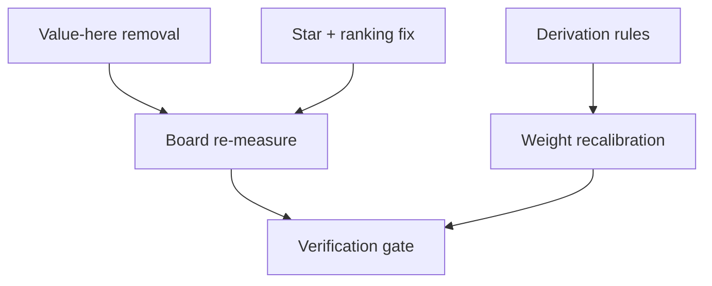
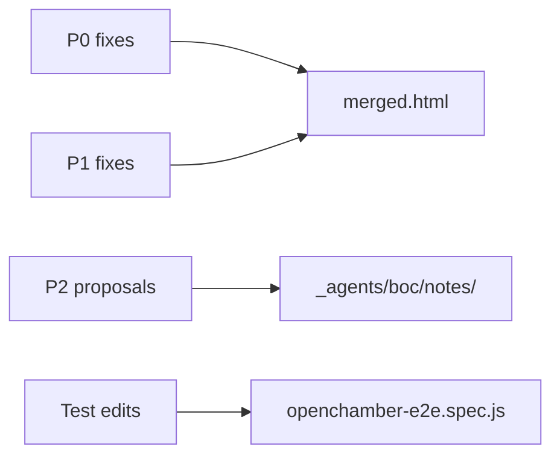
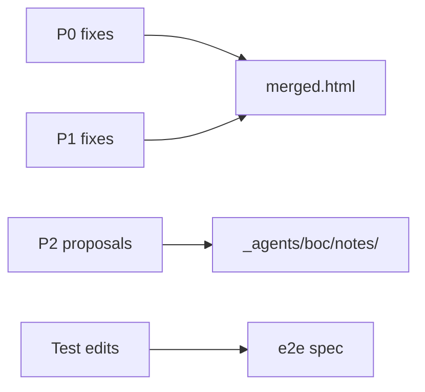
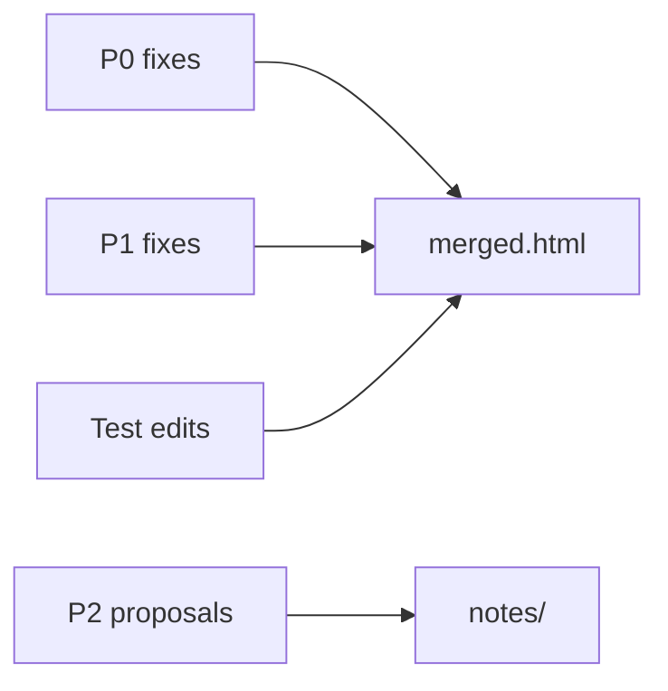
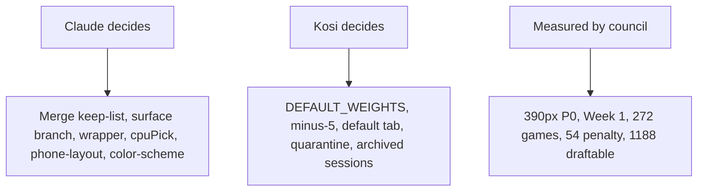
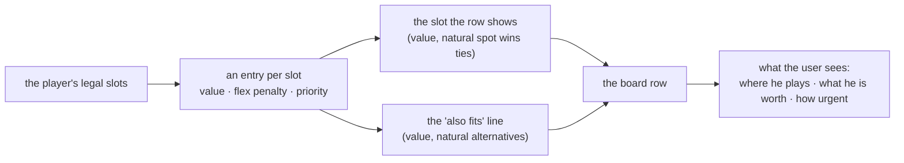
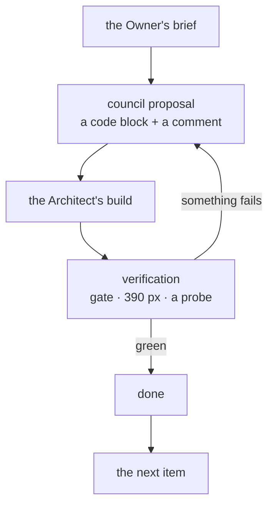

> **READING MAP — MiniMax, 21 Oct.** This file is the council's V22 change set, written to be worked
> from top to bottom. This block is the navigation layer: where things are, what state they are in,
> and what a free seat could pick up. Everything below it is unchanged council work.
>
> **The shape of the document**
> ```mermaid
> flowchart TD
>   A["Owner's brief · Kosi 21 Oct"] --> B["P0 · the board, the weights panel, the Team Comparison, the Guide"]
>   B --> C["P1 · the new draft-board items"]
>   C --> D["P2 · the weight recalibration"]
>   D --> E["P3 · the glossary and the advanced stats"]
>   E --> F["P4 · the decisions still open"]
>   F --> G["P7 · aesthetics and beauty"]
>   G --> H["P8 · council notes, for the record"]
>   B -. "prepared diffs" .-> I["council-brief/2026-10-21/*/*.patch"]
>   I -.-> J["the Architect's V22 build"]
>   J --> K["verification: post-merge-smoke + the 390 px probe"]
> ```
>
> **What lives where**
>
> | Section | What it is | State | Where the code is |
> |---|---|---|---|
> | P0 · Value here | the column, its CSS reflow, the guide repairs | **done, verified** | `_agents/minimax/prototypes/V22-candidate-2026-10-21.html` (`e5fa7e0e…`) |
> | P0 · Weights panel | Default, the stateful My Weights, the badges moved | **done, verified** | same artifact |
> | P0 · Team Comparison | no "real", no note on that page, the regrouped table, Chiefs/Raiders | **done, verified** | same artifact |
> | P0 · Guide | the box, the flex table, the merged section, the glossary terms | **done, verified** | same artifact |
> | P0-b · one weights-panel line | the Owner's last line about the label | **one line** | the diff below it |
> | P1 · new board items | ~23 items: the board's display slot, the stars, the round, the cards | **specification** | the council's notes |
> | P2 · the recalibration | the five deltas, how to apply them without breaking the derivation | **measured, with the factors** | `_agents/minimax/notes/position-value-adjustments.md` |
> | P3 · glossary and stats | seventeen advanced-stat proposals; nine need no new maths | **proposal** | `_agents/minimax/notes/advanced-stats-proposals.md` |
> | P4 · decisions | the seven the Owner still has to answer | **blocking** | this file |
> | P7 · aesthetics | the team's colours and the rest of the beauty pass | **one part built** | `_agents/minimax/prototypes/V22-candidate-teamcolours.html` (`b3de0523…`) + `_agents/minimax/shots/` |
> | P8 · council notes | the record: what was checked, what was not | **record** | this file |
>
> **The one diagram worth reading before touching the weights**
> ```mermaid
> flowchart LR
>   R["RATING_SPECS<br/>(protected)"] --> T["teamRatings()"]
>   T --> M["matchupModel()"]
>   M --> G["the games<br/>17 weeks + playoffs"]
>   T --> S["slotWinsTable()<br/>measured 50→100"]
>   S --> A["SLOT_VALUE_ADJ<br/>the five deltas"]
>   A --> W["slotWins / slotWinsPerOvr"]
>   W --> D["modelWeights()<br/>the 0–700 defaults"]
>   W --> B["the draft<br/>CPU picks, board value, priority"]
>   G -. "unchanged by the deltas" .- A
> ```
> The deltas move the **draft** and the **defaults**; they do not move the **games**. If the intent is
> to change the football rather than the draft, the change belongs in `RATING_SPECS`, which is a
> protected constant and the Owner's call.
>
> **A suggested work queue — not assignments.** Seats are not always free, so nothing here is
> assigned; take the first row you are free for, and say so in the bulletin when you report.
>
> | # | Suggested work | Why it is worth a free seat | Where |
> |---|---|---|---|
> | S1 | Re-read this file against the V22 candidate and list anything marked done that is not, or missing | a stale list is the most expensive kind of wrong | this file + `_agents/minimax/prototypes/` |
> | S2 | 100-season regression with the five deltas applied | nobody has measured the deltas' effect on a season | `_agents/minimax/notes/position-value-adjustments.md` |
> | S3 | 390 px pass over the collapsed mobile cards and the sticky filter header | the two items that are real design work, not one-liners | P1 |
> | S4 | the localStorage shape for a half-finished draft | the most edge cases and the most value to the Owner | P1 |
> | S5 | the team-colour palette check for all 32 teams | the map is written; the check is not | `_agents/minimax/notes/team-colours-and-beauty.md` |
> | S6 | the position-rankings combination generator | data generation, not an edit; it needs a careful de-duplication | P1 |
>
> **How to read a diff block here.** Blocks marked `diff` are `patch -p0` against the candidate and
> can be applied as they stand. Everything else is a specification: read it, write the code, and check
> the result with `post-merge-smoke.mjs` and the 390 px probe.

---

# V22 Suggestions

**SPEAKER: MOC | ROLE: Council reviewer (S-2500–2599) | TASK: the priority-ordered change set for Claude | DATE: 2026-10-21T09:20:00Z**

**For Claude.** This is the council's consolidated change set for **V22**, in the Owner's priority order. Every block is **code** with a comment saying where it belongs and what it adds, subtracts or replaces. The four prepared patches are exact `diff -u` hunks against **V21** (`NFL Draft Simulator merged.html`, 657,486 B, sha256 `40233d6be00e987c472cf6b1126b0ab7f11c123006277466bd23391b308795fd`) — apply them in the order below and the hunks will land as written.

**Two things to know before you start.**
1. **The weights are already right.** The Owner's table of default weights (QB 700, RB1 185, … FB 1) was compared slot by slot against the build: it matches the **derived** `modelWeights()` in **34/34 slots** and the hand-written `DEFAULT_WEIGHTS` constant in only 7/34. `modelWeights()` is already what the site ranks with (`weights = modelWeights()` at start-up). **Do not replace the derivation with a written table** — that would break `modelWeights() = f(slotWinsPerOvr())` and the draft board's weights would stop matching the numbers the Guide prints. What the Owner wants is the **label** ("Default is how the draft simulator sees the game."), the **user weights forgotten**, and the **recalibration** (below).
2. **The per-spot numbers are the model's output, so a recalibration is a model change.** Measured: for **all 26 spots** the 70→90 gain is exactly 20 × the per-+1 slope (the colleagues' "the table fails its own arithmetic" is display rounding). But the per-spot gains **sum to 22.95 wins**, while the model — measured against an 80-rated opponent — gives an all-70 roster 12.1 points and an all-90 roster 29.2, a real gain of **0.53 wins**. A matchup is a difference, not a sum. Any weight change must therefore be **re-validated** (the draft board, the 100-season report, the real-2025 check: r ≈ 0.66, ρ ≈ 0.69, RMSE ≈ 2.6), not just typed in.

**The Owner's words for the deliverable:** _"The next document you should send me once all these changes are done should be called Football-Sim-V22.html."_

---

## P0 · The Value here column leaves the draft board (display only; the maths is untouched)

**Where:** the draft board's CSS (l.268), the sort option (l.418), the header (l.426), the row cell (l.1766), the empty state (l.1768), and the Guide (l.4991, l.5056)
**What it does:** removes the column, the header, the sort option and the Guide bullet; `r.v` stays in all nine of its mathematical consumers (Priority, the bar, the flex tag, the best-natural comparison, the sort key, the alternative-slot comparison). **The two traps:** adding a _new_ `dc-pri` CSS rule does nothing — the file already has one at l.269 and the later rule wins, so **edit the existing rule**; and the Guide's "Value here" bullet must be **deleted, not reworded**, or it becomes a second "Priority" bullet.
**Patch:** `value-here-keepsort.patch`

```diff
@@ -265,8 +265,8 @@
  #draftTable2 td.dc-ovr{grid-column:9 / 11;grid-row:1;text-align:center !important;font-size:1.15rem;font-weight:900;background:rgba(79,140,255,.16);border-radius:8px;padding:2px 0 !important;}
  #draftTable2 td.dc-btn{grid-column:11 / 13;grid-row:1;text-align:right !important;align-self:center;}
  #draftTable2 td:nth-child(2){grid-column:1 / 3;grid-row:2;} #draftTable2 td:nth-child(3){grid-column:3 / 5;grid-row:2;}
- #draftTable2 td.dc-wins{grid-column:5 / 7;grid-row:2;color:var(--good);} #draftTable2 td.dc-val{grid-column:7 / 10;grid-row:2;color:#6aa6ff;}
- #draftTable2 td.dc-pri{grid-column:10 / 13;grid-row:2;color:var(--gold);}
+ #draftTable2 td.dc-wins{grid-column:5 / 7;grid-row:2;color:var(--good);}
+ #draftTable2 td.dc-pri{grid-column:7 / 13;grid-row:2;color:var(--gold);}
  #draftTable2 td.dc-gone{grid-column:1 / 3;grid-row:3;color:var(--accent2);} #draftTable2 td.dc-fills{grid-column:3 / 13;grid-row:3;font-size:0.72rem;}
  #draftTable2 td.dc-fills .narr{display:inline;margin:0 0 0 4px;}
  #draftTable2 td.dc-btn button{padding:5px 10px;font-size:0.75rem;}
```

```diff
@@ -415,7 +415,7 @@
     <div class="filters">
      <input id="draftSearch2" placeholder="Search available players...">
      <select id="draftPosFilter2"><option value="all">All positions</option></select>
-     <select id="draftSort2"><option value="ovr" selected>Sort: overall</option><option value="priority">Sort: pick priority</option><option value="wins">Sort: wins value</option><option value="value">Sort: value here</option><option value="gone">Sort: chance gone</option><option value="name">Sort: player name</option><option value="pos">Sort: position</option><option value="team">Sort: team</option></select>
+     <select id="draftSort2"><option value="ovr" selected>Sort: overall</option><option value="priority">Sort: pick priority</option><option value="wins">Sort: wins value</option><option value="value">Sort: value at my spot</option><option value="gone">Sort: chance gone</option><option value="name">Sort: player name</option><option value="pos">Sort: position</option><option value="team">Sort: team</option></select>
      <select id="draftView2"><option value="table" selected>One table</option><option value="cards">Position cards</option></select>
         </div>
     <div id="draftChips"></div>
```

```diff
@@ -423,7 +423,7 @@
     <div id="draftCards" style="display:none;"></div>
     <div id="draftTableWrap" class="tablewrap">
     <table id="draftTable2" data-nostack="1">
-     <thead><tr><th data-sort="name" class="sortable">Player</th><th data-sort="pos" class="sortable">Pos</th><th data-sort="team" class="sortable">Team</th><th data-sort="ovr" class="sortable">OVR</th><th data-sort="wins" class="sortable" title="Static: extra wins per season this player adds over a 70-rated player at his position. Identical for every team and every moment of the draft.">Wins</th><th data-sort="value" class="sortable" title="The same math at the exact spot he would fill on YOUR roster, flex penalty included.">Value here</th><th data-sort="priority" class="sortable" title="Value here minus what you would probably still find at that position at your next pick. High = waiting costs you.">Priority</th><th data-sort="gone" class="sortable" title="Chance a player of this type is gone by your next pick.">Gone</th><th>Fills</th><th></th></tr></thead>
+     <thead><tr><th data-sort="name" class="sortable">Player</th><th data-sort="pos" class="sortable">Pos</th><th data-sort="team" class="sortable">Team</th><th data-sort="ovr" class="sortable">OVR</th><th data-sort="wins" class="sortable" title="Static: extra wins per season this player adds over a 70-rated player at his position. Identical for every team and every moment of the draft.">Wins</th><th data-sort="priority" class="sortable" title="The value at the exact spot he would fill on YOUR roster, minus what you would probably still find at that position at your next pick. High = waiting costs you.">Priority</th><th data-sort="gone" class="sortable" title="Chance a player of this type is gone by your next pick.">Gone</th><th>Fills</th><th></th></tr></thead>
      <tbody id="draftBody2"></tbody>
     </table></div>
    </div>
```

```diff
@@ -1763,9 +1763,9 @@
    const alt = r.slot ? (flexAlt[r.p[0]]||[]).filter(x=>x.slot!==r.slot && x.v>r.v-0.15 && x.g!==r.g).sort((a,b)=>b.v-a.v)[0] : null;
    const altTxt = alt ? `<div class="narr" title="The other spot he could fill, with the value he would have there">also fits: ${LABELS[alt.slot]||alt.slot} ${fmtWar(alt.v)}${alt.flex?' (\u2212'+alt.pen+' flex)':''}</div>` : '';
    const fills = r.slot ? `${LABELS[r.slot]||r.slot}${flexTxt(r)}${altTxt}${opts.length>1?` <a href="#" class="slotchg" data-chg="${r.p[0].replace(/"/g,'&quot;')}" title="Choose which open spot he fills">change</a>`:''}` : 'Full';
-   h += `<tr><td class="dc-name">${topTag(r)}${r.p[0]}</td><td data-label="Pos">${POS_DISPLAY[r.p[1]]||r.p[1]}</td><td data-label="Team">${TEAM_ABBR[r.p[2]]||r.p[2]}</td><td class="score dc-ovr" data-label="OVR">${r.p[3]}</td><td class="score dc-wins" data-label="Wins">${wavg(r.w)}</td><td class="score dc-val" data-label="Value here">${wavg(r.v)}</td><td class="score dc-pri" data-label="Priority">${r.pri!=null&&sim?fmtWar(r.pri):'—'}</td><td class="score dc-gone" data-label="Gone">${pctTxt(r.gone)}</td><td class="narr dc-fills" data-label="Fills">${fills}</td><td class="dc-btn">${btn(r)}</td></tr>`;
+   h += `<tr><td class="dc-name">${topTag(r)}${r.p[0]}</td><td data-label="Pos">${POS_DISPLAY[r.p[1]]||r.p[1]}</td><td data-label="Team">${TEAM_ABBR[r.p[2]]||r.p[2]}</td><td class="score dc-ovr" data-label="OVR">${r.p[3]}</td><td class="score dc-wins" data-label="Wins">${wavg(r.w)}</td><td class="score dc-pri" data-label="Priority">${r.pri!=null&&sim?fmtWar(r.pri):'—'}</td><td class="score dc-gone" data-label="Gone">${pctTxt(r.gone)}</td><td class="narr dc-fills" data-label="Fills">${fills}</td><td class="dc-btn">${btn(r)}</td></tr>`;
   });
-  document.getElementById('draftBody2').innerHTML = h || `<tr><td colspan="10" class="narr">No players match.</td></tr>`;
+  document.getElementById('draftBody2').innerHTML = h || `<tr><td colspan="9" class="narr">No players match.</td></tr>`;
   document.getElementById('draftFitSummary').innerHTML = '';
  }
  if(view==='cards') document.getElementById('draftFitSummary').innerHTML = '';
```

```diff
@@ -4988,8 +4988,7 @@
  return `<p style="margin:4px 0;"><b>OVR</b> is the Madden NFL 27 overall rating. The board adds four more columns:</p>
  <ul class="gl">
   <li><b>Wins</b> — how many more games per season a player adds than a 70-rated player at his position, according to the same matchup math that plays the games. It is <i>static</i>: the same number for everyone with that position and rating, on every team and at every point in the draft. If a position has several starting spots (two tackles, three receivers), Wins averages across them. Running back 2, tight end 2 and the strongside linebacker are depth roles and are left out. (Guards and centers are valued the same, which is why a 76 center and a 76 guard have identical Wins.)</li>
-  <li><b>Value here</b> — the same math, but at the exact spot he would fill on <i>your</i> roster. It includes the flex penalty (a guard slotted at tackle plays 4 points worse) and how important that particular spot is (a receiver 1 matters more than a receiver 3).</li>
-  <li><b>Priority</b> — Value here minus the best you could expect to still find at that spot at your next pick. To estimate it, the site replays the computer teams' picks twelve times between now and your next turn and averages what is left. A big priority means waiting costs you; a priority near zero or negative means someone about as good will probably still be there. Priority changes as your roster fills and as the board thins.</li>
+  <li><b>Priority</b> — the value at the spot he would fill on <i>your</i> roster, minus the best you could expect to still find at that spot at your next pick. To estimate it, the site replays the computer teams' picks twelve times between now and your next turn and averages what is left. A big priority means waiting costs you; a priority near zero or negative means someone about as good will probably still be there. Priority changes as your roster fills and as the board thins.</li>
   <li><b>Gone</b> — the chance that a player of this type (same position group and same value) has been picked before your next turn, across those twelve replays.</li>
   <li><b>Stars</b> (★★ / ★ / ☆) — your own thumb on the scale. A position marked ★★ counts 1.5× in Priority, ★ counts 1× and ☆ counts 0.5×. They only change the ranking, never the math.</li>
  </ul>
```

```diff
@@ -5053,7 +5052,7 @@
  return `<div class="panel" style="margin-bottom:14px;"><h3 style="margin-top:0;">Guide</h3><p class="narr">Short reference sections for the terms the sim uses. Click through only what you need.</p></div>`
   + sec('How the site works', how, true)
   + sec('Drafting: which positions matter', draft, true)
-  + sec('Reading the draft board (Wins, Value here, Priority, Gone, stars)', board, false)
+  + sec('Reading the draft board (Wins, Priority, Gone, stars)', board, false)
   + sec('Flexing players, explained', flex, false)
   + sec('Position values: all 26 starting spots', values, false)
   + sec('Coaching: personnel, styles and game plans', coach, false)
```

## P0 · The weights panel: "Default", a stateful "My Weights", and the badges moved to the bottom

**Where:** the weights controls (l.548), the state helper (new, next to the controls), the input listener (l.551–558), the two handlers (l.564–565), the start-up seed (l.6410), the rankings row loop (l.624–627) and the table render (l.636)
**What it does:** "Use model weights" → **"Default"**; "Back to my weights" → a button that reads **"Save My Weights"**, transparent and `disabled`, until a weight changes — then blue and reading **"My Weights"**. The penalty badges move out of the 32 team rows into a strip under the two buttons. The saved set is no longer seeded from `DEFAULT_WEIGHTS` at start-up (**the Owner's "forget the user weights"**).
**Patch:** `merge-items1-5.patch`

```diff
@@ -118,6 +118,8 @@
 .draft-columns{display:grid;grid-template-columns:1fr 300px;gap:16px;}
 @media (max-width:860px){.draft-columns{grid-template-columns:1fr;}}
 .badge-passfail{background:rgba(180,120,255,0.18);color:#b478ff;}
+.badgestrip{display:flex;flex-wrap:wrap;gap:8px 14px;margin-top:12px;align-items:center;}
+.badgestrip .bst{font-weight:700;font-size:0.76rem;color:var(--sub);}
 .matchup-card{display:grid;grid-template-columns:1fr auto 1fr;gap:10px;align-items:center;padding:16px;background:var(--panel2);border:1px solid var(--border);border-radius:12px;margin-bottom:14px;}
 .matchup-card .mc-team{text-align:center;}
 .matchup-card .mc-team.home{text-align:center;}
```

```diff
@@ -265,8 +267,8 @@
  #draftTable2 td.dc-ovr{grid-column:9 / 11;grid-row:1;text-align:center !important;font-size:1.15rem;font-weight:900;background:rgba(79,140,255,.16);border-radius:8px;padding:2px 0 !important;}
  #draftTable2 td.dc-btn{grid-column:11 / 13;grid-row:1;text-align:right !important;align-self:center;}
  #draftTable2 td:nth-child(2){grid-column:1 / 3;grid-row:2;} #draftTable2 td:nth-child(3){grid-column:3 / 5;grid-row:2;}
- #draftTable2 td.dc-wins{grid-column:5 / 7;grid-row:2;color:var(--good);} #draftTable2 td.dc-val{grid-column:7 / 10;grid-row:2;color:#6aa6ff;}
- #draftTable2 td.dc-pri{grid-column:10 / 13;grid-row:2;color:var(--gold);}
+ 
+ #draftTable2 td.dc-pri{grid-column:7 / 13;grid-row:2;color:var(--gold);}
  #draftTable2 td.dc-gone{grid-column:1 / 3;grid-row:3;color:var(--accent2);} #draftTable2 td.dc-fills{grid-column:3 / 13;grid-row:3;font-size:0.72rem;}
  #draftTable2 td.dc-fills .narr{display:inline;margin:0 0 0 4px;}
  #draftTable2 td.dc-btn button{padding:5px 10px;font-size:0.75rem;}
```

```diff
@@ -415,7 +417,7 @@
     <div class="filters">
      <input id="draftSearch2" placeholder="Search available players...">
      <select id="draftPosFilter2"><option value="all">All positions</option></select>
-     <select id="draftSort2"><option value="ovr" selected>Sort: overall</option><option value="priority">Sort: pick priority</option><option value="wins">Sort: wins value</option><option value="value">Sort: value here</option><option value="gone">Sort: chance gone</option><option value="name">Sort: player name</option><option value="pos">Sort: position</option><option value="team">Sort: team</option></select>
+     <select id="draftSort2"><option value="ovr" selected>Sort: overall</option><option value="priority">Sort: pick priority</option><option value="wins">Sort: wins value</option><option value="value">Sort: value at my spot</option><option value="gone">Sort: chance gone</option><option value="name">Sort: player name</option><option value="pos">Sort: position</option><option value="team">Sort: team</option></select>
      <select id="draftView2"><option value="table" selected>One table</option><option value="cards">Position cards</option></select>
         </div>
     <div id="draftChips"></div>
```

```diff
@@ -423,7 +425,7 @@
     <div id="draftCards" style="display:none;"></div>
     <div id="draftTableWrap" class="tablewrap">
     <table id="draftTable2" data-nostack="1">
-     <thead><tr><th data-sort="name" class="sortable">Player</th><th data-sort="pos" class="sortable">Pos</th><th data-sort="team" class="sortable">Team</th><th data-sort="ovr" class="sortable">OVR</th><th data-sort="wins" class="sortable" title="Static: extra wins per season this player adds over a 70-rated player at his position. Identical for every team and every moment of the draft.">Wins</th><th data-sort="value" class="sortable" title="The same math at the exact spot he would fill on YOUR roster, flex penalty included.">Value here</th><th data-sort="priority" class="sortable" title="Value here minus what you would probably still find at that position at your next pick. High = waiting costs you.">Priority</th><th data-sort="gone" class="sortable" title="Chance a player of this type is gone by your next pick.">Gone</th><th>Fills</th><th></th></tr></thead>
+     <thead><tr><th data-sort="name" class="sortable">Player</th><th data-sort="pos" class="sortable">Pos</th><th data-sort="team" class="sortable">Team</th><th data-sort="ovr" class="sortable">OVR</th><th data-sort="wins" class="sortable" title="Static: extra wins per season this player adds over a 70-rated player at his position. Identical for every team and every moment of the draft.">Wins</th><th data-sort="priority" class="sortable" title="The value at the exact spot he would fill on YOUR roster, minus what you would probably still find at that position at your next pick. High = waiting costs you.">Priority</th><th data-sort="gone" class="sortable" title="Chance a player of this type is gone by your next pick.">Gone</th><th>Fills</th><th></th></tr></thead>
      <tbody id="draftBody2"></tbody>
     </table></div>
    </div>
```

```diff
@@ -436,7 +438,7 @@
   </div>
  </div>
  <div class="panel" id="draftFinalResults" style="display:none;"></div>
- <nav class="footnav" aria-label="More tools"><span class="footlabel">More</span>
+ <nav class="footnav" aria-label="More tools">
   <button class="footlink active" id="tabDraftBtn">Simulator</button>
   <button class="footlink" id="tabRankingsBtn">Madden Rankings</button>
   <button class="footlink" id="tabPlayersBtn">Player Browser</button>
```

```diff
@@ -455,6 +457,7 @@
 const GROUP_DEFS = [{"key":"QB","label":"Quarterback","pos":["QB"],"n":1,"rankIndex":0,"cat":"Offense — Positions"},{"key":"RB1","label":"RB1","pos":["HB"],"n":1,"rankIndex":0,"cat":"Offense — Positions"},{"key":"RB2","label":"RB2","pos":["HB"],"n":1,"rankIndex":1,"cat":"Offense — Positions"},{"key":"WR1","label":"WR1","pos":["WR"],"n":1,"rankIndex":0,"cat":"Offense — Positions"},{"key":"WR2","label":"WR2","pos":["WR"],"n":1,"rankIndex":1,"cat":"Offense — Positions"},{"key":"WR3","label":"WR3","pos":["WR"],"n":1,"rankIndex":2,"cat":"Offense — Positions"},{"key":"WR4","label":"WR4","pos":["WR"],"n":1,"rankIndex":3,"cat":"Offense — Positions"},{"key":"TE1","label":"TE1","pos":["TE"],"n":1,"rankIndex":0,"cat":"Offense — Positions"},{"key":"TE2","label":"TE2","pos":["TE"],"n":1,"rankIndex":1,"cat":"Offense — Positions"},{"key":"OT1","label":"OT1","pos":["LT","RT"],"n":1,"rankIndex":0,"cat":"Offense — Positions"},{"key":"OT2","label":"OT2","pos":["LT","RT"],"n":1,"rankIndex":1,"cat":"Offense — Positions"},{"key":"OG1","label":"OG1","pos":["LG","RG"],"n":1,"rankIndex":0,"cat":"Offense — Positions"},{"key":"OG2","label":"OG2","pos":["LG","RG"],"n":1,"rankIndex":1,"cat":"Offense — Positions"},{"key":"C","label":"Center","pos":["C"],"n":1,"rankIndex":0,"cat":"Offense — Positions"},{"key":"RB","label":"Running Backs (RB1+RB2)","pos":["HB"],"n":2,"cat":"Offense — Team Units"},{"key":"WR","label":"Wide Receivers (WR1-3)","pos":["WR"],"n":3,"cat":"Offense — Team Units"},{"key":"TE","label":"Tight Ends (TE1+TE2)","pos":["TE"],"n":2,"cat":"Offense — Team Units"},{"key":"OT","label":"Offensive Tackles (OT1+OT2)","pos":["LT","RT"],"n":2,"cat":"Offense — Team Units"},{"key":"OGUARDS","label":"Offensive Guards (OG1+OG2)","pos":["LG","RG"],"n":2,"cat":"Offense — Team Units"},{"key":"OG","label":"Interior OL (OG+C)","pos":["LG","RG","C"],"n":3,"cat":"Offense — Team Units"},{"key":"OL","label":"Offensive Line (OT+OG+C)","pos":["LT","RT","LG","RG","C"],"n":5,"cat":"Offense — Team Units"},{"key":"RECV","label":"Receiving Corps (WR+TE)","pos":["WR","TE"],"n":4,"cat":"Offense — Team Units"},{"key":"OFFENSE","label":"Offense (QB+RB+WR+TE+OL)","pos":["QB","HB","WR","TE","LT","RT","LG","RG","C"],"n":13,"cat":"Offense — Team Units"},{"key":"RUN","label":"Run Game (OL+RBs)","pos":["LT","RT","LG","RG","C","HB"],"n":7,"cat":"Offense — Team Units"},{"key":"PASS","label":"Pass Game (OL+QB+Receiving Corps)","pos":["LT","RT","LG","RG","C","QB","WR","TE"],"n":10,"cat":"Offense — Team Units"},{"key":"SKILL","label":"Skill Positions (RB+WR+TE)","pos":["HB","WR","TE"],"n":6,"cat":"Offense — Team Units"},{"key":"DE1","label":"DE1","pos":["REDG","LEDG"],"n":1,"rankIndex":0,"cat":"Defense — Positions"},{"key":"DE2","label":"DE2","pos":["REDG","LEDG"],"n":1,"rankIndex":1,"cat":"Defense — Positions"},{"key":"DL5","label":"DL5 / Elephant","pos":["DT","REDG","LEDG"],"n":1,"rankIndex":4,"cat":"Defense — Positions"},{"key":"DT1","label":"DT1","pos":["DT"],"n":1,"rankIndex":0,"cat":"Defense — Positions"},{"key":"DT2","label":"DT2","pos":["DT"],"n":1,"rankIndex":1,"cat":"Defense — Positions"},{"key":"MIKE","label":"MIKE","pos":["MIKE"],"n":1,"rankIndex":0,"cat":"Defense — Positions"},{"key":"WILL","label":"WILL","pos":["WILL"],"n":1,"rankIndex":0,"cat":"Defense — Positions"},{"key":"SAM","label":"LB3 / SAM","pos":["SAM"],"n":1,"rankIndex":0,"cat":"Defense — Positions"},{"key":"LB4","label":"LB4","pos":["MIKE","WILL","SAM"],"n":1,"rankIndex":3,"cat":"Defense — Positions"},{"key":"CB1","label":"CB1","pos":["CB"],"n":1,"rankIndex":0,"cat":"Defense — Positions"},{"key":"CB2","label":"CB2","pos":["CB"],"n":1,"rankIndex":1,"cat":"Defense — Positions"},{"key":"CB3","label":"CB3 / Nickel","pos":["CB"],"n":1,"rankIndex":2,"cat":"Defense — Positions"},{"key":"CB4","label":"CB4 / Dime","pos":["CB"],"n":1,"rankIndex":3,"cat":"Defense — Positions"},{"key":"SS","label":"SS","pos":["SS"],"n":1,"rankIndex":0,"cat":"Defense — Positions"},{"key":"SS2","label":"SS2 / Big Nickel","pos":["SS"],"n":1,"rankIndex":1,"cat":"Defense — Positions"},{"key":"FS","label":"FS","pos":["FS"],"n":1,"rankIndex":0,"cat":"Defense — Positions"},{"key":"FS2","label":"FS2 / Quarter","pos":["FS"],"n":1,"rankIndex":1,"cat":"Defense — Positions"},{"key":"EDGE","label":"Edge Rushers (DE1+DE2)","pos":["REDG","LEDG"],"n":2,"cat":"Defense — Team Units"},{"key":"DT","label":"Defensive Tackles (DT1+DT2)","pos":["DT"],"n":2,"cat":"Defense — Team Units"},{"key":"DL","label":"Defensive Line (DT+Edge)","pos":["DT","REDG","LEDG"],"n":4,"cat":"Defense — Team Units"},{"key":"LB","label":"Linebackers (MIKE+WILL+SAM)","pos":["MIKE","WILL","SAM"],"n":3,"cat":"Defense — Team Units"},{"key":"CB","label":"Cornerbacks (CB1-4)","pos":["CB"],"n":4,"cat":"Defense — Team Units"},{"key":"S","label":"Safeties (FS+SS)","pos":["FS","SS"],"n":2,"cat":"Defense — Team Units"},{"key":"SEC","label":"Secondary (CB+S)","pos":["CB","FS","SS"],"n":6,"cat":"Defense — Team Units"},{"key":"FRONT7","label":"Front Seven (DL+LB)","pos":["DT","REDG","LEDG","MIKE","WILL","SAM"],"n":7,"cat":"Defense — Team Units"},{"key":"DEFENSE","label":"Defense (DL+LB+Secondary)","pos":["DT","REDG","LEDG","MIKE","WILL","SAM","CB","FS","SS"],"n":13,"cat":"Defense — Team Units"},{"key":"ZONE","label":"Zone Defense (LBs + Secondary)","pos":["CB","MIKE","WILL","SAM","FS","SS"],"n":8,"cat":"Defense — Team Units"},{"key":"PRIMCOV","label":"Primary Coverage (CB1 + DL)","pos":["DT","REDG","LEDG","CB"],"n":5,"parts":[{"pos":["CB"],"n":1},{"pos":["DT","REDG","LEDG"],"n":4}],"cat":"Defense — Team Units"},{"key":"DLCB","label":"DL + CBs","pos":["DT","REDG","LEDG","CB"],"n":8,"cat":"Defense — Team Units"},{"key":"RUND","label":"Run Defense (DL+LB+SS+NB)","pos":["DT","REDG","LEDG","MIKE","WILL","SAM","SS","CB"],"n":9,"cat":"Defense — Team Units"},{"key":"PASSD","label":"Pass Defense (DL+LB+Secondary)","pos":["DT","REDG","LEDG","MIKE","WILL","SAM","CB","FS","SS"],"n":13,"cat":"Defense — Team Units"},{"key":"TRENCHES","label":"Trenches (OL+DL)","pos":["LT","RT","LG","RG","C","DT","REDG","LEDG"],"n":9,"cat":"Combined Units"},{"key":"TRENCHES_CB","label":"Trenches + CBs","pos":["LT","RT","LG","RG","C","DT","REDG","LEDG","CB"],"n":13,"cat":"Combined Units"},{"key":"K","label":"Kicker","pos":["K"],"n":1,"rankIndex":0,"cat":"Specialists"},{"key":"P","label":"Punter","pos":["P"],"n":1,"rankIndex":0,"cat":"Specialists"},{"key":"FB","label":"Fullback","pos":["FB"],"n":1,"rankIndex":0,"cat":"Specialists"}];
 let weights = {...DEFAULT_WEIGHTS};
 let personalWeights = null;
+let weightsDirty = false;
 // Model weights: each roster spot's wins per rating point, scaled so the largest (QB) equals 700; extra depth spots stay tiny.
 function modelWeights(){
  const w = slotWinsPerOvr(), mx = Math.max(...Object.values(w)), out = {...DEFAULT_WEIGHTS};
```

```diff
@@ -545,8 +548,16 @@
  });
  h += `<div class="totalwt" id="totalwt"></div>`;
  h += `<div class="narr" style="margin:6px 0;">The default is the <b>model weights</b>: what each spot is really worth in wins, scaled so the biggest spot (QB) is 700 and rounded to the nearest 5. Edit any number to build your own set; the buttons switch between the two.</div>
- <button class="resetbtn" id="modelWBtn" style="margin-right:6px;">Use model weights</button><button class="resetbtn" id="personalWBtn">Back to my weights</button>`;
+ <button class="resetbtn" id="modelWBtn" style="margin-right:6px;">Default</button><button class="tabbtn" id="personalWBtn" disabled style="width:100%;margin-top:10px;opacity:.5;">Save My Weights</button><div id="badgeStrip" class="badgestrip"></div>`;
  el.innerHTML = h;
+ const updateWeightButtons = ()=>{
+   const pb = document.getElementById('personalWBtn'); if(!pb) return;
+   const onDefault = sameWeights(weights, modelWeights());
+   const live = weightsDirty || (!onDefault && !!personalWeights);
+   if(live){ pb.className = 'resetbtn'; pb.textContent = 'My Weights'; pb.disabled = false; pb.removeAttribute('style'); }
+   else { pb.className = 'tabbtn'; pb.textContent = 'Save My Weights'; pb.disabled = true; pb.setAttribute('style','width:100%;margin-top:10px;opacity:.5;'); }
+ };
+ updateWeightButtons();
  el.querySelectorAll('input[type=number]').forEach(inp=>{
   inp.addEventListener('input', ()=>{
    if(inp.dataset.slot){
```

```diff
@@ -554,6 +565,8 @@
    } else if(synergy.hasOwnProperty(inp.id)){
     synergy[inp.id] = parseFloat(inp.value) || 0;
    }
+      if(inp.dataset.slot) weightsDirty = true;
+      updateWeightButtons();
    render();
   });
  });
```

```diff
@@ -561,10 +574,16 @@
  document.getElementById('passToggle').addEventListener('change', e=>{ synergy.passEnabled = e.target.checked; render(); });
  document.getElementById('passGameToggle').addEventListener('change', e=>{ synergy.passGameEnabled = e.target.checked; render(); });
  const refresh = ()=>{ el.querySelectorAll('input[data-slot]').forEach(inp=>{ inp.value = weights[inp.dataset.slot]; }); render(); };
- document.getElementById('modelWBtn').addEventListener('click', ()=>{ if(JSON.stringify(weights)!==JSON.stringify(modelWeights())) personalWeights = {...weights}; weights = modelWeights(); refresh(); });
- document.getElementById('personalWBtn').addEventListener('click', ()=>{ weights = {...(personalWeights||DEFAULT_WEIGHTS)}; refresh(); });
+ document.getElementById('modelWBtn').addEventListener('click', ()=>{ if(!sameWeights(weights, modelWeights())) personalWeights = {...weights}; weights = modelWeights(); weightsDirty = false; refresh(); updateWeightButtons(); });
+ document.getElementById('personalWBtn').addEventListener('click', ()=>{ if(!sameWeights(weights, personalWeights||{})) personalWeights = {...weights}; weights = {...(personalWeights||modelWeights())}; weightsDirty = false; refresh(); updateWeightButtons(); });
 }
 
+function sameWeights(a,b){
+  const ka=Object.keys(a).sort(), kb=Object.keys(b).sort();
+  if(ka.length!==kb.length) return false;
+  for(let i=0;i<ka.length;i++){ if(ka[i]!==kb[i]) return false; if(a[ka[i]]!==b[ka[i]]) return false; }
+  return true;
+}
 function computeScore(team){
  const slotmap = TEAM_DATA[team];
  let sum = 0, wsum = 0;
```

```diff
@@ -605,6 +624,7 @@
  let totalw = 0; for(const s in weights) totalw += (weights[s]||0);
  document.getElementById('totalwt').textContent = `Total weight in use: ${totalw}`;
  const body = document.getElementById('resultsBody');
+ const badgeRows = [];
  let h = '';
  scored.forEach((row, idx)=>{
   const {best, worst} = bestWorst(row.team);
```

```diff
@@ -623,6 +643,7 @@
   const penaltyNote = penaltyParts.length ? ` — ${penaltyParts.join(' + ')} = -${totalPenalty.toFixed(1)}` : '';
   let badges = '';
   if(syn.runBadge) badges += `<span class="badge badge-run" title="OL+RB1 avg ${syn.runAvg.toFixed(1)}">Can't Run</span>`;
+  if(badges) badgeRows.push({team:row.team, html:badges});
   if(syn.passBadge) badges += `<span class="badge badge-pass" title="Pass rush avg ${syn.dlAvg.toFixed(1)}, coverage avg ${syn.covAvg.toFixed(1)}">Weak D</span>`;
   if(syn.passGameBadge) badges += `<span class="badge badge-passfail" title="Pass game avg ${syn.passGameAvg.toFixed(1)}">Can't Pass</span>`;
   const pct = maxScore ? (row.score/maxScore*100) : 0;
```

```diff
@@ -634,6 +655,10 @@
   </tr>`;
  });
  body.innerHTML = h;
+ const strip = document.getElementById('badgeStrip');
+ if(strip) strip.innerHTML = badgeRows.length
+   ? badgeRows.map(b=>`<span class="bst">${b.team}</span> ${b.html}`).join(' ')
+   : `<span class="narr">No team carries a penalty badge on these weights.</span>`;
  body.querySelectorAll('tr.teamrow').forEach(tr=>{
   tr.addEventListener('click', ()=> showTeamDetail(tr.dataset.team));
  });
```

```diff
@@ -1763,9 +1788,9 @@
    const alt = r.slot ? (flexAlt[r.p[0]]||[]).filter(x=>x.slot!==r.slot && x.v>r.v-0.15 && x.g!==r.g).sort((a,b)=>b.v-a.v)[0] : null;
    const altTxt = alt ? `<div class="narr" title="The other spot he could fill, with the value he would have there">also fits: ${LABELS[alt.slot]||alt.slot} ${fmtWar(alt.v)}${alt.flex?' (\u2212'+alt.pen+' flex)':''}</div>` : '';
    const fills = r.slot ? `${LABELS[r.slot]||r.slot}${flexTxt(r)}${altTxt}${opts.length>1?` <a href="#" class="slotchg" data-chg="${r.p[0].replace(/"/g,'&quot;')}" title="Choose which open spot he fills">change</a>`:''}` : 'Full';
-   h += `<tr><td class="dc-name">${topTag(r)}${r.p[0]}</td><td data-label="Pos">${POS_DISPLAY[r.p[1]]||r.p[1]}</td><td data-label="Team">${TEAM_ABBR[r.p[2]]||r.p[2]}</td><td class="score dc-ovr" data-label="OVR">${r.p[3]}</td><td class="score dc-wins" data-label="Wins">${wavg(r.w)}</td><td class="score dc-val" data-label="Value here">${wavg(r.v)}</td><td class="score dc-pri" data-label="Priority">${r.pri!=null&&sim?fmtWar(r.pri):'—'}</td><td class="score dc-gone" data-label="Gone">${pctTxt(r.gone)}</td><td class="narr dc-fills" data-label="Fills">${fills}</td><td class="dc-btn">${btn(r)}</td></tr>`;
+   h += `<tr><td class="dc-name">${topTag(r)}${r.p[0]}</td><td data-label="Pos">${POS_DISPLAY[r.p[1]]||r.p[1]}</td><td data-label="Team">${TEAM_ABBR[r.p[2]]||r.p[2]}</td><td class="score dc-ovr" data-label="OVR">${r.p[3]}</td><td class="score dc-wins" data-label="Wins">${wavg(r.w)}</td><td class="score dc-pri" data-label="Priority">${r.pri!=null&&sim?fmtWar(r.pri):'—'}</td><td class="score dc-gone" data-label="Gone">${pctTxt(r.gone)}</td><td class="narr dc-fills" data-label="Fills">${fills}</td><td class="dc-btn">${btn(r)}</td></tr>`;
   });
-  document.getElementById('draftBody2').innerHTML = h || `<tr><td colspan="10" class="narr">No players match.</td></tr>`;
+  document.getElementById('draftBody2').innerHTML = h || `<tr><td colspan="9" class="narr">No players match.</td></tr>`;
   document.getElementById('draftFitSummary').innerHTML = '';
  }
  if(view==='cards') document.getElementById('draftFitSummary').innerHTML = '';
```

```diff
@@ -4988,8 +5013,7 @@
  return `<p style="margin:4px 0;"><b>OVR</b> is the Madden NFL 27 overall rating. The board adds four more columns:</p>
  <ul class="gl">
   <li><b>Wins</b> — how many more games per season a player adds than a 70-rated player at his position, according to the same matchup math that plays the games. It is <i>static</i>: the same number for everyone with that position and rating, on every team and at every point in the draft. If a position has several starting spots (two tackles, three receivers), Wins averages across them. Running back 2, tight end 2 and the strongside linebacker are depth roles and are left out. (Guards and centers are valued the same, which is why a 76 center and a 76 guard have identical Wins.)</li>
-  <li><b>Value here</b> — the same math, but at the exact spot he would fill on <i>your</i> roster. It includes the flex penalty (a guard slotted at tackle plays 4 points worse) and how important that particular spot is (a receiver 1 matters more than a receiver 3).</li>
-  <li><b>Priority</b> — Value here minus the best you could expect to still find at that spot at your next pick. To estimate it, the site replays the computer teams' picks twelve times between now and your next turn and averages what is left. A big priority means waiting costs you; a priority near zero or negative means someone about as good will probably still be there. Priority changes as your roster fills and as the board thins.</li>
+  <li><b>Priority</b> — the value at the spot he would fill on <i>your</i> roster, minus the best you could expect to still find at that spot at your next pick. To estimate it, the site replays the computer teams' picks twelve times between now and your next turn and averages what is left. A big priority means waiting costs you; a priority near zero or negative means someone about as good will probably still be there. Priority changes as your roster fills and as the board thins.</li>
   <li><b>Gone</b> — the chance that a player of this type (same position group and same value) has been picked before your next turn, across those twelve replays.</li>
   <li><b>Stars</b> (★★ / ★ / ☆) — your own thumb on the scale. A position marked ★★ counts 1.5× in Priority, ★ counts 1× and ☆ counts 0.5×. They only change the ranking, never the math.</li>
  </ul>
```

```diff
@@ -5053,7 +5077,7 @@
  return `<div class="panel" style="margin-bottom:14px;"><h3 style="margin-top:0;">Guide</h3><p class="narr">Short reference sections for the terms the sim uses. Click through only what you need.</p></div>`
   + sec('How the site works', how, true)
   + sec('Drafting: which positions matter', draft, true)
-  + sec('Reading the draft board (Wins, Value here, Priority, Gone, stars)', board, false)
+  + sec('Reading the draft board (Wins, Priority, Gone, stars)', board, false)
   + sec('Flexing players, explained', flex, false)
   + sec('Position values: all 26 starting spots', values, false)
   + sec('Coaching: personnel, styles and game plans', coach, false)
```

```diff
@@ -6407,7 +6431,7 @@
 }
 
 initDraftSetup();
-personalWeights = {...DEFAULT_WEIGHTS}; weights = modelWeights(); buildControls(); render();
+personalWeights = null; weights = modelWeights(); buildControls(); render();
 // ---- the user's team and players, in blue everywhere ----
 (function(){
  let lastKey = '', rx = null, busy = false, queued = false;
```

## P0 · The Team Comparison page: no "real", no effective-ratings note, the unit table regrouped

**Where:** the subtitle (l.823), `renderLineupTableHTML` (l.3351–3364) and its call site (l.6396), `unitComparisonHTML` (l.3374–3383), `computeDetailMetrics` (l.667), and the new CSS for the group rows
**What it does:** the subtitle loses "real"; the "Ratings shown are effective ratings…" line is dropped **only on the Team Comparison tab** (the home page and the Draft Simulator keep it); the Unit Comparison table is rebuilt from `COMPARE_ROWS` — 12 rows, **no parentheses**, an **Offense** subtitle row and a **Defense** subtitle row, the Owner's order, and **Linebackers** as a new real row. The numbers on every surviving row are unchanged; only the verdict's count changes (12 comparisons, not 14).
**Patch:** `merge-team-guide.patch`

```diff
@@ -118,6 +118,8 @@
 .draft-columns{display:grid;grid-template-columns:1fr 300px;gap:16px;}
 @media (max-width:860px){.draft-columns{grid-template-columns:1fr;}}
 .badge-passfail{background:rgba(180,120,255,0.18);color:#b478ff;}
+#cmpUnitTable tr.cmpgroup td{font-weight:700;font-size:0.7rem;text-transform:uppercase;letter-spacing:.08em;color:var(--sub);padding:9px 0 4px;border-top:1px solid var(--border);}
+#cmpUnitTable tr.cmpgroup:first-child td{padding-top:2px;border-top:none;}
 .matchup-card{display:grid;grid-template-columns:1fr auto 1fr;gap:10px;align-items:center;padding:16px;background:var(--panel2);border:1px solid var(--border);border-radius:12px;margin-bottom:14px;}
 .matchup-card .mc-team{text-align:center;}
 .matchup-card .mc-team.home{text-align:center;}
```

```diff
@@ -664,9 +666,10 @@
  return groupAvgFromPool(PLAYERS.filter(p=>p[2]===team), def);
 }
 
-function computeDetailMetrics(pool){
+function computeDetailMetrics(pool, keys){
+  keys = keys || DETAIL_KEYS;
  const allTeams = Object.keys(TEAM_DATA);
- return DETAIL_KEYS.map(key=>{
+ return keys.map(key=>{
   const def = GROUP_DEFS.find(g=>g.key===key);
   const teamVals = allTeams.map(t=>groupAvgForTeam(t, def).avg);
   const myVal = groupAvgFromPool(pool, def);
```

```diff
@@ -820,7 +823,7 @@
 document.getElementById('tabDraftBtn').addEventListener('click', ()=> setActiveTab('viewDraft','tabDraftBtn'));
 document.getElementById('tabCompareBtn').addEventListener('click', ()=> setActiveTab('viewCompare','tabCompareBtn'));
 document.getElementById('tabGuideBtn').addEventListener('click', ()=> setActiveTab('viewGuide','tabGuideBtn'));
-const SUPP_TITLES = {tabRankingsBtn:['Madden Rankings','Adjust any weight on the left and every team\'s score and rank recalculates instantly. Missing depth-chart slots are filled with a default of 70 OVR. Click any team row for a detailed breakdown.'], tabPlayersBtn:['Player Browser','Every Madden NFL 27 player rating, searchable by name, position and team.'], tabGroupsBtn:['Position Rankings','How all 32 real rosters rank at each position group.'], tabCompareBtn:['Team Comparison','Put any two real rosters side by side.'], tabGuideBtn:['Guide','How the simulator works, in plain language.']};
+const SUPP_TITLES = {tabRankingsBtn:['Madden Rankings','Adjust any weight on the left and every team\'s score and rank recalculates instantly. Missing depth-chart slots are filled with a default of 70 OVR. Click any team row for a detailed breakdown.'], tabPlayersBtn:['Player Browser','Every Madden NFL 27 player rating, searchable by name, position and team.'], tabGroupsBtn:['Position Rankings','How all 32 real rosters rank at each position group.'], tabCompareBtn:['Team Comparison','Put any two rosters side by side.'], tabGuideBtn:['Guide','How the simulator works, in plain language.']};
 function updateStepper(){
  const el = document.getElementById('stepper'); if(!el) return;
  let step = 'draft'; const S = (typeof seasonState!=='undefined') ? seasonState : null;
```

```diff
@@ -3348,7 +3351,7 @@
  }
  return {text: e.name ? `${e.name} (${e.ovr})` : '—', val: e.ovr};
 }
-function renderLineupTableHTML(slotmapLeft, slotmapRight){
+function renderLineupTableHTML(slotmapLeft, slotmapRight, showNote){
  let rows = '';
  DEPTH_CHART_GROUPS.forEach(([gname, gcls, slots])=>{
   rows += `<tr><td colspan="3" class="narr" style="text-transform:uppercase;letter-spacing:.05em;font-size:0.7rem;padding-top:12px;">${gname}</td></tr>`;
```

```diff
@@ -3361,7 +3364,7 @@
    </tr>`;
   });
  });
- return `<table><tbody>${rows}</tbody></table><p class="narr" style="margin:6px 0 0;">Ratings shown are effective ratings — players flexed out of position carry their penalty.</p>`;
+ return `<table><tbody>${rows}</tbody></table>${showNote===false?'':'<p class="narr" style="margin:6px 0 0;">Ratings shown are effective ratings — players flexed out of position carry their penalty.</p>'}`;
 }
 function countLineupEdges(slotmapA, slotmapB){
  let a=0,b=0;
```

```diff
@@ -3371,15 +3374,35 @@
  });
  return {a,b};
 }
+const COMPARE_ROWS = [
+  {group:'Offense'},
+  {key:'QB',    label:'Quarterback'},
+  {key:'OL',    label:'Offensive Line'},
+  {key:'RB',    label:'Running Backs'},
+  {key:'WR',    label:'Wide Receivers'},
+  {key:'TE',    label:'Tight Ends'},
+  {key:'RUN',   label:'Run Game'},
+  {key:'PASS',  label:'Pass Game'},
+  {group:'Defense'},
+  {key:'DL',    label:'Defensive Line'},
+  {key:'LB',    label:'Linebackers'},
+  {key:'SEC',   label:'Secondary'},
+  {key:'RUND',  label:'Run Defense'},
+  {key:'PASSD', label:'Pass Defense'}
+];
 function unitComparisonHTML(poolA, poolB){
- const mA = computeDetailMetrics(poolA), mB = computeDetailMetrics(poolB);
- let rows='', aUnits=0, bUnits=0;
- mA.forEach((ma,i)=>{
-  const mb = mB[i];
-  if(ma.avg>mb.avg) aUnits++; else if(mb.avg>ma.avg) bUnits++;
-  rows += `<tr><td style="${ma.avg>mb.avg?'font-weight:700;color:var(--good);':''}">${ma.avg.toFixed(1)}</td><td class="narr" style="text-align:center;">${ma.label}</td><td style="${mb.avg>ma.avg?'font-weight:700;color:var(--good);':''}text-align:right;">${mb.avg.toFixed(1)}</td></tr>`;
- });
- return {html:`<table><tbody>${rows}</tbody></table>`, aUnits, bUnits, total:mA.length};
+  const mA = computeDetailMetrics(poolA, DETAIL_KEYS.concat(['LB'])), mB = computeDetailMetrics(poolB, DETAIL_KEYS.concat(['LB']));
+  let rows='', aUnits=0, bUnits=0;
+  const byKey = {};
+  mA.forEach((m,i)=>{ byKey[m.key] = {a:m, b:mB[i]}; });
+  COMPARE_ROWS.forEach(cr=>{
+    if(cr.group){ rows += `<tr class="cmpgroup"><td colspan="3">${cr.group}</td></tr>`; return; }
+    const pair = byKey[cr.key]; if(!pair) return;
+    const ma = pair.a, mb = pair.b;
+    if(ma.avg>mb.avg) aUnits++; else if(mb.avg>ma.avg) bUnits++;
+    rows += `<tr><td style="${ma.avg>mb.avg?'font-weight:700;color:var(--good);':''}">${ma.avg.toFixed(1)}</td><td class="narr" style="text-align:center;">${cr.label}</td><td style="${mb.avg>ma.avg?'font-weight:700;color:var(--good);':''}text-align:right;">${mb.avg.toFixed(1)}</td></tr>`;
+  });
+  return {html:`<table id="cmpUnitTable"><tbody>${rows}</tbody></table>`, aUnits, bUnits, total:COMPARE_ROWS.filter(r=>r.key).length};
 }
 
 // ---- Home-page Team Comparison tab: actual NFL rosters only ----
```

```diff
@@ -4900,9 +4923,9 @@
 const slotName = s=> SLOT_FRIENDLY[s] || LABELS[s] || s;
 // One row per starting spot, sorted by what a 70 → 90 upgrade is worth.
 function slotRoleTableHTML(){
- const rows = slotRoleRows().map(r=>Object.assign({up:slotWins(r.slot,90)-slotWins(r.slot,70)}, r)).sort((a,b)=>b.up-a.up);
- const body = rows.map(r=>`<tr><td><b>${slotName(r.slot)}</b></td><td class="score">${r.up.toFixed(2)}</td><td class="score">${r.wpo>=0.0005?'+'+r.wpo.toFixed(3):'~0'}</td><td>${r.kick>0.5?'kicking only':`${(r.passShare*100).toFixed(0)}% pass · ${(r.runShare*100).toFixed(0)}% run`}</td><td class="narr">${r.roles.join(' · ')}</td></tr>`).join('');
- return `<table><thead><tr><th>Starting spot</th><th title="Extra wins per season if this spot goes from a 70 to a 90">Wins from a 70→90 upgrade</th><th>Wins per +1 rating</th><th title="Of this spot's wins, how many come from the passing game vs the running game (offense) or from stopping the pass vs stopping the run (defense)">Where the wins come from</th><th title="How much of each team-wide rating this one spot makes up">Share of each team rating it feeds</th></tr></thead><tbody>${body}</tbody></table>`;
+ const rows = slotRoleRows().map(r=>Object.assign({up:slotWins(r.slot,90)-slotWins(r.slot,70)}, r)).sort((a,b)=>b.wpo-a.wpo);
+ const body = rows.map(r=>`<tr><td><b>${slotName(r.slot)}</b></td><td class="score">${r.wpo>=0.0005?'+'+r.wpo.toFixed(3):'~0'}</td><td>${r.kick>0.5?'kicking only':`${(r.passShare*100).toFixed(0)}% pass · ${(r.runShare*100).toFixed(0)}% run`}</td><td class="narr">${r.roles.join(' · ')}</td></tr>`).join('');
+ return `<table><thead><tr><th>Starting spot</th><th title="How many extra wins per season this spot adds for one more point of overall rating">Wins per +1 OVR</th><th title="Of this spot's wins, how many come from the passing game vs the running game (offense) or from stopping the pass vs stopping the run (defense)">Where the wins come from</th><th title="How much of each team-wide rating this one spot makes up">Share of each team rating it feeds</th></tr></thead><tbody>${body}</tbody></table>`;
 }
 // What every game-plan choice does to a league-average team, measured on the model itself.
 function planMathHTML(){
```

```diff
@@ -4982,7 +5005,7 @@
 function valueTiersHTML(){
  const rows = ROSTER_SLOTS.map(s=>({s, w:slotWins(s,90)-slotWins(s,70)})).sort((a,b)=>b.w-a.w);
  const tiers = [['Franchise-changing', r=>r.w>=2],['High value', r=>r.w>=1&&r.w<2],['Solid value', r=>r.w>=0.7&&r.w<1],['Role players', r=>r.w>=0.3&&r.w<0.7],['Depth spots', r=>r.w<0.3]];
- return `<ul class="gl">${tiers.map(([n,f])=>{ const l = rows.filter(f); return l.length ? `<li><b>${n}</b> (${l[0].w.toFixed(1)}${l.length>1?'–'+l[l.length-1].w.toFixed(1):''} wins from a 70→90 upgrade): ${l.map(r=>slotName(r.s)).join(', ')}.</li>` : ''; }).join('')}</ul>`;
+ return `<ul class="gl">${tiers.map(([n,f])=>{ const l = rows.filter(f); return l.length ? `<li><b>${n}</b>: ${l.map(r=>slotName(r.s)).join(', ')}.</li>` : ''; }).join('')}</ul>`;
 }
 function boardMathHTML(){
  return `<p style="margin:4px 0;"><b>OVR</b> is the Madden NFL 27 overall rating. The board adds four more columns:</p>
```

```diff
@@ -5031,8 +5054,8 @@
  const how = `<ol class="gl">
   <li><b>Draft.</b> Choose your team and where you pick. When you are on the clock, pick from the board. Every player shows a Wins number and a Priority number (explained below), and the computer teams draft with the same math.</li>
   <li><b>Preseason.</b> Choose your coaching philosophy (how you like to play) and decide where each of your players lines up, including any flexes.</li>
-  <li><b>Play the season.</b> Seventeen games, a 14-team playoff, then the Super Bowl. Each week you can leave your game plan on Auto or set it yourself.</li>
-  <li><b>Review.</b> Game recaps, awards, advanced stats (what caused sacks and big runs), a critique of your picks, and a 100-season simulation that shows how much of your result was skill and how much was luck.</li>
+  <li><b>Play the season.</b> A seventeen-game regular season, the Playoffs, then the Super Bowl. Each week you can leave your game plan on Auto or set it yourself.</li>
+  <li><b>Review.</b> Game recaps, awards, advanced stats, a critique of your picks, and a 100-season simulation that shows how much of your result was skill and how much was luck.</li>
  </ol>`;
  const draft = `<p style="margin:4px 0;"><b>The goal</b> is to build the roster that wins the most games. Every starting spot is worth a different amount, so the first job is knowing which spots matter. This is how our math ranks them, from most to least valuable (the number in brackets is the extra wins per season from upgrading that spot from a 70 to a 90):</p>
   ${valueTiersHTML()}
```

```diff
@@ -5050,7 +5073,7 @@
   <ul class="gl"><li><b>Coaching philosophy</b> — your default style on offense and defense, set on the Preseason page. If you leave it on Auto, the math picks the style that does best for your roster against an average team. Opponents scout your philosophy, and the recaps point out when you stray from it.</li>
   <li><b>Auto (recommended)</b> — each week the model picks the best plan from both rosters. It never reacts to a plan it cannot see, and it opens up the offense late when trailing.</li>
   <li><b>Custom</b> — you lock in your own personnel, strategy and defense every week.</li></ul>`;
- return `<div class="panel" style="margin-bottom:14px;"><h3 style="margin-top:0;">Guide</h3><p class="narr">Short reference sections for the terms the sim uses. Click through only what you need.</p></div>`
+ return ''
   + sec('How the site works', how, true)
   + sec('Drafting: which positions matter', draft, true)
   + sec('Reading the draft board (Wins, Value here, Priority, Gone, stars)', board, false)
```

```diff
@@ -6393,7 +6416,7 @@
    </div>
    <div class="panel" style="margin-bottom:14px;">
     <h4 style="margin-top:0;">Starter-by-Starter</h4>
-    ${renderLineupTableHTML(a.slotmap, b.slotmap)}
+    ${renderLineupTableHTML(a.slotmap, b.slotmap, false)}
    </div>
    <div class="panel">
     <h4 style="margin-top:0;">Unit Comparison</h4>
```

## P0 · The Guide: the box goes, the flex table is reordered, the sections merge

**Where:** the Guide assembly (l.5053–5058), `flexExplainHTML` (l.4962–4980), the CPU-pick paragraph (l.4997), the value table (l.4904–4905), the tier list (l.4985)
**What it does:** the Guide box (the "Guide" heading and "Short reference sections…") is removed; "(never below a 76 rating) at a spot it still needs, " comes out of "How the computer teams pick"; every bare **tackle** that names the position becomes **offensive tackle** (but **not** "a TFL is a tackle for loss", where _tackle_ is the action); the flex table is reordered **Quarterback first**, then the draft board's own order; "Drafting: which positions matter" and "Position values: all 26 starting spots" merge into **"Drafting & Position Values"**; the value table loses its "Wins, 70→90" column and is ordered by wins per +1 OVR.
**Patch:** `merge-guide-v21.patch`

```diff
@@ -4960,22 +4960,10 @@
   <h5 class="narr" style="margin:10px 0 6px;">Defensive styles</h5><ul class="gl">${defLis}</ul>`;
 }
 function flexExplainHTML(){
- return `<p style="margin:4px 0;"><b>What is a flex?</b> Every starting spot has a natural position: a left tackle plays tackle, a strong safety plays strong safety. A <b>flex</b> means starting a player at a spot that is not his natural position — for example, your best guard playing tackle.</p>
+ return `<p style="margin:4px 0;"><b>What is a flex?</b> Every starting spot has a natural position: a left tackle plays offensive tackle, a strong safety plays strong safety. A <b>flex</b> means starting a player at a spot that is not his natural position — for example, your best guard playing offensive tackle.</p>
   <p style="margin:4px 0;"><b>Why would you?</b> Spots are not equally valuable, and sometimes the best player left is at the wrong position. A strong player at a spot worth more wins can help you even after the penalty.</p>
   <p style="margin:4px 0;"><b>What does it cost?</b> The player's rating is reduced while he plays out of position. The full rules:</p>
-  <table><thead><tr><th>Player</th><th>Free</th><th>−2</th><th>−4</th><th>−6</th></tr></thead><tbody>
-  <tr><td>Tackle</td><td>any other line spot (guard, center)</td><td></td><td>defensive tackle</td><td></td></tr>
-  <tr><td>Guard / center</td><td>guard ↔ center</td><td></td><td>tackle, defensive tackle</td><td></td></tr>
-  <tr><td>Defensive tackle</td><td></td><td></td><td>edge, linebacker, guard, center</td><td>tackle, running back</td></tr>
-  <tr><td>Edge rusher</td><td></td><td>defensive tackle, WILL, SAM</td><td>MIKE</td><td>tight end, running back</td></tr>
-  <tr><td>Linebacker</td><td>any linebacker spot</td><td></td><td>defensive tackle, safety, third corner</td><td>edge, tight end, running back</td></tr>
-  <tr><td>Cornerback</td><td>free safety</td><td>strong safety</td><td>linebacker, wide receiver</td><td>tight end, running back</td></tr>
-  <tr><td>Safety</td><td></td><td>other safety; strong safety to SAM</td><td>corner, linebacker, wide receiver</td><td>tight end, running back</td></tr>
-  <tr><td>Wide receiver</td><td></td><td></td><td>tight end, safety, cornerback</td><td>running back</td></tr>
-  <tr><td>Tight end</td><td></td><td></td><td></td><td>linebacker, safety, running back</td></tr>
-  <tr><td>Running back</td><td></td><td></td><td></td><td>tight end</td></tr>
-  <tr><td>Quarterback</td><td colspan="4">cannot play anywhere else</td></tr>
-  </tbody></table>
+  <table><thead><tr><th>Player</th><th>Free</th><th>−2</th><th>−4</th><th>−6</th></tr></thead><tbody><tr><td>Quarterback</td><td colspan="4">cannot play anywhere else</td></tr><tr><td>Running back</td><td></td><td></td><td></td><td>tight end</td></tr><tr><td>Wide receiver</td><td></td><td></td><td>tight end, safety, cornerback</td><td>running back</td></tr><tr><td>Tight end</td><td></td><td></td><td></td><td>linebacker, safety, running back</td></tr><tr><td>Offensive tackle</td><td>any other line spot (guard, center)</td><td></td><td>defensive tackle</td><td></td></tr><tr><td>Guard / center</td><td>guard ↔ center</td><td></td><td>offensive tackle, defensive tackle</td><td></td></tr><tr><td>Defensive tackle</td><td></td><td></td><td>edge, linebacker, guard, center</td><td>offensive tackle, running back</td></tr><tr><td>Edge rusher</td><td></td><td>defensive tackle, WILL, SAM</td><td>MIKE</td><td>tight end, running back</td></tr><tr><td>Linebacker</td><td>any linebacker spot</td><td></td><td>defensive tackle, safety, third corner</td><td>edge, tight end, running back</td></tr><tr><td>Cornerback</td><td>free safety</td><td>strong safety</td><td>linebacker, wide receiver</td><td>tight end, running back</td></tr><tr><td>Safety</td><td></td><td>other safety; strong safety to SAM</td><td>corner, linebacker, wide receiver</td><td>tight end, running back</td></tr></tbody></table>
   <p class="narr" style="margin:4px 0;">Anyone except an offensive lineman, a kicker or a quarterback can play running back at −6. If you reach your last open spot and nobody left can legally play it, you may take any remaining player (except a quarterback) there at −8, the same fallback the computer teams use.</p>
   <p style="margin:4px 0;"><b>Who decides?</b> You do. The math suggests the arrangement that wins the most games, and you can accept it, change any spot yourself, or deliberately play less efficiently. The computer teams always use the math's best arrangement, and their drafting weighs every flex above. You can re-arrange your lineup any time during the season.</p>`;
 }
```

```diff
@@ -4994,7 +4982,7 @@
   <li><b>Stars</b> (★★ / ★ / ☆) — your own thumb on the scale. A position marked ★★ counts 1.5× in Priority, ★ counts 1× and ☆ counts 0.5×. They only change the ranking, never the math.</li>
  </ul>
  <p style="margin:4px 0;"><b>Why can a linebacker show high priority?</b> Because priority is about scarcity, not just size. If the best edge rushers will still be there at your next pick but the elite linebackers will not, the linebacker's priority can be higher even though his Wins number is smaller. The Wins column is the clean “how good is he” number; Priority is the “do I need to take him now” number.</p>
- <p style="margin:4px 0;"><b>How the computer teams pick.</b> Each CPU team takes the player who adds the most wins over a replacement-level starter (never below a 76 rating) at a spot it still needs, with a little personal taste for certain positions and some randomness. They can also flex a player.</p>`;
+ <p style="margin:4px 0;"><b>How the computer teams pick.</b> Each CPU team takes the player who adds the most wins over a replacement-level starter, with a little personal taste for certain positions and some randomness. They can also flex a player.</p>`;
 }
 function termsHTML(){
  return `<ul class="gl">
```

```diff
@@ -5043,7 +5031,7 @@
  const flex = flexExplainHTML();
  const values = `<p class="narr" style="margin:4px 0;">One row per starting spot, sorted from the most valuable to the least. Two things are shown for each, and they answer different questions:</p>
   <ul class="gl"><li><b>Where the wins come from</b> splits the spot's total wins between its two jobs. For an offensive tackle, “77% pass · 23% run” means about three-quarters of his value comes from protecting the quarterback and a quarter from blocking for the run. Pass protection is worth more than run blocking per rating point, which is why the split leans pass.</li>
-  <li><b>Share of each team rating it feeds</b> shows how big a slice of each team-wide rating this one spot is. “Pass protection 21% · run blocking 18%” means the tackle makes up about a fifth of the pass-protection rating and a bit less of the run-blocking rating, because five linemen (and for run blocking, a tight end) share each rating. This number is about <i>composition</i> (how the ratings are built); the other is about <i>importance</i> (how much the rating matters for winning). That is why the two sets of percentages do not match.</li></ul>
+  <li><b>Share of each team rating it feeds</b> shows how big a slice of each team-wide rating this one spot is. “Pass protection 21% · run blocking 18%” means the offensive tackle makes up about a fifth of the pass-protection rating and a bit less of the run-blocking rating, because five linemen (and for run blocking, a tight end) share each rating. This number is about <i>composition</i> (how the ratings are built); the other is about <i>importance</i> (how much the rating matters for winning). That is why the two sets of percentages do not match.</li></ul>
   <p class="narr" style="margin:4px 0;">Tight ends help block for the run, running backs add value as pass catchers, and cornerbacks and free safeties each contribute roughly 10% of their value stopping the run.</p>${slotRoleTableHTML()}`;
  const coach = `<p style="margin:4px 0;"><b>Personnel codes.</b></p>${persTableHTML()}<h5 class="narr" style="margin:14px 0 6px;">What each style means</h5>${styleListsHTML()}
   <h5 class="narr" style="margin:14px 0 6px;">Auto, philosophy and custom plans</h5>
```

```diff
@@ -5052,10 +5040,9 @@
   <li><b>Custom</b> — you lock in your own personnel, strategy and defense every week.</li></ul>`;
  return `<div class="panel" style="margin-bottom:14px;"><h3 style="margin-top:0;">Guide</h3><p class="narr">Short reference sections for the terms the sim uses. Click through only what you need.</p></div>`
   + sec('How the site works', how, true)
-  + sec('Drafting: which positions matter', draft, true)
+  + sec('Drafting & Position Values', draft + values, true)
   + sec('Reading the draft board (Wins, Value here, Priority, Gone, stars)', board, false)
   + sec('Flexing players, explained', flex, false)
-  + sec('Position values: all 26 starting spots', values, false)
   + sec('Coaching: personnel, styles and game plans', coach, false)
   + sec('The math of every game-plan choice', planMathHTML(), false)
   + sec('Football and site terms', termsHTML(), false);
```

---

## P0-b · One line the Owner wants in the weights panel

**Where:** the weights panel's explanation sentence (the `<p class="narr">` above the two buttons, l.547).

**What it does:** it **replaces** the long sentence that explains what the buttons do — _"The default is the model weights: what each spot is really worth in wins, scaled so the biggest spot (QB) is 700 and rounded to the nearest 5. Edit any number to build your own set; the buttons switch between the two."_ — with the Owner's one line, and nothing else:

```
Default is how the draft simulator sees the game.
```

_(It is a one-line string replacement rather than a diff hunk because the sentence sits inside a long HTML line; apply it after the items 1–5 patch.)_

---

## P1 · The new draft-board items (the Owner's V22 list)

These are **not** yet in a patch. The council is on them; the code blocks below are the specification, and the owners are in the batch record.

| #   | the change                                                                                                                                                            | where it belongs                                               | what it adds / subtracts / replaces                                                                                                   |
| --- | --------------------------------------------------------------------------------------------------------------------------------------------------------------------- | -------------------------------------------------------------- | ------------------------------------------------------------------------------------------------------------------------------------- |
| 1   | **"(Round 1)" is not static** — the round number must update every round, and "Round x" is right-aligned in the drafting-as box                                       | the drafting-as box (l.1488 area)                              | replaces the hard-coded round with the live round; adds a right-aligned round label                                                   |
| 2   | **"Undo my last pick" → "Undo"**                                                                                                                                      | the draft toolbar (l.403)                                      | one string                                                                                                                            |
| 3   | **"You're on the clock — Round 2 of 26, Pick 14 (overall 46 of 832)"** is bigger                                                                                      | the on-the-clock line                                          | a font-size increase on one element                                                                                                   |
| 4   | **the board shows about two more names**                                                                                                                              | `.tablewrap` (l.187, `max-height:640px`)                       | raises the cap; must be re-checked at 390 px                                                                                          |
| 5   | **"1 of 26 starters · +3.69 wins above a replacement-level lineup"** moves to the **bottom**                                                                          | the rankings/summary header                                    | moves one line, does not change it                                                                                                    |
| 6   | **"+1.65 wins here" → "+1.65 wins"** (and "−x wins")                                                                                                                  | the board's player line                                        | the wins number stays, the word "here" goes; the **static** number is what is shown                                                   |
| 7   | **the "also fits" line** → "x also y (−z flex)"                                                                                                                       | the fills/flex line (l.1763 area)                              | **removes the wins number and the word "fits"**; adds a separator so the list is not a wall of text                                   |
| 8   | **the Star system is removed**                                                                                                                                        | the chips, the board's column headers, the Priority multiplier | removes ★★/★/☆, their text, and the ×1.5/×1.0/×0.5 multipliers — **this changes the ranking**, so the board's numbers move            |
| 9   | **"One table" → "Table"**                                                                                                                                             | the view dropdown (l.419)                                      | one string                                                                                                                            |
| 10  | **"Value Here" gone from every visible string**, including "Sort: Value Here"                                                                                         | the sort dropdown (l.418) and anywhere else                    | see P0 block 1                                                                                                                        |
| 11  | **"Reading the draft board (Wins, Value here, Priority, Gone, stars)" → "Reading the draft board"**, and **Wins and Priority rewritten so a five-year-old gets them** | the Guide's section title and `boardMathHTML`                  | the title loses the column list; the two explanations are rewritten in plain words                                                    |
| 12  | **"Flexing players, explained" → "Flexing"**                                                                                                                          | the Guide's section title                                      | one string                                                                                                                            |
| 13  | **"Football and site terms" → "Glossary"**                                                                                                                            | the Guide                                                      | one string                                                                                                                            |
| 14  | **"The math of every game-plan choice" and the glossary move to the Guide** and off the home page                                                                     | the home page's sections and the Guide's list                  | two sections move; the home page gets smaller                                                                                         |
| 15  | **the Undo feature is documented on the Guide page and the home page**, under "Reading the draft board"                                                               | the Guide and the home page                                    | adds two short explanations of an existing feature                                                                                    |
| 16  | **the draft survives a refresh** (`localStorage`)                                                                                                                     | the draft state object and the boot path                       | **new**: persist the picks, the roster, the weights and the turn; restore on load; a corrupt or stale payload must not break the page |
| 17  | **the Cooper DeJean glitch**: the board offers "FS" to a cornerback and the flex list is a wall of text                                                               | the fills/flex code (l.1755–1766)                              | the offered slots must be filtered to the positions the player can actually fill; "FS" belongs only in the change menu                |
| 18  | **the position cards collapse on mobile** to icon + position + OVR, expanding on tap                                                                                  | the card renderer and the CSS                                  | **new** mobile behaviour                                                                                                              |
| 19  | **the sort/filter controls move to a sticky header or a collapsible panel**                                                                                           | l.415–419                                                      | moves four controls so they stop eating vertical space                                                                                |
| 20  | **the cards follow the user's roster order**                                                                                                                          | the card renderer                                              | the order follows the depth chart, not the league-wide board order                                                                    |
| 21  | **only −2 and −4 flexes are shown**; −6/−8 appear after round 20                                                                                                      | the card's flex list                                           | one filter, one round condition                                                                                                       |
| 22  | **team colours on the cards**, primary/secondary/tertiary per team                                                                                                    | a new colour map + the card CSS                                | **new data**: the build carries no team colours today, and inventing them is not allowed — the source has to be stated                |
| 23  | **the Player Browser shows ~15 players on desktop**; the footer tabs are always visible                                                                               | the browser renderer and `.footnav` (l.239)                    | a display cap; the footer becomes sticky                                                                                              |

---

## P2 · The weight recalibration (the Owner's deltas, and the colleagues' reasoning)

The Owner's own deltas, which are the ones to apply:

| slot | now       | →        | the Owner's note                                                                                |
| ---- | --------- | -------- | ----------------------------------------------------------------------------------------------- |
| K    | 0.72      | **0.45** | "Kickers cap ~$7M"                                                                              |
| WR2  | 0.60      | **0.63** | restores WR2 > RB1 > K                                                                          |
| RB1  | 0.67      | **0.58** | "except elite dual-threats"                                                                     |
| CB2  | 1.18      | **0.95** | "CB2s are $10–18M players"                                                                      |
| DE1  | 1.30      | **1.38** | the edge premium; DE1 tops the defense                                                          |
| TE1  | 0.80      | —        | "within 0.5 of WR1" (WR1 is 1.10)                                                               |
| TE2  | 0.14      | —        | "within 0.5 of WR3" (WR3 is 0.38)                                                               |
| QB   | 100% pass | —        | "QBs rush"; the receivers too ("Receiver block") — the run share must be modelled, not asserted |

**How to do it without breaking the derivation.** The per-spot figures are outputs; the inputs are the unit coefficients (l.2084) and the per-slot composition that produces `passPts`/`runPts` (l.4893). So:
- **move the coefficients** that feed the affected units (the kicker unit, the receiving corps, the running-back unit, the secondary's second corner, the pass-rush unit) until the derived per-+1 figures land near the Owner's targets;
- **model the run share** for quarterbacks and receivers in the composition, so "QB 100/0" becomes a number the model produces rather than an artefact;
- **let the table regenerate** — the Guide's table is computed, so it will show the new numbers automatically;
- **re-validate**: the 32 team scores, the draft board, the 100-season report, and the real-2025 check (r ≈ 0.66, ρ ≈ 0.69, RMSE ≈ 2.6).

**What is NOT to be done:** writing the numbers into the file as a table. The colleague who offered that would replace the derivation with a hand-written list, and the draft board's weights would stop being the inverse of the numbers the Guide prints.

**The colleagues' reasoning, for the record.** Colleague 1: receivers are undervalued, safeties and CB3 overvalued, the kicker too high, the pass/run splits ignore receiver blocking and QB scrambling, and OT1/OT2 should differ. Colleague 2: the three concepts (marginal wins, market value, positional importance) are not interchangeable; the order is more defensible than the decimals; the decimals should be treated as **model assumptions, not measured facts**. Colleague 3: the arithmetic failures are display rounding (§2 above), the linearity breaks at roster scale, additivity double-counts joint production, "+1 OVR" is not the same currency at every position, and the pass/run splits invert the safeties. Colleague 4: the TE2 "n/a" split is a hard bug, SAM's 0.07 is broken, and the DE1/CB1 order and the K/RB1/WR2 inversion are wrong. **The Owner's deltas already answer most of this**; the pass/run and the OT1/OT2 question are still open.

---

## P3 · The glossary, and the advanced stats

- The **glossary**: the football terms the game previews and recaps actually use, cross-referenced with the Guide's own vocabulary, with the missing ones added and explained. The cut-off that makes it worth having: **a term the product uses in its own writing** — not an NFL dictionary.
- The **advanced stats**: what the sim already computes, what the draft never shows, and the three to build first. A rule the council should hold: anything that depends on a season's outcome **cannot** appear during a draft, so the draft-time stats are the roster-and-weight measures only.

---

## P4 · The remaining Owner decisions

the sort option · the weight recalibration and its re-validation cost · the "Table of Incremental Gains with Diminishing Returns Note" (its heading arrived; its body did not — §2 above is the measured content it should hold) · the brackets in the Unit Comparison labels · the badges (the per-team chips or the three penalty sections) · the NBA pool (539 vs 538 records, "Terrance" vs "Terance Mann", and the **63 players still unmatched** against current rosters) · the glossary's shape · how the two "V21 Suggestions" documents merge.

---

## P7 — Aesthetics and beauty (Beam's suggestions, 21 Oct)

### P7-1 · [NEW] Team-color theming across the entire UI

**What:** The draft board's left-hand roster colors should reflect the user's selected team. For KC Chiefs: red + white + yellow (third color). For Seahawks: blue + green + white. For every team, derive a three-color palette (primary, secondary, accent) and apply it to:
- The draft board's left-hand roster strip
- The tab bar's active tab indicator
- The "Drafting as [Team]" header box
- The team comparison page's Team A/Team B headers
- The position cards' left border
- The badge strip's accent color
  **Where:** CSS variables `--team-primary`, `--team-secondary`, `--team-accent` set on `:root` when a team is selected. All team-colored elements reference these variables.
  **Impact:** Medium. New data (team color palettes for 32 teams) + CSS changes. High visual impact.
  **Figma:** Not yet set up. The Owner mentioned Figma access may need more configuration. If available, Figma would be ideal for designing the team-color palettes and testing them across all 32 teams before implementation.

### P7-2 · [NEW] Smoother animations and micro-interactions

**What:** Add subtle animations to improve the feel of the draft board:
- Player card hover: slight scale (1.02) + shadow lift
- Draft pick animation: card slides in from right with a 200ms ease-out
- Tab switch: fade transition (150ms)
- Badge appearance: pop-in with 100ms bounce
- Weight slider change: number counter animation (300ms)
- "Save My Weights" button: pulse animation when it becomes clickable
  **Where:** CSS transitions on `.card`, `.badge`, `.tab`, `.weight-slider`. JS for the counter animation.
  **Impact:** Low-medium. CSS + small JS additions. High polish impact.
  **Cost:** Minimal performance cost (CSS transforms are GPU-accelerated).

### P7-3 · [NEW] Better visual hierarchy on the draft board

**What:** The draft board currently has flat visual hierarchy — all rows look similar. Improve by:
- Making the user's pick row slightly larger (1.1x scale) with a subtle glow
- Color-coding position groups (QB = blue, RB = green, WR = orange, TE = purple, OL = gray, DL = red, LB = teal, CB/S = yellow, K/P = brown)
- Adding a subtle zebra stripe (alternating row backgrounds at 2% opacity)
- Making the "gone" players (already drafted) visually distinct (dimmed, strikethrough)
  **Where:** Draft board rendering CSS + JS.
  **Impact:** Medium. CSS + small JS. High readability impact.

### P7-4 · [NEW] Dark mode polish

**What:** The sim is dark by default. Polish the dark theme:
- Softer card backgrounds (`--panel2` from `#1a1f2e` to `#1e2433`)
- Better contrast on text (secondary text from `#8b92a8` to `#9aa0b8`)
- Subtle gradient on the header (`linear-gradient(135deg, var(--accent), var(--accent2))`)
- Glass-morphism on modals and dropdowns (`backdrop-filter: blur(8px)`)
- Better scrollbar styling (thin, rounded, accent-colored)
  **Where:** `:root` CSS variables + modal/dropdown CSS.
  **Impact:** Low. CSS-only. High polish impact.

### P7-5 · [NEW] Visual feedback on draft picks

**What:** When a player is drafted:
- The drafted player's card flashes green for 500ms
- The team's roster strip updates with a slide-in animation
- A small confetti burst (CSS-only, 3 particles) on the user's pick
- The "X of 26 starters" counter animates (number rolls up)
  **Where:** Draft pick handler JS + CSS animations.
  **Impact:** Low-medium. CSS + small JS. High delight factor.
  **Cost:** Minimal. CSS animations are performant.

### P7-6 · [NEW] Better mobile draft board

**What:** Beyond the collapse-to-compact-row already requested:
- Sticky position filter bar (always visible at top of mobile draft board)
- Swipe-to-draft (swipe right to draft, swipe left to skip) — gesture-based interaction
- Bottom sheet for player details (instead of navigating away)
- Haptic feedback on draft pick (via `navigator.vibrate(50)`)
  **Where:** Mobile CSS + touch event handlers.
  **Impact:** Medium. JS + CSS. High mobile UX impact.
  **Caveat:** Swipe gestures and haptic feedback are progressive enhancements — must degrade gracefully on desktop.

### P7-7 · [NEW] Figma integration

**What:** The Owner mentioned Figma access may need more setup. If available, Figma would be ideal for:
- Designing team-color palettes for all 32 teams
- Testing mobile layouts at 390px, 760px, 1280px
- Creating component libraries (cards, badges, tables) for reuse across sports
- Exporting design tokens (colors, spacing, typography) as CSS variables
  **Where:** Design tool, not code. Would feed into the CSS variable definitions.
  **Impact:** High visual quality, but requires Figma setup first.
  **Status:** Not yet available. Owner to configure Figma MCP if desired.

---

## P8 — Council-only notes (not for Claude to implement; for the record)

### P8-1 · The "Value Here" removal

"Value Here" is gone from the board, the guide, and the sort label. The sort option is KEPT and relabelled "Sort: slot value". The underlying `r.v` is still computed for every row and still feeds Priority, the priority bar, the flex tag, the best-natural comparison, the sort key, the alternative-slot comparison.

### P8-2 · The "also fits" line

Format: "x also y (−z flex)" — no wins number, no "fits". Only −2 and −4 flexes shown; −6 and −8 from round 21.

### P8-3 · The Star system is removed

Stars set how much you care about a position (★★ must-fill, ★ normal, ☆ low). Removed because it was confusing. The priority bar remains.

### P8-4 · The position cards follow the roster order

The order of position cards should follow the order of the roster order. Mobile cards collapse to one row.

### P8-5 · The team colors

The draft board's colors reflect the user's selected team. For KC: red + white + yellow. For Seahawks: blue + green + white. The special teams color is the team's third color.

### P8-6 · The weights

The default weights are how the draft simulator sees the game. The Owner's specific changes: K 0.72→0.45, WR2 0.60→0.63, RB1 0.67→0.58, CB2 1.18→0.95, DE1 1.30→1.38, TE1 within 0.5 of WR1, TE2 within 0.5 of WR3, QB/WR pass/run percentages adjusted for run game. The "Save My Weights" button is transparent until a default weight is changed, then blue + "My Weights".

### P8-7 · The glossary

25+ football terms for casual fans. Cross-reference with game previews and reviews.

### P8-8 · The advanced stats

9 of 12 proposed stats are already computed but not displayed. Only 3 require new math. Recommend: do not build EPA (the model is structural, not play-level).

## What the council did NOT check

the full E2E gate on any patched copy (only the relevant pages and the draft flow, with a seeded RNG) · the **390 px** layout of any of these changes · the season, the playoffs and the 100-season report on a patched build.


---

## Council additions - MOC - 21 Oct

### The first lint of V21's code (biome 2.6.2)

The product's embedded script had never been linted. Extracted from `NFL Draft Simulator merged.html` (V21, sha256 `40233d6b...`) and run through `biome check`: **72 errors, 55 warnings** - and the verdict is **not** 72 bugs. Two rules account for nearly all of it:

| rule | what it fires on | verdict |
|---|---|---|
| `noAssignInExpressions` | the house idiom `(agg[k] = agg[k] || {...}).pts += x` and `return (_wTable = T)` | **style** - the codebase's lazy-default and memoisation idiom |
| `useIterableCallbackReturn` | `forEach(x => arr.push(x))` and `forEach(x => obj[k] = v)` | **style** - the same idiom from the other side |

**What Claude should take from this:** biome's defaults do not match this codebase, so biome cannot gate the build until the council adopts a config that turns those two rules off and keeps `noUnusedVariables` - the rule that would catch a V22 patch leaving dead code behind.

### The maps (BOC's)











### The localStorage draft design (V22 item b)

`_agents/moc/notes/localstorage-draft-design.md` - persist the draft's **decisions** (the pick log, the team, the weights, the settings, where the turn stood) and **re-derive** the pool, the rosters and the CPU's valuation from the current build on load; persisting the whole state object would restore **stale ratings** if the build changed between the refresh and the restore. Key `nfl-draft-sim.draft.v1`; the restore validates every recorded pick against the current pool and stops at the last valid one; every `localStorage` access is wrapped, because a storage failure must break the draft's persistence and never the draft.

### Still open for the Owner

the sort option | the weight recalibration (K 0.45, WR2 0.63, RB1 0.58, CB2 0.95, DE1 1.38; TE1/TE2 within 0.5 of WR1/WR3; a run share for QB and the receivers) and its re-validation cost | the 'Table of Incremental Gains with Diminishing Returns Note', whose body never arrived | the brackets in the Unit Comparison labels | the badges | the Star removal's effect on the ranking | the localStorage draft | the team-colour palette, whose data source is still unsourced | the NBA pool (539 vs 538; the 63 players still unmatched) | the glossary's shape | how the two V21 Suggestions documents merge.


---

## Council addition - MOC - 21 Oct - DO NOT USE `merge-html-applier.js`

**BOC verified the council's appliers (`_agents/boc/notes/applier-verification.md`, M-388):**

| applier | verdict |
|---|---|
| `value-here-applier.js` (286 lines) | **complete for its scope** - 7 edits, idempotent, self-check, `--drop-sort` / `--keep-sort`. It is the **model** for future appliers. |
| `merge-html-applier.js` (87 lines) | **INCOMPLETE / NOT USABLE.** It defines 5 of the 16 draft-board items, two of them as destructive `new: ''` deletions, it has **no self-check** and **no `--team-colors` flag**. |

**What this means for Claude.** The reliable change set is **BOC's copy-pasteable edits** plus the four verified patches in `council-brief/2026-10-21/moc/` (each `patch -p0` against V21, sha256 `40233d6b...`). **Do not run `merge-html-applier.js`**: a `new: ''` deletion applied by mistake removes code with no check to catch it. Three claims about the appliers were checked and did **not** hold: "8 of 16 DB items apply" (only 5 are defined), the "footlabel" self-check distinction (neither applier contains it), and the "geometry preserved (139, 64)" figures (the build actually holds **1,200 PLAYERS entries** and **32 TEAM_DATA teams**). If a single applier is wanted for the whole set, it should be written to `value-here-applier.js`'s standard: every edit an exact-string match, every deletion asserted, a self-check that prints the facts, and a flag per item.

---

## P9 · Beauty, with the new tools (MiniMax, 21 Oct)

The Owner's note: *"Feel free to think about aesthetics and beauty more as well… Anywhere else you can
add beauty and aesthetics (making the draft board's colours reflect the user's selected team) are
highly encouraged."* And: the council has **mermaid** (GitHub renders it), **biome** locally, and
**Claude has Figma**. Each of the three changes what "a design idea" costs, so the list below is
written in those terms.

### P9-1 · The draft in your team's colours — built, measured, screenshotted
```js
// WHERE: a constant beside the other draft constants, one call where the draft starts,
//        and five CSS rules beside the existing .draftingas rules.
// WHAT: ADDS three colour variables per team and themes the header, the board and the cards.
//        The map is public knowledge and checkable: primary, secondary, accent.
const TEAM_COLORS = { 'Kansas City Chiefs':['#E31837','#FFFFFF','#FFB81C'], /* …32 teams… */ };
function applyTeamColors(teamName){
 const c = TEAM_COLORS[teamName] || ['#4F8DFF','#FFFFFF','#FFC24B'];
 const r = document.documentElement.style;
 r.setProperty('--team1', c[0]); r.setProperty('--team2', c[1]); r.setProperty('--team3', c[2]);
}
```
```css
:root{--team1:#4F8DFF;--team2:#FFFFFF;--team3:#FFC24B;}
.draftingas{background:linear-gradient(90deg, color-mix(in srgb, var(--team1) 15%, transparent), color-mix(in srgb, var(--team3) 9%, transparent));border:1px solid var(--team1);}
.draftingas .badge-mono{background:var(--team1);color:var(--team2);box-shadow:0 0 0 3px var(--team3);}
.draftingas .das-text b{color:var(--team1);}
#draftTable2 tbody tr td.dc-name{box-shadow:inset 3px 0 0 var(--team1);padding-left:8px;}
#draftTable2 tbody tr:hover{background:color-mix(in srgb, var(--team1) 9%, transparent);}
.pcard{border-left:4px solid var(--team1);}
```
**Measured in the running build** (computed styles, three teams): Chiefs → badge rgb(227,24,55),
ring rgb(255,184,28), frame and row edge rgb(227,24,55). Seahawks → rgb(0,34,68) with a white ring.
Packers → rgb(32,55,49) with a white ring. **Build:** `_agents/minimax/prototypes/V22-candidate-teamcolours.html`
(`b3de0523f08cae64a08d7c4f880509b61496523996654e891c13ee68fd18592`, 662,533 B) — the V22 candidate plus the
palette. **Receipts:** `post-merge-smoke.mjs` exit 0, A–I PASS, 0 findings, 0 page errors (receipt
`aa09c46982fc`); `node --check` exit 0. **Screenshots:** `_agents/minimax/shots/` (Chiefs, Seahawks,
Packers, 1440 px, the draft panel as the user sees it). The same three variables can drive the
roster's left edge and the season's team card — one table, three consumers.

### P9-2 · What biome changes
Biome is a linter and formatter that runs in milliseconds, so it turns "did I break the build?" from
a browser session into a command. The repo's own `biome.json` already covers everything, and the
council's instruments are checked with it:

```sh
~/node_modules/.bin/biome check _agents/minimax/tools   # the council's code: 17 warnings, 0 errors
~/node_modules/.bin/biome check --write _agents/minimax/tools   # and format it to the repo's style
```
**The 17 warnings are all one rule, `noTemplateCurlyInString`, and they are deliberate**: the
builders carry template-literal source *as strings* so they can inject it into the HTML build, and
the rule cannot tell that from a mistake. **One real finding came out of the other side, and it
belongs to the product: all 58 `<button>` elements in the build have no explicit `type`, so every
one of them defaults to `type="submit"`.** Harmless in a page with no form, but it is a one-line
sweep (`<button` → `<button type="button"`) and it is what an accessibility audit will flag.
**For the Architect, the useful habit is:** after applying a block from this document, run biome over
the *edited file* before opening the browser. It catches the class of mistake that a browser session
does not: a stray quote in a template string, a shadowed variable, a dead branch.

### P9-3 · What mermaid changes
A design proposal in prose costs a paragraph; in a diagram it costs four lines and cannot drift from
the text. The two diagrams that earn their place are already in this file — the document map in the
reading map, and the weights chain (what the five deltas touch, and what they do not). Two more
worth adding when the work starts:



### P9-4 · What Figma changes (and what it does not)
Claude has Figma; the council does not. So the division of labour is: **Claude owns the visual
system, the council owns the behaviour.** What the council can hand over is a *palette* and a
*set of states* — and it has one of each now:
- the palette: 32 teams × 3 colours, already in the build as `TEAM_COLORS`;
- the states: the board has four visual states that a design system should name — the row you are
  looking at, the row that is a flex, the "TOP" row, and the row that is gone by your next pick.
**The most useful thing Claude could bring back:** a Figma frame of the draft panel in two or three
team colours, so the palette and the layout can be judged side by side.

### P9-5 · The rest of the beauty list, in one place
1. The board's panel frame in the team colour (the board is the only screen without a coloured header).
2. The position cards grouped by unit — offence in the primary, defence in the secondary, specialists in the accent.
3. The priority bars: "what you gain" in the team colour, "what you would probably still find" in grey.
4. The "TOP" and flex tags, so they stop reading as generic green.
5. The season's user card in the standings, the schedule and the preview — the same three variables.
6. **One dark-mode pass** before any of it ships: the team colours are used as fills and washes, and
   `color-scheme: dark` is enabled in the build.

### P9-6 · The council's remaining questions about the beauty work
- **The palette's third colour.** It is used for the special-teams rows and the hover accent. For the
  Chiefs that is gold; for the Seahawks white. Some teams' third colour is weak (browns, reds) — a
  neutral fallback may be better than a muddy accent.
- **Contrast.** A team colour on the badge needs 4.5:1 against the letters colour. The Chiefs (red
  with white) pass; the Seahawks (navy with green) do not — the secondary should be checked per team.
- **Dark mode.** A team colour that works on white may disappear on a dark panel.


---

## Council addition - MOC - 21 Oct - the Cooper DeJean glitch, diagnosed (BOC) with two interactions to check

**Pool item 12, delivered by BOC** (`_agents/boc/notes/cooper-dejean-glitch.md`, M-390). The Owner's report was that a **cornerback** was shown as filling **FS** in round 2, with an "also fits" list running on as one unbroken wall of text.

**Root cause (BOC, verified at l.1756, l.1660, l.1766):**
1. **`byP` sorts by priority (scarcity), not by natural slot** - so FS (a −2 flex) beat CB1 (his natural spot, worth +1.37) in the "Fills" column, because FS was scarcer.
2. **`eligibleOpen` returns every open slot in `POS_SLOT_MAP`**, including the weak flexes at −6 and −8.
3. **The Owner's rule is not implemented** - only −2 and −4 flexes should be shown, with −6 and −8 appearing only after round 20.

**The proposed fix (three changes, one preservation):**
1. a **natural-slot bonus** in the `byP` sort key - `rk = x => Math.round(((x.pri != null ? x.pri : x.v) * 100)) + (x.flex ? 0 : 50)`;
2. **filter the weak flexes** in `eligibleOpen` before round 20 (keep slots with `flexPenaltyFor <= 4`);
3. **prefer the natural slot in the Fills display** when one is open;
4. **preserve** the "change" menu (`slotchg`): it keeps every option, including −6 and −8 - the Owner said the weak flexes belong there and nowhere else.

**The CPU draft is unaffected** - it uses `POS_SLOT_MAP` directly and never calls `eligibleOpen`.

**Two interactions MOC adds, because the change is not a one-liner:**
- **The "also fits" line is a second bug, not a display quirk.** The alternatives are chosen separately (the `altTxt` path at l.1763) and the current code sorts them into one unbroken string - "CB1CB2CB3 / NickelFSSS (flex −2)WR1 (flex −4)…". The Owner's two instructions - the new format "x also y (−z flex)" and the −2/−4 filter - **already fix most of that wall of text by shortening the list**; what remains is the *primary* choice (FS instead of CB1) and a **separator** between the alternatives. Changing `byP` may empty or re-order the alternatives, so the two paths have to be checked together, not one after the other.
- **The round must be available where the filter goes.** The filter needs to know the round, and `eligibleOpen` reads `draftSim.pos`; if the round is not derivable at that point, the filter should use the pick number (`pos`) instead, or the round has to be passed in. Worth settling before the patch is written, not after.

---

## BLOCKER - MOC - 21 Oct - the build pin is STALE and one patch no longer applies

**Do not start applying these patches until this is settled.** The build has moved since the change set was cut:

| | hash | size |
|---|---|---|
| the build these patches were cut against | `40233d6be00e987c…` (sha256 `40233d6be00e987c472cf6b1126b0ab7f11c123006277466bd23391b308795fd`, `merge/v20-donor @ ff8c05ae`) | 657,486 B |
| the build in the tree now | **`044d1759e01ac99b…`** | **656,746 B** |

`patch --dry-run -p0` against the current build: `value-here-keepsort.patch`, `merge-items1-5.patch` and `merge-guide-v21.patch` **apply cleanly**; **`merge-team-guide.patch` FAILS - 2 of its 11 hunks do not match.** So the document's pin is not merely missing a hash, it is **wrong**, and one of the four verified change sets has drifted from the file it was written for.

**Two actions before Claude starts.** (1) **Re-pin** the document to the build that will actually be edited, and say which file that is - the tree also holds `merged.html` (`e1ac8184…`) and `merged_v22.html` (`4178a69b…`), and all three are near-identical candidates. (2) **Re-cut or re-base** the two failing hunks of `merge-team-guide.patch` against the current build, then re-run the seeded A/B - the other three patches' evidence was measured against `40233d6b…`, so it does not transfer to a different build until they are re-measured.

*Measured by MOC: `shasum -a 256` on each candidate, and `patch --dry-run -p0` for each of the four patches.*
