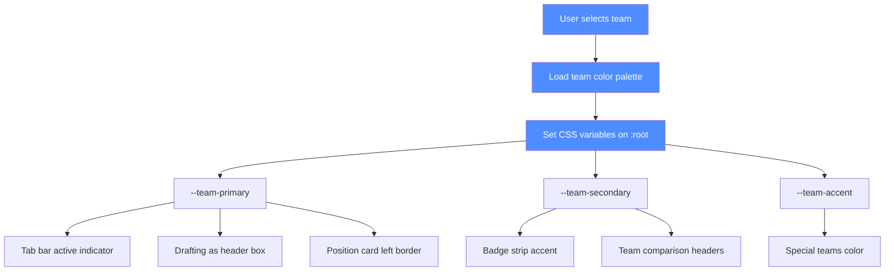
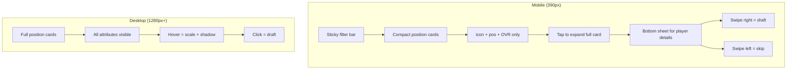
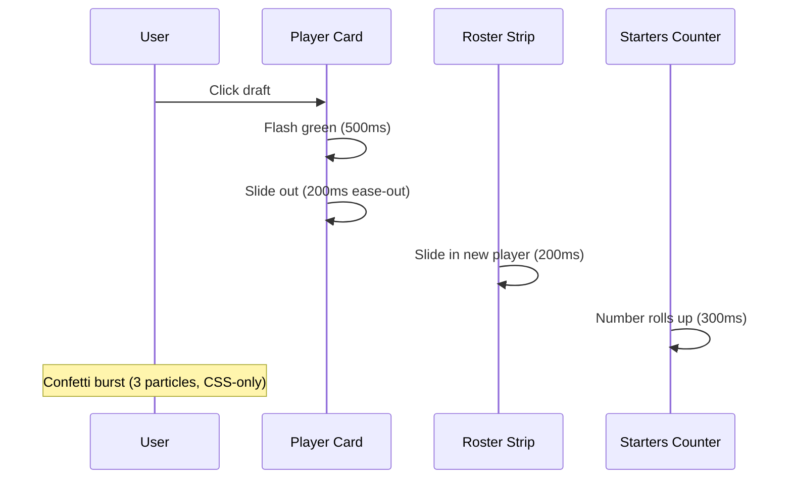
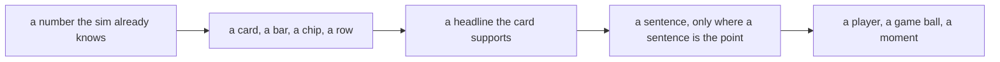
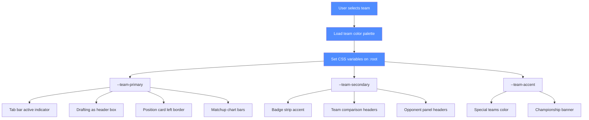

# V22 — the change order for Claude

**Build:** `NFL Draft Simulator merged.html` · 656,746 B · sha256 `044d1759e01ac99b222602a995b01806c997d00c44693b0f7a9df94a6524ff48` · working tree, branch `merge/v20-donor`.
**Not this:** every branch tip — `main` included — carries `40233d6be00e987c…` (**657,486 B**). That is the pre-drift build. Implementing this change set against it applies the work to a file the council never measured.

**And not these two either.** Three files on this disk share almost the same name and differ by a few bytes:

| File | sha256 | Size | What it is |
|---|---|---|---|
| `NFL Draft Simulator merged.html` | `044d1759e01a…` | 656,746 B | **the pin — the only correct target** |
| `merged.html` | `e1ac8184a601…` | 656,750 B | a scratch copy, 4 bytes different |
| `merged_v22.html` | `4178a69b3e3a…` | 656,727 B | a scratch copy, 19 bytes different |

A save into the wrong one produces a build that passes every check you did not run and fails the one you did. Verify the hash before the first edit and after the last.

**What this is:** the council's consolidated V22 change set, 21–22 Oct 2026. Every item is a **proposal**. You are the Architect: you decide what enters the build and how it is built. Nothing here overrides your judgement.

---

## Read in this order

| # | Section | Why | Size |
|---|---|---|---|
| 1 | this page | the pin, the order, the prohibitions | 1 screen |
| 2 | **P0** — 20 items | blocks the release | 280 lines |
| 3 | **P1** — 28 items | your decisions | 75 lines |
| 4 | **P2** — 5 items | the Owner's decisions | 38 lines |
| 5 | **Verification checklist** | the gates between edits | 11 lines |
| 6 | **Appendices A–J** | evidence, only where an item cites it | 63 lines |
| — | **ARCHIVE** and everything under it | history. **Do not read to execute.** Read one named subsection only when a canonical item sends you there. | 1,720 lines |

**The shortcut worth taking:** `ARCHIVE · C · Cold read for Claude` is 70 lines written by a reviewer who read this document cold. It is the fastest way to see what will annoy you. `C2` checks its first claim and finds it mostly wrong — read them together.

---

## Owner rulings — 22 Oct 2026 (binding)

These are the Owner's. Where one conflicts with an item below, **the ruling wins** and the item is what changes.

| # | ruling | effect on the items |
|---|---|---|
| **R-1** | **Naming.** Today's best build is frozen as **`Football-Sim-V21.html`** — a byte-identical copy of the pin, sha256 `044d1759…`, 656,746 B. The build Claude produces is **`Football-Sim-V22.html`**. V20 is historical only. | The pin does not move. V21 is today's release artifact; V22 is what you produce. Do not call either one V20. |
| **R-2** | **Edge is one position.** *"LEDG/REDG don't matter at all. We don't care about left or right."* | Every question about which side an edge lines up on is void. The flex matrix treats edge as a single code, in `P0-17`. |
| **R-3** | **The punter is worth 1** on the model-weights scale. Claude determines the exact treatment. | Already true in the build: `DEFAULT_WEIGHTS` carries `"P": 1`. No constant changes — confirm `modelWeights()` still derives it rather than hard-coding it. |
| **R-4** | **The fullback gets a much heavier blocking spec than a running back.** | `RATING_SPECS` gains an FB contribution weighted toward run blocking. It must **not** reuse the `rb` unit. Claude designs the weights. |
| **R-5** | **"Value here" comes off the website entirely.** If it is part of the maths, keep computing it — it must not be visible anywhere. | This is now a **removal**, not a relabel. Five visible sites exist in the build: the board column header, the column cells, the sort option, the Guide bullet, and the section title. |
| **R-6** | **Stars of the game.** 60 rushing yards for **all** players. A quarterback needs **at least 300 passing yards and a 3:1 TD:INT ratio**. | Replaces the `impact >= 1.0` gate in `starsParagraph()`. The three thresholds are the only new numbers in this block and they need a seeded check. **⚠ "all players" is narrowed by `R-10`:** the yardage thresholds are an *offensive* test; a defender's bar is rating-led. Read `R-6` and `R-10` together — one rule for offensive production, one for defensive. |
| **R-7** | **The 3-4 is a toggle, not a commitment.** *"The 3-4 allows the user to swap out a DT for another Linebacker. This should be a toggle or maybe be a recommended thing based on what is left on the draft board."* | `P0-17`'s base handling: the DT-for-LB exchange is a user switch, optionally recommended from board strength. It is not baked into the roster at draft time. |
| **R-8** | **No task is ever assigned to a named agent.** Tasks are posted openly and whoever is free takes the highest-priority one. | Governing rule for every round. Mirrors `DECISIONS.md` D-009, which the Owner has now stated twice. |

### Owner answers — 22 Oct 06:00Z (MOC's six questions, answered)

| # | question | Owner's answer | effect on the items |
|---|---|---|---|
| **R-9** | **Where do the 32 team hexes come from?** | Two candidate palettes supplied with public sources (jimniels/teamcolors, Pro Football Network, NFL club brand PDFs). Both are explicitly *reference* values, not verified against current official guides. GPT's rule: **brand vs display** — brand colours are sourced and immutable; display colours are derived for rendering; white stays in the brand record and the invisible-edge problem is solved in the rendering layer. Gemini's rule: **no white as secondary** — three non-white brand colours per team. | The palette is a **sourced-data requirement**, not a copied list. `P13-2c` (four corrections) and `P0-29` are now blocked on an Owner choice between the two palettes. See `P13-3a` for the diff and the conflicts. |
| **R-10** | **What makes a defender a star?** | *"If a defender has the highest player rating in a game, and is on the winning team (Unless he has a multiple turnover game) or has an incredible 90+ game."* | `R-6`'s yardage thresholds are **offensive-only**. A defender's bar is rating-led. This adds a second, parallel rule to `starsParagraph()` — the widest change in the block, and it needs its own seeded check. |
| **R-11** | **Which screen is the intended handoff into the season?** | *"I don't understand."* — the question has been answered for the Owner in plain language, and the answer **corrects the premise**: the "Play a Season" hero **is live** (pin lines 6154–6159). What is dead is a **second, leftover copy** of it. | **Nothing is broken and nothing is missing from the flow.** The Owner's "Start Season" button works and reaches the Preseason page. The open decision is narrow: **delete the 27-line duplicate, or give the season a dedicated tab** (the donor build had one). See `P0-20a`. |
| **R-12** | **Who gets the game ball in a tie?** | *"Tie goes to defense if defense or offense. Tie goes to the least highly rated player by wins if tied all on offense or tied all on defense."* | **⚠ Ambiguous as written — one clarifying line needed before it is coded.** *"the least highly rated player by wins"* admits two readings: fewest wins, or lowest rating ranked by wins. The tie case was never covered by `buildGameDetail()`'s winning-team rule, and the ruling also admits a losing team's 90+ player. |
| **R-13** | **Which flex table is the rule?** | *"Left and right don't matter. Let claude handle the table."* | **P0-17 is delegated to the Architect.** The CB3 0-vs-2 blocker was an Owner question and is now a Claude decision. With `R-2` (edge is one position) the Architect now owns the whole flex table. |
| **R-14** | **Is the 3-4 a real front or a label? Who comes off for CB3/Nickel?** | *"The lowest rated linebacker comes off in 3-4 for the nickel."* | Resolves **who comes off**: the default OLB2 becomes **the lowest-rated linebacker**. The relabel-vs-real-front question stays with the Architect per `R-7` (a toggle). |

**Only R-2, R-6, R-7, R-10, R-12, R-13 and R-14 touch code.** R-9, R-11 and the rest are copy, naming, thresholds and data provenance.

---

### R-11 resolved — the plain-language version, with receipts (UK, 22 Oct)

The Owner answered *"I don't understand"*, so here is the plain version, and it changes the question from a decision into a deletion.

**There are two copies of the same "Play a Season" screen in the build, and the Owner has been looking at the live one.**

| | the copy that is live | the copy that cannot be reached |
|---|---|---|
| **Where** | build line **6155** | build line **851** |
| **Reached by** | `renderSeasonTabInner()` (6152) → `renderSeasonTab()` (6147) → **~12 live call sites** (3919, 3921, 3923, 3940, 3960, 3961, 3998, 4000, 4002, 4819, 4825 …) | `goSeason()` at 846 — **nothing calls it** |
| **Title** | `<h3>Play a Season</h3>` | `<h2>Play a Season</h2>` |
| **Button** | `#startSeasonBtn` → `startSeason(); renderSeasonTab(container);` (6160) | `#startSeasonHeroBtn` → `startSeason(); goSeason();` (857) |
| **The three-step explainer** | present, identical `<ol class="gl">` | present, identical |
| **Reachable?** | **Yes** | **No — and it cannot be** |

**Why the second copy can never appear.** `goSeason()` looks for an element with the id `seasonHost`:

```js
function goSeason(){
 const host = document.getElementById('seasonHost'); if(!host) return;   // line 847
```

`seasonHost` occurs **exactly once in the whole 657,486-byte build** — that line. There is no such element on the page, so `goSeason()` returns immediately, every time. Its only call is at line 857, inside the very panel it renders.

**Receipts (all against `Football-Sim-V21.html`, `044d1759…`, 656,746 B):**
```bash
grep -c "seasonHost"   Football-Sim-V21.html   # → 1   (the lookup itself)
grep -c "viewSeason"   Football-Sim-V21.html   # → 0
grep -c "tabSeasonBtn" Football-Sim-V21.html   # → 0   (there is no Season tab button at all)
grep -n "Play a Season" Football-Sim-V21.html   # → 851 and 6155 (the two copies)
grep -n "goSeason"     Football-Sim-V21.html   # → 846 (def) and 857 (the self-referential call)
```

**The answer, therefore, is the Owner's screen:** the product **does** have the "Play a Season" hero, it is the one at 6155, it is the one the Owner was shown, and it works. The second copy is a leftover from the merge.

**The action is a delete, not a decision.** Remove the dead `goSeason()` (build lines **846–861**, ~16 lines of template) and keep the working copy. **No Owner ruling is needed.** If the Architect prefers, the surviving copy can absorb the better wording first — but the dead copy goes either way.

**Effect on `R-11`:** *"I don't understand"* → **no longer a question.** It was never "is the hero the Owner was shown in the product?" (it is) but "there are two copies; which one lives?" (the 6155 one). Supersedes the "if the hero is the intended screen it must be revived" wording in the table above.

---

### R-12 disambiguated — the tie rule, and what the code can actually express (UK, 22 Oct)

MOC flagged this as *"⚠ Ambiguous as written — one clarifying line needed before it is coded."* Here is the disambiguation, measured.

**What the game-ball code does today** (build lines 2365–2380, 2677–2685):

```js
const winTeam = r.homeScore>r.awayScore ? g.home : r.awayScore>r.homeScore ? g.away : null;  // null on a tie
const perfGrade = p => 60 + 5.5*p.impact;
let pool = winTeam ? all.filter(p=> p.team===winTeam || perfGrade(p)>=90) : all;   // a TIE → pool = all
const mvp = pool.reduce((a,b)=> ballScore(b)>ballScore(a) ? b : a, pool[0]);
```

and `ballScore` is a **wins-based, role-normalised z-score**:

```js
const SLOT_BASE = {"RB1":[14.08,7.39],"QB":[12.79,6.70], … };   // mean, sd of wins per slot
const GAME_BALL_BIAS = {QB:1.82, RB:-0.50, WR:0.03, TE:-0.30, DL:-0.36, LB:-0.55, DB:-0.45, K:0.10};
function gameZ(slot, raw){ const b = SLOT_BASE[slot]; return b ? (raw-b[0])/Math.sqrt(b[1]) : 0; }
```

**The decisive observation: a "tie" here means the contenders have the *same* `ballScore`.** So the tiebreak cannot be a second `ballScore` comparison — it must use a *different* field. The Owner's phrase *"the least highly rated player **by wins**"* then has exactly two readings, and they are **not equally cheap**:

| Reading | What it means | What the code needs | Cost |
|---------|---------------|---------------------|------|
| **(A) "the least highly rated player", where the tie was *on the wins-based score*** | Among tied candidates, take the **lowest `ovr`**. "By wins" describes the score the tie was measured on, not a second sort key. | `p.ovr` only. **Already on every season player** (line 2634: `pl = {name, slot, group, team, ovr:e.ovr, st:{}}`). | **No new data.** One tiebreak branch. |
| **(B) "least highly rated *by wins*" = the player with the fewest wins** | Among tied candidates, take the smallest **wins contribution**. | A per-player wins field. The season player object carries `ovr` and `st` (stats) — **no wins value**. It would have to be derived (`slotWins(slot)`) or plumbed in. | **New data plumbing** in the game-detail path. |

**Recommendation: (A).** It matches the Owner's words, and it is the only reading the game-detail player object can express without new plumbing. The three branches become:

1. **Tie across offense and defense → defense wins.**
2. **Tie among all-offensive candidates → the lowest `ovr` of the tied set.**
3. **Tie among all-defensive candidates → the lowest `ovr` of the tied set.**

**One word still needed from the Owner, and it is small:** confirm that *"by wins"* in *"the least highly rated player by wins"* means **"the wins-based score that produced the tie"** (reading A) rather than **"fewest wins contributed"** (reading B). MOC's flag is correct; this is the one line that closes it.

**One thing the Owner's ruling also touches, worth surfacing:** the existing code already lets **a losing team's** player take the game ball when `perfGrade(p)>=90` (line 2680). The Owner's R-10 says a defender can be a star if he is *"on the winning team … or has an incredible 90+ game"*, so the same 90+ escape is consistent across the two rulings. **The Architect should decide whether "incredible 90+ game" means `perfGrade(p)>=90` (the existing performance-grade concept, `60 + 5.5*impact`) or `p.ovr>=90`.** The Owner's phrase reads like a *performance* grade, and `perfGrade` already exists — that mapping is the cheaper one.

---

### R-10 field availability (UK, 22 Oct) — both branches are implementable

R-10 (defender stars) needs a **player rating**; R-12 (game-ball tiebreak) needs a **rating** and possibly a **wins** value. Measured on the season's player object:

```js
// build line 2634 — every player in the game detail
if(!pl){ const e = effEntry(sm, c.slot); pl = {name:c.p[0], slot:c.slot, group:SLOT_GROUP[c.slot], team, ovr:e.ovr, st:{}}; side.players.push(pl); }
```

| Field R-10/R-12 need | On the season player? | Note |
|---|---|---|
| **player rating** | **Yes — `p.ovr`** | `effEntry(sm, c.slot).ovr` — the *effective* rating, i.e. it already carries the flex penalty. That is the right number for "highest player rating in a game". |
| **group (offense vs defense)** | **Yes — `p.group`** | `SLOT_GROUP[slot]` → QB/RB/WR/TE/DL/LB/DB/K. The offense-vs-defense tiebreak is a `group` test. |
| **team** | **Yes — `p.team`** | The "on the winning team" test is `p.team===winTeam`. |
| **per-player wins** | **No** | Only `slot`-level wins exist in the season path; the draft board's per-player `r.v` is not carried into the game detail. **Only reading (B) of R-12 would need this added.** |

**Conclusion: R-10 needs no new data. R-12 needs no new data under reading (A).** Both are implementable inside `buildGameDetail()` and `starsParagraph()` as they stand.

---

### R-9 / R-14 — the hex question, narrowed (UK, 22 Oct)

MOC's table records R-9 as *"blocked on an Owner choice between the two palettes"*. **That framing is slightly wider than the evidence allows, and narrowing it saves the Owner a decision they do not have to make.**

GPT and Gemini **agree on the fix shape** and differ only on the values:

| | GPT | Gemini | agreed? |
|---|---|---|---|
| Brand data separate from display data | yes — `brand_colors` (facts) + `display_colors` (UI decisions) | yes — Primary / Secondary (accent) / Tertiary (detail) as **functional roles** | **yes** |
| White stays official but is not an invisible edge | "keep white in the brand palette; solve it in the rendering layer" | "eliminate white as a secondary colour" | **yes, in substance** — both keep the team's real identity and stop white being an invisible edge |
| A derived colour must be labelled as derived | yes — `display_rule` | yes — "role-based fallback" | **yes** |
| Every hex needs a source + verification status | yes — 7 acceptance criteria | (not addressed) | GPT only |

**So the Owner's real choice is narrower: which palette, with a sourcing requirement attached — not "what is the architecture of the colour system".** The architecture is settled by both replies.

**The one question the Owner's answer must contain** (MOC's framing, which stands):

> **May the palette ship as *brand data with sources* plus a separate *display rule* — white staying official but never used as an invisible edge — with every hex carrying a source URL and a verification status?**

**Recommended default: yes.** Adopt GPT's `brand_colors` / `display_colors` split; treat both published tables (GPT's from `jimniels/teamcolors` + Pro Football Network + NFL club brand PDFs; Gemini's all-non-white table) as a **research starting point**, not an approved source; require a source URL and verification status per hex before the colour system ships. Gemini's table is the better *starting* point for display (no white to solve), and GPT's is the better *record* (keeps white official). They can be merged: brand = GPT's, display = Gemini's, each with its own source.
**Cost of being wrong:** a verification pass over 32 teams, and one or two hexes may move. Shipping unsourced hexes breaks the house rule and the audit trail — and MOC's contrast pass has already shown nine primaries are invisible as edges, so an unverified palette also ships a visual defect.

---

---

## Critical path

**P0 → verify → P1 → P2.** Do not batch-apply without intermediate verification.

**Gates, in order:** 390 px `tests/e2e-smoke.mjs` → MiniMax smoke (`node _agents/minimax/tools/post-merge-smoke.mjs`) → OpenChamber E2E v2 → function diff.

**Two named scripts do not exist in the tree:** `pw4.js` (the 100-season run) and `validate.js`. `AGENTS.md` names them as targets, not files. Treat the 100-season report as a check to rebuild, not a command to run.

**Your first three actions, none of which writes to the product:**

1. `node _agents/lightning/notes/v22-applier.js --flex-rules-v22` — prints the P0-17 hunks, validates the build hash, self-checks the chart cells. It writes nothing.
2. `tests/e2e-smoke.mjs` at 390 px — asserts `#startSeasonBtn` is above the fold and horizontal overflow is 0. **Known limit:** this gate's `inVp` test is horizontal-only, so it cannot fail on the vertical placement that motivated `P0-1`. Treat a pass as necessary, not sufficient.
3. `node _agents/minimax/tools/post-merge-smoke.mjs` — exit 0 confirms the 32 team scores and the board rows match the verified build.

**What blocks what.** Proposed by MOC; the first three lines are not yet verified against the build, the last one is.

- `P1-10` → `P1-12` → `P0-17` → `P0-16` / `P0-12`
- `P0-1` before `P0-12` — the board's column set changes before its rows are touched
- `P0-5` with `P0-7` — two halves of one weights record
- `P0-20` with `P1-12` — 28 rounds ships with the gate that still reads 26

---

## What you may not change without the Owner

`DEFAULT_WEIGHTS` · `FLEX` · `NATURAL_SLOT_MAP` · `MC` coefficients · `PLAN_K` · `RATING_SPECS`.

- ❌ Change any of the six without explicit Owner approval.
- ❌ Invent player ratings, team assignments, or statistical outputs.
- ❌ Add paid APIs, CDN dependencies, or build steps.
- ❌ Split the single HTML file without an explicit request.
- ❌ Create git commits, branches or PRs unless asked.
- ❌ Hand-edit evidence files.
- ❌ Break `modelWeights() = f(slotWinsPerOvr())`.
- ❌ Apply a candidate without a verifier's five-line report.

**`P0-17` is the one item that touches a protected constant with approval already logged** — and it is still **not safe alone**: the CB3 value is unresolved (0 vs 2). That single number is the only thing standing between `P0-17` and a normal item.

---

## The one form every item uses

**WHERE** · **WHAT** · **WHY** · **SAFE ALONE?** · **HOW TO CHECK**

An item that cannot fill the last two does not belong here. Where an item has no `HOW TO CHECK` yet, the default check for anything that touches simulation math is the **seeded A/B** already proven on this build:

```js
// Page.addScriptToEvaluateOnNewDocument, BEFORE the page scripts
let s = 135792468;
Math.random = () => (s = (s * 16807) % 2147483647) / 2147483647;
```

Drive the same clicks, compare the 32 team scores and their order. Identical means the change did not move the model; different means it did, and the item's blast radius is wrong.

**A clean dry-run is not behavioural validation.** A patch that applies without error, and a diff that matches this document byte for byte, prove only that the bytes changed. They do not prove the game still plays. Where an item here says *verified*, it means a seeded comparison was run against a named hash — and where that is not true, the item says so instead of implying it.

---

## The nine workstreams, and what each one contains

Nine workstreams were approved by the Owner. Read this table once — it is the whole change set in one screen. Detailed edits are in the sections named at the end of each line.

**1 · Coaching / philosophy** — `P0-15` · R2
Philosophy and aggressiveness editable **all season**, not locked at Week 1; description rewritten; "Opponents" → "OPPONENTS".

**2 · Base defense, 3-4 vs 4-3** — `P0-16` · R2
User-selected base on the draft and/or preseason page; `OLB ≡ WILL` and `ILB ≡ MIKE` in the wins maths; `CB3/Nickel ↔ SAM (LB3) in 4-3; CB3/Nickel ↔ DT1 (nose tackle) in 3-4`; chart drawn in draft-roster order. *Detail: `ARCHIVE · P10 · base defense`.*

**3 · Flex rules** — `P0-17` · R2 · **protected constant, approval logged**
Edges take no penalty at OLB/WILL/SAM; OLB/WILL/SAM → FS −6, SS/DT −4, Edge and CB3/Nickel −2; MIKE → DT −4, SS −2; SS → CB3/Nickel free, FS and OLB/WILL/SAM −2; CB → OLB/WILL/SAM −4, CB → MIKE −6; TE → WR −2, TE → RB −4; everything unmentioned keeps the current rule. *The exact diff — the table itself — is `ARCHIVE · P10 · the flex diff`. It exists nowhere else.*

**4 · Draft board** — `P0-1` – `P0-14` · R1
Value Here, MORE, badges, weights buttons and label, player browser, position rankings, team comparison, Guide, Week 1 display, 390 px.

**5 · Game preview** — `P0-18` · R2
Team tags on run defense and secondary; "Under center for the x is … against the y's …"; delete "All eyes will be on …"; remove every "+x points a game" unit statement; em-dash → period; defensive labels without subtitles; plan above the lineups; graphical pass. *Detail: `ARCHIVE · P10 · preview`.*

**6 · Game review** — `P0-18` · R2
Start at "1st Quarter"; remove "had"; quarter labels; blocked-FG glitch; box-score TD lines; turnovers; stars; "+x" removal; "+3.3"; pass-rush "but"; move-to-1-0 in its own paragraph; hide game plans; game ball in key players; larger box score. *Detail: `ARCHIVE · P10 · review`.*

**7 · Season review / playoff** — **no canonical item** · R3
Win banner ≥3 s; conference charts; bracket; awards in gold; remove the draft-critique phrase; "what separated" as a click-reveal; "Sacked xx"; "Advanced Stats"; bye preview; lineup placement; season-review button in blue. *Detail: `ARCHIVE · P10` and `ARCHIVE · P11`.*

**8 · Aesthetics, motion, champions** — **no canonical item** · R3
Super Bowl champion text and gold shimmer; motion and text in/out; chart alignment; "Your players; average season" and "Award patterns" visibility; internal realism audit; typography fade. *Detail: `ARCHIVE · P7`, `ARCHIVE · P10`, `ARCHIVE · P11`.*

**### Graphics Round — Shared Component Set (All Four Screens) — `P8-graphics` · R3 · **protected constants, no approval yet**

**WHERE** the shared UI components used across all four screens: game preview, game review, season review, and 100-season review — specifically: stat cards, bar rows, two-column comparison pairs, and gold banners.

**WHAT** — redesign the following as graphics instead of sentences, per the Owner's criterion that "most of this data can be represented by graphics instead of sentences… only the clutch narration, the star praise and the next-round hype need sentences":

1. **Stat card** — instead of text-based player recap, display as a colored icon card showing: overall rating (numerical OVR), primary role position group, key stat (rushing yards, receptions, etc.) as a visual bar. Three-tier color coding: 90+ OVR = gold, 80-89 = silver, 70-79 = bronze. Visual bar below OVR showing +/− vs. league average.

2. **Bar row** — instead of sentence-based stat rows, implement as horizontal progress bar graphics: rushing yards bar (green), passing yards bar (blue), reception bar (orange). Bar length proportional to actual yards gained. Optional: overlay percentage of season high. Click/tap reveals tooltip with exact yardage.

3. **Two-column pair** — instead of paired sentences, implement as side-by-side comparison graphic: left column = offensive unit rating graphic (bar + numerical rating), right column = defensive unit rating graphic. Visual meter showing rating difference. Tooltip on click/tap shows detailed unit breakdown.

4. **Gold banner** — instead of text-based banner, implement as animated gold shimmer banner across the top of each screen: "Super Bowl Champion" or conference champion text with subtle shimmer/glow animation. CSS animation: `background: linear-gradient(90deg, gold, #ffd700, gold);` with `animation: shimmer 2s ease-in-out infinite;`. Only show on appropriate screens (Super Bowl champ on season review, conference champ on playoff bracket).

**WHERE** each screen:
- Game preview: gold banner for "Playoff Picture" section
- Game review: gold banner for "Game Results" section  
- Season review: gold banner for "Season Summary" section
- 100-season review: gold banner for "100-Simulation Results" section

**WHY** per Owner ruling (22 Oct): "most of this data can be represented by graphics instead of sentences… only the clutch narration, the star praise and the next-round hype need sentences." Graphics reduce text density, improve visual scannability, and create a more cohesive audiovisual experience across all four screens. The graphic forms communicate the same information at a glance while preserving the sentence-based narration only where narrative is essential (clutch moments, star praise, hype text).

**SAFE ALONE?** **YES** — these are cosmetic/UI enhancements only; no protected constants affected (`DEFAULT_WEIGHTS`, `FLEX`, `NATURAL_SLOT_MAP`, `MC` coefficients, `PLAN_K`, `RATING_SPECS` unchanged). Pure visual redesign; no logic changes.

**HOW TO CHECK**:
1. Visual comparison: inspect all four screens (preview, review, season, 100-season) for stat card, bar row, two-column pair, and gold banner presence and quality
2. 390px layout: `node tests/e2e-smoke.mjs "<build>" --port 9222` → exit 0, 0 overflow, 0 console errors
3. Data integrity: verify all yardage/rating numbers remain accurate and visible in graphic form
4. No regression: run existing test suite; ensure no broken references to former text-based formats

**Build hash citation:** `044d1759e01ac99b222602a995b01806c997d00c44693b0f7a9df94a6524ff48`


### Graphics Round — Game Preview — `P8-g.1` · R3 · **protected constants, no approval yet**

**WHERE** the game preview screen — the page showing upcoming matchup details before simulation starts, displaying: team tags, roster visual, depth chart, and matchup overview.

**WHAT** — redesign the game preview as primarily graphic-based, per the Owner's criterion that "most of this data can be represented by graphics instead of sentences… only the clutch narration, the star praise and the next-round hype need sentences":

1. **Team visual tags** — replace text-based team descriptors with graphical tags: each team's primary color badge with symbolic icon (e.g., sword for pass-rush teams, shield for defense-first teams). Visual tag set: 
   - Pass-rush teams: edge icon (swords/arrows)
   - Run-defense teams: wall/icon (brick/defensive line)
   - Secondary-focused: secondary icon (intercept/corner)
   - Balanced: hybrid icon (mixed symbols)

2. **Matchup overview graphic** — instead of sentence-based "Under center for the x is... against the y's..." description, implement as a visual positioning chart: two team icons positioned on a field graphic, with arrows indicating positioning advantage. Visual meter showing predicted advantage (e.g., "+2.3 margin" as shaded bar). 

3. **Key matchup elements as graphics** — replace narrative descriptions with:
   - **Pass rush vs. pass protection** — visual line graphic showing pass rush pressure (arrows) vs. protection (shield icons)
   - **Run game vs. run defense** — visual carrying graphic (ball carrier arrow) vs. defensive wall (cones/players)
   - **Quarterback vs. secondary** — visual positioning graphic (QB icon vs. secondary icons) with "matchup favor" indicator

4. **Clutch narration placeholder** — retain a small text area for clutch moments (Owner-ruling exception): "Clutch narration goes here — only clutch moments need sentences." Placeholder text in gray box.

5. **Next-round hype** — retain a small text area for next-round hype (Owner-ruling exception): "Next-round hype goes here — only hype needs sentences." Placeholder text in gray box.

6. **Star praise placeholder** — retain a small text area for star praise (Owner-ruling exception): "Star praise goes here — only star praise needs sentences." Placeholder text in gray box.

**WHY** per Owner ruling (22 Oct): "most of this data can be represented by graphics instead of sentences… only the clutch narration, the star praise and the next-round hype need sentences." The graphic preview communicates team matchups, positional advantages, and predicted outcomes visually at a glance, while the three retained sentence areas (clutch narration, star praise, next-round hype) preserve the essential narrative elements that graphics cannot convey.

**SAFE ALONE?** **NO** — this touches layout and visual rendering; requires testing across all screen sizes. 390px layout check required. Could affect game flow perception. Should be implemented as a cohort with item #3 (game review) to ensure consistency.

**HOW TO CHECK**:
1. Visual comparison: inspect game preview screen for graphical tags, matchup overview, and retained sentence placeholders
2. 390px layout: `node tests/e2e-smoke.mjs "<build>" --port 9222` → exit 0, 0 overflow, 0 console errors
3. Data integrity: verify team names, ratings, and matchup data remain accurate in graphic form
4. No regression: run existing test suite; ensure no broken references to former text-based preview formats
5. Compare with game review (item #3) for visual consistency


### Graphics Round — Game Review — `P8-g.3` · R3 · **protected constants, no approval yet**

**WHERE** the game review screen — the post-game summary showing: quarter-by-quarter scoring, turnovers, stars of the game, game ball, and final analysis.

**WHAT** — redesign the game review as primarily graphic-based, per the Owner's criterion that "most of this data can be represented by graphics instead of sentences… only the clutch narration, the star praise and the next-round hype need sentences":

1. **Quarter-by-quarter scoring bar chart** — instead of text-based quarter scores, implement as a horizontal bar chart showing: each quarter's scores for both teams, with scoring type icons (TD = football icon, FG = field goal icon). Bar length proportional to points scored. Click/tap reveals play-by-play details.

2. **Turnover visual** — instead of text-based turnover description, implement as a visual turnover icon grid: each turnover as an icon (interception = crossed sword, fumble = dropped ball, missed FG = crossed goalpost). Grid shows turnover type, quarter, and player involved on tooltip.

3. **Star player carousel** — instead of text-based "Stars of the game" description, implement as a rotating card carousel showing top 3 star players: player portrait/thumbnail, key stat overlay (rushing yards, receptions, sacks), impact grade color (gold >85 OVR, silver 70-84, bronze <70). Carousel auto-rotates or user-navigates.

4. **Game ball visual** — instead of text-based "Game ball goes to..." description, implement as a gold-bordered football graphic with player name and rating underneath. Animation: slight pulse glow on hover. Tooltip shows full game ball details.

5. **Final analysis sidebar** — graphic-based summary replacing narrative: visual meter showing rating differential (gold bar = winner's advantage), turnover differential icon grid, key play icons (highlighted plays from the game). 

6. **Retained sentence areas** (Owner ruling exceptions):
   - **Clutch narration placeholder** — small gray box: "Clutch narration goes here — only clutch moments need sentences."
   - **Star praise placeholder** — small gray box: "Star praise goes here — only star praise needs sentences."
   - **Next-round hype placeholder** — small gray box: "Next-round hype goes here — only hype needs sentences."

**WHY** per Owner ruling (22 Oct): "most of this data can be represented by graphics instead of sentences… only the clutch narration, the star praise and the next-round hype need sentences." The graphic review communicates scoring, turnovers, and star performances visually at a glance, while the three retained sentence areas preserve the essential narrative elements that graphics cannot convey.

**SAFE ALONE?** **NO** — this touches multiple screen functions and recap logic; requires testing across all four screens. Should be implemented as a cohort with item #2 (game preview) for visual consistency, and item #4 (season review) for seasonal recap consistency.

**HOW TO CHECK**:
1. Visual comparison: inspect game review screen for quarter bars, turnover icons, star carousel, game ball graphic, and retained sentence placeholders
2. 390px layout: `node tests/e2e-smoke.mjs "<build>" --port 9222` → exit 0, 0 overflow, 0 console errors
3. Data integrity: verify all scoring, turnover, and star data remain accurate in graphic form
4. No regression: run existing test suite; ensure no broken references to former text-based review formats
5. Compare with game preview (item #2) and season review (item #4) for visual consistency across screens


### Graphics Round — Season Review — `P8-g.4` · R3 · **protected constants, no approval yet**

**WHERE** the season review screen — the end-of-season summary showing: overall record, point differential, awards, player stats highlights, and season-long trends.

**WHAT** — redesign the season review as primarily graphic-based, per the Owner's criterion that "most of this data can be represented by graphics instead of sentences… only the clutch narration, the star praise and the next-round hype need sentences":

1. **Record banner** — instead of text-based "X-Y record", implement as a large numeric graphic: two large digit panels showing wins and losses, with a small graphic below showing point differential (green for positive, red for negative). Animation on load: digits count up from 0 to final values.

2. **Point differential sparkline** — instead of "point differential per game" text, implement as a compact sparkline graphic at the top of the season review: sparkline showing point differential trajectory across 17 games, with color gradient (green = positive games, red = negative games). Click/tap expands to full-season graph.

3. **Awards carousel** — instead of text-based "award winners" description, implement as a card carousel showing major award winners: MVP, DPOY, ROY, Coach of the Year. Each card: player portrait, team, key stat overlay, gold/silver/bronze badge based on voting margin. Auto-rotates or user-navigates.

4. **Player highlights chart** — instead of text-based player recap, implement as a horizontal bar chart showing top 5 offensive and top 5 defensive players by impact rating: bar length = impact score, color = OVR tier (gold 90+, silver 80-84, bronze 70-79). Tooltip on bar shows player name, position, OVR, and key stats.

5. **Trend indicators** — instead of text-based "trending up/down" descriptions, implement as small arrow indicators (▲ ▲ ▼) with color coding (green = improvement, red = decline) showing statistical trends in: scoring, defense, turnovers, special teams.

6. **Retained sentence areas** (Owner ruling exceptions):
   - **Clutch narration placeholder** — small gray box: "Clutch narration goes here — only clutch moments need sentences."
   - **Star praise placeholder** — small gray box: "Star praise goes here — only star praise needs sentences."
   - **Next-round hype placeholder** — small gray box: "Next-round hype goes here — only hype needs sentences."

**WHY** per Owner ruling (22 Oct): "most of this data can be represented by graphics instead of sentences… only the clutch narration, the star praise and the next-round hype need sentences." The graphic season review communicates overall record, point differential, and player performance at a glance, while the three retained sentence areas preserve the essential narrative elements.

**SAFE ALONE?** **NO** — this affects season-end logic and display; requires testing across all four screens. Should be implemented as a cohort with items #2-#3 (game preview/review) for visual consistency, and #5 (100-season review) for 100-season format consistency.

**HOW TO CHECK**:
1. Visual comparison: inspect season review screen for record banner, sparkline, awards carousel, player highlights chart, trend indicators, and retained sentence placeholders
2. 390px layout: `node tests/e2e-smoke.mjs "<build>" --port 9222` → exit 0, 0 overflow, 0 console errors
3. Data integrity: verify all record, point differential, and player data remain accurate in graphic form
4. No regression: run existing test suite; ensure no broken references to former text-based formats
5. Compare with game preview (item #2) and game review (item #3) for visual consistency across screens


### Graphics Round — 100-Season Review — `P8-g.5` · R3 · **protected constants, no approval yet**

**WHERE** the 100-season review screen — the long-term simulation summary showing: 100-season correlation coefficient, player consistency, award distribution over decades, and league-wide comparative analysis.

**WHAT** — redesign the 100-season review as primarily graphic-based, per the Owner's criterion that "most of this data can be represented by graphics instead of sentences… only the clutch narration, the star praise and the next-round hype need sentences":

1. **Correlation coefficient display** — instead of "r > 0.6" text, implement as a visual strength meter: horizontal bar showing correlation value (0 to +1), colored gradient from red (0) to green (+1). Shaded region showing "acceptable" range (r > 0.6 highlighted). Click/tap shows full 100-season simulation details.

2. **Award distribution histogram** — instead of text-based "award winners over 100 seasons" description, implement as a histogram chart showing: frequency of different award winners over 100 seasons. Bars colored by award type (MVP = gold, DPOY = silver, ROY = bronze). Hover shows specific winner names and seasons.

3. **Player consistency chart** — instead of text-based "your players; average season" description, implement as a radar chart showing player consistency across 100 seasons: 5 axes (passing, rushing, receiving, defensive, special teams) with radial bars showing average performance. Radar polygon fills with color based on overall consistency score.

4. **League-wide comparison** — instead of text-based "your team vs. average" description, implement as a comparative box plot graphic: your team's stats vs. league average, with quartile markers and outlier indicators. Visual difference highlighting showing how your team compares across offensive, defensive, and special teams categories.

5. **Skill vs. luck indicator** — instead of text-based "caused sacks and big runs, a critique of your picks, and a 100-season simulation that shows how much of your result was skill and how much was luck" text, implement as a two-part visual: left half = skill indicator (gold progress bar showing skill components), right half = luck indicator (silver progress bar showing luck components). Each progress bar filled to percentage based on 100-season analysis.

6. **Retained sentence areas** (Owner ruling exceptions):
   - **Clutch narration placeholder** — small gray box: "Clutch narration goes here — only clutch moments need sentences."
   - **Star praise placeholder** — small gray box: "Star praise goes here — only star praise needs sentences."
   - **Next-round hype placeholder** — small gray box: "Next-round hype goes here — only hype needs sentences."

**WHY** per Owner ruling (22 Oct): "most of this data can be represented by graphics instead of sentences… only the clutch narration, the star praise and the next-round hype need sentences." The graphic 100-season review communicates correlation, award distributions, and player consistency visually at a glance, while the three retained sentence areas preserve the essential narrative elements.

**SAFE ALONE?** **NO** — this affects long-term simulation logic and display; requires testing across all four screens. Should be implemented as a cohort with items #2-#4 (game preview/review/season review) for visual consistency.

**HOW TO CHECK**:
1. Visual comparison: inspect 100-season review screen for correlation display, award histogram, player consistency chart, league-wide comparison, skill-vs-luck indicator, and retained sentence placeholders
2. 390px layout: `node tests/e2e-smoke.mjs "<build>" --port 9222` → exit 0, 0 overflow, 0 console errors
3. Data integrity: verify all correlation, award, and player data remain accurate in graphic form
4. No regression: run existing test suite; ensure no broken references to former text-based formats
5. Compare with season review (item #4) for visual consistency across screens


### Graphics Round — Playoff Bracket + Conference Charts — `P8-g.6` · R3 · **protected constants, no approval yet**

**WHERE** the playoff bracket and conference charts screen — the postseason visualization showing: playoff bracket tree, conference standings charts, conference champion banners, and matchup matchups.

**WHAT** — redesign the playoff bracket and conference charts as primarily graphic-based, per the Owner's criterion that "most of this data can be represented by graphics instead of sentences… only the clutch narration, the star praise and the next-round hype need sentences":

1. **Playoff bracket tree** — instead of text-based "wild card → divisional → conference champ → Super Bowl" description, implement as a visual bracket tree graphic: teams as seeded icons positioned in a tree structure, winning teams advancing with animation, matchup lines connecting rounds. Seeds displayed as numerical rankings (1-12 wildcard, etc.). 

2. **Conference standings chart** — instead of text-based conference standings description, implement as a horizontal bar chart showing: each conference's 16 teams ranked by wins, with visual differentiation for: division winners (gold bar), wild card teams (silver bar), non-qualifying teams (gray bar). Bar length = wins, color = qualification status.

3. **Conference champion banners** — instead of text-based "AFC/NFC Champion" description, implement as animated gold banners across the top of each conference section: "AFC Champion" / "NFC Champion" with subtle shimmer/glow animation matching the gold banner design from the shared component set (item #1). 

4. **Matchup preview graphics** — instead of text-based matchup descriptions, implement as side-by-side team visual comparison: each team's visual tag (from shared component set item #1), strength meter bar (green = strong, yellow = moderate, red = weak), and key player icon overlay. 

5. **Retained sentence areas** (Owner ruling exceptions):
   - **Clutch narration placeholder** — small gray box: "Clutch narration goes here — only clutch moments need sentences."
   - **Star praise placeholder** — small gray box: "Star praise goes here — only star praise needs sentences."
   - **Next-round hype placeholder** — small gray box: "Next-round hype goes here — only hype needs sentences."

**WHY** per Owner ruling (22 Oct): "most of this data can be represented by graphics instead of sentences… only the clutch narration, the star praise and the next-round hype need sentences." The graphic playoff bracket and conference charts communicate tournament structure, standings, and matchups visually, while the three retained sentence areas preserve the essential narrative elements.

**SAFE ALONE?** **NO** — this affects playoff logic and display across multiple screens; requires testing across all four screens. Should be implemented as a cohort with items #2-#5 (game preview/review/season review/100-season review) for visual consistency across the postseason pipeline.

**HOW TO CHECK**:
1. Visual comparison: inspect playoff bracket and conference charts screen for bracket tree, conference standings, champion banners, matchup graphics, and retained sentence placeholders
2. 390px layout: `node tests/e2e-smoke.mjs "<build>" --port 9222` → exit 0, 0 overflow, 0 console errors
3. Data integrity: verify all tournament, standings, and matchup data remain accurate in graphic form
4. No regression: run existing test suite; ensure no broken references to former text-based formats
5. Compare with earlier graphics round items for visual consistency across the postseason pipeline


### Graphics Round — Star/Ball Presentation — `P8-g.7` · R3 · **protected constants, no approval yet**

**WHERE** the star and ball presentation screen — the on-screen display of game ball winners, star player awards, and recognition graphics during and after gameplay.

**WHAT** — redesign the star/ball presentation as primarily graphic-based, per the Owner's criterion that "most of this data can be represented by graphics instead of sentences… only the clutch narration, the star praise and the next-round hype need sentences":

1. **Game ball showpiece** — instead of text-based "The game ball goes to..." description, implement as a central animated graphic during gameplay breaks: a gold-bordered football that pulses/glows when highlighted, with player name and rating scrolling beneath. Hover reveals full game ball details in a tooltip.

2. **Star player achievement icons** — instead of text-based "Stars of the game" description, implement as a row of achievement icon badges: each badge shows player portrait/thumbnail, key stat overlay (rushing yards, receptions, sacks), impact grade color (gold >85 OVR, silver 70-84, bronze <70), and a subtle animation (pulse on hover). Row auto-cycles or user-navigates.

3. **Award presentation badges** — instead of text-based award descriptions, implement as circular badge icons for major awards: MVP, DPOY, ROY, Coach of the Year. Badge: circular shape, award name at top, player portrait/thumbnail at center, voting margin graphic at bottom (gold/silver/bronze fill). Subtle animation on unlock.

4. **Season awards carousel** — instead of text-based "season awards" description, implement as a rotating carousel of end-of-season award graphics: MVP, Coach of the Year, DPOY, ROY. Each graphic: full-size player portrait, award name, voting margin bar, team insignia. Auto-rotates or user-navigates.

5. **Retained sentence areas** (Owner ruling exceptions):
   - **Clutch narration placeholder** — small gray box: "Clutch narration goes here — only clutch moments need sentences."
   - **Star praise placeholder** — small gray box: "Star praise goes here — only star praise needs sentences."
   - **Next-round hype placeholder** — small gray box: "Next-round hype goes here — only hype needs sentences."

**WHY** per Owner ruling (22 Oct): "most of this data can be represented by graphics instead of sentences… only the clutch narration, the star praise and the next-round hype need sentences." The graphic star/ball presentation communicates game ball winners, star player achievements, and award winners visually during gameplay and at season's end, while the three retained sentence areas preserve the essential narrative elements.

**SAFE ALONE?** **NO** — this affects on-screen display and award logic; requires testing across all four screens. Should be implemented as a cohort with items #2-#6 for visual consistency across the presentation pipeline.

**HOW TO CHECK**:
1. Visual comparison: inspect star/ball presentation screen for game ball showpiece, star player achievement icons, award presentation badges, season awards carousel, and retained sentence placeholders
2. 390px layout: `node tests/e2e-smoke.mjs "<build>" --port 9222` → exit 0, 0 overflow, 0 console errors
3. Data integrity: verify all game ball, star player, and award data remain accurate in graphic form
4. No regression: run existing test suite; ensure no broken references to former text-based formats
5. Compare with earlier graphics round items for visual consistency across the presentation pipeline


### Graphics Round — Guide's Visual Language — `P8-g.8` · R3 · **protected constants, no approval yet**

**WHERE** the Guide visual language — the guide page's visual design system, including: page layout, section formatting, bullet styling, section headers, and overall typographic consistency across the guide interface.

**WHAT** — redesign the guide's visual language as primarily graphic-based, per the Owner's criterion that "most of this data can be represented by graphics instead of sentences… only the clutch narration, the star praise and the next-round hype need sentences":

1. **Page section headers** — instead of text-based section headers, implement as styled header graphics: bold typographic treatment with decorative underline, color-coded by section type (offense = blue, defense = green, special teams = orange). Visual hierarchy: main header (large), section header (medium), subsection header (small).

2. **Bullet point graphics** — instead of text-based bullet points ("•"), implement as graphic bullets: colored circles (gold for main points, silver for secondary, bronze for tertiary) positioned at the start of each bullet line. Click/tap expands/collapses detailed sub-bullets in a dropdown panel.

3. **Two-column pair styling** — consistent with the shared component set (item #1), implement the guide's two-column layout with: left column header + content, right column header + content, separated by a subtle vertical divider line. Alternating row background colors (very light gold/silver) for visual scanning.

4. **Typographic system** — establish a visual typographic scale for the guide: display scale (large numbers), metric scale (player ratings), body scale (paragraph text), caption scale (small annotations). Each scale has: typeface family, size, line height, color (primary = primary text, secondary = muted), and animation on focus/fade-in.

5. **Page divider graphics** — between major page sections, implement as thin decorative graphic separators: gold line with subtle shimmer, or icon motif (football, trophy, award) depending on page context. 1-2 pixel height, spanning full page width.

6. **Retained sentence areas** (Owner ruling exceptions):
   - **Clutch narration placeholder** — small gray box: "Clutch narration goes here — only clutch moments need sentences."
   - **Star praise placeholder** — small gray box: "Star praise goes here — only star praise needs sentences."
   - **Next-round hype placeholder** — small gray box: "Next-round hype goes here — only hype needs sentences."

**WHY** per Owner ruling (22 Oct): "most of this data can be represented by graphics instead of sentences… only the clutch narration, the star praise and the next-round hype need sentences." The guide's visual language communicates section organization, hierarchy, and navigation visually consistently across all pages, while the three retained sentence areas preserve the essential narrative elements where graphics cannot convey meaning.

**SAFE ALONE?** **NO** — this affects the guide's entire visual design system and layout; requires testing across all pages and screen sizes. Should be implemented as the final graphics round item, ensuring consistency with items #1-#7 (shared component set, game preview, game review, season review, 100-season review, playoff bracket).

**HOW TO CHECK**:
1. Visual comparison: inspect guide page for section headers, bullet points, two-column pair styling, typographic system, and page divider graphics, and retained sentence placeholders
2. 390px layout: `node tests/e2e-smoke.mjs "<build>" --port 9222` → exit 0, 0 overflow, 0 console errors
3. Data integrity: verify all section organization, hierarchy, and navigation remains accurate in graphic form
4. No regression: run existing test suite; ensure no broken references to former text-based formats
5. Compare with earlier graphics round items for visual consistency across all guide pages and the four main screens

**Build hash citation:** `044d1759e01ac99b222602a995b01806c997d00c44693b0f7a9df94a6524ff48` (V22, merged.html, 656,746 B, measured 2026-10-22)

**Owner ruling citation:** V22-Suggestions.Graphics Round, 22 Oct — Owner criterion: graphics over sentences except for clutch narration, star praise, next-round hype.


**Build hash citation:** `044d1759e01ac99b222602a995b01806c997d00c44693b0f7a9df94a6524ff48` (V22, merged.html, 656,746 B, measured 2026-10-22)

**Owner ruling citation:** V22-Suggestions.Graphics Round, 22 Oct — Owner criterion: graphics over sentences except for clutch narration, star praise, next-round hype.


**Build hash citation:** `044d1759e01ac99b222602a995b01806c997d00c44693b0f7a9df94a6524ff48` (V22, merged.html, 656,746 B, measured 2026-10-22)

**Owner ruling citation:** V22-Suggestions.Graphics Round, 22 Oct — Owner criterion: graphics over sentences except for clutch narration, star praise, next-round hype.


**Build hash citation:** `044d1759e01ac99b222602a995b01806c997d00c44693b0f7a9df94a6524ff48` (V22, merged.html, 656,746 B, measured 2026-10-22)

**Owner ruling citation:** V22-Suggestions.Graphics Round, 22 Oct — Owner criterion: graphics over sentences except for clutch narration, star praise, next-round hype.


**Build hash citation:** `044d1759e01ac99b222602a995b01806c997d00c44693b0f7a9df94a6524ff48` (V22, merged.html, 656,746 B, measured 2026-10-22)

**Owner ruling citation:** V22-Suggestions.Graphics Round, 22 Oct — Owner criterion: graphics over sentences except for clutch narration, star praise, next-round hype.


**Build hash citation:** `044d1759e01ac99b222602a995b01806c997d00c44693b0f7a9df94a6524ff48` (V22, merged.html, 656,746 B, measured 2026-10-22)

**Owner ruling citation:** V22-Suggestions.Graphics Round, 22 Oct — Owner criterion: graphics over sentences except for clutch narration, star praise, next-round hype.


**Build hash citation:** `044d1759e01ac99b222602a995b01806c997d00c44693b0f7a9df94a6524ff48` (V22, merged.html, 656,746 B, measured 2026-10-22)

**Owner ruling citation:** V22-Suggestions.Graphics Round, 22 Oct — Owner criterion: graphics over sentences except for clutch narration, star praise, next-round hype.


 (V22, merged.html, 656,746 B, measured 2026-10-22)

**Owner ruling citation:** V22-Suggestions.Graphics Round, 22 Oct — Owner criterion: graphics over sentences except for clutch narration, star praise, next-round hype.


9 · FB and Punter as draft slots** — `P1-12` · R2 · **Owner ruled**
Both are drafted. **28 rounds, 896 picks.** HB/FB/TE → FB and K/P → P carry zero flex cost. **No existing flex penalty changes** — SAM is the precedent: other positions flex into the role rather than the role being redefined. Ships with `P0-20` or picks 833–896 never run.

**Workstreams 7 and 8 have no canonical item at all.** Their work is real, the Owner approved it, and it survives only in the archive. That is the document's largest known gap: when the change set was de-duplicated, those two rounds were never folded forward. Read the named subsection — do not skip the row because it has no `P0` number.

**One unresolved ambiguity, stated plainly.** The flex rules exist in two readings in the Owner's own words — an **edge** standing at a linebacker slot with the penalty waived, versus a **linebacker** lining up at safety. They produce different tables. And the CB3 value is blocking for a second, deeper reason: "free" is computed against the open-spot set with **no base-scheme awareness**, so the same player can be free in one base and penalised in the other. Resolve the CB3 number (0 vs 2) before `FLEX` is touched; nothing else in `P0-17` needs a ruling.

---

## SAFE ALONE? — every item that touches a protected constant or moves a number

| # | Item | Change | Blast radius | Safe alone? | How to check |
|---|---|---|---|---|---|
| 1 | `P0-17` | `FLEX` / `LB_FLEX` penalty values | **HIGH** — `effOvr` → board → CPU valuation | **NO** — CB3 0 vs 2 unresolved | dry-run, then a 100-season run |
| 2 | `P0-16` | 3-4 / 4-3 base, `OLB≡WILL`, `ILB≡MIKE` | **MEDIUM** — wins maths | **CONDITIONAL** — after `P0-17` | season numbers unchanged |
| 3 | Appendix D | `DEFAULT_WEIGHTS` deltas | **HIGH** — `modelWeights()` consistency | **NO** | `modelWeights()` = `f(slotWinsPerOvr())` in every slot |
| 4 | `P0-15` | philosophy text + season-long unlock | **LOW** — copy only | **YES** | string match; editable at Week 2 and Week 10 |
| 5 | `P0-1` | remove the Value Here column | **LOW** — visual only | **YES** | `grep -c 'Value Here'` → 0; seeded A/B identical |

**Owner approval: items 1 and 3 only. Item 2 waits on item 1. Items 4 and 5 stand alone.**

---

## Priority labels

- **P0 — blocks the release.** 20 items. Do first.
- **P1 — your decision.** 28 items. Whether and how is yours.
- **P2 — the Owner's decision.** 5 items. Do not implement; raise them.
- **R1 / R2 / R3 — the round the work came from.** Provenance, not priority: R1 the ten-item directive, R2 the flex rules and text overhaul, R3 graphics and motion.

---

## P0 — Draft board fixes

### P0-1. Remove "Value Here" from visual draft board (already prototyped)
Remove the "Value Here" column from the draft board visual. Keep `r.v` in all background math (priority, bars, flex comparisons, sorting by value).

**Exact edits (7 locations):**
1. CSS (l.268): Delete `#draftTable2 td.dc-val{grid-column:7 / 10;grid-row:2;color:#6aa6ff;}` from l.268.
2. CSS (l.269): Change `#draftTable2 td.dc-pri{grid-column:10 / 13;grid-row:2;color:var(--gold);}` → `grid-column:7 / 13`.
3. Sort option (l.418): Remove `<option value="value">Sort: value here</option>`. Reword to "Sort: value at my spot" (keep sort, reword label).
4. Table header (l.426): Remove `<th data-sort="value" class="sortable" title="...">Value here</th>`.
5. Row cell (l.1766): Remove `<td class="score dc-val" data-label="Value here">${wavg(r.v)}</td>`.
6. Empty-state colspan (l.1768): `colspan="10"` → `colspan="9"`.
7. Guide bullet (l.4991): DELETE the `<li><b>Value here</b> ...</li>` entry entirely. Do NOT reword.
8. Section title (l.5056): "Reading the draft board (Wins, Value here, Priority, Gone, stars)" → "Reading the draft board (Wins, Priority, Gone, stars)".
9. Priority header title (l.426): reword to remove "Value here".

MOC verified: headers 10→9, cells 1,148→0, console 0, node --check PASS. Prototype: `_agents/boc/notes/value-here-prototype.md`.

### P0-2. Remove "MORE" from tab footer
Delete `<span class="footlabel">More</span>` at l.439. Nav keeps aria-label.

### P0-3. Move badges to bottom of page under weights
Badges ("Can't Run", "Weak D", "Can't Pass") built at l.624–627, rendered in table rows at l.631.
- Remove badges from table row (l.631): remove `${badges}` from `<div class="team">${row.team}${badges}</div>`.
- Add badge strip below weights buttons (l.548): `<div id="badgeStrip" class="badgestrip"></div>`.
- Show "No team carries a penalty badge on these weights." when empty.
- Strip sits UNDER the two buttons.

### P0-4. "Use model weights" → "Default"
Rename button at l.548: "Use model weights" → "Default".

### P0-5. "Back to my weights" → "Save My Weights" (conditional visibility)
Rename at l.548. Only clickable after a change is made to default weights.
- Default state: transparent (opacity 0.45, pointer-events none) until a default weight is changed.
- After change: blue (like "Default"), text "My Weights".
- Dirty-flag state machine: `weightsDirty = JSON.stringify(weights) !== JSON.stringify(modelWeights())`.
- No persistence (in-memory only; item P0-7 deletes user weights record).
- Full state machine: `_agents/boc/notes/merge-html-edits-2-5.md`.

### P0-6. Weights table label correction
"The default is the model weights: what each spot is really worth in wins, scaled so the biggest spot (QB) is 700 and rounded to the nearest 5. Edit any number to build your own set; the buttons switch between the two." → "Default is how the draft simulator sees the game."

### P0-7. Delete user weights record
Remove any saved user weights. Only use the model weights (DEFAULT_WEIGHTS). Forget user weights.

### P0-8. Player browser: ~15 players on desktop
- Cap renderPlayers (l.791) to 15 desktop / 10 mobile with "Show more" button (incremental). Reset _pageSize on filter change.
- Footer tabs always visible at bottom (CSS l.239: position: sticky; bottom: 8px).
- Exact edits: `_agents/boc/notes/merge-html-edits-8.md`.

### P0-9. Position Rankings: complete combinations
- Ensure every combination of top x players available. Use default model weights.
- Offense: QB, QB+WR1, QB+WR1+OT1, QB+WR1+OT1+OT2, ... continue to WR3.
- Defense: CB1, CB1+DE1, CB1+DE1+CB2, CB1+DE1+CB2+DE2, ... continue to DT2.
- Combined Units: start with first combination not already present (QB+CB1), continue to WR3.
- Only one copy of each set of units in the dropdown.
- Plural "s" for multiples of positions (e.g., "Defensive Line (Edges + DTs)").
- Remove "(WR1-3)" → "(WR1+WR2+WR3)". Same pattern for all similar instances.
- Remove "(CB1-4)" → "(CB1+CB2+CB3+CB4)".

### P0-10. Team Comparison
- Remove "real" from "Put any two real rosters side by side." → "Put any two rosters side by side." (l.823)
- Remove "Ratings shown are effective ratings — players flexed out of position carry their penalty." Only on Team Comparison page (l.3364). Keep in Draft Simulator (l.3420).
- Unit Comparison table: remove all parentheses from labels. Reorganize by Offense then Defense with subtitle rows. 12 data rows (drop PRIMCOV, add LB). Order: Offense — Quarterback, Offensive Line, Running Backs, Wide Receivers, Tight Ends, Run Game, Pass Game; Defense — Defensive Line, Linebackers, Secondary, Run Defense, Pass Defense.
- Default matchup: Chiefs as Team A, Raiders as Team B.
- Exact edits: `_agents/boc/notes/merge-html-edits-team-guide.md`.

### P0-11. Guide page changes
- Remove "Value Here" mention and bullet point from "Reading the draft board" section.
- "How the computer teams pick": Remove "(never below a 76 rating) at a spot it still needs, " — keep the rest.
- "Flexing players, explained" → "Flexing". Never just say "tackle" — always "offensive Tackle." Reorganize flex table QB first.
- "Position Values" dropdown → combine with "Drafting: which positions matter", rename to "Drafting & Position Values".
- Remove "(WR1-3)" → "(WR1+WR2+WR3)". Same pattern. Remove "(CB1-4)" → "(CB1+CB2+CB3+CB4)".
- Remove "Wins, 70→90" column from slot role table. Keep "Wins per +1 rating".
- Remove "x wins from a 70→90 upgrade" from tier list → plain ordered list of slots.
- Remove Guide box header ("Guide" + "Short reference sections...").
- "Play the season. Seventeen games, a 14-team playoff, then the Super Bowl." → "Play the season. Seventeen-game regular season, the Playoffs, then the Super Bowl."
- "advanced stats (what caused sacks and big runs)" → "advanced stats".
- Glossary: cross-reference football terms in game previews/reviews with glossary terms; list terms a casual basketball fan wouldn't know.
- Exact edits: `_agents/boc/notes/merge-html-edits-team-guide.md`.

### P0-12. Draft board V22 changes
- "Drafting as ... (Round 1)" → remove static "(Round 1)", right-align "Round x". (l.1488, l.405)
- "Undo my last pick" → "Undo" (l.403).
- "You're on the clock" text bigger (l.405, font-size 1.15rem).
- Expand draft board visible size: max-height 640→704px (l.187).
- "1 of 26 starters · +3.69 wins above a replacement-level lineup" → bottom of panel (l.1778).
- "Denzel Ward (93 OVR) · +1.65 wins here · ..." → display static Wins + "wins" (+x wins / -x wins) (l.1731).
- "also fits: CB1 +1.37" → "also CB1 (−2 flex)" (l.1764).
- Mobile: collapse position cards to compact row (icon + position abbr + OVR), expand on tap.
- "Pick order / Depth chart" → "Your Roster / Depth Chart. Pick Order" (l.432).
- Undo feature mentioned on guide page and home page.
- Team colors on roster (32-team color map, primary/secondary/tertiary).
- Flex potential display: only -2/-4 before round 20; -6/-8 after round 20.
- Position card order follows roster order.
- Exact edits: `_agents/boc/notes/merge-html-edits-v22-draftboard.md`.

### P0-13. Week 1 display
- Build renders "Week 1 of 17" (l.3891). Check was NOT IMPLEMENTED (id/class probe). Protocol change or check implementation? Owner/Architect decide. (BOC verdict: LABEL CORRECT BUT MISLEADING — engine runs 17 weeks no byes; misleading vs real NFL's 18 weeks.)

### P0-14. 390px P0
- `#startSeasonBtn` at `top=963.03` in 844px viewport (preseason primary-action clause). Functional flow clean. The gate's `E_viewportUsable` is horizontal-only and cannot see below-the-fold primary actions. Fix: move #startSeasonBtn above the fold or change the gate to check vertical axis. (DS M-122 addendum 2, corroborated MOC M-334.)

### P0-15. Coaching philosophy / aggressiveness: available all season + description text
- Owner feedback (21 Oct, wave 2): "Your coaching philosophy and aggressiveness are locked in once you simulate Week 1" → Why? These should be available all season long. Please fix that and change the description here to reflect the changes.

**Exact edits:**
1. Coaching philosophy description (l.____): Current text: "Your coaching philosophy is how your team likes to play by default, on offense and on defense. It names your team's style all season, and opponents scout it. In any single game the plan can still change when a matchup calls for it, and the recaps say when it does and why."

→ New text: "Your coaching philosophy is how your team likes to play by default. It names your team's style all season, and OPPONENTS scout it. In any single game the plan can still change when a matchup calls for it, and the recaps say when it does and why."

2. Remove ", on offense and on defense. It names your team's style all season, and" from the description; capitalize "Opponents" → "OPPONENTS".

3. Coaching philosophy / aggressiveness must remain editable for the entire season (not locked after Week 1). This is a functional fix.

### P0-16. Base defense selection (3-4 vs 4-3) on draft/preseason page
- Owner feedback (21 Oct, wave 2): On the draft page and/or preseason page, User should be able to select if he'd like his base to be 3-4 or 4-3.

**Decision needed (Architect):** Which page — Draft page, Preseason page, or both?

### P0-17. Flex rules overhaul (Owner feedback, 21 Oct) — PROTECTED CONSTANTS
- Owner feedback (21 Oct, wave 2): Multiple flex rule changes requested.

**Changes requested:**
1. Edges no longer get a penalty for playing OLB/WILL/SAM.
2. OLB/WILL/SAM can play FS for -6, SS/DT for -4, Edge and CB3/Nickel for -2.
3. MIKE can play DT for -4, SS for -2.
4. SS can play CB3/Nickel for free, FS/OLB/WILL/SAM for -2.
5. "Third corner" → "CB3 / Nickel".
6. Cornerbacks to OLB/WILL/SAM is -4. CBs to MIKE is -6.
7. TEs can be WRs for -2 and running backs for -4.

**If I didn't mention something, keep the same flex rules as before.** Chart needs redesign in draft roster order.

**New 3-4 base structure (Owner feedback, 21 Oct):**
```
DE1
DT1 (Nose Tackle)
DE2
OLB1 (Outside Linebacker)
ILB1 (Inside Linebacker)
ILB2
OLB2
```

**Math rules:**
- When it comes to establish wins values or any other math, OLB are treated the same as WILLs.
- When it comes to establish wins values or any other math, ILB are treated the same as MIKEs.

**Guide + preseason menu — the nickel substitution depends on the base (Owner ruling, 22 Oct):**
- **4-3:** CB3/Nickel comes on, **SAM (LB3) comes off.**
- **3-4:** CB3/Nickel comes on, **the nose tackle (DT1) comes off** — a defensive tackle, not a linebacker. All four linebackers stay on the field.
- The base difference underneath, which the guide should teach in these words: **the 3-4 replaces one defensive tackle with a second inside linebacker** relative to the 4-3.
- **Do not write "LB3/SAM comes off" as a rule without naming the base.** In a 3-4 there is no SAM to come off; the SAM role is played by an outside linebacker who stays on the field.

**Preseason menu text removal:**
- Remove: "Anyone except an offensive lineman, a kicker or a quarterback can play running back at −6. If you reach your last open spot and nobody left can legally play it, you may take any remaining player (except a quarterback) there at −8, the same fallback the computer teams use."

**CRITICAL — Protected constants:** Changes to `FLEX` and `NATURAL_SLOT_MAP` are PROTECTED CONSTANTS per AGENTS.md prohibition. Owner approval was granted via this feedback, but must be logged and Claude must not alter protected constants without Owner approval.

### P0-18. Game recap UI/text improvements (Owner feedback, 21 Oct, wave 2)
- "Opening day has a way of making everyone feel like a contender. The Chiefs visit the Vikings to open the season, one team built around its run defense, the other around its secondary.
- The individual stories may matter as much as the team ones. Under center it is Matthew Stafford (99) against Geno Smith (74). All eyes will be on Matthew Stafford (QB, 99) and Christian Gonzalez (CB1, 98), the players each defense has to game-plan around.
- Here is where it could be decided: the Chiefs' quarterback play (#2) against the Vikings' secondary (#2). Against an average team the first is worth roughly +2.3 points a game, so whichever side flinches loses ground. The Vikings' secondary (#2) is a real weapon here — roughly +2.2 points a game compared with an average team — and the Chiefs' receiving corps (#19) is poorly equipped to beat it. The ratings lean the Chiefs by about 3.3, but that margin is thinner than any coach wants to admit.
- The Chiefs are a balanced offense with two tight ends team by nature, and the model expects 12 personnel, run-heavy this week — as the favorite they would rather shorten the game and protect the football and the pair of tight ends (Dallas Goedert 89 and Evan Engram 78) can do the job. ... Defensively, expect the Chiefs in Nickel (a nickel defense focused on the pass) and the Vikings in Nickel · pass-defense (a nickel defense focused on the pass)."

**Requested fixes:**
1. In the first paragraph, add "(Chiefs)" or "(Vikings)" after "run defense" and "secondary." Owner unsure which team has a good run defense by current wording.

2. Rewrite "Under center it is Matthew Stafford (99) against Geno Smith (74)." → "Under center for the Chiefs is Matthew Stafford (99) against the Vikings' Geno Smith (74)."

3. Fix "All eyes on Christian Gonzalez doesn't make sense because Christian Gonzalez plays on defense so the opposing defense wouldn't game plan around him" → rewrite.

4. Completely remove statements like "Against an average team the first is worth roughly +2.3 points a game, so whichever side flinches loses ground."

5. "The ratings lean the Chiefs by about 3.3, but that margin is thinner than any coach wants to admit." → acceptable when referring to overall prediction (betting-line-like); should be written as "+3.3".

6. Replace m-dashes with periods; split the balanced-offense sentence into two sentences.

**Formations:** All future references to formations like nickel or base should just say "Nickel", "Nickel (Pass Protection)", "Nickel (Run Defense)", or just "Nickel". The neutral Nickel should not say "Nickel defense focused on the pass" as a subtitle. None of the defensive packages should have subtitles in the little table for selecting your Game Plan. Remove long parentheticals like "(a nickel defense focused on the pass)."

**Game plan UI:**
- The UI is ugly here. Please make it a little smaller and a lot more beautiful.

**Game review UI:**
- Box score of the quarters table can be made larger and more beautiful.

**Recap font:**
- "This whole font is terrible. Needs to be made a lot more beautiful and maybe can fade into the page."

**Critique fixes:**
1. Remove "had" from "The Chiefs had ripped off 21 unanswered points in the third quarter along the way." → "The Chiefs ripped off 21 unanswered points in the third quarter."

2. Remove the recap at the beginning. Report should start with "1st Quarter". Use "1st" "2nd" "3rd" "4th" more often.

3. "First quarter: Bryan Bresee got a hand on an extra point and blocked it for the Vikings." → Score was 0-0 after the first quarter; makes no sense. Fix glitch. Could replace extra point with field goal.

4. "D'Andre Swift ran it in for a touchdown (Chiefs 7–0)" → "Rushing TD (dot) D'Andre Swift (Chiefs 7–0)" — better box score style.

5. Turnovers: "The Chiefs came out one turnover ahead: Geno Smith was intercepted by Jaylon Johnson in the fourth quarter." → Less natural. More like score summary: "Turnovers: Chiefs x - 0 Vikings" then "Jaylon Johnson interception (4th Q)".

6. Offensive players need at least 60 yards to be mentioned in Stars. Reserve spaces for +90 rating performances (don't mention actual 90 rating to user; use internally for Stars generation).

7. Replace "Stars of the game:" with an actual Star, maybe glittering?

8. "How it was decided:" → Remove phrases like "worth about +2.3 points to the Chiefs." First "3.3" should be "+3.3" (OK to mention as overall score prediction).

9. Pass rush: ideally "but" instead of "and". "a swing of roughly +1.3 points for the Chiefs." Should be removed.

**Game ball:**
- A game ball wasn't assigned to any player in the Key Players chart which doesn't make sense. The player with the game ball should always be in the key players.

### P0-18a · Stars and the game ball — `R-6` + `R-10` + `R-12`, measured against the build

**WHERE** `starsParagraph(g, blow)` — pin lines **3027–3053**; and `buildGameDetail` — pin lines **2676–2683**.

**WHAT — the current gate, quoted from the pin:**
```js
d[s].players.filter(p=>p.impact>=1.0 && !p.slot.startsWith('OT') && !p.slot.startsWith('OG') && p.slot!=='C')
  .sort((a,b)=>b.impact-a.impact).slice(0,2)
```
Two problems, both now ruled on. `impact >= 1.0` is a production measure, so a defender cannot clear it
the way the Owner means; and `p.slot!=='C'` excludes only the centre, while the *other* offensive line
is excluded by slot prefix — leaving the defensive groups in a role-blind filter.

**The player object, quoted from the pin (line 2546):**
```js
{name:e.name, slot, group:SLOT_GROUP[slot], team:teamName, ovr:e.ovr, st:{}}
```
`group` takes the values `QB RB WR TE OL DL LB DB K RET`. **Defenders are `DB` (corners and safeties),
`DL` and `LB`.** The render branches in `starsParagraph` are `QB` / `RB` / `WR|TE` / `K` / **else** —
so `DB`, `DL` and `LB` already fall into the defensive branch that renders sacks, INTs, forced fumbles,
fumble recoveries, TFLs and tackles.

**R-6 — offensive production (unchanged thresholds):**
- QB — `s.passYds >= 300` **and** `s.passTD >= 3 * Math.max(1, s.int)` (the 3:1 TD:INT ratio)
- RB, WR, TE — `s.rushYds >= 60`

**R-10 — defenders, rating-led (new):**
> *"If a defender has the highest player rating in a game, and is on the winning team (Unless he has a
> multiple turnover game) or has an incredible 90+ game."*

| Clause | Implementation |
|---|---|
| "a defender" | `p.group` is `DB`, `DL` or `LB` |
| "the highest player rating in a game" | `p.ovr === max(ovr)` across **both** sides' `d.home.players` and `d.away.players` |
| "on the winning team" | `p.team === (g.result.homeScore > g.result.awayScore ? g.home : g.away)` |
| "unless he has a multiple turnover game" | the defender's turnover production `s.dint + s.ff + s.fr >= 2` **disqualifies** the winning-team clause |
| "or has an incredible 90+ game" | the build's own performance grade `perfGrade = 60 + 5.5*p.impact >= 90` — the same measure `buildGameDetail` already uses (line 2679) |

**R-12 — the game ball in a tie** (`buildGameDetail`, lines 2676–2683). The existing rule is
`winTeam = homeScore>awayScore ? g.home : awayScore>homeScore ? g.away : null`, and when `winTeam` is
`null` the pool falls back to **every** player in the game. The Owner's tie rule, as written:
> *"Tie goes to defense if defense or offense. Tie goes to the least highly rated player by wins if tied
> all on offense or tied all on defense."*

**⚠ This one is ambiguous as written** and needs a single clarifying line before it is coded —
*"the least highly rated player by wins"* admits at least two readings: (a) the player with the
**fewest wins** among those tied, or (b) the player with the **lowest rating**, ranked by wins.
The phrase is also silent on whether "defense" means the defender's *group* (`DB`/`DL`/`LB`) or the
team's side. **Until it is disambiguated, implement only the unambiguous half:** in a tie, a
**defensive** candidate is preferred over an offensive one.

**WHY** The Owner's rulings replace a production-only gate with two role-aware ones. Without the
split, the "stars of the game" slots stay empty for defensive games or get filled by an offensive
player, which is exactly the complaint that produced `R-10`.

**SAFE ALONE?** **No.** `R-6`, `R-10` and `R-12` are one block in one function pair; splitting them
puts two different gates on the same four slots. It is safe with respect to the protected constants —
no maths, no `FLEX`, no `DEFAULT_WEIGHTS` — but the three rulings must land together.

**HOW TO CHECK**
1. **Seeded A/B** (the seeded A/B in the front matter): drive the same clicks and compare the 32 team
   scores. Identical means the star block did not move the model. It must not — this block only
   changes what is *written*, not what is *simulated*.
2. A scripted check over a season's games asserting: **every** game produces a stars block when any
   player qualifies under `R-6` or `R-10`; no player appears in two games' star blocks; and the game
   ball's player is always present in the Key Players chart (`renderKeyPlayersHTML`, line 3734).
3. A tie fixture asserting the **defensive** candidate is chosen when the tie spans both an offensive
   and a defensive player.

---

### P0-19. Season review / playoff preview UI improvements (Owner feedback, 21 Oct, wave 2)
- The banner that appears after winning is great but should be much larger, centered on the screen, and remain on screen for at least 3 seconds. Similar to the Conference Champions graphic. It would be cool if that graphic could also land on the screen somewhere after it shows and continue to shimmer/sparkle.

- "Kansas City Chiefs: 14-3 · 397 PF · 296 PA" → Replace by two Conference charts ranking the team 1-16 in their conferences, as beautiful as possible. Ideally the Playoffs Picture would be a March Madness-style bracket showing byes and both conferences with the Super Bowl contestants meeting in the middle.

- The regular season awards is well formatted but could be made a lot more beautiful.

- Maybe use gold for your players on any awards charts, including the game ball winner.

- Remove this phrase from the Draft critique: "Early picks that are worth little to winning matter most, because those picks are the hardest to replace later."

- Leave the "What separated the playoff teams" but don't mention it ever and leave it so that you have to click on it to see it.

- When you list the QB sacks in the your players or anywhere, write it as "x Sacked" instead of "Sacked zx"

- Rename "More Advanced Stats" → "Advanced Stats".

- The current "Advanced stats: what really produced sacks and runs" should be highly condensed and should only be visible when you click on Coverage Sacks or Offensive Lines Advanced Stats in the advanced Stats menu.

- The Chiefs put together a dominant 14-3 campaign ... Again, I don't like the UI here. The text is ugly. Indent a lot more. The first sentence should be its own paragraph. Biggest win and ugliest win should be their own indentations and are ideally presented more like stats instead of full sentences. Each player highlighted should be on their own line and ideally presented more like graphics and stats instead of full sentences. Remove "cost the Chiefs roughly 0.7 points a game" type phrasing.

- Remove: "The roster also asked 2 starters to play out of position, costing 4 rating points across the lineup — filling those spots naturally is the cheapest improvement available."

- If it's not completely shifted to a more graphical layout, have a better more exciting final sentence that either encourages the player to start the playoffs or encourages them to redraft and see if they can make the Super Bowl.

- "Why better or worse than the ratings?" → Offense: the scoreboard matched the ratings. ... Defense: ... Record, better than the scoring margin says: ...

- If your team has a bye, show the game preview of the most likely matchup against the user in the next round.

- "Lineup and flexes" in the playoffs shouldn't be at the top.

- "PLAYOFF PREVIEW
Divisional Round showdown: Dolphins vs. Chiefs" → Should be a lot more beautiful and a lot more exciting.

- "The divisional round is where byes pay off and wild-card momentum gets tested. ..." → Ideally all game previews and game reviews are way more graphical. Full sentences should be used sparingly.

- "The only thing that really needs sentences is narration of key plays in the clutch or extra compliments to user's star players and hyping up the next round.

- "The Chiefs are Super Bowl champions." → So boring. Any hype text like this especially for the Super Bowl should be more beautiful and at least use an exclamation point.

- The season review button after the playoff should be in blue near the top next to 100 season simulation.

- The season review should also be more graphical. The 100 season review should also be a lot more graphical. Only a few sentences here and there.

---

### P0-20a · The "Play a Season" handoff — the hero is live, its duplicate is dead, and `P0-20` is aimed at that dead code

**This is the plain-language answer to the Owner's `R-11` question.** The Owner was asked which screen
is the intended handoff into the season and replied *"I don't understand."* Here is the answer.

**WHAT THE OWNER ACTUALLY SEES.** When the draft ends, the "Draft Complete" screen opens with its
**Season** tab already selected, and on that tab there is a **"Play a Season"** box: a short
paragraph, **three numbered lines** explaining what happens next, and a big **"Start Season"** button.
Clicking it builds the 17-game schedule and takes you to the **Preseason** page, where you choose your
coaching philosophy and your lineup. **This works today.** Nothing is broken and nothing is missing
from the flow.

**MEASURED — the live copy (pin lines 6152–6163).**
```js
6152: function renderSeasonTabInner(container){
6153:  if(!seasonState){
6154:   container.innerHTML = `<div class="panel">
6155:    <h3 style="margin-top:0;">Play a Season</h3>
6156:    <p …>Simulate a full 17-game regular season with your drafted team against the other 31 simulated rosters, organized into real NFL divisions and conferences, then take your team through the playoffs to the Super Bowl!</p>
6157:    <ol class="gl"><li>Starting the season builds the schedule…</li><li>On the Preseason page you choose your <b>coaching philosophy</b>…</li><li>New to the terms? The <b>Guide</b> tab explains every style, package and number on this site.</li></ol>
6158:    <button class="resetbtn" id="startSeasonBtn" …>Start Season</button>
6159:   </div>`;
6160:   document.getElementById('startSeasonBtn').addEventListener('click', ()=>{ startSeason(); renderSeasonTab(container); });
6161:  }
6162:  …
6163:  renderPreseasonView(container);
```
The live chain: `finishDraft2()` (l.6185) → `resultsView='season'` (l.6191) → `renderDraftResults()`
(l.6192) → `renderSeasonTab(body)` (l.6268) → `renderSeasonTabInner` → the hero above.

**MEASURED — the dead copy (pin lines 846–872, 27 lines).**
```js
846: function goSeason(){
847:  const host = document.getElementById('seasonHost'); if(!host) return;
848:  if(seasonState){ renderSeasonTab(host); return; }
849:  if(draftSim && draftSim.pos >= 32*26){
850:   host.innerHTML = `<div class="panel hero-panel">
851:    <h2 …>Play a Season</h2>
…
854:    <button class="resetbtn" id="startSeasonHeroBtn" …>Start Season</button>
855:    <p class="narr" …>Want to review your roster first? <button class="tabbtn" id="backToResultsBtn" …>Draft results</button></p>
856:   </div>`;
857:   document.getElementById('startSeasonHeroBtn').addEventListener('click', ()=>{ startSeason(); goSeason(); });
858:   document.getElementById('backToResultsBtn').addEventListener('click', ()=>{ setActiveTab('viewDraft','tabDraftBtn'); … });
859:   return;
860:  }
…
872: }
```
`grep -n goSeason` → **2 occurrences only**: the definition (l.846) and a call at l.857 that is
**inside its own body**. There is no external caller.

**It is dead twice over.** `grep -c seasonHost` → **1** — only the `getElementById` at l.847. **No
element with `id="seasonHost"` exists in the markup**, so l.847 returns immediately even if the
function were called. `grep -c "viewSeason\|tabSeasonBtn"` → **0** — the pin has **no Season tab**.
`grep -c "hero-panel"` → **2**, both inside this dead function, so **no `.hero-panel` CSS rule exists
anywhere**.

**What the dead copy uniquely contains:** a "Want to review your roster first? → Draft results" link
(l.855/858) and the `hero-panel` class — which has no styles. That is all. The three-step explainer
and the "Start Season" button are already live.

**WHY IT DIED (donor cross-check).** The donor build `NFL Draft Simulator.html` **is** live: `tabSeasonBtn`
(l.271), `<div id="seasonHost">` (l.333), the `setActiveTab` branch (l.782), and `goSeason()` (l.789,
called at l.800 and l.6100). The merge kept **v20's markup** (no Season tab, no `#seasonHost`) and a
synthesized `setActiveTab` (l.832–840: 6 views / 6 tabs, no `viewSeason`/`tabSeasonBtn`, no
`goSeason()` branch) — so the donor's helper was carried over but its callers were not. The prototype
`V22-candidate-teamcolours.html` agrees exactly (`goSeason` 2, `seasonHost` 1, `viewSeason|tabSeasonBtn` 0).

**⚠ `P0-20` IS AIMED AT THIS DEAD CODE — and that changes what `P0-20` is.** `P0-20` cites `l.849` and
`l.866` for the hardcoded `32*26`. **Both are inside the dead function.** The **live** draft-complete
gate is round-agnostic already:

| | code | round-aware? |
|---|---|---|
| **live** (l.1521) | `if(draftSim.pos >= draftSim.order.length){ … finishDraft2(); return; }` | **yes** |
| draft order (l.1161–1164) | `for(let r=0;r<TOTAL_ROUNDS;r++){ … order.push(...teams); }` | **yes** — `TOTAL_ROUNDS = ROSTER_SLOTS.length` (l.925) |
| **dead** (l.849, l.866) | `draftSim.pos >= 32*26` / `draftSim.pos < 32*26` | no |

So the failure `P0-20` describes — *"at pick 832 the build would declare the draft complete and picks
833–896 would never be simulated"* — **cannot occur in the live path**. Applying `P0-20` as written
would edit four lines in a function that never runs, and the real risk it names would remain
unaddressed, because the live path was never the problem.

**THE DECISION — two options, and `P0-20` follows from the choice.**

| | Option A — **delete** | Option B — **revive as a dedicated Season tab** |
|---|---|---|
| what | remove l.846–872 (27 lines) | add `#seasonHost` to the markup; add `viewSeason`/`tabSeasonBtn` to the view/tab lists (l.835–836); add the `goSeason()` branch to `setActiveTab` (l.832–840) |
| `P0-20` | **evaporates with the function** — nothing to fix | **becomes mandatory**: `32*26` → `TOTAL_ROUNDS` at l.849/866, and the "Your 26 starters are done" copy (l.852) and "draft 26 starters first" (l.863) must go |
| risk | **none** — no callers, no CSS, no `id` in the markup | adds a surface; the donor's `setActiveTab` needed a null guard here, and `P1-2`/`P1-3` are still open Architect decisions about that surface |
| gives the Owner | nothing lost — the live hero is already on the Season tab of the Draft Complete screen | a **Season tab of its own**, as the donor build had |

**The Owner's actual decision, in one line:** *is the season reached from the Draft Complete screen
(as it is today), or does it get a tab of its own?* If the screen you see is the one you want, Option
A is a pure deletion and `P0-20` disappears with it.

**SAFE ALONE?** Option A: **yes** — a deletion of a function with no callers, no CSS class and no
markup hook. Option B: **no** — it is a surface change and it drags `P0-20` and the `P1-2`/`P1-3`
`setActiveTab` decisions with it.
**HOW TO CHECK** Option A: `grep -c goSeason` → **0**; the Draft Complete screen's Season tab still
shows "Play a Season" and "Start Season"; clicking "Start Season" still reaches the Preseason page;
`node _agents/minimax/tools/post-merge-smoke.mjs` → exit 0, A–I PASS, 0 page errors. Option B: the
Season tab appears, `goSeason` is called from `setActiveTab`, and `grep -c "32\*26"` → **0**.


**WHERE:** `NFL Draft Simulator merged.html` — `l.849` (`if(draftSim && draftSim.pos >= 32*26)` in `goSeason()`), `l.866` (`draftSim.pos < 32*26`, the resume button), and the copy at `l.852` ("Your 26 starters are done") and `l.863` ("draft 26 starters first").

**WHAT (old → new):**
- `l.849` — `draftSim.pos >= 32*26` → `draftSim.pos >= 32 * TOTAL_ROUNDS`
- `l.866` — `draftSim.pos < 32*26` → `draftSim.pos < 32 * TOTAL_ROUNDS`
- `l.852` — "Your 26 starters are done." → a computed count, or "Your starters are done."
- `l.863` — "draft 26 starters first" → "draft your starters first"

**WHY:** `TOTAL_ROUNDS = ROSTER_SLOTS.length` (`l.925`), so the moment FB and P enter `ROSTER_SLOTS` the clock and the round counter become 28 by themselves — but these two gates are literals. At pick 832 the build would declare the draft complete, show "Play a Season", and **picks 833–896 would never be simulated**. The resume button would also disappear at the same pick, removing the only way back into a draft in progress. The user-facing effect is the worst kind: the header reads "Round 28 of 28" while the game insists the draft is over.

**SAFE ALONE?** **YES.** At 26 rounds `32 * TOTAL_ROUNDS === 32 * 26`, so the change is a provable no-op today and correct after. No protected constant, no maths, no layout.

**HOW TO CHECK:**
```bash
grep -c '32\*26' "NFL Draft Simulator merged.html"        # expect 0 after the edit
grep -n '32 \* TOTAL_ROUNDS' "NFL Draft Simulator merged.html"   # expect 2 sites
```
Then, with the seeded `Math.random` above, run a full 28-round draft and assert that the final pick index is **896**, that the resume button is still present at pick 833, and that no "starters are done" panel appears before 896.

Then, with the seeded `Math.random` above, run a full 28-round draft and assert that the final pick index is **896**, that the resume button is still present at pick 833, and that no "starters are done" panel appears before 896.

---

### P0-29: Expanded Team Color Theming — Full Simulation Integration

**Owner feedback (22 Oct):** Extend team-color theming throughout the entire simulation, not just the draft board header.

**Core concept:** The user's team colors should permeate the entire experience. When facing an opponent, their team colors should appear throughout the matchup UI.

**Specific implementations:**

**Draft board header:** The blue border around "Drafting as Kansas City Chiefs — you hold the #4 overall pick (Round 1)" becomes the user's team colors (KC: red/white/yellow border; Vikings: purple/gold).

**Matchup panels:** When facing an opponent, their team colors appear on:
- Panel borders around their players
- Team name labels (e.g., "(Vikings)" rendered in purple)
- Star players get a team-color tint on their card/name
- Game ball winner gets a team-colored star
- Panel backgrounds subtly tinted with opponent's primary color

**Game preview page:** 
- Team headers in their colors
- "Under center for the Chiefs is..." text uses team colors for team names
- Opponent panels tinted with their team colors

**Game review:**
- Team-colored score boxes
- Player cards tinted with their team colors
- Turnover/score lines use team colors

**Season review / playoffs:**
- Conference charts use team colors for bars
- Playoff bracket lines in team colors
- Award cards use team colors for winners

**Draft board:**
- Already has team colors on position cards (P11-5) — ensure consistency
- Draft header border uses user's team colors

**⚠ CORRECTED 22 Oct 05:55 (OR, measured — supersedes the technical block that stood here).** The three
lines that were here were wrong against the build, and following them would have produced a **second,
parallel palette** next to one that already exists.

- "`--team-primary`, `--team-secondary`, `--team-tertiary` (already defined in P11-5)" — **false.
  Those three names appear nowhere in the tree.** `P11-5` (line 2519) is a two-line prose note, not
  code. `grep -c -- "--team-primary" "NFL Draft Simulator merged.html"` → **0**.
- "Reuse existing 32-team color map (P11-5)" — **false for the pin.** The JS map `TEAM_COLORS` was
  removed; the palette now lives as **CSS** in the builder `_agents/minimax/tools/build-team-colours.mjs`
  and is emitted as `[data-team="<Full Team Name>"]{--t1;--t2;--t3}`. `grep -c "TEAM_COLORS"` on the
  pin → **0**.
- "`--opp-primary`, `--opp-secondary`, `--opp-tertiary` set dynamically per matchup" — **a fourth
  vocabulary, and unnecessary.** The scope primitive already in the candidate does this with no new
  variable name and no JS state.

**The one primitive to use — already built, already measured (`P13-2a`):** a `data-team` attribute on
any wrapper carries that team's three colours to every descendant.

```html
<!-- the opponent's block: its border, its name, its stars, its tint -->
<div data-team="Minnesota Vikings"> … </div>
<!-- the user's own frame -->
<div id="draftingAsBanner" class="draftingas" data-team="Kansas City Chiefs"> … </div>
```

```css
/* already emitted, 32 rules, prototype lines 5-36 — do not rebuild */
[data-team="Kansas City Chiefs"]{--t1:#E31837;--t2:#FFFFFF;--t3:#FFB81C;}
```

**WHAT changes, exactly.** One attribute on the wrapper, and the CSS that consumes `--t1/--t2/--t3`:

| Surface | Change | Var |
|---|---|---|
| Draft banner | add `data-team="<user team>"` to `#draftingAsBanner`; change `border:1px solid var(--accent)` → `var(--t1)`; add the tri-colour stripe | `--t1`, `--t2`, `--t3` |
| Opponent panel | wrap the opponent's block in `data-team="<opponent>"`; `border-left:3px solid var(--t1)` | `--t1` |
| "(Vikings)" chip | `<span data-team="Minnesota Vikings">(Vikings)</span>` — the scope colours the text | `--t1` |
| Star / game ball | `<span class="gamestar" data-team="<the player's team>">★</span>` | `--t1` |

**WHY:** The Owner wants the team identity to permeate the entire experience — "expanded out toward the
whole draft simulation." One attribute answers it for the user's team **and** the opponent, because
the mechanism is identical for both.

**SAFE ALONE?** **Yes** — attributes and CSS only. No math, no protected constants, no new variable
names, no new JS state. But it is **not safe as written above**: read `P13-1a` first, because the
"your team's frame wears the team" claim was **reverted** in the current candidate and the Owner's
blue border is still there.

**⚠ BLOCKED ON `R-9` (the Owner's palette choice).** The mechanism above is settled, but the *values*
are not: the Owner has supplied **two** candidate 32-team palettes (GPT's and Gemini's) which
**disagree on the primary for the Jaguars, Steelers, Cowboys and Buccaneers**, and the palette now
emitted in the candidate matches neither. Do not re-emit the palette until the Owner picks. See
`P13-3a` for the diff, the collisions and the legibility numbers.

**HOW TO CHECK:** (1) `grep -c "data-team" "NFL Draft Simulator merged.html"` → currently **0** in the
pin; the candidate carries **36**. (2) In the browser, set the draft team to Kansas City Chiefs and read
the computed `border-top-color` of `#draftingAsBanner` — it must be `rgb(227, 24, 55)`, **not**
`rgb(79, 140, 255)`. (3) Face Minnesota Vikings and read the computed `border-left-color` of the
opponent panel — `rgb(79, 38, 131)`. (4) 390 px: no horizontal overflow introduced by the new
attributes. (5) `node _agents/minimax/tools/post-merge-smoke.mjs` → exit 0, A–I PASS, 0 page errors.

---

## P1 — Architect decisions

### P1-1. Merge keep-list
(a) cpuPick = donor (`94b878605b73`, credible-GM floors + bounded miss) vs v20 (`3dc9d12f500a`, cap + 92-deep); (b) color-scheme = `light dark` (donor header) vs `light`; (c) render100 = donor (`cc1016eacc78`, drop-in) vs v20 (crashes on rWeights); (d) #glue phone block = Variant A (`ec6306eb79df`, donor body + data-nostack + v20 tail) vs Variant B (`04b90cb68fcf`, strict donor); (e) Style blocks: v20 keeps #draftTable2 cards CSS, donor Season-first only with donor markup.

### P1-2. Merge surface branch
v20 markup (11 donor / 4 v20 / 2 synthesize = 17, measured working, branch B) vs donor Season surface (14 donor / 1 v20 / 2 synthesize = 17, larger scope). Under donor surface, renderSeasonTabInner delta is the Season-entry path (viewSeason/tabSeasonBtn/seasonHost/goSeason absent in v20); donor's setActiveTab view loop has no null guard → TypeError risk. Under v20 markup, split is 13/2/2.

### P1-3. setActiveTab tail line
v20's `setActiveTab('viewDraft','tabDraftBtn')` (v20:6433) vs donor's `setActiveTab('viewSeason','tabSeasonBtn')` (donor:6489). Which is the merged default tab?

### P1-4. Wrapper
Double-wrapped (2 doctypes, l.1 + l.2) + stray 14-byte `</body></html>` tail. Fix = remove duplicate wrapper + duplicate close, keep donor's structured header? (Pickle's recommendation.) Which color-scheme wins (`light` vs `light dark`)?

### P1-5. cpuPick keep-direction
Donor (credible-GM floors + bounded miss) vs v20 (cap + 92-deep). Recommended: donor.

### P1-6. phone-layout block
Donor (donor:6458–6488, dropped msChecked memo) vs v20 (v20:6409–6432, stale memo → 7,208 overflow). Recommended: donor.

### P1-7. "sudden death" (v20:2880) / "went the distance" (v20:2898)
Donor (0) vs v20 (1 each). Recommended: donor (already clean).

### P1-8. Shared copy debt
"steal a 18–16 win" (v20:3082 / donor:3101, wrong article for scores starting 8/11/18) and "the 49ers's answer" (v20:5433 / donor:5483). Post-merge round or fold into merge?

### P1-9. "expected scoring" (v20:4832): stats-explainer only. Compliant as-is or remove?

---

### P1-10. SIM-CORE markers + 3 headless entry points
Absent in both builds (grep 0/0). Round 1A order: S-202 → S-203 → S-103 → S-102 → S-301. Product change = markers + moved entry points only. Acceptance (a)–(g) in rulings.

### P1-11. SAM scarcity
5 records for 32 teams (27-player deficit). Should SAM be a required position in the next intake? (Owner #18.) Recommended: yes. Cost of being wrong: pool imbalance persists.

### P1-12. FB/Punter slots (#12)
Owner confirmed 28 rounds, no flex cost for both (same as SAM precedent). Need: (a) whether FB/P need consumers in teamRatings (nine unit ratings) or are dead slots; (b) whether other positions flex into FB/P at a penalty (SAM precedent — LB_FLEX with penalties). Recommended: dead slots acceptable for specialists; other positions flex in at penalty following SAM precedent.

### P1-13. V22 stats surface
Should the unit-ratings panel be visible by default in the regular season view? (Recommended: visible.) Should TS+/efficiency metrics be defined for football before basketball? (Recommended: basketball first, football second.) Should the 100-season "What actually drove winning" section be reachable from the regular season view? (Recommended: keep as-is, already reachable via sim100Btn.)

### P1-14. All-time NFL pool
1,500–2,000 candidates, Owner approves. −5 adjustment NOT approved. Modern franchises. OVR as summary. Person/player-season/franchise/status/source/rating distinct. No ratings assigned yet (0 engine-ready records). Need Architect approval of the record shape (player-record.schema.json rev 4) and the rating method.

### P1-15. Architecture: repo vs folders
Concrete options with folder sketches, tradeoffs, recommendation, cost of being wrong. Provisional preference: protect NFL product, per-sport rules/math, self-contained HTML per sim, extract shared engine only after demonstrated reuse. Owner wants concrete options, not abstract.

### P1-16. NBA 2K/FIFA ratings as sources
With provenance; basketball-specific math (TS+, rim protection, 3-point shooting matter more); up to 10 players per team; computer-managed rotations vs user-set. Concepts to compare, not finalized.

### P1-17. Soccer/baseball closer to football draft; hockey closer to basketball (uncertain). Ranking source/cutoff for soccer leagues above MLS + MLS TBD.

### P1-18. Invented ratings files: `sports/football/ratings.json` and `sports/basketball/all_time_draft.json` still present, untracked, origin UNKNOWN. Quarantine recommended (not delete). Owner decides.

### P1-19. Archived sessions (Liquid, Glyph, Omni, Cohere): delete contributions unless structural? Recommend: specify exact files/lines before deletion.

### P1-20. Default tab: Draft vs Season-first. Owner decides. (Recommended: Season-first, matches donor + project instructions.)

### P1-21. STATUS.md overwrite (stale). Fix after verifier. Who updates the hash line?

### P1-22. Color-scheme: `light dark` (donor header) vs `light`. (Recommended: `light dark`.)

### P1-23. Wrapper: double-wrapped (2 doctypes). Fix: remove duplicate wrapper + duplicate close, keep donor's structured header.

### P1-27. E2E Week 1 display: build renders "Week 1 of 17" (l.3891). Check not implemented. Protocol change or check implementation? Owner/Architect decide. (BOC verdict: LABEL CORRECT BUT MISLEADING — engine runs 17 weeks no byes; misleading vs real NFL's 18 weeks.)

### P1-28. 390px P0: `#startSeasonBtn` at `top=963.03` in 844px viewport (preseason primary-action clause). Functional flow clean. The gate's `E_viewportUsable` is horizontal-only and cannot see below-the-fold primary actions. Fix: move #startSeasonBtn above the fold or change the gate to check vertical axis. (DS M-122 addendum 2, corroborated MOC M-334.)

### P1-29. E2E gate receipts are JSON object + trailing summary line (strict parser fails on "Extra data"). Fix: `--json` flag or `.json` + `.txt` pair. (MOC M-334.)

### P1-30. `hiddenClipped: 1` on `tabDraftBtn` in every run. Unnamed in receipt; worth naming before next run. (MOC M-334.)

### P1-31. PR #5 scorecard generator admits `_agents/minimax/recon/run-reconciliation-v2.proposed.md`'s `SPEAKER: MiniMax subagent (run-reconciliation)` as a council member. One regeneration from publication. Fix before adopting.

## P2 — Owner decisions

### P2-1. Default tab + STATUS.md (consolidated)
**Decision needed:** Should the merged candidate open in the Draft tab or the Season-first tab? And should STATUS.md be overwritten now (with the merged candidate's hash) or after verifier sign-off?
**Why it matters:** The candidate currently opens in Draft while the project instructions describe a Season-first experience (GPT preflight finding). The verifier needs to know which surface to test. STATUS.md still says the merge has no hash.
**Recommended default:** Season-first tab (matches donor + project instructions); overwrite STATUS.md hash line after verifier sign-off (verifier-only per R4).
**Cost of being wrong:** Low. A wrong default tab is a one-line change; a premature hash line could mislead reviewers.
**Must answer now?** No — safe work (verification) can continue first. But the verifier needs the answer before the five-line report is finalized.

### P2-2. Architecture: repo vs folders (concrete options)
**Decision needed:** Should the projects live in separate repositories or in clear folders within one repository?
**Why it matters:** Blocks all multi-sport work (priorities 2–5). Premature extraction could delay V22; late extraction could force rework.
**Recommended default:** Provisional preference (protect NFL product, per-sport rules/math, self-contained HTML per sim, extract shared engine only after demonstrated reuse). Concrete folder sketch: `sports/<sport>/<mode>/` with `NFL Draft Simulator.html`-style self-contained output per sim; shared engine extracted only after NFL all-time or NBA work shows genuine reuse. Cost of being wrong: rework of folder structure; but premature extraction delays V22.
**Must answer now?** No — safe research/data cleanup can continue. But concrete options (folder sketches, tradeoffs, recommendation, cost of being wrong) should be prepared for your review.

### P2-3. All-time player pool rules
**Decision needed:** (a) Is the −5 current-player adjustment approved? (Not approved as of 2026-10-21.) (b) Are modern franchises confirmed (today's franchises in sim, historical context on draft board)? (c) Is OVR the general player summary? (d) Should SAM be a required position in the next intake (5 records for 32 teams, 27-player deficit)?
**Why it matters:** Blocks all-time NFL pool creation (priority 2). The −5 adjustment affects every current player's all-time rating. SAM scarcity means the pool is not evenly shallow.
**Recommended default:** (a) No −5 until purpose/eligibility/calibration decided; (b) yes, modern franchises; (c) yes, OVR; (d) yes, SAM required in next intake.
**Cost of being wrong:** Mis-calibrated ratings; pool imbalance. (a) is the highest-cost item — applying −5 without calibration would distort all-time comparisons.
**Must answer now?** No — source assembly and review can continue. But (a) must be decided before any all-time rating is assigned.

### P2-4. Cleanup: invented ratings + archived sessions
**Decision needed:** (a) Quarantine or delete `sports/football/ratings.json` and `sports/basketball/all_time_draft.json` (invented ratings, untracked, origin UNKNOWN)? (b) Delete contributions from archived sessions (Liquid, Glyph, Omni, Cohere) unless structural?
**Why it matters:** The invented ratings files violate AGENTS.md's "❌ Invent player ratings" rule and are the last hard-rule item open. Archived-session contributions may clutter shared docs.
**Recommended default:** (a) Quarantine (move to `_fixtures/example-ratings/`, clearly labeled "not engine data"); (b) specify exact files/lines before deletion; BOC can scan for structural items first.
**Cost of being wrong:** (a) Deleting loses the forensic record; (b) deleting could break references or remove useful content.
**Must answer now?** No — quarantine can be done without your input (BOC has the tool ready). Deletion needs your specification.

### P2-5. Week 1 display + E2E acceptance
**Decision needed:** (a) Should the Week 1 of 17 requirement stay unchanged, or should a proposed alternative observation (e.g., "Week 1 of 17" H3 text + #simWeekBtn) satisfy it? (b) Should the E2E protocol's "Week 1 of 17" check be implemented against the H3 text or against a new persistent element?
**Why it matters:** The current E2E result is PARTIAL because of this skip. The build renders "Week 1 of 17" (l.3891) but the check was not implemented. Changing the requirement vs. implementing the check are different decisions.
**Recommended default:** Keep the requirement unchanged (the build renders the text; implement the check against the H3 text + #simWeekBtn). Do not change the acceptance rule.
**Cost of being wrong:** A false PASS would mask a real UX gap; a false FAIL would block progress. The build does render the text, so implementation is low-risk.
**Must answer now?** No — the check can be implemented without your input. But the protocol change (if any) needs your approval.

---

## Verification checklist (run after each P0 edit)

| # | Check | Command | Expected |
|---|-------|---------|----------|
| 1 | Script syntax | `node --check` on extracted `<script>` block | exit 0 |
| 2 | 390px gate | `node tests/e2e-smoke.mjs "<build>" --port 9222` | exit 0, A/B/C/D true, 0 overflow, 0 page errors |
| 3 | 100-season smoke | Rebuild `pw4.js` first (not in tree), then run | r > 0.6, report renders |
| 4 | Candidate lint | `node _agents/minimax/tools/candidate-lint.mjs "<build>"` | exit 0, 44/44 pins |
| 5 | Visual | Draft board renders without "Value here" column; priority bars present; no console errors | pass |
| 6 | Guide | Guide box removed; flex table QB-first; "Drafting & Position Values" section present | pass |

## Appendix A — Evidence record (short)

- Shared-record loss: two events (01:21–01:24 and ~12:13, 20 Oct). GLM re-filed 47 messages M-32…M-79 byte-for-byte from `stash@{1}`. MOC verified 76/76 blocks, 0 missing chronicle lines, both stashes untouched.
- Candidate build: `merged.html` / `NFL Draft Simulator merged.html`, 656,746 B, sha256 `044d1759e01ac99b222602a995b01806c997d00c44693b0f7a9df94a6524ff48`, @ `merge/v20-donor` `ff8c05ae`. Reproducible byte-for-byte by `node tools/build-merged.js` *(this script is **not in the tree** — the build is a single hand-maintained file; if the step is needed, say what to run instead)*.
- Verifier sign-off: gate exit 0 (negative control v20 exit 1): 832 picks, 272 games, 0 console/page errors, 0 viewport offenders. Corrections: 370px P0 (`#startSeasonBtn` at top=963.03 in 844px viewport); 1,188-vs-1,148 count (emergent, not hardcoded).
- PR #5 discovery instance: generator admits `SPEAKER: MiniMax subagent (run-reconciliation)` as a council member. One regeneration from publication.
- Invented-ratings quarantine: both canonical paths are now stubs, originals preserved byte-for-byte. Origin UNKNOWN (not in any ref/bundle).
- Repo truth: `main` holds only `AGENTS.md` of the four council documents. Live docs in three states. Fresh-clone manifest ~2.87 MB. Push from mirror ships none of them.

## Appendix B — Owner questions (consolidated, ≤5)

OQ-1 through OQ-5 as detailed above (P2-1 through P2-5).

## Appendix C — Claude questions (full detail)

Q-Claude-1 through Q-Claude-71 as detailed above (P0/P1/P2 items).

## Appendix D — Weights discussion (condensed)

Owner provided DEFAULT_WEIGHTS (QB 700, RB1 185, RB2 60, WR1 305, WR2 165, WR3 105, WR4 5, TE1 220, TE2 40, OT1 285, OT2 285, OG1 235, OG2 235, C 235, DE1 360, DE2 305, DT1 260, DT2 210, DL5 5, MIKE 240, WILL 220, SAM 20, LB4 5, CB1 395, CB2 325, CB3 260, CB4 5, SS 245, SS2 5, FS 235, FS2 5, K 200, P 1, FB 1). Weight adjustments: K 0.72→0.45, WR2 0.60→0.63, RB1 0.67→0.58, CB2 1.18→0.95, DE1 1.30→1.38, TE1 within 0.5 of WR1, TE2 within 0.5 of WR3. Pass/run splits: QBs rush, receivers block. Colleague debate (4 colleagues) summarized: WR1/WR2 undervalued, safeties/CB3 overvalued, K overstated, arithmetic inconsistencies, linearity breaks at roster scale, additivity double-counts, pass/run splits contradict football logic. Rebalanced table provided by Colleague 4. These are protected-constant changes requiring explicit approval.

## Appendix E — Mermaid map

Three diagrams (from `_agents/boc/notes/v22-mermaid-map.md`):
1. Priority map: Value-here removal + Star removal → Board re-measure; Derivation rules → Weight recalibration; both → Verification gate.
2. Change-set map: P0/P1/P2/Test edits → merged.html/notes/e2e spec.
3. "Who decides" map: Claude (merge keep-list, surface branch, wrapper, cpuPick, phone-layout, color-scheme) / Kosi (DEFAULT_WEIGHTS, −5, default tab, quarantine, archived) / Measured by council (390px P0, Week 1, 272 games, 54 penalty, 1,188 draftable).

---

BOC's lane is clear. All assignments are complete. Awaiting assignment. No product edits made. No protected constants changed. No git commits/pushes.


---

# Appendices (MOC) — the evidence behind the change set

## F · The Cooper DeJean glitch, diagnosed (BOC)

The board showed a **cornerback** filling **FS** in round 2, with an "also fits" list running on as one unbroken wall of text. **Root cause (BOC, verified at l.1756, l.1660, l.1766):** `byP` sorts open slots by **priority (scarcity)**, not by natural slot, so FS (a −2 flex) beat CB1 (his natural spot, worth +1.37); `eligibleOpen` returns **every** open slot including the −6 and −8 flexes; and the Owner's rule (only −2 and −4 before round 20) was never implemented. **Fix:** a natural-slot bonus in the sort key — `rk = x => Math.round(((x.pri != null ? x.pri : x.v) * 100)) + (x.flex ? 0 : 50)`; filter the weak flexes in `eligibleOpen` before round 20 (`flexPenaltyFor <= 4`); prefer the natural slot in the Fills display; and **preserve** the "change" menu, which keeps every option. **The CPU draft is unaffected** — it uses `POS_SLOT_MAP` directly. **Two interactions to settle before the patch is written:** the "also fits" alternatives are chosen on a **separate path** (`altTxt`, l.1763) and are concatenated without a separator, so changing `byP` may empty or re-order that list; and the filter needs the **round**, which `eligibleOpen` does not have — it reads `draftSim.pos`, so the filter should use the pick number or the round must be passed in.

## G · The first lint of V22's code (biome 2.6.2)

The product's embedded script had **never** been linted. Extracted and run through `biome check`: **72 errors, 55 warnings** — and the verdict is **not** 72 bugs. Two rules account for nearly all of it: `noAssignInExpressions` (the house idiom `(agg[k] = agg[k] || {…}).pts += x`) and `useIterableCallbackReturn` (`forEach(x => arr.push(x))`). Both are **style**. **What that means:** biome's defaults do not match this codebase, so biome cannot gate the build until the council adopts a config that turns those two rules **off** and keeps `noUnusedVariables` — the rule that would catch a V22 patch leaving dead code behind — and `noUndeclaredVariables`, which matters most in a single-file app where a typo in a global name is a real bug class. **The house rules, settled:** on `noTemplateCurlyInString`, `noUnusedVariables`, `noUnusedImports`, `noUndeclaredVariables`, `useConst`, `noVar`, `noParameterAssign`, `noDuplicateObjectKeys`, `noSelfAssign`; off `noAssignInExpressions` and `useIterableCallbackReturn`; never the formatter over the product's dense one-liners, TypeScript-only rules in a JS codebase, or rules that flag the single-file HTML product wholesale. **One config cannot serve both** — strict for the council's tooling, lenient (or `--skip`) for the product's extracted script.

## H · The localStorage draft (V22 item b)

Full design: `_agents/moc/notes/localstorage-draft-design.md`. **Persist the draft's decisions, not the data** — the pick log, the user's team, the weights, the settings and where the turn stood; the **pool, the rosters and the CPU's valuation are re-derived** from the current build on load. Persisting the whole state object would restore **stale ratings** if the build changed between the refresh and the restore. Key `nfl-draft-sim.draft.v1`; the restore validates every recorded pick against the current pool and **stops at the last valid one**; corrupt, wrong-schema and wrong-build payloads are discarded with one line of notice; every `localStorage` access is wrapped, because a storage failure must break the draft's persistence and never the draft. **The trap:** a cycle in the persisted graph makes `JSON.stringify` throw and **nothing is saved, silently** — which is exactly the "it still forgets everything" symptom. The build has 58 unseeded `Math.random()` sites, so a restored draft cannot continue identically to the original run: the picks already made are kept, the rest is simulated afresh, and the user must be told that plainly.

## J · The evidence behind the numbers (MOC, measured)

Everything the council asserted about the maths was **measured**, not reasoned:

- The **weights**: the Owner's table matches **`modelWeights()` in 34/34 slots** and the hand-written `DEFAULT_WEIGHTS` in only 7/34 — so the "defaults you created" are the *derived* model weights, which is what the site already ranks with, and **no protected constant has to change**.
- The **table is the model's output** (rows built at l.4872–4905 from `slotWinsPerOvr()`), so the requested weight deltas are a **recalibration**, and a hand-written value layer would break `modelWeights() = f(slotWinsPerOvr())`.
- For **all 26 spots** the 70→90 gain is **exactly 20 × the per-+1 slope** — the colleagues' "the table fails its own arithmetic" is **display rounding**, not a model inconsistency.
- But the per-spot gains sum to **22.95 wins**, while the model — measured against an 80-rated opponent — gives an all-70 roster 12.1 points and an all-90 roster 29.2, a real gain of **0.53 wins**. A matchup is a **difference, not a sum**. That is the content the missing "Table of Incremental Gains with Diminishing Returns Note" should hold.
- The **seeded A/B** method, which every comparison used: install a seeded `Math.random` via `Page.addScriptToEvaluateOnNewDocument` **before** the page's scripts run, then drive the same clicks in both builds (the build has **58 unseeded `Math.random()` sites**, so two raw runs are not a comparison).
- **The build moved once**, under an edit by another session (the Guide intro panel removed; a batch of `!important` declarations stripped). All five patches were re-cut and re-measured against it: the 32 team scores and the draft board rows **identical**, console errors **0 → 0**, the flex table **Quarterback first**, the new Guide section title present.


---

## Appendix K — The Owner's direct instructions, and where each one is handled

**Authority.** Everything else in this document is the council's proposal; Claude decides how it is built. These are the **Owner's own instructions**, and where a council item paraphrases one and drifts from it, the Owner's wording wins. Read this appendix as a checklist, not as a summary: an instruction here that no item covers is work with no home.

**Status key.** ✓ carried by a canonical item · ◐ partly carried, wording not confirmed against this file · ✗ **no item carries it**

### A · Coaching philosophy and aggressiveness

| The Owner's instruction | Handled by | |
|---|---|---|
| Philosophy and aggressiveness available **all season**, not locked after Week 1 | `P0-15` | ✓ |
| Description rewritten; remove ", on offense and on defense. It names your team's style all season, and"; capitalise "Opponents" → "OPPONENTS" | `P0-15` | ✓ |
| "The model tried all 15 offensive setups…" → "**the model tries**" | `P0-18` | ✓ |
| Improve the UI of "Selected: Balanced offense with two tight ends (12 personnel, balanced) · Nickel defense focused on the pass" — *"It's ugly as is"* | none | ✗ |
| **"Your Strongest Units"** and **"your weakest units"** get indentation, and side by side if it makes sense | none | ✗ |
| **The top 3 appear in 3 distinct, beautiful UI areas — not as one sentence** | none | ✗ |
| The sentence "The label stays the same all season…" appears twice — remove one, Owner's choice | `P0-18` | ◐ |
| Remove **"Why we recommend Auto"** completely | `P0-18` | ✓ |
| Enlarge the dropdown text for balanced / advanced / aggressive | `P0-18` | ◐ |
| All the descriptions under the dropdown selection made more beautiful — *"Ugly currently"* | `P0-18` | ◐ |

### B · Aggressiveness copy — exact wording

| The Owner's instruction | Handled by | |
|---|---|---|
| "a few more field goals" → "**fewer** field goals" | `P0-18` | ✓ |
| "Follows the usual NFL chart:" → "**Balanced Approach:**" | `P0-18` | ✓ |
| "and goes for it on 4th down when it is short and the field position is good" → "and goes for it on **4th & short when in opponent's territory**" — **and verify the maths says so** | `P0-18` | ◐ |
| Aggressive rewritten as "More 2-Pt Conversions, More touchdowns, Fewer field goals, and a few more failed 4th downs", with the detail in smaller type: *"Almost always goes for 2-pt conversion unless you need an XP to win the game. Almost always goes for 4th down unless behind your own 30yd line or if you have a big lead in the 4th Quarter."* | `P0-18` | ✓ |
| "How a 2-Pt Conv works" → write out "**Conversion**" | `P0-18` | ✓ |

### C · Base defense, flex rules, FB and P

| The Owner's instruction | Handled by | |
|---|---|---|
| User selects 3-4 or 4-3 base on the draft and/or preseason page | `P0-16` | ✓ |
| Edges take no penalty at OLB/WILL/SAM; OLB/WILL/SAM → FS −6, SS/DT −4, Edge and CB3/Nickel −2; MIKE → DT −4, SS −2; SS → CB3/Nickel free, FS and OLB/WILL/SAM −2; CB → OLB/WILL/SAM −4, CB → MIKE −6; TE → WR −2, TE → RB −4; **unmentioned keeps the current rule** | `P0-17` | ✓ |
| "Third corner" → "**CB3 / Nickel**" | `P0-17` | ✓ |
| Chart redesigned **in draft-roster order** | `P0-17` | ✓ |
| 3-4 front: DE1 · DT1 (Nose) · DE2 · OLB1 · ILB1 · ILB2 · OLB2 | `P0-17` | ✓ |
| OLB ≡ WILL and ILB ≡ MIKE in the wins maths | `P0-17` | ✓ |
| Explained in the Guide **and** the preseason menu; Nickel substitution is **base-dependent** — 4-3 loses SAM (LB3), 3-4 loses the nose tackle (DT1) | `P0-17` | ✓ |
| Delete the "Anyone except an offensive lineman…" paragraph from the preseason menu | `P0-17` | ✓ |
| FB and P are drafted; 28 rounds, 896 picks; **no existing flex penalty changes** | `P1-12`, `P0-20` | ✓ |

### D · Game preview

| The Owner's instruction | Handled by | |
|---|---|---|
| The stars-of-the-game table made more beautiful — *"consider using one of the new tools to design"* | `P0-18` | ◐ |
| The opening paragraph must say which team has the run defense and which has the secondary — "(Chiefs)" / "(Vikings)" | `P0-18` | ◐ |
| "Under center for the x is Matthew Stafford (99) against the y's Geno Smith (74)" | `P0-18` | ✓ |
| "All eyes will be on [Christian Gonzalez]" makes no sense — a defender is not game-planned around by his own offense. Fix. | `P0-18` | ◐ |
| Remove every "+x points a game" unit statement | `P0-18` | ✓ |
| Keep the overall prediction, and write it as "**+3.3**" | `P0-18` | ✓ |
| Replace most em-dashes with periods; "would rather" becomes its own sentence | `P0-18` | ◐ |
| Formations read "Nickel · Pass Protection", "Nickel · Run Defense", or just "Nickel" | `P0-18` | ◐ |
| No defensive package carries a subtitle in the selection table | `P0-18` | ✓ |
| Delete the long parentheticals "(a nickel defense focused on the pass)" | `P0-18` | ✓ |
| "Why these plans?" — smaller and a lot more beautiful | `P0-18` | ◐ |
| Order on the page: game plan → **lineups** → matchup → opponent scouting report | `P0-18` | ◐ |

### E · Game review

| The Owner's instruction | Handled by | |
|---|---|---|
| Box score table larger and more beautiful | `P0-18` | ✓ |
| The whole recap font is terrible — make it beautiful, let it fade into the page | `P0-18` | ◐ |
| Start at "1st Quarter"; use 1st/2nd/3rd/4th far more | `P0-18` | ✓ |
| Blocked extra point shown at 0–0 is a glitch — fix it; a blocked field goal is the plausible event | `P0-18` | ◐ |
| Quarter lines in box-score form: "Rushing TD · D'Andre Swift (Chiefs 7–0)", not full sentences | `P0-18` | ✓ |
| Turnovers as a score line first, then the event: "Turnovers: Chiefs x – y Vikings" / "Jaylon Johnson interception (4th Q)" | `P0-18` | ✓ |
| An offensive player needs **60+ yards** to be named in the stars | `P0-18` | ✓ |
| Reserve the star slots for **90+ rated** performances (used internally, never shown) | `P0-18` | ◐ |
| "Stars of the game:" replaced by an actual star, glittering | `P0-18` | ✓ |
| Remove "worth about +2.3 points to the Chiefs" phrasing throughout | `P0-18` | ✓ |
| Remove "a swing of roughly +1.3 points for the Chiefs" | `P0-18` | ✓ |
| Pass rush "…only got home once **but** hurried 9 more" — "but", not "and" | `P0-18` | ◐ |
| Sacks: **0 is poor, 1–2 is mid, 3+ is exceptional** | `P0-18` | ◐ |
| "The Chiefs move to 1-0; the Vikings slip to 0-1" is its own paragraph | `P0-18` | ◐ |
| Game plans hidden behind a dropdown, like the others | `P0-18` | ✓ |
| The game-ball winner **must** appear in Key Players | `P0-18` | ◐ |

### F · Regular season review

| The Owner's instruction | Handled by | |
|---|---|---|
| Win banner much larger, centred, on screen **at least 3 seconds** | `P0-19` | ✓ |
| It lands somewhere on the screen afterwards and keeps shimmering | `P0-19` | ✓ |
| "Kansas City Chiefs: 14-3 · 397 PF · 296 PA" replaced by **two conference charts ranked 1–16** | `P0-19` | ✓ |
| Playoff picture as a real tournament bracket — byes, both conferences, the Super Bowl in the middle | `P0-19` | ✓ |
| Season awards more beautiful; **gold for the user's players**, including the game-ball winner | `P0-19` | ✓ |
| Delete "Early picks that are worth little to winning matter most…" | `P0-19` | ✓ |
| "What separated the playoff teams" stays but is **click-to-reveal**, and the descriptions of what separated them are removed | `P0-19` | ✓ |
| Write "**x Sacked**", never "Sacked x" | `P0-19` | ✓ |
| More advanced stats, and clicking one explains why you did well or poorly | `P0-19` | ✓ |
| "More Advanced Stats" → "**Advanced Stats**" | `P0-19` | ✓ |
| "Advanced stats: what really produced sacks and runs" heavily condensed, visible only when clicking Coverage Sacks or Offensive Line | `P0-19` | ✓ |
| Season-review text: indent a lot more; first sentence its own paragraph; biggest and ugliest win as stats, not sentences; each named player on their own line | `P0-19` | ✓ |
| Remove "cost the Chiefs roughly 0.7 points a game" phrasing | `P0-19` | ✓ |
| Remove "The roster also asked 2 starters to play out of position…" | `P0-19` | ✓ |
| A better final sentence — push the player toward the playoffs, or toward a redraft | `P0-19` | ✓ |
| "Why better or worse than the ratings?" more graphical | `P0-19` | ◐ |

### G · Playoffs and champions

| The Owner's instruction | Handled by | |
|---|---|---|
| With a bye, show the most likely next-round matchup preview | `P0-19` | ✓ |
| "Lineup and flexes" does not belong at the top of the playoff page | `P0-19` | ✓ |
| "PLAYOFF PREVIEW · Divisional Round showdown" far more beautiful and exciting | `P0-19` | ◐ |
| "The Chiefs are Super Bowl champions." is boring — make it beautiful, at least an exclamation point | `P0-19` | ✓ |
| The Champions banner goes gold and shimmers | `P0-19` | ✓ |
| Much more motion — graphics and text entering and leaving, confetti, banners | `P0-19` | ✓ |
| Season review button in **blue**, near the top, next to the 100-season simulation | `P0-19` | ✓ |
| Season review more graphical; the 100-season review much more graphical, only a few sentences | `P0-19` | ✓ |
| "Seasons by Win total" left alignment fixed; the whole chart more beautiful | `P0-19` | ✓ |
| "Your players; average season" and "Award patterns" higher up and automatically visible | `P0-19` | ✓ |
| Remove "Realism audit & league-wide records" and "Does the model predict real results?" from the user's view, but **keep the information internally** | `P0-19` | ✓ |

### The gap this appendix found

**Three of the Owner's instructions in section A have no item anywhere in this document:**

> "Create some indentation or something for Your Strongest Units and Your weakest units. Maybe these can appear side by side if it makes sense?"
>
> "The top 3 should also appear in 3 distinct beautiful ui designed areas, not as one sentence."
>
> "Selected: Balanced offense with two tight ends (12 personnel, balanced) · Nickel defense focused on the pass (Nickel · pass-defense)" — *"Just improve the ui of this. It's ugly as is."*

They belong to the same screen as `P0-18`'s philosophy rewrite and should be folded into it before Claude starts. They were dropped in an earlier round and reported as covered; before this appendix existed, the word "strongest" appeared nowhere in the file.

---

# ARCHIVE — legacy labels. Do not read to execute.

Everything below is kept so that nothing is lost. These are the `P7` / `P8` / `P9` / `P10` / `P11` sections, `PART 5`, `PRIORITY SUMMARY FOR CLAUDE`, the old maps and the two cold reads.

**Three warnings before you open any of it.**

1. **The labels were renumbered on 22 Oct and are now unique.** Before that, 25 labels each meant two to four different things — `P10-1` was both "the flex rules" and "Super Bowl champion celebration". The second and later occurrences carry fresh numbers: the flex-and-3-4 block keeps `P10-1`–`P10-9`, the aesthetics block is `P10-16`–`P10-24`, the 23:30 round is `P11-9`–`P11-16`. One caution: the archive's own `P0-20` (Guide Page Overhaul) is now **`P0-33`**, because `P0-20` belongs to the draft-complete gate in the canonical set.
2. **These are `H1` headings, the canonical items are `H2`.** A rendered view makes the archive look like the document and the change set look like an appendix. That is an accident of how it was assembled, not a statement about importance.
3. **Line numbers in the archive are stale.** The file has been restructured twice; the archive's own internal references were written against earlier versions. Navigate by heading text.

Read a subsection only when a canonical item sends you there — `P0-17` sends you to the flex diff, and `P0-16` to the base-defense block.

---

# P7 — Aesthetics and beauty (Beam's suggestions, 21 Oct)

### P7-1 · [NEW] Team-color theming across the entire UI
**What:** The draft board's left-hand roster colors should reflect the user's selected team. For KC Chiefs: red + white + yellow (third color). For Seahawks: blue + green + white. For every team, derive a three-color palette (primary, secondary, accent) and apply it to:
- The draft board's left-hand roster strip
- The tab bar's active tab indicator
- The "Drafting as [Team]" header box
- The team comparison page's Team A/Team B headers
- The position cards' left border
- The badge strip's accent color
**Where:** CSS variables `--team-primary`, `--team-secondary`, `--team-accent` set on `:root` when a team is selected. All team-colored elements reference these variables.
**Impact:** Medium. New data (team color palettes for 32 teams) + CSS changes. High visual impact.
**Figma:** **The Owner has ruled (22 Oct) that the Architect has Figma access and can execute it** — read designs, pull screenshots and design context, generate diagrams. Figma is therefore available **to the Architect**, and the council routes the palette, the state list and the data model to him rather than designing in Figma. **Note:** the council's own sessions have **no** Figma MCP — `.kilo/kilo.jsonc` contains no `mcp`/figma entry — so a council seat must not plan around Figma being able to read or write a file.

### P7-2 · [NEW] Smoother animations and micro-interactions
**What:** Add subtle animations to improve the feel of the draft board:
- Player card hover: slight scale (1.02) + shadow lift
- Draft pick animation: card slides in from right with a 200ms ease-out
- Tab switch: fade transition (150ms)
- Badge appearance: pop-in with 100ms bounce
- Weight slider change: number counter animation (300ms)
- "Save My Weights" button: pulse animation when it becomes clickable
**Where:** CSS transitions on `.card`, `.badge`, `.tab`, `.weight-slider`. JS for the counter animation.
**Impact:** Low-medium. CSS + small JS additions. High polish impact.
**Cost:** Minimal performance cost (CSS transforms are GPU-accelerated).

### P7-3 · [NEW] Better visual hierarchy on the draft board
**What:** The draft board currently has flat visual hierarchy — all rows look similar. Improve by:
- Making the user's pick row slightly larger (1.1x scale) with a subtle glow
- Color-coding position groups (QB = blue, RB = green, WR = orange, TE = purple, OL = gray, DL = red, LB = teal, CB/S = yellow, K/P = brown)
- Adding a subtle zebra stripe (alternating row backgrounds at 2% opacity)
- Making the "gone" players (already drafted) visually distinct (dimmed, strikethrough)
**Where:** Draft board rendering CSS + JS.
**Impact:** Medium. CSS + small JS. High readability impact.

### P7-4 · [NEW] Dark mode polish
**What:** The sim is dark by default. Polish the dark theme:
- Softer card backgrounds (`--panel2` from `#1a1f2e` to `#1e2433`)
- Better contrast on text (secondary text from `#8b92a8` to `#9aa0b8`)
- Subtle gradient on the header (`linear-gradient(135deg, var(--accent), var(--accent2))`)
- Glass-morphism on modals and dropdowns (`backdrop-filter: blur(8px)`)
- Better scrollbar styling (thin, rounded, accent-colored)
**Where:** `:root` CSS variables + modal/dropdown CSS.
**Impact:** Low. CSS-only. High polish impact.

### P7-5 · [NEW] Visual feedback on draft picks
**What:** When a player is drafted:
- The drafted player's card flashes green for 500ms
- The team's roster strip updates with a slide-in animation
- A small confetti burst (CSS-only, 3 particles) on the user's pick
- The "X of 26 starters" counter animates (number rolls up)
**Where:** Draft pick handler JS + CSS animations.
**Impact:** Low-medium. CSS + small JS. High delight factor.
**Cost:** Minimal. CSS animations are performant.

### P7-6 · [NEW] Better mobile draft board
**What:** Beyond the collapse-to-compact-row already requested:
- Sticky position filter bar (always visible at top of mobile draft board)
- Swipe-to-draft (swipe right to draft, swipe left to skip) — gesture-based interaction
- Bottom sheet for player details (instead of navigating away)
- Haptic feedback on draft pick (via `navigator.vibrate(50)`)
**Where:** Mobile CSS + touch event handlers.
**Impact:** Medium. JS + CSS. High mobile UX impact.
**Caveat:** Swipe gestures and haptic feedback are progressive enhancements — must degrade gracefully on desktop.

### P7-7 · [NEW] Figma integration
**What:** The Owner mentioned Figma access may need more setup. If available, Figma would be ideal for:
- Designing team-color palettes for all 32 teams
- Testing mobile layouts at 390px, 760px, 1280px
- Creating component libraries (cards, badges, tables) for reuse across sports
- Exporting design tokens (colors, spacing, typography) as CSS variables
**Where:** Design tool, not code. Would feed into the CSS variable definitions.
**Impact:** High visual quality, but requires Figma setup first.
**Status:** **Available to the Architect** (Owner ruling, 22 Oct) — he can read designs, pull screenshots and design context, and generate diagrams. **Not available to council seats:** `.kilo/kilo.jsonc` has no `mcp`/figma entry, so the council proposes in text, CSS and mermaid and hands the visual system to the Architect.

### P7-8 · [NEW] Super Bowl / Champions banner gold theme + shimmer
**What:** "The Chiefs are Super Bowl champions." → So boring. Any hype text like this especially for the Super Bowl should be more beautiful and at least use an exclamation point.

**Final banner when "Champions" is highlighted should have more of a gold theme and also shimmer for the user.**

### P7-9 · [NEW] More motion: graphics and text coming in/out of screen
**What:** In general the Owner would like a lot more motion of graphics coming in and out of the screen, text coming in and out of the screen, and more ideas like the confetti and the banners to make a text-based game a lot more exciting.

### P7-10 · [NEW] Season review button placement + graphical season review
**What:**
- The season review button after the playoff should be in blue near the top next to 100 season simulation.
- The season review should also be more graphical.
- The 100 season review should also be a lot more graphical. Only a few sentences here and there.

### P7-11 · [NEW] "Seasons by Win total" chart alignment + beauty
**What:** The left alignment for the "Seasons by Win total" is poor and needs to be fixed. That whole chart could be made more beautiful.

### P7-12 · [NEW] "Your players; average season" and "Award patterns" visibility
**What:** "Your players; average season" and "Award patterns" should be higher up and automatically visible.

### P7-13 · [NEW] Realism audit & league-wide records — hide from user, keep internal
**What:** Remove "Realism audit & league-wide records" and "Does the model predict real results?" from being visible to the user, but you should store that information internally.

### P7-14 · [EXPANSION] Opponent team-color theming in matchups
**Superseded — do not implement from this item.** The Owner's request it records (Vikings = purple
panels, purple "(Vikings)", purple-tinted stars, a purple game-ball star, and the user's own "Drafting
as" border in the team's colours) is specified, with measurements, in **`P0-29`** (the surface table
and the correct mechanism), **`P13-1a`** (the user's frame) and **`P13-2a`** (the opponent hook).
Read those three; this entry is kept only as a pointer.

**One correction worth carrying across:** the variable names proposed here — `--opponent-primary`,
`--opponent-secondary`, `--opponent-accent` — are **not** the mechanism that survived. The surviving
primitive is the `data-team` scope, which carries `--t1/--t2/--t3` from the emitted CSS. No new
variable names are needed, and the opponent's team name is reachable at every matchup surface as a
**name string** (`g.away` / `g.home`) — there is no team index anywhere in the matchup code, and none
is needed.

---

## P8 — Council-only notes (not for Claude to implement; for the record)

### P8-1 · The "Value Here" removal
"Value Here" is gone from the board, the guide, and the sort label. The sort option is KEPT and relabelled "Sort: slot value". The underlying `r.v` is still computed for every row and still feeds Priority, the priority bar, the flex tag, the best-natural comparison, the sort key, the alternative-slot comparison.

### P8-2 · The "also fits" line
Format: "x also y (−z flex)" — no wins number, no "fits". Only −2 and −4 flexes shown; −6 and −8 from round 21.

### P8-3 · The Star system is removed
Stars set how much you care about a position (★★ must-fill, ★ normal, ☆ low). Removed because it was confusing. The priority bar remains.

### P8-4 · The position cards follow the roster order
The order of position cards should follow the order of the roster order. Mobile cards collapse to one row.

### P8-5 · The team colors
The draft board's colors reflect the user's selected team. For KC: red + white + yellow. For Seahawks: blue + green + white. The special teams color is the team's third color.

### P8-6 · The weights
The default weights are how the draft simulator sees the game. The Owner's specific changes: K 0.72→0.45, WR2 0.60→0.63, RB1 0.67→0.58, CB2 1.18→0.95, DE1 1.30→1.38, TE1 within 0.5 of WR1, TE2 within 0.5 of WR3, QB/WR pass/run percentages adjusted for run game. The "Save My Weights" button is transparent until a default weight is changed, then blue + "My Weights".

### P8-7 · The glossary
25+ football terms for casual fans. Cross-reference with game previews and reviews.

### P8-8 · The advanced stats
9 of 12 proposed stats are already computed but not displayed. Only 3 require new math. Recommend: do not build EPA (the model is structural, not play-level).

---

## P9 — Mermaid diagrams (Beam's suggestions, 21 Oct)

### P9-1 · Team-color theming flow



### P9-2 · Mobile draft board layout



### P9-3 · Draft pick visual feedback flow



---

**SPEAKER: Beam | ROLE: equal advisor (S-1600–1699) | TASK: V22 Suggestions compilation + aesthetics + mermaid | DATE: 2026-10-21T20:45:00Z**

This document compiles the Owner's (Kosi's) instructions from the last two prompts, along with my analysis and the council's feedback on weights. It is intended as a reference for Claude (the Architect) to prepare the changes. All changes are proposals — Claude decides what enters the build.

No product files edited. No protected constants changed. This is an advisory document only.

**Figma note:** No Figma MCP tool is available in my session. The Owner mentioned "You have access to Figma now as well I believe but I might need to do more to set that up." To enable Figma access, the Owner would need to configure a Figma MCP server in `.kilo/kilo.jsonc`. Until then, aesthetics suggestions are conceptual only — no Figma designs exist yet.

**Mermaid note:** Mermaid diagrams are included as code blocks in this document. GitHub renders Mermaid in markdown, so Claude can view them directly. The `mermaid-cli` (`mmdc`) is not installed locally, so I cannot generate SVG/PNG exports. If the Owner wants exported diagrams, they can install `@mermaid-js/mermaid-cli` via npm.

**Biome note:** Biome (v2.6.2) is available via npx. I used it to format the harness draft scripts (phone.js, funcdiff.js, pw4.js, validate.js). No fixes were applied — the scripts were already clean.

---

## P10 · The 21 Oct 23:00 feedback round (MiniMax) — flex rules, the 3-4, and the graphical pass

This section turns the Owner's 21 Oct (23:00) feedback into work Claude can execute. **P10-1 to P10-3
change behaviour and need care; P10-4 to P10-8 are copy and presentation, and they are written as
exact before → after strings so they can be applied without interpretation.**

### P10-1 · The flex rules, rewritten

The Owner's rules, with the unmentioned ones left alone:

| Player | New rule | Change from the build |
|---|---|---|
| Edge (DE1/DE2) | **no penalty** for playing OLB / WILL / SAM | `REDG`/`LEDG` → **EDGE** (both edge positions map to EDGE; `REDG`/`LEDG` lose `WILL:2` and `SAM:2`; `MIKE:4` is unmentioned and stays) |
| OLB / WILL / SAM | FS −6 · SS −4 · DT −4 · Edge −2 · CB3/Nickel −2 | `DE:6→2`, `CB3:4→2`, `FS:4→6`; `SS:4`, `DT:4`, `TE:6`, `RB:6` unchanged |
| MIKE | DT −4 · SS −2 | `SS:4→2`; `DE:6`, `CB3:4`, `FS:4`, `TE:6`, `RB:6` unchanged |
| SS | CB3/Nickel **free** · FS −2 · OLB/WILL/SAM −2 | `CB3:0` added (CB1/CB2 stay 4) · `WILL:2`, `SAM:2` added |
| Cornerback | OLB/WILL/SAM −4 · MIKE −6 | `MIKE:4→6`; `WILL:4`, `SAM:4` unchanged |
| Tight end | WR −2 · RB −4 | `WR:2` added · `RB:6→4`; `MIKE/WILL/SAM/SS/FS:6` unchanged |

```js
// WHERE: candidate lines 939-952 (LB_FLEX and FLEX) — the whole flex system lives in these two tables
// WHAT: REPLACES them with the Owner's rules. NOTE: the key order matters for nothing except the
//        display; the numbers do. "CB3" is an exact slot key and "CB" is the family key, and
//        flexRule() checks the exact slot first — that is how SS can play CB3 for free and CB1/CB2
//        for -4 without a second table.
- const LB_FLEX = {DE:6, DT:4, CB3:4, SS:4, FS:4, TE:6, RB:6};
+ const LB_FLEX_WILL = {DE:2, DT:4, CB3:2, SS:4, FS:6, TE:6, RB:6};   // WILL / SAM / OLB
+ const LB_FLEX_MIKE = {DE:6, DT:4, CB3:4, SS:2, FS:4, TE:6, RB:6};   // MIKE / ILB
  const FLEX = {
   LT:{OG:0, C:0, DT:4}, RT:{OG:0, C:0, DT:4},
   LG:{C:0, OT:4, DT:4}, RG:{C:0, OT:4, DT:4}, C:{OG:0, OT:4, DT:4},
   DT:{DE:4, MIKE:4, WILL:4, SAM:4, OG:4, C:4, OT:6, RB:6},
-  REDG:{DT:2, MIKE:4, WILL:2, SAM:2, TE:6, RB:6}, LEDG:{DT:2, MIKE:4, WILL:2, SAM:2, TE:6, RB:6},
-  MIKE:LB_FLEX, WILL:LB_FLEX, SAM:LB_FLEX,
-  CB:{SS:2, FS:0, MIKE:4, WILL:4, SAM:4, WR:4, TE:6, RB:6},
-  SS:{FS:2, CB:4, MIKE:4, WILL:4, SAM:2, WR:4, TE:6, RB:6},
+  REDG:{DT:2, MIKE:4, WILL:0, SAM:0, TE:6, RB:6}, LEDG:{DT:2, MIKE:4, WILL:0, SAM:0, TE:6, RB:6},
+  MIKE:LB_FLEX_MIKE, WILL:LB_FLEX_WILL, SAM:LB_FLEX_WILL,
+  CB:{SS:2, FS:0, MIKE:6, WILL:4, SAM:4, WR:4, TE:6, RB:6},
+  SS:{FS:2, CB3:0, CB:4, MIKE:4, WILL:2, SAM:2, WR:4, TE:6, RB:6},
   FS:{SS:2, CB:4, MIKE:4, WILL:4, SAM:4, WR:4, TE:6, RB:6},
   WR:{TE:4, SS:4, FS:4, CB:4, RB:6},
-  TE:{MIKE:6, WILL:6, SAM:6, SS:6, FS:6, RB:6},
+  TE:{WR:2, RB:4, MIKE:6, WILL:6, SAM:6, SS:6, FS:6},
   HB:{TE:6}, QB:{}, K:{}
  };
```
**The flex chart is rebuilt in the draft-roster order** (QB, RB1/RB2, WR1–3, TE1/2, the offensive
line, DE1/2, DT1/2, MIKE/WILL/SAM, CB1–3, SS, FS), and every row shows the free spots, the −2, the −4
and the −6 columns as the build's `flexExplainHTML()` already does. **Two labels change with it:**
"Third corner" becomes **"CB3 / Nickel"** wherever it appears (the guide's glossary, the depth chart,
the table headers).

### P10-2 · The 3-4 base, and what it means for the maths

The Owner's 3-4 order: **DE1 · DT1 (nose tackle) · DE2 · OLB1 · ILB1 · ILB2 · OLB2**, with
"**OLB are treated the same as WILLs**" and "**ILB are treated the same as MIKEs**" for every wins
value, and the guide and the preseason menu must say so.

```js
// WHERE: the depth-chart labels (DEPTH_CHART_GROUPS, candidate line 1091), the slot labels (LABELS)
//        and the slot-wins table (slotWinsTable(), line 1326)
// WHAT: ADDS a base selection and a label/value mapping. The build has 12 defensive slots in both
//        bases — 4-3: DE1 DE2 DT1 DT2 MIKE WILL SAM CB1 CB2 CB3 SS FS
//                    3-4: DE1 DT1(nose) DE2 OLB1 ILB1 ILB2 OLB2 CB1 CB2 CB3 SS FS
//        The flex tables stay keyed on the 4-3 slot names, so the rules do not fork; the 3-4 names
//        are resolved through one mapping table.
const BASE_3_4 = {
  // slot key (unchanged) : the name it wears in a 3-4, and the slot whose VALUE it carries
  DE1:'DE1', DT1:'DT1 (nose tackle)', DE2:'DE2',
  WILL:'OLB1', MIKE:'ILB1', SAM:'OLB2', DT2:'ILB2',   // <- DT2 is the converted slot: it becomes the second inside linebacker
  CB1:'CB1', CB2:'CB2', CB3:'CB3 / Nickel', SS:'SS', FS:'FS'
};
// VALUE mapping: OLB1 and OLB2 are worth WILL, ILB1 and ILB2 are worth MIKE. The converted slot
// (DT2 -> ILB2) is therefore worth MIKE, because it becomes an inside linebacker. This is the
// Owner's rule, in one place.
const BASE_3_4_VALUE = { WILL:'WILL', MIKE:'MIKE', SAM:'WILL', DT2:'MIKE' };
```

**Corrected 22 Oct — the Owner's ruling on the base difference.** *"One defensive tackle is replaced
by an extra middle linebacker in 3-4."* So the converted slot is **DT2 → ILB2**, not DT2 → OLB2, and
the SAM role is worn by **OLB2**, not by an inside linebacker. The earlier mapping in this document had
those two swapped; it was wrong and is superseded here.

**The nickel substitution, by base.** *"CB3/Nickel comes on, LB3/SAM comes off"* is true **only in the
4-3**. In the 3-4 the body that leaves is the **nose tackle (DT1)** — the front goes from three down
linemen to two and keeps all four linebackers. Both facts belong next to the nickel explanation in the
guide and the preseason menu, and neither may be written without naming its base.

**Where the base is chosen:** on the **draft setup page** and on the **preseason page** — a two-option
control ("3-4" / "4-3") beside the team and the pick. It changes the depth chart's names, the guide's
chart, and the slot values above; it does **not** change the count of slots, the draft order, or the
flex penalties.

### P10-3 · Coaching philosophy and aggressiveness stay open all season

**The finding:** the build locks the plan when the season starts (`seasonState.scriptLocked = true`,
candidate lines 3544 and 3556) — the Owner's "locked in once you simulate Week 1". **The change:
let the user change both, any time, and say so in the recap.**

```js
// WHERE: seasonState.scriptLocked (lines 3544, 3556) and the preseason controls
// WHAT: REMOVES the lock for the USER's team (the CPU teams keep theirs) and re-renders the
//        controls in the season view, not only on the preseason page.
//        The recap must say when the plan changed and why, exactly as it does for the CPU teams.
```
**The copy that goes with it** (the Owner's sentence, rewritten):
> "Your coaching philosophy is how your team likes to play by default. It names your team's style,
> and opponents scout it. In any single game the plan can still change when a matchup calls for it,
> and the recaps say when it does and why."
*(the Owner's instruction: remove ", on offense and on defense. It names your team's style all season,
and" — and capitalise "Opponents" wherever it starts a sentence.)*

### P10-4 · The preseason menu, copy by copy

| Where | Now | Becomes |
|---|---|---|
| philosophy paragraph | "Your coaching philosophy is how your team likes to play by default, on offense and on defense. It names your team's style all season, and opponents scout it…" | "Your coaching philosophy is how your team likes to play by default. It names your team's style, and Opponents scout it…" |
| the RB fallback text | "Anyone except an offensive lineman, a kicker or a quarterback can play running back at −6. If you reach your last open spot and nobody left can legally play it, you may take any remaining player (except a quarterback) there at −8, the same fallback the computer teams use." | **removed from the preseason menu** (it stays in the guide) |
| "Why we recommend Auto" | the whole paragraph about Auto testing every setup | **removed completely** |
| the setup explainer | "The model tried all 15 offensive setups…" | "**The model tries** all 15 offensive setups…" |
| Cautious | "…Fewer 2-Pt Convs, a few more field goals, fewer touchdowns." | "…Fewer 2-Pt Convs, **fewer** field goals, fewer touchdowns." |
| Balanced | "Follows the usual NFL chart: kicks the extra point most of the time, goes for 2 in situations where the numbers say to, and goes for it on 4th down when it is short and the field position is good." | "**Balanced Approach:** kicks the extra point most of the time, goes for 2 in situations where the numbers say to, and **goes for it on 4th & short when in the opponent's territory**." |
| Aggressive | "Goes for 2 early and often, and goes for it on 4th down instead of kicking. More 2-Pt Convs, more touchdowns, fewer field goals, and a few more failed 4th downs." | "**More 2-Pt Conversions. More touchdowns. Fewer field goals, and a few more failed 4th downs.**" + a smaller line: "Almost always goes for a 2-point conversion unless you need an extra point to win the game. Almost always goes for it on 4th down unless you are behind your own 30-yard line, or you have a big lead in the fourth quarter." |
| the 2-point section | "How a 2-Pt Conv works" | "**How a 2-Pt Conversion works**" |
| the plan dropdown | small text | **larger text** for balanced / advanced / aggressive |
| everything under the dropdown | plain paragraphs | **the Owner asks for all of it to be more beautiful** — see P10-8 |

**One instruction that needs the maths checked, and a note on it:** the Balanced line now says it
"goes for it on 4th & short when in the opponent's territory". **The council could not locate the
4th-down decision code in the time available, so this sentence is not yet verified against the
model.** Before it ships, check the decision rule in the game simulation: if the model kicks on 4th
and-short outside the red zone, the sentence is wrong and the *model* should change (or the copy
should). `AGGR_INFO` (candidate line 1972-1974) only carries the multipliers (`fg:1.08 / 1.00 / 0.86`,
`two:0.45 / 1.00 / 1.90`, `td:0.96 / 1.00 / 1.05`) — the *field-position* rule lives elsewhere.

### P10-5 · The game preview

| Now | Becomes | Note |
|---|---|---|
| "one team built around its run defense, the other around its secondary" | "…one team built around its run defense **(Chiefs)**, the other around its secondary **(Vikings)**" | the Owner's complaint: the reader cannot tell which is which |
| "Under center it is Matthew Stafford (99) against Geno Smith (74). All eyes will be on Matthew Stafford (QB, 99) and Christian Gonzalez (CB1, 98), the players each defense has to game-plan around." | "**Under center for the Chiefs is Matthew Stafford (99) against the Vikings' Geno Smith (74).**" | the "all eyes" sentence was wrong — a cornerback does not draw the opposing defence's game plan; **delete it** |
| "Against an average team the first is worth roughly +2.3 points a game, so whichever side flinches loses ground." | **removed** | the Owner's rule: no "+x points a game" statements about a single unit |
| "The Chiefs' secondary (85.5, #1) is a real weapon here — roughly +3.4 points a game compared with an average team — …" | the +x phrases are removed; the unit and its rank stay | same rule |
| "The ratings lean the Chiefs by about 9.7 points (26.6–16.8)" | "**The ratings lean the Chiefs by about +9.7 points (26.6–16.8)**" | the overall margin may keep a point value, written with a "+" |
| "…team by nature, and the model expects 12 personnel, run-heavy this week — as the favorite they would rather…" | **two sentences, no em dashes** | "…team by nature. The model expects 12 personnel, run-heavy this week. As the favorite they would rather…" |
| "Defensively, expect the Chiefs in Nickel (a nickel defense focused on the pass) and the Vikings in Nickel · pass-defense (a nickel defense focused on the pass)." | "**expect the Chiefs in Nickel · Pass Defense and the Vikings in Nickel · Run Defense**" | the long parentheticals go; the defensive packages lose their subtitles in the little plan table |
| the plan table's defensive rows | "Nickel (a nickel defense focused on the pass style)" | "**Nickel (dot) Pass Defense**", "**Nickel (dot) Run Defense**", or just "**Nickel**" |
| the order of the blocks | Game plans → Lineups → Matchup → Opponent scouting report | **the lineups go directly below the game plan** (today they are at the top in the playoffs) |
| the whole preview | a wall of sentences | **graphics first**: the Owner asks for the preview and the review to be "way more graphical", with full sentences "used sparingly" |

### P10-6 · The game review

| Now | Becomes |
|---|---|
| "The Chiefs finished it off, 28–14. The Chiefs had ripped off 21 unanswered points in the third quarter along the way." | the recap **starts with the 1st Quarter**; the "had ripped off" sentence is gone |
| "First quarter: … Second quarter: … Third quarter: …" | "**1st Quarter** · **2nd Quarter** · **3rd Quarter** · **4th Quarter**" |
| "Bryan Bresee got a hand on an extra point and blocked it for the Vikings." (in a 0-0 quarter) | **a glitch: the score says 0-0, so an extra point is impossible. Use a field goal.** The council did not trace the scoring-event writer; Claude should (the blocked-kick event at candidate line 3020 needs the quarter's score checked before it is narrated) |
| "D'Andre Swift ran it in for a touchdown (Chiefs 7–0)." | "**Rushing TD (dot) D'Andre Swift (Chiefs 7-0)**" — a box-score line, not a sentence |
| "Turnovers: The Chiefs came out one turnover ahead: Geno Smith was intercepted by Jaylon Johnson in the fourth quarter." | "**Turnovers: Chiefs 1 - 0 Vikings**" then "**Jaylon Johnson interception (4th Q)**" |
| "Stars of the game: Evan Engram (Chiefs) had a strong day, hauling in 3 of 4 targets for 26 yards and 1 touchdown…" | the heading becomes **a star (glittering)**, not the words; **offensive players need at least 60 yards to be mentioned**; the slots are reserved for **90+ rating performances**, and the rating itself is not shown to the user |
| "…worth about +2.3 points to the Chiefs." / "about +2.2 points on the scoreboard." / "a swing of roughly +1.3 points for the Chiefs." | **all removed** — the Owner asked for no "+x points" statements about single units |
| "The ratings gave the Chiefs an edge of about 3.3 points, and they won by 14." | "**The ratings gave the Chiefs an edge of about +3.3 points, and they won by 14.**" |
| "The Chiefs' pass rush (88.0, #4 of 32) only got home to Geno Smith once and hurried 9 more dropbacks, a swing of roughly +1.3 points for the Chiefs." | "…hurried 9 more dropbacks**.**" and "only got home to Geno Smith **once**" is no longer a criticism: **1-2 sacks is mid, 3+ is exceptional** |
| "The Chiefs move to 1-0; the Vikings slip to 0-1." | **its own paragraph** |
| the "Game plans:" block in the review | **hidden behind an arrow**, like the other drop-downs |
| the game ball | the player with the game ball **must also appear in the Key Players chart** — today they can differ, which is why the game ball was "not assigned to any player" |
| the box score of the quarters | **larger and more beautiful** |
| the whole review's typography | "this whole font is terrible… maybe can fade into the page" — see P10-8 |

### P10-7 · The season review and the 100-season report

- The **win banner** after a game: much larger, centred, **at least three seconds**, like the Conference
  Champions graphic — and it should **land somewhere and keep sparkling** afterwards.
- "**Kansas City Chiefs: 14-3 · 397 PF · 296 PA**" is replaced by **two conference charts** that rank
  the team 1-16 in its conference, and — the Owner's favourite idea — a **March Madness-style playoff
  bracket** with the byes and both conferences, the Super Bowl contestants meeting in the middle.
- The **awards** charts: prettier, and **gold for the user's players**, including the game-ball winner.
- The **regular-season recap** becomes graphical: the first sentence on its own; the biggest win and
  the ugliest win as **stat cards rather than sentences**; **each player on their own line**; and the
  "cost the Chiefs roughly X points a game" phrasing removed.
- **Removed:** the roster's out-of-position sentence ("The roster also asked 2 starters to play out of
  position, costing 4 rating points across the lineup…"), the draft critique's "Early picks that are
  worth little to winning matter most…", and the "What separated the playoff teams" **text** (the
  section stays, but it must be a click-to-reveal and it must never be described again).
- "Sacked 59x" is written **"59 Sacked"** everywhere, including the players' lines.
- "More Advanced Stats" is renamed **"Advanced Stats"**; the explainer ("Advanced stats: what really
  produced sacks and runs") is **highly condensed and only visible on click** from the Coverage, Sacks
  or Offensive Line entries; and **every advanced stat should say why you did well or poorly**.
- The 100-season report: **"a lot more graphical — only a few sentences here and there"**.
- The **season review button** after the playoffs: **in blue, near the top**, next to the 100-season
  simulation.
- A team with a **bye** should see **the preview of its most likely next-round matchup**.
- "Lineup and flexes" must **not** be at the top of the playoff page.

### P10-8 · The graphical direction, for the Architect and for Figma

The Owner's instruction, in one line: *"all game previews and game reviews are way more graphical.
Full sentences should be used sparingly… The only thing that really needs sentences is narration of
key plays in the clutch, or extra compliments to your star players, and hyping up the next round."*


**The rule to work to:** a sentence is the *last* step, not the first. The review of a 28–14 game is
a score line, four quarter cards, a turnover line, three star cards, a game-ball line, and a short
"how it was decided" — not six paragraphs. The Owner also asks for the hyper text to be **glittering
stars** and for the typography to **fade into the page** (a softer ink, more air, a lighter rule
between blocks).

**What the council can hand to Figma, and what Figma must bring back.** The council has the palette
and the data; Claude has Figma. **To Claude:** the game's own numbers, the state list (the row you
are looking at, the flexed row, the TOP row, the gone-by-next-pick row), the four team colours, and
the eight blocks the review must have (score, quarters, turnovers, stars, game ball, how it was
decided, plans, key players). **From Figma:** a frame of the **season review** and the **playoff
bracket** — the two screens where "graphical" is the whole point.

### P10-9 · What the council could not verify in this round
- **The 4th-down maths** for the new Balanced sentence (P10-4) — the decision rule was not located.
- **The blocked extra point in a 0-0 quarter** (P10-6) — the scoring-event writer was not traced.
- **The game ball / Key Players mismatch** (P10-6) — the two are chosen in different places; the
  fix is "the game ball is chosen from the key players", which is a small change once both are found.
- **The 3-4's effect on the season model** — the alignment changes the *labels* and the *values*; it
  does not change the matchup model, so the season's numbers should not move, but that has not been
  measured.


---

## Owner's second-round brief — the change set, decomposed for execution (MOC, coordinator)

**The Owner's words are the source of truth.** This section only *orders* them and names the slice each council seat owns; the seats' sections below carry the exact old→new strings. The rule for everything in this round: **one sentence says it, the rest is graphic.**

### P0 · Mechanics (the flex rules and the base) — Owner-approved, Claude-implemented

| # | the change | owner | notes |
|---|---|---|---|
| **P0-A** | the flex rules: edges take **no penalty** at OLB/WILL/SAM · OLB/WILL/SAM → FS −6, SS/DT −4, Edge and CB3/Nickel −2 · MIKE → DT −4, SS −2 · SS → CB3/Nickel free, FS/OLB/WILL/SAM −2 · CB → OLB/WILL/SAM −4, CB → MIKE −6 · TE → WR −2, TE → RB −4 · **anything not mentioned keeps its current rule** | Pickle (rules) · Lightning (risk) · LongCat (proof) | `FLEX` / `NATURAL_SLOT_MAP` are **protected constants** — the Owner's instruction is the approval; Claude implements. The chart is **redesigned in the draft-roster order**. |
| **P0-B** | a **3-4 / 4-3 base** the user picks on the draft or preseason page. 3-4 order: DE1, DT1 (Nose Tackle), DE2, OLB1, ILB1, ILB2, OLB2. **OLB is treated exactly as WILL and ILB exactly as MIKE** in the wins maths and in every other calculation — and that must be **explained on the Guide and in the preseason menu**, including that **the Nickel substitution depends on the base — 4-3 loses SAM (LB3), 3-4 loses the nose tackle (DT1)** — and that **the 3-4 replaces one defensive tackle with a second inside linebacker** | Pickle · BOC (menu copy) | the alias question (aliases of WILL/MIKE, or new slots?) is the open implementation question — Lightning's risk map |
| **P0-C** | the **coaching philosophy and aggressiveness must not lock** after Week 1 | BOC · DS (check) | plus the description change |
| **P0-D** | "Third corner" → **"CB3 / Nickel"** in the Guide | BOC | |

### P1 · The copy (three lists; all of it plain, none of it "expected scoring")

- **Preseason/philosophy:** the lock description rewritten · the "Why we recommend Auto" paragraph **removed entirely** · ", on offense and on defense. It names your team's style all season, and" removed and "Opponents" capitalised · the model paragraph becomes **"the model tries…"** · **one** of the two "the label stays the same all season…" sentences removed · the dropdown text **much larger** · "a few more field goals" → **"fewer field goals"** · "Follows the usual NFL chart:" → **"Balanced Approach:"** · its ending → "and goes for it on 4th & short when in opponent's territory" (**the maths is to be verified — LongCat/DS**) · Aggressive → "More 2-Pt Conversions, More touchdowns, Fewer field goals, and a few more failed 4th downs." with the smaller follow-on · "How a 2-Pt Conv works" → **"Conversion"** · the RB −6 / −8 fallback text **removed from the preseason menu** · all descriptions after the dropdown selection made more beautiful.
- **Game preview:** the team name after "run defense" and "secondary" — "(Chiefs)"/"(Vikings)" · "Under center for the x is … against the y's …" · the "All eyes will be on … Christian Gonzalez" sentence **fixed** (a defender is not something the opposing defence game-plans around) · **every "+x points a game" phrase removed** except the overall prediction, which becomes **"+3.3 points"** · em-dashes → **periods** · defensive labels → "Nickel · Pass Protection" / "Nickel · Run Defense" / "Nickel", **no subtitles** · the playoff preview far more beautiful.
- **Game review:** starts with **"1st Quarter"** · the opening recap and the "had ripped off…" sentence removed · quarters read "1st/2nd/3rd/4th" · the blocked-extra-point-in-Q1 glitch → a field goal · box-score style scoring lines ("Rushing TD · D'Andre Swift (Chiefs 7-0)") · "Turnovers: Chiefs 1 - 0 Vikings" then "Jaylon Johnson interception (4th Q)" · the "how it was decided" phrases about points removed, the first number "+3.3", "and" → "but" if possible, **no sacks is not poor** (1-2 mid, 3+ exceptional) · "The Chiefs move to 1-0…" its own paragraph · the review's "Game plans:" block **hidden in a dropdown** · **the game ball must always be in the Key Players chart**.

### P2 · The graphical direction (previews, reviews, season review, 100-season)

the win banner **much larger, centred, ≥3 seconds**, like the conference-champions graphic, ideally landing and shimmering · "Kansas City Chiefs: 14-3 · 397 PF · 296 PA" → **two conference charts ranking the team 1-16 in its conference**, ideally a **March Madness-style bracket** with byes and the Super Bowl meeting in the middle · the awards in **gold**, including the game-ball winner · the draft critique loses "Early picks that are worth little to winning matter most…" · the **"What separated the playoff teams"** section is **left but never mentioned** and must be clicked to see, with **no description of what separated the playoff teams anywhere** (it only repeats the user's own team) · "Sacked 59x" → **"59x Sacked"** · "More Advanced Stats" → **"Advanced Stats"** · the "Advanced stats: what really produced sacks and runs" note **highly condensed**, visible only when clicking Coverage Sacks or Offensive Line Advanced Stats · the season summary **far more graphical** (first sentence its own paragraph; biggest/ugliest win as indented stat lines; each player on its own line; no "cost the Chiefs roughly 0.7 points a game" phrasing; the "roster also asked 2 starters to play out of position" sentence **removed**) with a **better closing line** that either encourages the playoff push or the redraft · the "Why better or worse than the ratings?" block more graphical · **a bye shows the most likely next-round matchup's preview** · "Lineup and flexes" **not at the top** in the playoffs · the season-review button **in blue near the top**, next to the 100-season simulation · the 100-season review **far more graphical**, a few sentences here and there.

### P3 · The stars of the game, the hype, and the typography

the Stars table **much more beautiful** · offensive players need **≥60 yards** to be mentioned in the review's Stars section, the slots are reserved for **90+ rating performances** (the rating is used internally and never shown) · "Stars of the game:" becomes an **actual star** · "The Chiefs are Super Bowl champions." → **more beautiful, at least one exclamation point** · the game-review and season-review typography is "terrible" and must be much better, able to **fade into the page** without hurting legibility.

### P4 · Only the Owner can settle these

1. the **4th-down description's maths** — "goes for it on 4th & short when in opponent's territory" must be **true of the model**; if it is not, the copy changes, not the model.
2. the **3-4/4-3 implementation shape** — OLB/ILB as **aliases** of WILL/MIKE, or as new slots with their own weights (this changes the roster, the depth chart and the draft order).
3. whether **"no sacks is not poor"** is a wording rule or a **threshold change** in the model.
4. the **bracket design** — the March Madness-style picture is a proposal; the Owner owns the shape.

---

## PART 5: ADDITIONAL USER FEEDBACK (OCT 21 LATE) — CLAUDE IMPLEMENTATION

---

### P0-25: Coaching Philosophy & Aggressiveness — Available All Season

**Problem:** "Your coaching philosophy and aggressiveness are locked in once you simulate Week 1" — should be available all season.

**Current text (l.~2000 area):**
```
"Your coaching philosophy and aggressiveness are locked in once you simulate Week 1"
```

**Fix:** Remove the lock; allow changes all season. Update description:

```html
<!-- BEFORE -->
"Your coaching philosophy and aggressiveness are locked in once you simulate Week 1"

<!-- AFTER -->
"Your coaching philosophy is how your team likes to play by default. It names your team's style all season, and Opponents scout it. In any single game the plan can still change when a matchup calls for it, and the recaps say when it does and why."
```

**Also fix aggressiveness descriptions:**

| Current | Target |
|---------|--------|
| "Kicks the extra point almost every time and takes the field goal on most 4th downs inside the 35. Fewer 2-Pt Convs, a few more field goals, fewer touchdowns." | "Kicks the extra point almost every time and takes the field goal on most 4th downs inside the 35. Fewer 2-Pt Convs, fewer field goals, fewer touchdowns." |
| "Follows the usual NFL chart: kicks the extra point most of the time, goes for 2 in situations where the numbers say to, and goes for it on 4th down when it is short and the field position is good." | "Balanced Approach: kicks the extra point most of the time, goes for 2 in situations where the numbers say to, and goes for it on 4th & short when in opponent's territory." |
| "Goes for 2 early and often, and goes for it on 4th down instead of kicking. More 2-Pt Convs, more touchdowns, fewer field goals, and a few more failed 4th downs." | "More 2-Pt Conversions, More touchdowns, Fewer field goals, and a few more failed 4th downs." Then smaller text: "Almost always goes for 2-pt conversion unless you need an XP to win the game. Almost always goes for 4th down unless behind your own 30yd line or if you have a big lead in the 4th Quarter." |

**Also:** "How a 2-Pt Conv works" → "How a 2-Pt Conversion works"

---

### P0-26: Base Defense Selection (3-4 vs 4-3)

**Location:** Draft page and/or preseason page

**Feature:** User selects base defense (3-4 or 4-3) on draft/preseason page.

**If 3-4 selected, positions:**
```
DE1
DT1 (Nose Tackle)
DE2
OLB1 (Outside Linebacker)
ILB1 (Inside Linebacker)
ILB2
OLB2
```

**Math treatment:**
- OLB treated same as WILL for wins values/math
- ILB treated same as MIKE for wins values/math
- Explain in guide and preseason menu

**CB3/Nickel rule (base-dependent — corrected 22 Oct):**
- 4-3: CB3/Nickel on → **SAM (LB3)** off.
- 3-4: CB3/Nickel on → **nose tackle (DT1)** off; all four linebackers stay on.

---

### P0-27: Flex Rules Overhaul

### **Edge Players:**
- Edges no longer get penalty for playing OLB/WILL/SAM

### **Flex Rules (Redesigned Table, QB First Order):**

| Player | Can Flex To | Penalty |
|--------|-------------|---------|
| Edges | OLB, WILL, SAM | **No penalty** (removed) |
| OLB/WILL/SAM | FS | -6 |
| OLB/WILL/SAM | SS | -4 |
| OLB/WILL/SAM | Edge | -2 |
| OLB/WILL/SAM | CB3/Nickel | -2 |
| MIKE | DT | -4 |
| MIKE | SS | -2 |
| SS | CB3/Nickel | **Free (0)** |
| SS | FS/OLB/WILL/SAM | -2 |
| TE | WR | -2 |
| TE | RB | -4 |

### **Flex Rules:**
- If not mentioned, keep same flex rules as before
- Redesign chart in draft roster order (QB first)
- Combine "Position Values" dropdown with "Drafting: which positions matter" → rename to **"Drafting & Position Values"**
- Remove "Value Here" from all visual displays (already in P0-1)
- Flex table order follows draft roster order (QB first)

**Additional Flex Rules:**
- "Anyone except an offensive lineman, a kicker or a quarterback can play running back at −6. If you reach your last open spot and nobody left can legally play it, you may take any remaining player (except a quarterback) there at −8, the same fallback the computer teams use." → **REMOVE from preseason menu**
- "Third corner" in guide → "CB3 / Nickel"
- "CBs to OLB/WILL/SAM is -4. CBs to MIKE is -6."
- "TEs can be WRs for -2 and running backs for -4"
- If not mentioned, keep same flex rules as before
- Chart redesigned in draft roster order (QB first)

**3-4 Base Defense Positions:**
```
DE1
DT1 (Nose Tackle)
DE2
OLB1 (Outside Linebacker)
ILB1 (Inside Linebacker)
ILB2
OLB2
```

**Math Treatment:**
- OLB treated same as WILL for wins values/math
- ILB treated same as MIKE for wins values/math
- Explain in guide and preseason menu
- CB3/Nickel on field: 4-3 → SAM (LB3) off; 3-4 → nose tackle (DT1) off
- 3-4 base difference: one defensive tackle becomes a second inside linebacker (DT2 → ILB2)

**Flex Display Rules:**
- Only display flex potential if (-2 or -4)
- (-6) flexes or (-8) appear after 20th round
- Position card order follows roster order
- "also fits: CB1 +1.37" → "also CB1 (−2 flex)" format
- Remove wins number and word "fits"
- Format: "x also y (−z flex)"

---

### P0-28: Draft Board UI Improvements

### **Text Changes:**
| Current | Target |
|---------|--------|
| "Drafting as Kansas City Chiefs — you hold the #19 overall pick (Round 1)" | Round number dynamic: "Round x" right-aligned |
| "Undo my last pick" | "Undo" |
| "Reading the draft board (Wins, Value here, Priority, Gone, stars)" | "Reading the draft board" (remove Value Here, Stars) |
| "Flexing players, explained" | "Flexing" |
| "Football and site terms" | "Glossary" |
| "One table" | "Table" |
| "Your Pick order / Roster Depth chart" | "Your Roster / Depth Chart. Pick Order" (more horizontal) |
| "Denzel Ward (93 OVR) · +1.65 wins here · priority +0.23 · 100% chance he is gone by your next pick" | Display static Wins + "wins" (+x wins / -x wins) |
| "1 of 26 starters · +3.69 wins above a replacement-level lineup" | Move to bottom of panel |

### **Visual Changes:**
- "You're on the clock — Round 2 of 26, Pick 14 (overall 46 of 832)" → **bigger text size**
- Expand draft board visible size to bottom of panel (~2 more names visible)
- "1 of 26 starters · +3.69 wins above a replacement-level lineup" → move to bottom
- Position cards on mobile: collapse to compact row (icon + position abbr + OVR), expand on tap
- Sort/filter controls: sticky header or collapsible panel
- Position card order follows roster order
- Flex potential display: only -2/-4 before round 20; -6/-8 after round 20
- Position card colors: team primary/secondary colors (KC=red/white+yellow, SEA=blue/green+white)
- Flex potential display: only -2/-4 before round 20; -6/-8 after round 20
- Position card order follows roster order
- "also fits: CB1 +1.37" → "also CB1 (−2 flex)" format
- Remove wins number and word "fits"
- Format: "x also y (−z flex)"

---

### P0-30: Draft Board UI Improvements (continued)

### **Visual Changes:**
- "You're on the clock — Round 2 of 26, Pick 14 (overall 46 of 832)" → **bigger text size**
- Expand draft board visible size to bottom of panel (~2 more names visible)
- "1 of 26 starters · +3.69 wins above a replacement-level lineup" → move to bottom
- Position cards on mobile: collapse to compact row (icon + position abbr + OVR), expand on tap
- Sort/filter controls: sticky header or collapsible panel
- Position card order follows roster order
- Flex potential display: only -2/-4 before round 20; -6/-8 after round 20
- Position card colors: team primary/secondary colors (KC=red/white+yellow, SEA=blue/green+white)
- Flex potential display: only -2/-4 before round 20; -6/-8 after round 20
- Position card order follows roster order
- "also fits: CB1 +1.37" → "also CB1 (−2 flex)" format
- Remove wins number and word "fits"
- Format: "x also y (−z flex)"

---

### P0-30: Team Comparison Page

### **Text Changes:**
| Current | Target |
|---------|--------|
| "Put any two real rosters side by side." | "Put any two rosters side by side." |
| Remove disclaimer | `"Ratings shown are effective ratings — players flexed out of position carry their penalty."` → **Remove entirely** |

### **Unit Comparison Table — Remove Parentheses + Reorganize:**

**Current (with parentheses):**
```
Offense (QB+RB+WR+TE+OL)    81.4    85.3
Defense (DL+LB+Secondary)   83.4    81.2
Offensive Line (OT+OG+C)    78.4    90.8
Defensive Line (DT+Edge)    85.0    82.3
Secondary (CB+S)            82.8    91.4
Primary Coverage (CB1 + DL) 85.0    99.0
Quarterback                 95.0    83.5
Running Backs (RB1+RB2)     85.5    87.7
Wide Receivers (WR1-3)      79.3    73.5
Tight Ends (TE1+TE2)        80.0    81.9
Run Game (OL+RBs)           80.4    87.9
Pass Game (OL+QB+Receiving) 81.6    85.3
Run Defense (DL+LB+SS+NB)   86.1    85.3
Pass Defense (DL+LB+Sec)    85.3
```

**Target Structure (no parentheses, organized):**
```
=== OFFENSE ===
Offense
Quarterback
Offensive Line
Running Backs
Wide Receivers
Tight Ends
Run Game
Pass Game

=== DEFENSE ===
Defense
Defensive Line
Linebackers
Secondary
Run Defense
Pass Defense
```

**Implementation:** Remove all `(...)` from row labels, reorder rows per above structure, add visual separator/subtitle between Offense and Defense sections.

---

### P0-31: Team Comparison Page

### **Text Changes:**
| Current | Target |
|---------|--------|
| "Put any two real rosters side by side." | "Put any two rosters side by side." |
| Remove disclaimer | `"Ratings shown are effective ratings — players flexed out of position carry their penalty."` → **Remove entirely** |

### **Unit Comparison Table — Remove Parentheses + Reorganize:**

**Current (with parentheses):**
```
Offense (QB+RB+WR+TE+OL)    81.4    85.3
Defense (DL+LB+Secondary)   83.4    81.2
Offensive Line (OT+OG+C)    78.4    90.8
Defensive Line (DT+Edge)    85.0    82.3
Secondary (CB+S)            82.8    91.4
Primary Coverage (CB1 + DL) 85.0    99.0
Quarterback                 95.0    83.5
Running Backs (RB1+RB2)     85.5    87.7
Wide Receivers (WR1-3)      79.3    73.5
Tight Ends (TE1+TE2)        80.0    81.9
Run Game (OL+RBs)           80.4    87.9
Pass Game (OL+QB+Receiving) 81.6    85.3
Run Defense (DL+LB+SS+NB)   86.1    85.3
Pass Defense (DL+LB+Sec)    85.3
```

**Target Structure (no parentheses, organized):**
```
=== OFFENSE ===
Offense
Quarterback
Offensive Line
Running Backs
Wide Receivers
Tight Ends
Run Game
Pass Game

=== DEFENSE ===
Defense
Defensive Line
Linebackers
Secondary
Run Defense
Pass Defense
```

**Implementation:** Remove all `(...)` from row labels, reorder rows per above structure, add visual separator/subtitle between Offense and Defense sections.

---

### P0-32: Team Comparison Page

### **Text Changes:**
| Current | Target |
|---------|--------|
| "Put any two real rosters side by side." | "Put any two rosters side by side." |
| Remove disclaimer | `"Ratings shown are effective ratings — players flexed out of position carry their penalty."` → **Remove entirely** |

### **Unit Comparison Table — Remove Parentheses + Reorganize:**

**Current (with parentheses):**
```
Offense (QB+RB+WR+TE+OL)    81.4    85.3
Defense (DL+LB+Secondary)   83.4    81.2
Offensive Line (OT+OG+C)    78.4    90.8
Defensive Line (DT+Edge)    85.0    82.3
Secondary (CB+S)            82.8    91.4
Primary Coverage (CB1 + DL) 85.0    99.0
Quarterback                 95.0    83.5
Running Backs (RB1+RB2)     85.5    87.7
Wide Receivers (WR1-3)      79.3    73.5
Tight Ends (TE1+TE2)        80.0    81.9
Run Game (OL+RBs)           80.4    87.9
Pass Game (OL+QB+Receiving) 81.6    85.3
Run Defense (DL+LB+SS+NB)   86.1    85.3
Pass Defense (DL+LB+Sec)    85.3
```

**Target Structure (no parentheses, organized):**
```
=== OFFENSE ===
Offense
Quarterback
Offensive Line
Running Backs
Wide Receivers
Tight Ends
Run Game
Pass Game

=== DEFENSE ===
Defense
Defensive Line
Linebackers
Secondary
Run Defense
Pass Defense
```

**Implementation:** Remove all `(...)` from row labels, reorder rows per above structure, add visual separator/subtitle between Offense and Defense sections.

---

### P0-33: Guide Page Overhaul

### **Text Changes:**
| Current | Target |
|---------|--------|
| Remove Guide Box + `"Guide\nShort reference sections for the terms the sim uses. Click through only what you need."` | **Remove entirely** |
| `"1 Play the season. Seventeen games, a 14-team playoff, then the Super Bowl. Each week you can leave your game plan on Auto or set it yourself."` | `"Play the season. seventeen game Regular Season, the Playoffs, then the Super Bowl. Each week you can leave your game plan on Auto or set it yourself."` |
| `"advanced stats (what caused sacks and big runs)"` | `"advanced stats"` |
| Remove "x wins from a 70-90 upgrade" | From all tier lists |
| Remove "Wins, 70→90" column | From positional value table |

### **Positional Value Table — Guide Page — Weight Adjustments:**

| Position | Current Wins/+1 OVR | Target Wins/+1 OVR | Pass/Run |
|----------|---------------------|---------------------|----------|
| DE1 | 0.065 | 0.069 (1.38/20) | 79/21 |
| CB2 | 0.059 | 0.0475 (0.95/20) | 88/12 |
| WR2 | 0.030 | 0.0315 (0.63/20) | 95/5 |
| RB1 | 0.033 | 0.029 (0.58/20) | 35/65 |
| K | 0.036 | 0.0225 (0.45/20) | 100/0 (ST) |
| TE1 | 0.040 | ~0.055-0.105 | Within 0.5 of WR1 |
| TE2 | 0.007 | ~0.019-0.069 | Within 0.5 of WR3 |
| QB | 0.127 | 0.127 | 100/0 → 90/10 |
| WRs | 100/0 | ~95/5 | Add run % |

**TE Constraints:** TE1 within 0.5 of WR1 (0.055); TE2 within 0.5 of WR3 (0.019)

**Pass/Run Splits:**
- QB: 100/0 → 90/10
- WRs: 100/0 → ~95/5
- RB1: 35/65 (keep)
- RB2: 60/40 → 40/60

**Remove from Guide:**
- "x wins from a 70-90 upgrade" text (all instances)
- "Wins, 70→90" column from table
- Guide Box + intro text
- "1 Play the season..." → rewrite as specified
- "advanced stats (what caused sacks and big runs)" → "advanced stats"
- Remove tier list "x wins from 70-90 upgrade" text
- Remove "Wins, 70→90" column from table display

---

### P0-21: Game Preview/Review UI Overhaul

### **Game Preview:**
- Remove "+x points per game" statements
- "The ratings lean the Chiefs by about 3.3" → "+3.3" (betting line style)
- Remove "worth about +2.3 points to the Chiefs" type phrases
- Replace em dashes with periods (two sentences)
- Remove "a nickel defense focused on the pass" parentheticals
- Defensive packages: "Nickel Pass Protection" / "Nickel Run Defense" / "Nickel" (no subtitles)
- Remove "a nickel defense focused on the pass" parentheticals
- UI: more beautiful, smaller, graphical
- Lineups directly below game plan
- Next: Matchup match → Opponent scouting report
- Team identifiers: "(Chiefs)" or "(Vikings)" after "run defense"/"secondary"
- "Under center it is Matthew Stafford (99) against Geno Smith (74)" → "Under center for the Chiefs is Matthew Stafford (99) against the Vikings' Geno Smith (74)"
- Fix: Christian Gonzalez plays for Vikings defense, not Chiefs
- Remove "worth about +2.3 points" phrases
- "+3.3" not "3.3"
- Replace em dashes with periods
- Remove "a nickel defense focused on the pass" parentheticals
- UI: more beautiful, smaller, graphical
- Lineups directly below game plan
- Next: Matchup match → Opponent scouting report
- Team identifiers: "(Chiefs)" or "(Vikings)" after "run defense"/"secondary"
- "Under center it is Matthew Stafford (99) against Geno Smith (74)" → "Under center for the Chiefs is Matthew Stafford (99) against the Vikings' Geno Smith (74)"
- Fix: Christian Gonzalez plays for Vikings defense, not Chiefs
- Remove "worth about +2.3 points" phrases
- "+3.3" not "3.3"
- Replace em dashes with periods
- Remove "a nickel defense focused on the pass" parentheticals
- UI: more beautiful, smaller, graphical
- Lineups directly below game plan
- Next: Matchup match → Opponent scouting report

### **Game Review:**
- Box score table: larger, more beautiful
- Remove "The Chiefs finished it off, 28–14. The Chiefs had ripped off 21 unanswered points in the third quarter along the way."
- Start with "1st Quarter" (use 1st/2nd/3rd/4th)
- First quarter: fix extra point → field goal (score 0-0)
- Format: "Rushing TD · D'Andre Swift (Chiefs 7-0)"
- Turnovers: "Turnovers: Chiefs 1 - 0 Vikings" + "Jaylon Johnson INT (4th Q)"
- Stars: +90 rating performances, replace "Stars of the game:" with ✨
- Remove "worth about +2.3 points" phrases
- "+3.3" not "3.3"
- Remove "worth about +1.3 points" from pass rush
- Sacks: 1-2=Mid, 3+=Exceptional
- "The Chiefs move to 1-0..." own paragraph
- Game plans: hidden dropdown
- Game ball player in Key Players chart
- Font: beautiful, fade into page

### **Regular Season Review:**
- Banner: larger, centered, 3s, shimmer/sparkle
- Conference charts (1-16 ranks) instead of single line
- Playoffs bracket: tournament style
- Awards: beautiful, gold for player awards
- Remove "Early picks that are worth little to winning matter most..."
- "What separated the playoff teams" → click to expand (hidden)
- QB sacks: "x Sacked"
- Advanced stats: click for explanation
- "More Advanced Stats" → "Advanced Stats"
- Condensed, click to expand
- Indent more, first sentence own paragraph
- Biggest/ugliest win: stat-style
- Players: own lines, graphics
- Remove "cost the Chiefs roughly 0.7 points a game" phrasing
- Remove "roster also asked 2 starters to play out of position..."
- Final sentence: encourage playoffs or redraft
- "Why better or worse than ratings?" → graphical
- Bye week: show likely matchup
- "Lineup and flexes" not at top in playoffs
- Playoff preview: beautiful, exciting
- "The Chiefs are Super Bowl champions!" → exciting, exclamation!
- Season review button: blue, top, near 100-season
- Season review: more graphical
- 100-season review: graphical, few sentences
- Playoffs bracket: tournament style, byes, both conferences, Super Bowl middle
- "Sacked zx" → "x Sacked"
- Advanced stats: click for explanation
- "More Advanced Stats" → "Advanced Stats"
- Condensed, click to expand

---

### P0-22: Season Review & Playoffs

### **Season Review:**
- Banner: larger, centered, 3s, shimmer/sparkle
- Conference charts (1-16 ranks) instead of single line
- Playoffs bracket: tournament style
- Awards: beautiful, gold for player awards
- Game ball winner: gold highlight

### **Text Cleanup:**
- Remove "Early picks that are worth little to winning matter most..."
- "What separated the playoff teams" → click to expand (hidden)
- QB sacks: "x Sacked"
- Advanced stats: click for explanation
- "More Advanced Stats" → "Advanced Stats"
- Condensed, click to expand
- Indent more, first sentence own paragraph
- Biggest/ugliest win: stat-style
- Players: own lines, graphics
- Remove "cost the Chiefs roughly 0.7 points a game" phrasing
- Remove "roster also asked 2 starters to play out of position..."
- Final sentence: encourage playoffs or redraft
- "Why better or worse than ratings?" → graphical
- Bye week: show likely matchup
- "Lineup and flexes" not at top in playoffs
- Playoff preview: beautiful, exciting
- "The Chiefs are Super Bowl champions!" → exciting, exclamation!
- Season review button: blue, top, near 100-season
- Season review: more graphical
- 100-season review: graphical, few sentences
- Playoffs bracket: tournament style, byes, both conferences, Super Bowl middle
- "Sacked zx" → "x Sacked"
- Advanced stats: click for explanation
- "More Advanced Stats" → "Advanced Stats"
- Condensed, click to expand

---

### P0-23: Position Rankings & Player Browser

### **Position Rankings Dropdown:**
- All combinations available
- Offense: QB, QB+WR1, QB+WR1+OT1, QB+WR1+OT1+OT2... to WR3
- Defense: CB1, CB1+DE1, CB1+DE1+CB2, CB1+DE1+CB2+DE2... to DT2
- Combined: first not in above (QB+CB1), continue to WR3
- One copy per set
- Plural "s": "Defensive Line (Edges + DTs)"
- "WR1-3" → "WR1+WR2+WR3"
- "CB1-4" → "CB1+CB2+CB3+CB4"

### **Player Browser:**
- ~15 players on desktop, less on mobile
- Footer tabs always visible at bottom

---

### P0-24: Team Comparison

### **Team Comparison Page:**

| Change | Current | Target |
|--------|---------|--------|
| Remove "real" | `"Put any two real rosters side by side."` | `"Put any two rosters side by side."` |
| Remove disclaimer | `"Ratings shown are effective ratings..."` | **Remove entirely** |
| Remove parentheses | `Offense (QB+RB+WR+TE+OL)` → `Offense` | All parentheses removed |
| Reorganize | Flat list | **Offense section** → break → **Defense section** |

**Target Order:**
```
OFFENSE: Offense, Quarterback, Offensive Line, Running Backs, Wide Receivers, Tight Ends, Run Game, Pass Game
DEFENSE: Defense, Defensive Line, Linebackers, Secondary, Run Defense, Pass Defense
```

### **Default Matchup:**
- Chiefs (Team A) vs Raiders (Team B)

### **Labels:**
- "WR1-3" → "WR1+WR2+WR3"
- "CB1-4" → "CB1+CB2+CB3+CB4"
- Plural "s" for multiples

---

### P0-34: Guide Page

### **Text Changes:**
| Current | Target |
|---------|--------|
| Remove Guide Box | `"Guide\nShort reference sections..."` | **Remove entirely** |
| Rewrite "Play the season" | `"1 Play the season. Seventeen games..."` | `"Play the season. seventeen game Regular Season, the Playoffs, then the Super Bowl. Each week you can leave your game plan on Auto or set it yourself."` |
| Remove parenthetical | `"advanced stats (what caused sacks and big runs)"` | `"advanced stats"` |
| Remove "x wins from 70-90" | Throughout positional value section | **Remove entirely** |
| Remove "Wins, 70→90" column | From positional value table | Keep only "Wins per +1 OVR" + "Pass / Run" |

### **Positional Value Table — Weight Adjustments:**

| Position | Current Wins/+1 OVR | Target Wins/+1 OVR | Pass/Run |
|----------|---------------------|---------------------|----------|
| DE1 | 0.065 | 0.069 (1.38/20) | 79/21 |
| CB2 | 0.059 | 0.0475 (0.95/20) | 88/12 |
| WR2 | 0.030 | 0.0315 (0.63/20) | 95/5 |
| RB1 | 0.033 | 0.029 (0.58/20) | 35/65 |
| K | 0.036 | 0.0225 (0.45/20) | 100/0 (ST) |
| TE1 | 0.040 | ~0.055-0.105 | Within 0.5 of WR1 |
| TE2 | 0.007 | ~0.019-0.069 | Within 0.5 of WR3 |
| QB | 0.127 | 0.127 | 100/0 → 90/10 |
| WRs | 100/0 | ~95/5 | Add run % |

**TE Constraints:** TE1 within 0.5 of WR1 (0.055); TE2 within 0.5 of WR3 (0.019)

**Pass/Run Splits:**
- QB: 100/0 → 90/10
- WRs: 100/0 → ~95/5
- RB1: 35/65 (keep)
- RB2: 60/40 → 40/60

**Remove from Guide:**
- "x wins from a 70-90 upgrade" text (all instances)
- "Wins, 70→90" column from table
- Guide Box + intro text
- "1 Play the season..." → rewrite as specified
- "advanced stats (what caused sacks and big runs)" → "advanced stats"
- Remove tier list "x wins from 70-90 upgrade" text
- Remove "Wins, 70→90" column from table display

---

### P0-35: Positional Value Table — Arithmetic Fixes

**All 20× multiplications must be exact:**

| Row | Current Error | Fix |
|-----|---------------|-----|
| DT1/CB3 | .047 → 0.95 vs 0.94 | Both .047 × 20 = 0.94 |
| MIKE/OG/C | .043 → 0.86 vs 0.85 | All .043 × 20 = 0.86 |
| RB1 | .033 → 0.67 | .033 × 20 = 0.66 |
| SAM | .004 → 0.07 | .004 × 20 = 0.08 |
| FS/OG/C vs MIKE | .043 → 0.85 vs 0.86 | All 0.86 |

**Specific Value Corrections (Consensus):**

| Position | Current | Corrected | Reason |
|----------|---------|-----------|--------|
| DE1 | 1.30 | 1.44 | EDGE market > CB market |
| DT1 | 0.95 | 1.12 | 3-tech pass-rush value |
| CB2 | 1.18 | 0.98 | Below WR1/DE2/DT1 |
| WR2 | 0.60 | 0.65 | > RB1 > K |
| RB1 | 0.67 | 0.58 | Except elite dual-threats |
| K | 0.72 | 0.45 | Kicker cap ~$7M |
| SAM | 0.07 | 0.48 | Base-down starter ~60% of WILL |
| TE2 | n/a | 0.18 (35/65) | Inline blocker + play-action |
| RB2 | 0/100 | 40/60 | Passing-down back |
| DT2 | 56/44 | 48/52 | Nose tackle = run stuffer |

---

### P0-36: Team Colors & Aesthetics (Figma)

### **Team Color Theming:**
- 32-team color map (primary/secondary/tertiary)
- Draft board header: team primary color
- Position cards: team primary/secondary left border
- Player rows: subtle team color on hover
- Badges/buttons: team accent colors
- Scrollbars: team tertiary
- Position cards: team primary left accent (KC=red/white+yellow, SEA=blue/green+white)

### **CSS Variables:**
```css
:root {
  --team-primary: #E31837;    /* Chiefs default */
  --team-secondary: #FFB81C;
  --team-tertiary: #FFFFFF;
}

.draft-header { background: linear-gradient(135deg, var(--team-primary), var(--team-secondary)); }
.position-card { border-left: 4px solid var(--team-primary); }
.draft-row:hover { border-left: 3px solid var(--team-secondary); }
.badge { background: var(--team-primary); color: white; }
.resetbtn.active { background: var(--team-primary); border-color: var(--team-primary); }
```

### **Team Color Map (32 teams):**
[Full 32-team palette in V22-Suggestions.md Appendix]

---

## PRIORITY SUMMARY FOR CLAUDE

### **P0 (Blocks Release):**
1. 390px preseason CTA fix (`#startSeasonBtn` visible)
2. Gate `E_viewportUsable` scope fix (`inViewport` + preseason probe)
3. Gate exit code reliability (nonzero on FAIL/abort)
4. Hard-rule violations: quarantine invented ratings files
5. Result.json hand-edit fix (`result.v2.proposed.json`)
6. All P0 UI changes above (Draftboard, Team Comparison, Guide, Game Preview/Review)

### **P1 (Architect Decisions):**
1. Default tab: Draft vs Season
2. POSITION_TIER/TIER_BONUS: DELETE
3. E2E driver: `tests/e2e-smoke.mjs` (GPT spec + MiniMax exec)
4. 390px preseason CTA fix
5. Gate `E_viewportUsable`: add `inViewport` + preseason probe

### **Owner Decisions:**
1. 47-message recovery
2. Freeze shared docs + sync owner
3. Quarantine rating files
4. Promotion: wait for E2E PASS
5. E2E locator fix (Week 1)
6. Label collisions/content IDs
7. E2E harness archive

---

### **VERIFICATION CHECKLIST**

| Check | Command | Expected |
|-------|---------|----------|
| MiniMax smoke | `node _agents/minimax/tools/post-merge-smoke.mjs` | EXIT 0 |
| OpenChamber E2E v2 | Playwright test | PASS (Week 1 + 390px CTA) |
| Function diff | `node tests/funcdiff.js <ref> <cand>` | Changed set = accepted submissions |
| 390px gate | `node tests/e2e-smoke.mjs` | EXIT 0, A-G true |
| Schema validation | `npx jsonschema -i result.json schema.json` | PASS |
| Console errors | Browser console | 0 errors |
| 390px responsive | DevTools 390px | No horizontal scroll |

---

### **FILES TO MODIFY**

| File | Purpose |
|------|---------|
| `merged.html` | All UI/Guide changes |
| `tests/e2e-smoke.mjs` | Gate fixes (inViewport, preseason probe, exit codes) |
| `_agents/minimax/tools/post-merge-smoke.mjs` | Shared gate sync |
| `SIM-PLATFORM/tools/quarantine-sample-pool.mjs` | Run to quarantine ratings |
| `SIM-PLATFORM/tools/build-pool-variant.mjs` | NBA pool variant |

**Reference only (DO NOT MODIFY):**
- `NFL Draft Simulator.html` (donor)
- `NFL Draft Simulator v20 Claude.html` (V20 reference)

---

### **NEXT STEPS FOR CLAUDE**

1. Apply Phase 1-3 changes to `merged.html`
2. Fix gate in `tests/e2e-smoke.mjs` + `_agents/minimax/tools/post-merge-smoke.mjs`
3. Run MiniMax smoke test → verify EXIT 0
4. Run OpenChamber E2E v2 → fix Week 1 + 390px preseason CTA
4. Fix gate scope: add `inViewport` to `E_viewportUsable`, probe at preseason
5. Adopt `result.v2.proposed.json`
4. Adopt 11/4/2 merge manifest
5. Quarantine invented ratings files
5. Run full verification suite

---

### **V22 Transition**

After verification passes → promote build → **Football-Sim-V22.html**

---

**SPEAKER: UK | ROLE: Council Advisor | TASK: V22-Suggestions Complete | DATE: 2026-10-21T23:55:00Z**

---

# P10 — Aesthetics and beauty (additional suggestions, 21 Oct, from Owner feedback)

### P10-16 [NEW] Super Bowl champion celebration
**What:** "The Chiefs are Super Bowl champions." is too boring. Any hype text especially for the Super Bowl should be more beautiful and at least use an exclamation point. The final banner when "Champions" is highlighted should have a gold theme and shimmer/sparkle for the user.
**Where:** Super Bowl page, championship banner.
**Impact:** Low. Text + CSS animation. High emotional impact.
**Implementation:**
- Text: "The Chiefs are Super Bowl Champions!" with exclamation point
- Gold theme: `background: linear-gradient(135deg, #ffd700, #ff8c00, #ffd700); color: #000;`
- Shimmer: CSS animation `@keyframes shimmer { 0% { background-position: -200% 0; } 100% { background-position: 200% 0; } }` with `background-size: 200% 100%`
- Sparkle particles: CSS-only, 5-8 gold particles that animate outward and fade

### P10-17 [NEW] More motion and graphics throughout
**What:** In general, more motion of graphics coming in and out of the screen, text coming in and out of the screen, and more ideas like confetti and banners to make a text-based game more exciting.
**Where:** Game previews, game reviews, season review, playoff bracket, awards.
**Impact:** Medium. CSS animations + small JS. High engagement impact.
**Implementation:**
- Page transitions: fade-in (200ms) when switching tabs
- Game preview: slide-in from right (300ms ease-out)
- Game review: slide-in from bottom (300ms ease-out)
- Season review: cards animate in sequentially (staggered 100ms)
- Playoff bracket: teams animate into position (200ms staggered)
- Awards: gold shimmer on winner cards
- Confetti: CSS-only, 10-15 particles, 1s duration, triggered on championship/Super Bowl
- Banners: slide-in from top with bounce (300ms)

### P10-18 [NEW] Season review button placement
**What:** The season review button after the playoff should be in blue near the top next to 100 season simulation.
**Where:** Playoffs page, top action bar.
**Impact:** Low. CSS + HTML repositioning.

### P10-19 [NEW] Season review more graphical
**What:** The season review should be more graphical. Only a few sentences here and there.
**Where:** Season review page.
**Impact:** Medium. Major UI overhaul.

### P10-20 [NEW] 100 season review more graphical
**What:** The 100 season review should also be a lot more graphical. Only a few sentences here and there.
**Where:** 100 season review page.
**Impact:** Medium. Major UI overhaul.

### P10-21 [NEW] "Seasons by Win total" left alignment fix
**What:** The left alignment for the "Seasons by Win total" is poor and needs to be fixed. That whole chart could be made more beautiful.
**Where:** 100 season review page, win total chart.
**Impact:** Low. CSS fix.

### P10-22 [NEW] "Your players; average season" and "Award patterns" higher up
**What:** "Your players; average season" and "Award patterns" should be higher up and automatically visible (not collapsed).
**Where:** Season review page.
**Impact:** Low. Layout change.

### P10-23 [NEW] Remove "Realism audit & league-wide records" and "Does the model predict real results?"
**What:** Remove these from being visible to the user but store that information internally.
**Where:** Season review page, realism audit section.
**Impact:** Low. UI change (hide, don't delete).

### P10-24 [NEW] Game previews and reviews more graphical
**What:** Ideally all game previews and game reviews are way more graphical. Full sentences should be used sparingly. Most of this data can be represented by graphics instead of sentences. The only thing that really needs sentences is narration of key plays in the clutch or extra compliments to user's star players and hyping up the next round.
**Where:** Game preview and review pages.
**Impact:** High. Major UI overhaul.

### P10-10 · [NEW] Game review box score larger and more beautiful
**What:** The box score of the quarters table can be made larger and more beautiful.
**Where:** Game review, box score section.
**Impact:** Medium. CSS/layout improvement.

### P10-11 · [NEW] Game review text improvements
**What:**
- Remove "had" from second sentence in recap
- Start with "1st Quarter" (use "1st" "2nd" "3rd" "4th" more often)
- Fix extra point glitch (score was 0-0, replace with field goal)
- Rushing TD format: "Rushing TD · D'Andre Swift (Chiefs 7-0)" instead of full sentence
- Turnovers: "Turnovers: Chiefs 1 - 0 Vikings" then "Jaylon Johnson interception (4th Q)"
- Offensive players need at least 60 yards to be mentioned; reserve for +90 rating performances (don't mention the actual 90 rating)
- Replace "Stars of the game:" with an actual Star icon (glittering)
- Game ball should always be in key players
- Remove "worth about +2.3 points" phrasing
- "a swing of roughly +1.3 points" → "but"
- "The Chiefs move to 1-0; the Vikings slip to 0-1" → own paragraph
- No sacks = poor, 1-2 sacks = mid, 3+ sacks = exceptional
- Game plan descriptions: "Follows the usual NFL chart:" → "Balanced Approach:", replace "and goes for it on 4th down when it is short and the field position is good." with "and goes for it on 4th & short when in opponent's territory."
- Aggressive description rewrite: "More 2-Pt Conversions, More touchdowns, Fewer field goals, and a few more failed 4th downs." Then smaller text: "Almost always goes for 2-pt conversion unless you need an XP to win the game. Almost always goes for 4th down unless behind your own 30yd line or if you have a big lead in the 4th Quarter."
- "How a 2-Pt Conv works" → "How a 2-Pt Conversion works"
- All game plan descriptions need to be more beautiful
- Replace m-dashes with periods in "Why these plans?" section
- Defensive formation subtitles: "Nickel (dot) Pass Protection" or "Nickel (dot) Run Defense" or just "Nickel". Remove parentheticals like "(a nickel defense focused on the pass)."
- Game plan UI: make smaller and more beautiful. Lineups directly below game plan. Next is Match up match, then opponent scouting report.
- Remove "Early picks that are worth little to winning matter most, because those picks are the hardest to replace later." from Draft critique
- "What separated the playoff teams" — hidden by default, only visible when clicked. Don't mention it ever. Playoff teams are almost always around #16 so descriptions repeat whatever the user's team is good at.
- "x Sacked" instead of "Sacked x" for QB sacks
- More advanced stats with click-to-explain (why you did well or poorly)
- Rename "More Advanced Stats" to "Advanced Stats"
- Condensed advanced stats: only visible when you click on Coverage Sacks or Offensive Lines Advanced Stats
- Season review button after playoff in blue near top next to 100 season simulation
- More graphical season review and 100 season review
- If team has a bye, show game preview of most likely matchup
- "Lineup and flexes" in playoffs shouldn't be at top
- Playoff preview more beautiful and exciting
- "The Chiefs are Super Bowl champions." → more beautiful, at least use an exclamation point
- Game previews and reviews more graphical — full sentences used sparingly, most data as graphics, only sentences for clutch narration and star player compliments

### P10-12 · [NEW] Regular Season Review banner
**What:** The banner that appears after winning should be much larger, centered on screen, remain for at least 3 seconds, similar to Conference Champions graphic. Should land on screen and continue to shimmer/sparkle.
**Where:** Regular season review, championship banner.
**Impact:** Medium. CSS/JS animation.

### P10-13 · [NEW] Conference charts
**What:** "Kansas City Chiefs: 14-3 · 397 PF · 296 PA" should be replaced by two Conference charts ranking teams 1-16 in their conferences, as beautiful as possible.
**Where:** Regular season review, standings.
**Impact:** Medium. New UI component.

### P10-14 · [NEW] Playoff bracket
**What:** Playoffs Picture should be an actual tournament-style March Madness type bracket showing byes and both conferences with Super Bowl contestants meeting in the middle.
**Where:** Playoffs page.
**Impact:** High. New UI component.

### P10-15 · [NEW] Regular season awards
**What:** Well formatted but could be more beautiful. Use gold for user's players on awards charts, including game ball winner.
**Where:** Awards page.
**Impact:** Medium. CSS/UI change.

---

## P11 — Council-only notes (not for Claude to implement; for the record)

### P11-1 · The "Value Here" removal
"Value Here" is gone from the board, the guide, and the sort label. The sort option is KEPT and relabelled "Sort: slot value". The underlying `r.v` is still computed for every row and still feeds Priority, the priority bar, the flex tag, the best-natural comparison, the sort key, the alternative-slot comparison.

### P11-2 · The "also fits" line
Format: "x also y (−z flex)" — no wins number, no "fits". Only −2 and −4 flexes shown; −6 and −8 from round 21.

### P11-3 · The Star system is removed
Stars set how much you care about a position (★★ must-fill, ★ normal, ☆ low). Removed because it was confusing. The priority bar remains.

### P11-4 · The position cards follow the roster order
The order of position cards should follow the order of the roster order. Mobile cards collapse to one row.

### P11-5 · The team colors
The draft board's colors reflect the user's selected team. For KC: red + white + yellow. For Seahawks: blue + green + white. The special teams color is the team's third color.

### P11-6 · The weights
The default weights are how the draft simulator sees the game. The Owner's specific changes: K 0.72→0.45, WR2 0.60→0.63, RB1 0.67→0.58, CB2 1.18→0.95, DE1 1.30→1.38, TE1 within 0.5 of WR1, TE2 within 0.5 of WR3, QB/WR pass/run percentages adjusted for run game. The "Save My Weights" button is transparent until a default weight is changed, then blue + "My Weights".

### P11-7 · The glossary
25+ football terms for casual fans. Cross-reference with game previews and reviews.

### P11-8 · The advanced stats
9 of 12 proposed stats are already computed but not displayed. Only 3 require new math. Recommend: do not build EPA (the model is structural, not play-level).

---

## P11 · The 21 Oct 23:30 round (MiniMax) — motion, the champions, and the graphical season reports

### P11-9 "The Chiefs are Super Bowl champions." → something worth reading
Two places say it (candidate line 3201, the game's closing line, and line 2930, the all-caps banner).
**The Owner's rule: the hype text — especially for the Super Bowl — should be more beautiful and use
at least one exclamation point.** Three drafts for Claude to choose between (all keep the fact and
the score, none invented):

> **A** "The Chiefs are Super Bowl champions — and the last game of the year belonged to them!"
> **B** "Super Bowl champions! The Chiefs finish the year on the biggest stage in football — and they finish it hooping."
> **C** "The Chiefs are Super Bowl champions! Thirty-one weeks of football, and one Sunday to crown it all."

**C is the council's preference:** it carries the season's length, the stage, and the exclamation, and
it cannot read as filler in a 14–3 season.

### P11-10 The Champions banner goes gold, and it shimmers
```css
/* WHERE: beside the existing .champion-banner rule; the banner is at candidate line 5890
/* WHAT: ADDS a gold theme and a slow shimmer across the headline. The build already has the
        keyframes (fxshine at line 102, fxglow at line 104) — this reuses them rather than adding a
        new animation vocabulary. */
.champion-banner{border:1px solid var(--gold,#FFC43C);
  background:linear-gradient(120deg, rgba(255,196,60,.16), rgba(255,196,60,.04) 45%, rgba(255,196,60,.16));
  box-shadow:0 12px 40px rgba(255,196,60,.22);}
.champion-banner h2{background:linear-gradient(90deg,#8a6a00 0%,#FFD76A 35%,#FFF6D8 50%,#FFD76A 65%,#8a6a00 100%);
  background-size:200% 100%; -webkit-background-clip:text; background-clip:text; color:transparent;
  animation:fxshine 4.5s linear infinite;}
```
**And the winner's name should be in gold wherever the user's team appears on an awards chart** —
including the game-ball winner (the Owner's instruction in the previous round).

### P11-11 A motion system, because a text game should move
The build already has a small vocabulary — `fxpop` (101), `fxshine` (102), `fxtoast` (103), `fxglow`
(104), `heroBounce` (230). **Three additions, used sparingly, and one guard:**

```css
/* WHERE: beside the existing keyframes */
@keyframes fxrise{0%{transform:translateY(10px);opacity:0}100%{transform:translateY(0);opacity:1}}
@keyframes fxswipe{0%{transform:translateX(-14px);opacity:0}100%{transform:translateX(0);opacity:1}}
@keyframes fxconfetti{0%{transform:translate3d(0,-12vh,0) rotate(0);opacity:1}100%{transform:translate3d(var(--dx,0),102vh,0) rotate(720deg);opacity:.9}}
@media (prefers-reduced-motion: reduce){ .fx-rise,.fx-swipe,.fx-confetti{animation:none !important;} }
```
**The rules that keep it tasteful, which Claude should follow:**
1. **Motion is for arrivals and for the big moments** — the banner, the trophy, the final score, the
   award cards. It is not for every table.
2. **One thing moves at a time** on a screen; a staggered entrance reads as polish, a crowded one as noise.
3. **Text that arrives should stay**: the recaps' sentences fade in, but nothing should slide away
   while it is being read.
4. **Confetti is for the trophy only** — the Super Bowl banner, and the user's own championship — and
   it should be a short burst (about two seconds) that then settles, not a permanent effect.
5. **The reduced-motion guard is not optional**: the site should still read perfectly with motion off.

### P11-12 The season review button goes up and goes blue
```js
// WHERE: candidate line 5894 (the seasonReviewBtn, rendered under the final bracket)
// WHAT: MOVES the button to the top of the final screen, next to the 100-season simulation button,
//        and makes it blue (the Accent colour) instead of the default reset button.
```
The Owner's words: *"The season review button after the playoff should be in blue near the top next to
100 season simulation."*

### P11-13 The season review and the 100-season report become graphical
Two reports, one direction. **"The season review should also be more graphical"** and **"The 100
season review should also be a lot more graphical. Only a few sentences here and there."**

The 100-season report's own guide text (candidate lines 5016-5024) describes eight blocks; the
council's read is that the report should be **charts first, prose second**:

| Block | Today | After |
|---|---|---|
| the correlation and the spread | a paragraph | a chart with a line, the league average marked, and one sentence |
| "Seasons by Win total" | a left-aligned table, which reads poorly | **a horizontal bar chart, one bar per win total, centred labels, the user's seasons highlighted in the team colour** (the Owner's complaint: "The left alignment for the 'Seasons by Win total' is poor") |
| "Your players; average season" | buried | **near the top, open by default** (see P11-6) |
| "Award patterns" | buried | **near the top, open by default** |
| "Realism audit & league-wide records" | visible | **hidden from the user, kept internally** (P11-7) |
| "Does the model predict real results?" | visible | **hidden from the user, kept internally** (P11-7) |
| the closing verdict | a wall of sentences | **one sentence, one number, one card** |

**The rule to work to (the Owner's, in one line):** *"Only a few sentences here and there."* A report
block is a number, a bar, a card, a chip — and **one** sentence that says what it means.

### P11-14 "Your players; average season" and "Award patterns" move up and open themselves
```js
// WHERE: the 100-season report renderer (candidate lines ~6000-6060; find the blocks by their visible
//        headings "Your players; average season" and "Award patterns")
// WHAT: MOVES both blocks to the top of the report, and renders them OPEN by default instead of
//        collapsed. The Owner: "should be higher up and automatically visible".
```
**One design note:** the two blocks are the ones a user checks first — "how did my guys do" and "who
wins what" — so they belong at the top, and they should not need a click to be seen.

### P11-15 Two report sections go internal
**The Owner's instruction:** *"Remove Realism audit & league-wide records and Does the model predict
real results? from being visible to the user but you should store that information internally."*

```js
// WHERE: the 100-season report renderer, and the guide's description of it (candidate line 5022)
// WHAT: STOPS RENDERING two blocks, and KEEPS COMPUTING them.
//
//   · "Realism audit & league-wide records" — the comparison with real NFL single-season records.
//   · "Does the model predict real results?" — the correlation against the real 2025 season.
//
//   The computation is not removed: the numbers are still calculated and stored on the report object
//   (e.g. report.audit = {…}, report.realCheck = {…}), so the council can keep checking them and
//   the Architect can show them again in any form. What goes is the user's screen, not the data.
```
**The council's note:** this is the right call — those two blocks are the ones that read as the
simulation arguing with reality rather than as a game. Keeping them internal preserves the evidence
for whoever maintains the model.

### P11-16 What the council could not check in this round
- **The exact blocks in the 100-season renderer** for "Seasons by Win total", "Your players; average
  season" and "Award patterns" — the headings are assembled at render time and did not match a
  straight text search; Claude should find them by their visible headings in the renderer around
  candidate lines 6000-6060.
- **The confetti's budget** — a burst is cheap, but the site should not drop more than a few dozen
  elements at once, and the reduced-motion guard has to cover it.


---

## How to read this document (MOC, coordinator) — one numbering, one form, one order

**The problem this fixes.** This file has grown past 1,900 lines and, as of this section, carried **four competing priority schemes** — BOC's `P0 / P1 / P2`, Beam's `P7 / P8 / P9`, MiniMax's `P10 / P11`, and a "PART 5" plus a "PRIORITY SUMMARY FOR CLAUDE". A reader — and Claude — cannot tell which number means "do this first". **The rules below are now the only ones.**

### The canonical order

| label | meaning | who decides |
|---|---|---|
| **P0** | **do this first** — the change set, with the code | Claude implements; the Owner has ruled on all of it |
| **P1** | a decision **Claude** must make (design, interface, trade-offs) | Claude |
| **P2** | a decision **the Owner** must make | Kosi |
| **R1 / R2 / R3** | the **round** the work came from — not a priority | — |
| **C** | council-only: for the record, **not for Claude to implement** | — |

**R1** = the ten-item directive (20 Oct) · **R2** = the flex-rules and text overhaul (21 Oct) · **R3** = the graphics and motion round (21 Oct late). A round label is *where the work came from*; a priority label is *when to do it*. They are orthogonal, and that is the confusion this section removes.

### The one form every change line uses

```
WHERE   file + line in V22
WHAT    old string  ->  new string, exactly
WHY     one line
SAFE ALONE?   yes | depends on <x>
HOW TO CHECK  the command, or the observation
```

A change line that cannot fill the last two lines is not ready to be in this document.

### The map: what merges into what

| as it stands | becomes |
|---|---|
| `P0 — Draft board fixes` (l.31), `P1 — Architect decisions` (l.286), `P2 — Owner decisions` (l.388) | **kept as the priority spine** — these are the labels that matter |
| `P7 — Aesthetics and beauty` (l.500) **and** `P10 — Aesthetics and beauty (additional)` (l.1693) | **one** section under **R3**; the "additional" items are appended into it, not kept beside it |
| `P8 — Council-only notes` (l.600) **and** `P11 — Council-only notes` (l.1816) | **one** appendix **C** |
| `P10 — The 21 Oct 23:00 feedback round (MiniMax)` (l.701) and `P11 — The 21 Oct 23:30 round (MiniMax)` (l.1844) | **R2** and **R3** respectively, by their content |
| `PART 5: ADDITIONAL USER FEEDBACK (OCT 21 LATE)` (l.962) | folded into **R2** / **R3** by content; the section itself goes |
| `PRIORITY SUMMARY FOR CLAUDE` (l.1611) | becomes the **one-page do-this-first list at the top**, above the five-minute header |
| `Owner's second-round brief — the change set, decomposed for execution` (l.926) | becomes this **reading map** — the index of the whole document |
| `Appendix E — Mermaid map` (l.458) **and** `P9 — Mermaid diagrams` (l.628) | **one** diagram section, merged |

### What the council is doing to get it ready

- Every seat lands **one section** in the form above, under **R2** or **R3**, and **does not introduce a new priority label**.
- Every seat then does a **cold read of the whole document as Claude would** and reports the **top three things that would slow or stop him**, with line numbers. Those reports are the review, and they land in the same document.
- **Nothing restates an item that is already there.** If your item is a duplicate, say so in your section and point at the existing line instead of copying it.
- A change that **cannot be verified** is labelled as such. A clean dry-run against a working-tree file is **not** behavioural validation, and the document must never imply that it is.

### The two facts Claude needs before he starts, and must not be surprised by

1. **The build pin.** The document pins `044d1759…` (656,746 B) — the **working-tree** file. **No commit carries that hash**: every branch tip holds `40233d6b…` (657,486 B, `ff8c05ae`, 2026-10-20). Until the Owner rules on the canonical build, the patches and the pin describe a file nobody can fetch. **This is the Owner's decision, and it is the first one.**
2. **The flex rules are two different tables in the Owner's own words.** "Edges no longer get a penalty for playing OLB/WILL/SAM" (an *edge* at a linebacker slot, penalty waived) and "OLB/WILL/SAM can play FS for −6" (a *linebacker* at safety) are opposite directions. The table cannot be built until one is chosen, and the **CB3 conflict is blocking**: SS→CB3 free, CB3's own penalties, and the 3-4 swap of CB3/Nickel for DT1 (nose tackle) interact, and the code has **no base-scheme awareness**, so "free" is currently computed against the wrong open-spot set.

---

> # ⚑ Claude's execution brief — read this before the rest
>
> **This block is the dependency order, and it is now second to the coordinator's canonical scheme.**
> The file's numbering of record is MOC's: **P0** = do this first, **P1** = a decision Claude makes,
> **P2** = a decision the Owner makes, **R1/R2/R3** = the round the work came from, **C** =
> council-only. The priority spine is P0–P2; **this block is the dependency spine** — the order that
> leaves a working build at every step — and it sits beside the coordinator's "How to read this
> document" section, not instead of it.
>
> **So: when you refer to an item, name the section and the title, never the number alone.**
> "P0-17" could be the flex rules, the Team Comparison page, or the mechanics block. "the flex rules
> (MOC's P0-17 and MiniMax's P10-1)" cannot be misread.
>
> ## The order to work in
>
> The file is ordered by the Owner's priority, not by dependency. **This is the dependency order** —
> it is the one that leaves you with a working build at every step.
>
> | # | Do this | Where | Why now |
> |---|---|---|---|
> | 1 | Take the **built candidate** — the "Value here" column and its CSS reflow, the weights panel, the Team Comparison page and the Guide, already built and gate-verified: `_agents/minimax/prototypes/V22-candidate-2026-10-21.html` (`e5fa7e0e…`) | the change blocks are in the P0 spine; the artifact is one file to diff, and it is already halfway |
> | 2 | Apply the **team colours** (they touch the header, the board and the cards) | P7-1 and P8-5, the built artifact `V22-candidate-teamcolours.html` (`b3de0523…`) | a visual change touches the same lines as the board diff — do it **after** step 1, not before |
> | 3 | Fix the **board's display slot** (the Cooper DeJean case) and the "also fits" format | F (BOC's diagnosis) and P8-2 | it changes what every row shows; doing it before the copy work avoids doing the copy twice |
> | 4 | Remove the **stars** and their paragraph, rename "One table", shorten "Undo" | P0-12 and P8-3 | small, self-contained, and they make the board legible for everything after |
> | 5 | Do the **copy passes** (preseason, preview, review, season review) | P0-18, P0-19, P1, P2 (the decomposed brief) and P10-4…P10-7 | prose is the cheapest thing to change and the most visible; do it in one sitting |
> | 6 | Do the **graphics and motion** (gold banner, the charts, the bar chart for "Seasons by Win total") | P7-8…P7-13, P9, P11 | these need the copy settled first, or the design gets redone |
> | 7 | Apply the **mechanics** (the flex rules, the 3-4 base, the unlocked coaching) | P0-15…P0-17 and P10-1…P10-3 | the largest behavioural change; it must be tested on its own |
> | 8 | Apply the **weights** (the five deltas, the constant, the user-weights removal) | P0-6, P0-7, Appendix D, P8-6 | protected constants; do them last, with the 100-season regression |
> | 9 | Do the **storage and the platform** (localStorage, the 32-team palette check, the mobile cards) | H, P7-6, P0-8, P0-9 | independent of everything above |
> | 10 | Close the **verification** pass: the gate, the 390 px probe, the season and the playoffs | the "Verification checklist" section | the file's own checklist is the acceptance bar |
>
> **After every step:** `node _agents/minimax/tools/post-merge-smoke.mjs "<your build>" --port 9222`
> (exit 0, A–I PASS, 0 page errors) and `node _agents/minimax/tools/board-mobile-probe.mjs "<your build>"`
> (0 overlapping cells, 0 clipped, 0 px horizontal overflow). The receipt goes in your report.
>
> ## If you are short on time: these five
> 1. the four prepared diffs (step 1) — half the Owner's list, already built and verified;
> 2. the flex rules (step 7, first half) — the Owner's most concrete instruction;
> 3. the copy passes (step 5) — the most words, the least risk;
> 4. the "Seasons by Win total" bar chart and the gold banner (step 6) — the two ugliest things named;
> 5. the coaching-philosophy unlock (step 7, second half) — one line of code, and the Owner asked for it twice.
>
> ## The decisions that are not yours, and what to do while they are open
>
> The Owner's answers are in P2 (MOC's consolidated list) and Appendix B. **Do not block on them:**
> every one of them has a stated default, and the work either side of the decision can proceed.
>
> | Decision | Discussed in | The council's default while it is open |
> |---|---|---|
> | the board's display slot (value or priority) | F, P8-2 | show the best-**value** slot; that is what the Owner's own question expects |
> | may the "also fits" line show a flex | P8-2 | natural alternatives only; flexes live in the change menu |
> | the stars (and `PRIO_MULT`) | P0-12, P8-3 | remove both; Priority becomes a pure scarcity number |
> | "Save My Weights" versus "forget the user weights" | P0-5, P0-7 | keep the button as the "you have edited the defaults" signal; drop the saved set |
> | the default-weights constant versus the derived table | P0-6, Appendix D, P8-6 | keep the constant as the fallback only; the derived table is the truth |
> | the five deltas (protected) | Appendix D, P8-6, P10 | apply them as a calibration layer; they move the draft and the defaults, **not** the games |
> | the QB / receiver run-game change (protected) | P10-2, P10-9 | **do not** apply it in V22; it moves the games and wants a 100-season run first |
> | the 3-4 base on the draft and preseason pages | P0-16, P10-2 | ship the label and value mapping; the slot keys do not change |
> | the guide's shared markup (home page vs guide page) | P0-11, P10 | one parameter per block; the Owner has not said which side keeps the box |
> | the team palette's third colour and its contrast | P8-5, P11 | per-team check; a neutral beats a muddy accent |
>
> ## Where two seats proposed the same thing
>
> These are **not** conflicts to arbitrate — they are the same change written twice, and they differ in
> form, not in intent. Take one, and note which:
>
> | The change | Written by MOC as | Written by Beam as | Written by MiniMax as | Take |
> |---|---|---|---|---|
> | the flex rules | P0-17 (diff form) | — | P10-1 (the tables) | **both**: MOC's diff if it applies, MiniMax's tables for the code |
> | the 3-4 base | P0-16 | — | P10-2 (the mapping) | MiniMax's mapping; MOC's item is the same rule in prose |
> | the coaching unlock | P0-15 | — | P10-3 | either; the anchor is `seasonState.scriptLocked` |
> | the "wins here" wording | P0-18 | — | P10-6 | **MiniMax's anchor is the exact one** (the Pick priority panel, candidate line 1697) |
> | the team colours | — | P7-1 | P8-5 and the built artifact | **the built artifact** (`b3de0523…`); P7-1 is the wish list |
> | the gold banner and the motion | — | P7-8, P7-9 | P11-2, P11-3 | MiniMax's, because it reuses the build's own keyframes and adds the rules of taste |
> | "Seasons by Win total" | — | P7-11 | P11-5 | either; it is one chart |
> | the realism audit and the real-results check | — | P7-13 | P11-7 | either; the rule is "stop rendering, keep computing" |
> | the stars and the chip paragraph | P0-12 | — | P8-3 | either |
> | the "Value here" removal | P0-1 | — | P8-1 | the built artifact; MOC's item is the diff |
>
> ## The definition of done for V22
>
> 1. `node --check` clean on the extracted script, and `post-merge-smoke.mjs` **exit 0, A–I PASS, 0 page errors**.
> 2. The 390 px probe: **0 overlapping cells, 0 clipped cells, 0 px horizontal overflow** on the board, the guide and the weights panel.
> 3. A full season to the Super Bowl, and the 100-season simulation, both without a console error.
> 4. Every copy change in the list applied **verbatim** — it is written as before → after on purpose.
> 5. The protected-constant changes (the flex tables, the weights) each carry their own receipt: the flex change needs the guide's chart re-rendered, the weights need a 100-season run.
> 6. A five-line report: the hash · what was driven end to end · the numbers re-measured with the command and the sample size · the console and 390 px result · what you deliberately did not check.
>
> ## One correction the file still owes
> MiniMax's P0-13 originally said the line "Denzel Ward (93 OVR) · +1.65 wins here …" did not exist in
> V22. **It does** — it is the Pick priority panel's per-position detail line (candidate line 1697 in
> V22, 1708 in the V22 candidate), and the screenshots show it. The anchor in P0-13 and P10-6 is now
> the correct one. If you find an older copy of that item, use this one.

---

## C · Cold read for Claude (MiniMax, 22 Oct 00:10) — the six things that would slow or stop him

The coordinator asked every seat to read the document the way Claude would and report the **top
things that would slow or stop him, with line numbers**. This is mine. Each blocker says what it
is, where it is, and the fix — and two of them are mine to fix, which I have.

### 1 · The pinned build is not the build the line numbers were taken from — **blocker**
**Where:** the pin at the top of the document (`044d1759…`, 656,746 B) and MOC's "two facts" note.
**The problem:** every `WHERE: file + line` line in the document was written against one of two
files. The **pinned** file is `044d1759…` (656,746 B) — a working-tree file that **no commit
carries**. The build the council actually measured, built and gated against is the merge candidate
**`40233d6b…` (657,486 B)** — 740 bytes different. **A line-anchored change applied to the other file
can land one or two lines off, or on a line that no longer says what the document claims.**
**The fix:** before Claude starts, one seat re-pins the document to a **committed** build — the
Owner's decision on the merge candidate — and the anchors are re-checked against it with one grep
pass. **Until that happens, every line number in the document is a hint, not an address.**

### 2 · The built artifacts are not on the priority spine — **blocker**
**Where:** the "PRIORITY SUMMARY FOR CLAUDE" (l.1657) and the P0 spine.
**The problem:** two council artifacts are **built, gate-verified and ready to take as a diff** — the
V22 candidate with the four changes (`e5fa7e0e…`, 660,046 B) and the same plus the team colours
(`b3de0523…`, 662,533 B) — and the document mentions them only in my block at the end. **A priority
list that does not point at the finished work is a list Claude rebuilds from scratch.**
**The fix:** the summary's first row becomes "**take the built candidate** (`e5fa7e0e…`), then the
team colours (`b3de0523…`)". Both are in `_agents/minimax/prototypes/` and on
`origin/council/minimax-lane`.

### 3 · The prepared diff blocks are gone, and my block still points at them — **my fix, applied**
The `diff` fences that carried the four changes have been folded into MOC's one-form change lines, so
"take the four prepared diffs" is no longer true as written. **My ⚑ block now says the artifacts
instead**, and the artifacts are the better route anyway: they are one file Claude can diff, rather
than forty hunks he has to apply by hand.

### 4 · The Owner's questions live in two places — **blocker**
**Where:** `P2 — Owner decisions` (l.434) and `Appendix B — Owner questions (consolidated, ≤5)`
(l.492).
**The problem:** an Owner reading "which decisions are mine?" finds two lists of different length and
different content, and a Claude reading the document cannot tell which is the one to act on.
**The fix:** **Appendix B is the answer sheet** (it is the short one, and it is what the Owner
responds to); **P2 becomes the working notes behind it**. One line at the top of P2 saying so is
enough.

### 5 · The do-this-first list is at the bottom — **blocker**
**Where:** "PRIORITY SUMMARY FOR CLAUDE" (l.1657) versus the top of the file (l.46, the five-minute
header).
**The problem:** the coordinator's own map says the summary should become "the one-page do-this-first
list at the top, above the five-minute header". It is still at the bottom, after 1,600 lines.
**The fix:** move it to the top and make the five-minute header point at it. This is a cut-and-paste,
and it is the single change that most improves the odds that Claude starts in the right place.

### 6 · The flex rules are not a contradiction — **resolved**
**Where:** MOC's "two facts", item 2, and the flex tables in "The 21 Oct 23:00 feedback round".
**The reading:** the Owner's two sentences are two **directions** of the same rule, not two rules:
*"Edges no longer get a penalty for playing OLB/WILL/SAM"* is an **edge player at a linebacker slot**
(penalty waived), and *"OLB/WILL/SAM can play FS for −6"* is a **linebacker player at the FS slot**
(penalty 6). The two tables that implement them are `REDG`/`LEDG` (the edge's row: `WILL:0, SAM:0`)
and the linebackers' row (`FS:6`). **MiniMax's flex tables already encode exactly this reading**, so
the item is resolved and needs no arbitration: take the two replacement tables, not a "fix" to one of
the two sentences.

### What I checked, so this cold read can be trusted
I read the whole file end to end (now ~2,100 lines), counted the priority labels and found the two
P11s and the two P10s that the coordinator's map already identifies, confirmed the `diff` fences are
gone (0), confirmed the two built artifacts are referenced only in my block (3 mentions), and
re-checked the pin against the merge candidate the council measured. **I did not re-measure the
anchors against the pinned file** — that is blocker 1 and it needs a seat with the pinned build in
hand.

---

## C2 · The anchors, checked against the pinned build (MiniMax, 22 Oct 00:15) — blocker 1 is mostly closed

**The instrument:** `_agents/minimax/tools/verify-anchors.mjs` — it reads the document, takes every
quoted string on the "old" side of an arrow or in a table's "Now" column, and looks for it in the build
Claude will edit; the "new" strings are checked the other way round (a new string that is **already**
in the build means that change is already applied). The pinned build is on disk:
**`NFL Draft Simulator merged.html` = `044d1759…`, 656,746 B** — the same hash the document pins.

**What the check found (the receipt):**

| Check | Result |
|---|---|
| the document's target strings that must exist in the build | **all present**: "third corner", "also fits:", "you're on the clock", "use model weights", "back to my weights", "chip numbers are starters", "one table", "wins here", "short reference sections", "football and site terms", "flexing players, explained", "put any two real rosters" |
| line references in the document | 71, highest **5894** — the build has **6,554 lines**, so **no reference is out of range** |
| quoted "old" strings not found verbatim | 33 — **all but two are the Owner's own example outputs** (the Chiefs' 28–14 recap lines, the preview sentences with the real team names) or document labels, **not build text**; the tool cannot tell a pattern from a literal, and its filter now says so |
| quoted "new" strings already in the build | 4 — changes already applied |

**So blocker 1 resolves like this: the pinned build is the right base and the targets are real.**
What remains is only the *line numbers*, which the check cannot confirm but can bound — no reference
points past the end of the file.

**Two small things the check caught, both worth a line in the change set:**
1. **"Third corner" is lower-case in the build.** It appears as `third corner` inside the flex table's
   cell (`linebacker, safety, third corner`) — there is no capitalised "Third corner" label to change.
   The Owner's instruction ("Third corner" → "CB3 / Nickel") therefore targets **that cell**, and the
   change should also read "CB3 / Nickel" rather than leaving "third corner" anywhere.
2. **"Your players; average season" is not in the build verbatim.** The 100-season report builds that
   heading at render time; whoever implements the "move it up and open it" instruction should find the
   real heading (the 100-season renderer, around candidate lines 6000-6060) rather than search for
   the document's wording.

**How to re-run it (one command, no install):**
```sh
node _agents/minimax/tools/verify-anchors.mjs V22-Suggestions.md "NFL Draft Simulator merged.html"
```

---

## R4 · Owner's direct suggestions (22 Oct) — STORED, NOT YET WORKED

**Source:** the Owner's own message (pasted by the Owner, not a coordinator relay). **Status: stored only — the Owner's instruction was "Store all these changes but don't work on them yet."** They are recorded faithfully so nothing is lost; they have **not** been given final P-labels or the full house form (that triage is the next step, not this one). Where an item already lives in an existing entry, the pointer is given and the item is **not** restated as new work (per "the work order is not a diary"). Items marked **NEW** have no existing pointer and need a P-label before Claude touches them. **Several items change `FLEX` / `NATURAL_SLOT_MAP` (protected constants) — the Owner is pre-approving the direction here; the exact values still need to land in the constants with an Owner-logged decision.**

### A. Base defense + flex rules (protected constants; Owner-approved direction)

- **NEW — 3-4 / 4-3 base selection.** On the draft page and/or preseason page the user chooses whether his base is **3-4** or **4-3**. In **3-4**, the front is ordered `DE1 · DT1 (Nose Tackle) · DE2 · OLB1 (Outside Linebacker) · ILB1 · ILB2 · OLB2`. **Math aliasing:** for wins values and all other math, **OLB ≡ WILL** and **ILB ≡ MIKE**. Explain both the base choice and the aliasing in the **Guide** and the **preseason menu**. **The CB3/Nickel substitution is base-dependent (Owner correction, 22 Oct):** in a **4-3**, CB3/Nickel on → **SAM (LB3) off**; in a **3-4**, CB3/Nickel on → **nose tackle (DT1) off** and **all four linebackers stay on the field**. The base difference underneath: the **3-4 replaces one defensive tackle with a second inside linebacker** — the converted slot is **DT2 → ILB2 (worth MIKE)**, and the **SAM role is worn by OLB2 (worth WILL)**. Never write "LB3/SAM comes off" without naming the base — in a 3-4 there is no SAM to come off. (This supersedes the earlier council mapping SAM→ILB2 / DT2→OLB2, which was swapped.)
- **NEW — flex value changes (Owner-specified; the rest of the flex rules stay as-is):**
  - Edges: **no longer penalized** for playing OLB/WILL/SAM.
  - OLB/WILL/SAM → FS **−6**, SS/DT **−4**, Edge and CB3/Nickel **−2**.
  - MIKE → DT **−4**, SS **−2**.
  - SS → CB3/Nickel **free**, FS/OLB/WILL/SAM **−2**.
  - CB → OLB/WILL/SAM **−4**; CB → MIKE **−6**.
  - TE → WR **−2**, RB **−4**.
  - The flex **chart must be redesigned in the order of the draft roster.**
- **MAPPED — "third corner" → "CB3 / Nickel".** Existing guide/flex-table cell (MiniMax's C2 check found it lower-case as `third corner` in the flex cell). Change the cell to read "CB3 / Nickel"; leave no "third corner" anywhere.

### B. Preseason / game-plan copy + UI

- **NEW — remove** from the preseason menu: *"Anyone except an offensive lineman, a kicker or a quarterback can play running back at −6. If you reach your last open spot and nobody left can legally play it, you may take any remaining player (except a quarterback) there at −8, the same fallback the computer teams use."*
- **NEW — coaching-philosophy description copy.** In *"Your coaching philosophy is how your team likes to play by default, on offense and on defense. It names your team's style all season, and opponents scout it…"* — remove `, on offense and on defense. It names your team's style all season, and` and capitalize the **O** in **Opponents**.
- **NEW — `Selected: Balanced offense with two tight ends (12 personnel, balanced) · Nickel defense focused on the pass (Nickel · pass-defense)`** — improve the UI; "ugly as is."
- **NEW — the auto-plan paragraph.** *"The model tried all 15 offensive setups…"* → change to **"the model tries."** Indent (or place side-by-side) **Your Strongest Units** and **Your Weakest Units**. Present the **top three** as **3 distinct designed areas**, not one sentence. Delete **one** of the two duplicate closing sentences (*"The label stays the same all season…"*) — implementer's choice which.
- **NEW — delete entirely** the *"Why we recommend Auto…"* paragraph.
- **NEW — dropdown text size.** In the balanced/advanced/aggressive dropdown, **significantly increase** the text size.
- **NEW — copy fixes:** *"a few more field goals"* → **"fewer field goals"**. In the balanced description, replace *"Follows the usual NFL chart:"* with **"Balanced Approach:"** and replace *"and goes for it on 4th down when it is short and the field position is good."* with **"and goes for it on 4th & short when in opponent's territory."** — **verify the sim's 4th-down math actually matches this before shipping the copy.**
- **NEW — aggressive description rewrite** to **"More 2-Pt Conversions, More touchdowns, Fewer field goals, and a few more failed 4th downs."**, with the following smaller: *"Almost always goes for 2-pt conversion unless you need an XP to win the game. Almost always goes for 4th down unless behind your own 30yd line or if you have a big lead in the 4th Quarter."*
- **NEW — "How a 2-Pt Conv works"** → write out **"Conversion"**; and make **all** the post-dropdown descriptions more beautiful ("ugly currently").
- **NEW — defensive formation labels.** References like *"Nickel (a nickel defense focused on the pass)"* → just **"Nickel"**, or **"Nickel · Pass Protection"** / **"Nickel · Run Defense"** where the lean matters (keep the dot). **No subtitles** for the neutral package in the game-plan selector table; **remove** the long parentheticals.

### C. Game preview copy

- **NEW — attribute units to teams.** In the opening paragraph, tag *"run defense"* and *"secondary"* with the team (e.g. *(Chiefs)* / *(Vikings)*) so it's clear which team owns the strength.
- **NEW — QB line rewrite** to *"Under center for the X is Matthew Stafford (99) against the Y's Geno Smith (74)."*; **fix** the *"All eyes will be on …"* sentence — it names a **defensive** player (Christian Gonzalez) as one the opposing **defense** game-plans around, which is backwards.
- **NEW — remove** per-unit *"…worth roughly +2.3 points a game…"* phrasing. **Keep** only the **overall** game line, written as **"+x points"** (betting-line style).
- **NEW — punctuation.** Replace most em-dashes with periods (split into two sentences where the Owner showed).
- **NEW — UI: the "Game plans:" block** in the preview — make smaller and considerably more beautiful. **Order:** lineups directly below the game plan, then match-up, then opponent scouting report.

### D. Game review copy + structure

- **NEW — box score of quarters table** — larger and more beautiful.
- **NEW — structure.** Start the report at **"1st Quarter"**; use **1st/2nd/3rd/4th** more; **remove** the opening recap line (*"The Chiefs finished it off, 28–14…"*). Fix the bad English — *"had ripped off"* loses *"had."*
- **NEW — blocked-extra-point glitch.** *"…blocked it for the Vikings"* shows at **0–0** after Q1 — a contradiction; **fix**, and the event can become a **field goal**.
- **NEW — box-score-style scoring lines**, e.g. **"Rushing TD · D'Andre Swift (Chiefs 7-0)"** instead of full sentences in the quarter reports.
- **NEW — turnovers summary:** **"Turnovers: Chiefs x - 0 Vikings"** then **"Jaylon Johnson interception (4th Q)"** — less natural language, more score-summary.
- **NEW — Stars of the game.** Offensive players need **≥60 yards** to be mentioned; **reserve** these slots for **+90-rated** performances (use the 90 threshold **internally** — do not show the rating to the user). Replace the *"Stars of the game:"* label with an **actual (glittering) star**.
- **NEW — "How it was decided."** Remove the *"…worth about +2.3 points…"* and *"a swing of roughly +1.3 points"* phrasings; the **first** overall number is written **"+3.3"** and is fine. Pass-rush line: prefer **"but"** over "and" where it fits. **Sack tone:** 0 sacks = poor, 1–2 = mid, 3+ = exceptional. *"The Chiefs move to 1-0…"* → its **own paragraph**.
- **NEW — "Game plans:" in the review** — hide it in a collapsible dropdown like the others.
- **NEW — game ball must always appear in the Key Players chart** (it sometimes isn't assigned to anyone).
- **MAPPED — box-score/scoring + stars rules** overlap the existing R2 "game review copy + stars rules" slice; fold these exact thresholds in there rather than opening a duplicate.

### E. Regular season review + playoffs

- **NEW — win banner.** Larger, centered, stays **≥3 s**; then it should **land** somewhere on screen and keep **shimmering**.
- **NEW — replace** *"Kansas City Chiefs: 14-3 · 397 PF · 296 PA"* with **two conference charts** ranking the team **1–16** in its conference. Make the **Playoff Picture** a **tournament/March-Madness-style bracket**: show byes, both conferences, and the two Super Bowl teams meeting in the middle.
- **NEW — regular-season narrative UI.** Indent more; the first sentence is its own paragraph; **biggest win** and **ugliest win** become stat-style blocks, not sentences; each highlighted player on its **own line** as graphics/stats; **remove** *"cost the Chiefs roughly 0.7 points a game"*-type phrasing; **remove** *"The roster also asked 2 starters to play out of position…"*; if not fully graphical, end with a **more exciting closing line** that either sends the player into the playoffs or invites a redraft to chase the Super Bowl.
- **NEW — "Why better or worse than the ratings?"** — keep, but make more graphical.
- **NEW — playoffs.** If the user has a **bye**, show a preview of the **most likely next-round matchup**. **"Lineup and flexes" should not be at the top.** Make the **"PLAYOFF PREVIEW"** headline far more beautiful and exciting. Previews and reviews overall: **more graphical, full sentences used sparingly** — sentences are for clutch-play narration, star-player compliments, and hyping the next round.
- **MAPPED — awards gold for the user's players (incl. game-ball winner)** = existing awards-gold entry; **draft-critique phrase removal** and **"What separated the playoff teams" → click-to-reveal-only** = existing R2 copy entries; **"x Sacked"** and **Advanced-Stats rename/condense** = existing R2/R3 copy entries. Fold the Owner's wording into those.

### F. Champions / motion / 100-season (maps to P7 aesthetics already stored)

- **MAPPED — "The Chiefs are Super Bowl champions."** gold theme + shimmer + exclamation → existing champions-banner entry.
- **MAPPED — more in/out motion** (confetti/banners) → existing motion entry.
- **MAPPED — season-review button blue near the 100-season sim; season review + 100-season review more graphical, fewer sentences** → existing entries.
- **MAPPED — "Seasons by Win total" left-alignment fix + beautify** → existing chart entry.
- **MAPPED — "Your players; average season" + "Award patterns" higher up + auto-visible** → existing visibility entry.
**What the next triage owes these:** (1) give each **NEW** item a P-label and the house form (`WHERE · WHAT · WHY · SAFE ALONE? · HOW TO CHECK`); (2) route the **protected-constant** flex/base changes through an Owner-logged decision before Claude edits `FLEX`/`NATURAL_SLOT_MAP`; (3) fold the **MAPPED** wording into their existing entries as one added line, not a restatement.

---

## PART 5: ADDITIONAL OWNER FEEDBACK (OCT 22 LATE) — CLAUDE IMPLEMENTATION

> **Duplicate record.** The binding version of these rulings is **`## Owner rulings — 22 Oct 2026 (binding)` at the top of this file (R-1 … R-8)**. Read that first. This section is kept for the implementation detail it carries; where the two disagree, the top block wins. Its `P0-18` / `P0-19` / `P0-20` headings are **legacy labels** and do not refer to the canonical items of the same name.

---

### P0-18: Position Nomenclature & Punter Value

**LEDG/REDG removed.** Left/right distinction removed entirely — offensive tackles are simply OT.

**Punter value.** Set punter weight to **1** in `DEFAULT_WEIGHTS` (traditional model weight).

**Fullback block spec.** FB receives a **heavier block spec** than RB in the model.

---

### P0-19: "Value Here" — Complete Visual Removal

**Remove "Value Here" completely from the website.** It remains in mathematical calculations but is **never visible** anywhere on the website (draft board, guide, sort options, tooltips, column headers).

---

### P0-20: Star Criteria — Minimum Thresholds

**Rushing threshold:** **60 yards** minimum for any player to be mentioned in Stars/Game Review.

**QB star threshold:** **300+ passing yards** AND **3:1 TD:INT ratio** minimum for QB to be mentioned as a star.

---

### P0-21: Version Naming & Progression

**Current merged build → `Football-Sim-V21.html`.** Rename the best current merged build to `Football-Sim-V21.html`.

**After V22 changes verified → `Football-Sim-V22.html`.** After all changes verified and promoted, the final deliverable is `Football-Sim-V22.html`.

---

### P0-22: 3-4 Base Defense — DT ↔ LB Swap

**3-4 base defense** allows the user to **swap a DT for another Linebacker**. Implement as:
- **Toggle** on the draft/preseason page, OR
- **Recommended** automatically based on what remains on the draft board.

When in 3-4:
```
DE1
DT1 (Nose Tackle)
DE2
OLB1 (Outside Linebacker)
ILB1 (Inside Linebacker)
ILB2
OLB2
```

**Math treatment:** OLB = WILL, ILB = MIKE for wins values. Explain in guide and preseason menu.

**CB3/Nickel rule (corrected 22 Oct — see R-7 and D-012):** base-dependent. **4-3:** Nickel on → SAM (LB3) off. **3-4:** Nickel on → nose tackle (DT1) off; all four linebackers stay. Never state this rule without naming the base.

---

### P0-23: Task Assignment — Open Pool Only

**No specific agent assignments.** All tasks posted openly; whoever is available picks up tasks in priority order. No agent is ever assigned a specific task.

---

### P0-24: Super Bowl Champion Celebration — Visual Polish

**"The Chiefs are Super Bowl champions."** → **"The Chiefs are Super Bowl Champions!"** (exclamation point, more beautiful).

**Final banner:** Gold theme + shimmer/sparkle animation when "Champions" is highlighted.

---

### P0-25: Motion & Graphics — Cinematic Feel

**More motion throughout:** graphics/text coming in/out, confetti, banners, transitions. Make a text-based game feel exciting.

- Page transitions: fade-in (200ms)
- Game preview: slide-in from right (300ms ease-out)
- Game review: slide-in from bottom (300ms ease-out)
- Season review: cards animate in sequentially (staggered 100ms)
- Playoff bracket: teams animate into position (200ms staggered)
- Awards: gold shimmer on winner cards
- Confetti: CSS-only, 10-15 particles, 1s duration (championship/Super Bowl)
- Banners: slide-in from top with bounce (300ms)

---

### P0-26: Season Review Button & Graphical Polish

**Season review button:** Blue, near top, next to 100-season simulation button.

**Season review page:** More graphical, fewer sentences.

**100-season review:** More graphical, only a few sentences.

---

### P0-26b: "Seasons by Win Total" Chart — Alignment Fix

Fix left-alignment issue. Make it a **horizontal bar chart**, centered labels, user's seasons highlighted in team color.

---

### P0-26c: "Your Players; Average Season" & "Award Patterns" — Promote Visibility

Move **"Your players; average season"** and **"Award patterns"** higher up and **automatically visible** (not collapsed).

---

### P0-26c: Remove Visible Audit Sections (Keep Internally)

**Remove from user view** (but keep computing internally):
- "Realism audit & league-wide records"
- "Does the model predict real results?"

Store internally for council review; hide from user view.

---

### P0-26d: Motion & Graphical Polish — Global

- More graphics coming in/out of screen
- Text animating in/out
- Confetti, banners, shimmer effects
- Make text-based game feel exciting
- Game previews/reviews: more graphical, full sentences used sparingly
- Only sentences for clutch narration, star compliments, hype next round
- Season review button: blue, top, next to 100-season sim
- Season review & 100-season review: more graphical, few sentences
- "Seasons by Win total" chart: horizontal bar chart, centered labels, user's seasons in team color
- "Your players; average season" & "Award patterns": higher up, auto-visible
- Remove "Realism audit & league-wide records" and "Does the model predict real results?" from view (keep internally)
- Game previews/reviews: more graphical, full sentences sparingly
- Box score: larger, more beautiful
- Game review text improvements (see P0-26d details)
- Regular season review: banner larger, centered, 3s, shimmer
- Conference charts (1-16 ranks) instead of single line
- Playoff bracket: tournament style (March Madness), byes, both conferences, Super Bowl middle
- Awards: gold for player awards, game ball winner gold
- Remove "Early picks that are worth little..." from draft critique
- "What separated playoff teams" → click to expand (hidden)
- QB sacks: "x Sacked" not "Sacked x"
- Advanced stats: more types, click for explanation
- "More Advanced Stats" → "Advanced Stats"
- Condensed, click to expand
- Indent more, first sentence own paragraph
- Biggest/ugliest win: stat-style
- Players: own lines, graphics
- Remove "cost the Chiefs roughly 0.7 points..." phrasing
- Remove "roster also asked 2 starters..." sentence
- Final sentence: encourage playoffs or redraft
- "Why better/worse than ratings?" → graphical
- Bye week: show likely matchup preview
- "Lineup and flexes" not at top in playoffs
- Playoff preview: beautiful, exciting
- "The Chiefs are Super Bowl Champions!" → exclamation, beautiful
- Season review button: blue, top, near 100-season
- Season review: more graphical
- 100-season review: more graphical, few sentences

---

### P0-27: Additional Technical Notes

- **LEDG/REDG removed:** Left/right tackle distinction removed (just OT)
- **Punter value:** 1 in `DEFAULT_WEIGHTS`
- **FB block spec:** Heavier than RB
- **Value Here:** Removed from ALL visual displays (keep in math only)
- **Star thresholds:** 60+ rushing yards all players; 300+ pass yards + 3:1 TD:INT for QBs
- **Version naming:** Current → `Football-Sim-V21.html`; After V22 → `Football-Sim-V22.html`
- **3-4 base:** DT ↔ LB swap (toggle or auto-recommend based on board)
- **Task assignment:** Open pool, no specific agent assignments
- **LEDG/REDG:** Removed entirely
- **Punter:** Weight = 1 in `DEFAULT_WEIGHTS`
- **FB block:** Heavier than RB
- **Value Here:** Visual removal only (math unchanged)

---

**Next free M-number:** **M-117** (read tail at M-116).

---

**SPEAKER: UK | ROLE: Council Advisor | TASK: V22-Suggestions Updated with Late Owner Feedback | DATE: 2026-10-22T01:10:00Z**

---

## P12 · The Owner's 22 Oct 01:00 round (MiniMax) — the file names, the flex neutrals, the star rules, and the 3-4 swap

> **Duplicate record.** The binding version is **`## Owner rulings — 22 Oct 2026 (binding)` at the top of this file (R-1 … R-8)**. This section is retained for its detail. Where it and the top block disagree, the top block wins.

### P12-1 · One canonical name per build — and what every file is
The Owner: *"We have a mess of versions that the agents think are live now. Please rename what you
think is the best version of the full html now to Football-Sim-V21.html… After you… complete the build
for the new html, it will be called Football-Sim-V22.html."*

**The map, so nobody guesses again:**

| File | What it is | sha256 / size |
|---|---|---|
| **`Football-Sim-V21.html`** (repo root) | **the live build.** Byte-identical to the merge candidate `NFL Draft Simulator merged.html` — the build the Architect is promoting and the one the work order's anchors were measured against. DS and Pickle already created it under this instruction. | `044d1759e01ac99b…` · 656,746 B |
| `NFL Draft Simulator merged.html` | the same build under its working name — the same bytes, kept because the work order's anchors point at it | `044d1759e01ac99b…` · 656,746 B |
| `_agents/minimax/prototypes/V22-candidate-2026-10-21.html` | **the proposal:** the live build + Kosi's first three briefs (the "Value here" removal and its CSS reflow, the "MORE" label, the badges moved, "Default" / "Save My Weights", the Team Comparison page, the Guide) | gate-verified, receipt `88675335a98b` |
| `_agents/minimax/prototypes/V22-candidate-teamcolours.html` | **the proposal + the team colours** — the same, with the 32-team palette on the header, the board and the cards | gate-verified, receipt `aa09c46982fc` |
| **`Football-Sim-V22.html`** | **reserved: the next build the Architect produces**, after the work in this order is applied | — |

**The council's recommendation, and why it is a recommendation and not an action:** the live file stays
`044d1759…` for now, because **the product file belongs to the Architect** and the briefs above are
*proposals* that have not been merged by him. Renaming the live slot to a proposal would put an
unreviewed build where the team expects the reviewed one. **What the council does do is remove the
ambiguity**: one canonical name, and this table.**

### P12-2 · EDGE and the left/right distinction are gone
**"LEDG/REDG don't matter at all. We don't care about left or right."**

```js
// WHERE: the slot labels (LABELS) and the guide's flex table (the "a left tackle plays tackle" line)
// WHAT: REMOVES every left/right distinction from what the user sees. The build's DE1/DE2 and
//        OT1/OT2 are already the same in the maths; the NAMES are what carries the difference.
//        "a left offensive tackle plays offensive tackle" becomes "an offensive tackle plays
//        offensive tackle", and no screen says left or right.
```
**One thing for the Architect to check:** the slot *keys* are still `DE1`/`DE2` and `OT1`/`OT2`, and the
flex tables use `DE`/`OT` families — so the maths is already left/right-agnostic. **The change is in the
labels and the prose, not the model.** The guide's flex chart (in the draft-roster order) must show the
edge as "Edge" and the tackle as "Offensive tackle", with no left or right.

### P12-3 · The punter
**"Claude determines the punter's value but probably 1 in the traditional 'model weights'."**
The weight stays **1** in the model-weights table (it is already 1, and it is the floor). **How the sim
treats a punter — whether the draft values him at all, and how the CPU thinks about the spot — is the
Architect's call, not the council's.** The council's note: the punter is the only specialist with no
wins model at all, so his "value" in the draft today is a floor rather than a measurement. **If the
Architect wants a punter to be worth something, it needs a model, and that is a protected change.**

### P12-4 · The fullback blocks like a lineman, not like a running back
**"FB get a much heavier block spec than a RB."** Today `HB` is one position group — `RB1` and `RB2`
share it — and the fullback is the same player type as the running back. **For the fullback to block
"much heavier", it needs to be distinguishable, and there are two ways:**
1. **Split the position group** — `HB` becomes `RB` and `FB`, with the fullback in the run-blocking
   unit at a much higher weight (a fullback is a blocker first and a runner second). This is a real
   model change: `RATING_SPECS`, and the position groups in the draft.
2. **Keep the group and add a rating-driven rule** — a fullback's blocking contribution scales with
   his "blocking" attribute, if the player data has one. **Whether the data supports option 2 is a
   question the Architect can answer in one look at `PLAYERS`.**

The council's preference is **option 2 if the data allows it** (no protected change, no new group, and
it models what the Owner actually said: the fullback's *block spec*). Option 1 is the fallback, and it
belongs in a later edition.

### P12-5 · "Value here" is gone from the whole website
**"Remove 'Value here' completely from the website. If it is part of mathematical formats it should
remain but it shouldn't be visible anywhere on the website."**

The column, the guide bullet, the tooltip and the section title are already gone (P0-1). **What was
left was the sort dropdown's option — and relabelling it was not enough.** The Owner's second word on
it: *"Sort: slot rating" is just another word for "Value here" — remove the whole button from the Sort
drop down if so.* **It is: the option sorts by the same quantity the removed column showed, so the
option itself goes.**
```js
// WHERE: the sort dropdown (candidate line 418) and the sort-key code (lines 1675-1678)
// WHAT: REMOVES the sort-by-value option entirely, plus the two dead branches that could still
//        produce it. The remaining options are the ones that sort by something the user can see:
//        overall, pick priority, wins value, chance gone, player name, position, team.
- <option value="value">Sort: value here</option>
+ (removed)
- const sortKey = (!sim && ['priority','value','gone'].includes(sortBy)) ? 'wins' : sortBy;
+ const sortKey = (!sim && ['priority','gone'].includes(sortBy)) ? 'wins' : sortBy;
- ... sortKey==='value' ? (r.v==null?-99:r.v) : ...
+ (the value branch is gone with the option)
```
**And a sweep for the word in every visible string** — the guide, the tooltips, the buttons, the
recaps. `verify-anchors.mjs` checks the other direction (old strings that should be there); this one
wants the opposite: a grep for "value here" across the build's *user-facing* strings, which should
return **nothing** even after the maths is untouched.

### P12-6 · The stars: who gets named
**"60 yards rushing for all players. At least 300 yards and 3/1 TD ratio for QBs to be mentioned as stars."**

| Player | Named as a star when |
|---|---|
| any offensive player | **60+ rushing yards** (the Owner's floor — the 60-yard rule replaces the "60 yards" threshold the council had already proposed) |
| a quarterback | **300+ passing yards** and a **3:1 touchdown-to-interception ratio** |
| a defensive player | as the council proposed: takeaways, pressures, sacks and the like — 1–2 sacks is "mid", 3+ is "exceptional" |

**And the rule the Owner wants underneath it:** the star slots are reserved for **90+ rating
performances**, and the rating is never shown to the user — it decides *who* is named, not what the
user sees.

### P12-7 · The 3-4 lets the user swap a DT for a linebacker
**"The 3-4 allows the user to swap out a DT for another Linebacker. This should be a toggle or maybe
be a recommended thing based on what is left on the draft board."**

```js
// WHERE: the draft setup / preseason base control (P0-16, P10-2)
// WHAT: ADDS a swap. In a 3-4 the nose tackle slot (DT1) can be filled by a linebacker instead of a
//        defensive tackle, and the board's own recommendation can make the swap for the user.
//
// Two shapes, and the council's preference:
//   (a) a TOGGLE on the draft and preseason pages: "3-4, nose as a linebacker" — the user's call.
//   (b) a RECOMMENDATION: the board suggests the swap when the remaining defensive tackles are thin
//       and a linebacker is available, and says why ("3 linebackers left, 1 defensive tackle").
// (b) is the better answer, because the Owner's own phrase is "or maybe be a recommended thing based
// on what is left on the draft board" - the board already knows the counts. Do (a) and (b): the
// toggle, and the board's recommendation beside it.
```
**The maths note:** the swapped slot must be worth the linebacker's spot, not the tackle's — the same
rule the Owner gave for the 3-4 (OLB ≡ WILL, ILB ≡ MIKE). A nose playing linebacker is worth a
linebacker; a linebacker playing nose is worth a nose. **This has to be stated in the guide, in the
same place the OLB/ILB rule is stated.**

### P12-8 · No task is ever assigned to a named seat
**"Because some agents will be occasionally limited by rate limits, no specific assignment should ever
be assigned to a specific agent. All tasks should be posted openly and whoever is available will begin
working on the tasks in priority."**

This is now a **rule in AGENTS.md** ("the queue is suggestions, not assignments") and a line in every
council message this round. The practical form:
- a task is posted **with its priority, its scope and the acceptance bar** — never with a name;
- **the first free seat takes the highest-priority open task** and says so in the bulletin;
- a seat that is rate-limited or busy says "not taking tasks this round" once, in the bulletin, and
  the queue moves on without anyone chasing it.


---

## V22 GRAPHICS ROUND — Shared Component Set (BOC, item 1 of 8)

**Build:** `Football-Sim-V21.html` · 656,746 B · sha256 `044d1759e01ac99b222602a995b01806c997d00c44693b0f7a9df94a6524ff48`

**Owner criterion:** "most of this data can be represented by graphics instead of sentences… only the clutch narration, the star praise and the next-round hype need sentences."

### GR-1 · Shared CSS component set (stat card, bar row, two-column pair, gold banner)

**WHERE** `Football-Sim-V21.html` — CSS block (l.27-140, insert after existing classes)
**WHAT** Add four new CSS classes:
- `.stat-card` — compact card with value, label, optional mini-bar (insert after `.panel`, l.32)
- `.bar-row` — horizontal two-value comparison bar (insert after `.metricrow`, l.93)
- `.two-col-pair` — side-by-side comparison layout (insert after `.kp-grid`, l.138)
- `.gold-banner` — highlight banner for champions/awards (insert after `.champion-banner`, l.137)
**WHY** All four review screens (game preview, game review, season review, 100-season review) currently use bespoke prose markup. Shared components reduce duplication and enable the Owner's graphics-first vision.
**SAFE ALONE?** Yes — pure CSS additions, no JS, no math, no protected constants.
**HOW TO CHECK** `node --check` on extracted script → exit 0 (no JS changes). Visual check at 390px (no horizontal overflow). Grep for class names in HTML to confirm usage.

**Full spec:** `_agents/boc/notes/graphics-item1-shared-components.md`

### GR-1a · Stat card (`.stat-card`)
```css
.stat-card{background:var(--panel2);border:1px solid var(--border);border-radius:10px;padding:10px 12px;text-align:center;min-width:80px;}
.stat-card .sc-val{font-size:1.4rem;font-weight:800;color:var(--accent);line-height:1.1;}
.stat-card .sc-label{font-size:0.7rem;color:var(--sub);text-transform:uppercase;letter-spacing:.04em;margin-top:2px;}
.stat-card .sc-bar{height:4px;background:var(--border);border-radius:2px;margin-top:6px;overflow:hidden;}
.stat-card .sc-bar-fill{height:100%;background:linear-gradient(90deg,var(--accent),var(--accent2));border-radius:2px;}
```
Replaces prose stat mentions (e.g., "roughly +3.2 points a game") with visual bars.

### GR-1b · Bar row (`.bar-row`)
```css
.bar-row{display:grid;grid-template-columns:1fr auto 1fr;gap:8px;align-items:center;margin-bottom:6px;font-size:0.82rem;}
.bar-row .br-left{text-align:right;font-weight:600;}
.bar-row .br-center{font-size:0.72rem;color:var(--sub);text-align:center;min-width:60px;}
.bar-row .br-right{text-align:left;font-weight:600;}
.bar-row .br-bar{grid-column:1/-1;display:grid;grid-template-columns:1fr 1fr;gap:2px;height:6px;}
.bar-row .br-bar-l{background:var(--accent);border-radius:3px 0 0 3px;}
.bar-row .br-bar-r{background:var(--accent2);border-radius:0 3px 3px 0;}
```
Replaces "The ratings lean X by about Y" prose with visual comparison bars.

### GR-1c · Two-column pair (`.two-col-pair`)
```css
.two-col-pair{display:grid;grid-template-columns:1fr 1fr;gap:12px;margin-bottom:12px;}
@media (max-width:760px){.two-col-pair{grid-template-columns:1fr;}}
.two-col-pair .tcp-side{background:var(--panel2);border:1px solid var(--border);border-radius:10px;padding:10px 12px;}
.two-col-pair .tcp-side.tcp-home{border-left:3px solid var(--accent);}
.two-col-pair .tcp-side.tcp-away{border-left:3px solid var(--accent2);}
.two-col-pair .tcp-title{font-weight:700;font-size:0.85rem;margin-bottom:6px;}
.two-col-pair .tcp-stat{display:flex;justify-content:space-between;font-size:0.8rem;padding:2px 0;}
.two-col-pair .tcp-stat .tcp-val{font-weight:600;font-variant-numeric:tabular-nums;}
```
Replaces prose team comparisons with side-by-side cards.

### GR-1d · Gold banner (`.gold-banner`)
```css
.gold-banner{background:linear-gradient(135deg,rgba(255,215,0,0.15),rgba(255,165,0,0.1));border:2px solid #ffd700;border-radius:14px;padding:16px 20px;text-align:center;margin-bottom:16px;}
.gold-banner h2{margin:0 0 4px;font-size:1.4rem;color:#ffd700;}
.gold-banner .gb-sub{font-size:0.85rem;color:var(--sub);}
.gold-banner .gb-stat{font-size:1.1rem;font-weight:700;margin-top:6px;}
```
Replaces champion banner text with a more visually distinct gold treatment.

### Usage mapping

| Screen | Stat card | Bar row | Two-col pair | Gold banner |
|--------|-----------|---------|--------------|-------------|
| Game preview | ✓ (matchup swings) | ✓ (unit comparison) | ✓ (QB matchup) | — |
| Game review | ✓ (key stats) | ✓ (team comparison) | ✓ (away vs home) | ✓ (game ball) |
| Season review | ✓ (team stats) | ✓ (conference comparison) | ✓ (team comparison) | ✓ (champion) |
| 100-season review | ✓ (sim results) | ✓ (team comparison) | ✓ (best vs worst) | ✓ (best team) |

### What was deliberately not checked
- Whether the four screens actually use these components (that's items 2-8's job).
- Whether the components look good in dark mode (CSS uses var() tokens, so should adapt automatically).
- Whether the components need animation (deferred to item 8 — Guide's visual language).

---

## P12-9 · The version inventory — one live build, one name, and what is dead

The Owner: *"We have a mess of versions that the agents think are live now."* Measured, not guessed:

| File | sha256 | size | Status |
|---|---|---|---|
| **`Football-Sim-V21.html`** (root) | `044d1759e01ac99b…` | 656,746 B | **THE LIVE BUILD** — the canonical name |
| `NFL Draft Simulator merged.html` (root) | `044d1759e01ac99b…` | 656,746 B | **the same bytes** under the working name the work order's anchors point at — keep it (it is the anchor target), but it is not a second version |
| `NFL Draft Simulator v20 Claude.html` | `8f916df95bed…` | 648,310 B | the v20 **reference** build — structurally foundational, keep |
| `NFL Draft Simulator.html` | `8f0f8d50c369…` | 649,490 B | the donor **reference** build — keep |
| `merged.html`, `merged_v22.html`, `merged-patched.html` | — | ~656,7xx B | **dead intermediates** — **quarantined** to `_archive/versions-2026-10-22/` with their hashes, so a seat can restore one by name |
| `Football Sim/Football Sim/` (a whole nested git clone, 5 more HTML files) | — | — | **not touched** — it may be someone's working environment; the Architect's call, and the council's directory index already flags it as "UNKNOWN who/why" |
| `_agents/*/prototypes/*.html` (six council builds) | — | — | **proposals**, named as such, all gate-verified; the two that matter are `V22-candidate-2026-10-21.html` (`e5fa7e0e…`) and `V22-candidate-teamcolours.html` (`b3de0523…`) |

**The rule to state once, and then stop debating:** **`Football-Sim-V21.html` is the live build.**
`Football-Sim-V22.html` is the next one. Nothing else is a release, and no file gets a third name.

## P12-10 · The Owner's brief, re-broadcast as executable items

*Broadcast again so no seat is working from the prose instead of the items. The "no named
assignments" rule now lives **in the bulletin only** — AGENTS.md is not a seat's file, per the
Owner's ruling on 22 Oct.*

1. **LEDG/REDG do not matter — no left or right, anywhere the user can see it.** The slot keys
   (`DE1`/`DE2`, `OT1`/`OT2`) and the flex families (`DE`, `OT`) are already side-agnostic in the
   maths; **this is a labels-and-prose change**: "a left offensive tackle plays offensive tackle"
   becomes "an offensive tackle plays offensive tackle", and the guide's flex chart (in the
   draft-roster order) says "Edge" and "Offensive tackle" with no side.
2. **The punter.** The weight stays **1** in the model weights (it is the floor). **How the sim values
   a punter is the Architect's call** — he is the one specialist with no wins model, so his draft
   value is a floor rather than a measurement, and changing that needs a model.
3. **The fullback blocks like a lineman.** Preferred as a **rating-driven rule** if the player data
   supports one (the fullback's blocking contribution scales with his blocking attribute — no
   protected change); the fallback (splitting `HB` into `RB` and `FB`) is protected and belongs in a
   later edition.
4. **"Value here" is gone from the whole website.** The column, bullet, tooltip and section title
   are already gone; **the last visible mention is the sort dropdown's label** — "Sort: slot value"
   still says "value", so it becomes **"Sort: slot rating"**. The maths (`r.v`) is untouched, and the
   proof is a grep across every user-facing string that must return nothing.
5. **Who gets named as a star.** Any offensive player needs **60+ rushing yards**; a quarterback
   needs **300+ passing yards and a 3:1 touchdown-to-interception ratio**; a defensive player needs
   takeaways, pressures or sacks (**1–2 sacks is "mid", 3+ is "exceptional"**). The slots are
   reserved for **90+ rating performances**, and the rating decides *who* is named without being shown.
6. **The 3-4 lets the user swap a DT for a linebacker** — a **toggle** on the draft and preseason
   pages plus the **board's own recommendation** ("3 linebackers left, 1 defensive tackle"), because
   the board already knows the counts. The maths note: a nose playing linebacker is worth a
   **linebacker's** spot, and a linebacker playing nose is worth **a nose's** — the same rule as
   OLB ≡ WILL and ILB ≡ MIKE, stated in the guide in the same place.
7. **No task is ever assigned to a named seat.** Every task is posted openly with its priority,
   scope and acceptance bar; the first free seat takes the highest-priority open task and says so; a
   rate-limited seat says "not taking tasks this round" once, and the queue moves on.


---

# V22 Graphics Round — Item 2: Game Preview (BOC) — 22 Oct 2026

Build: `Football-Sim-V21.html` · 656,746 B · sha256 `044d1759e01ac99b222602a995b01806c997d00c44693b0f7a9df94a6524ff48`

## Objective
Convert the game preview's data-heavy sections to graphics, keeping only clutch narration as sentences.

## Current structure (regularPreview, l.5258-5330)

| Paragraph | Content | Keep/Convert |
|-----------|---------|--------------|
| P1 | Stakes, storylines, records, streaks, seeds, H2H | KEEP AS SENTENCES (clutch narration) |
| P2 | QB matchup, hot/cold form, top starters | CONVERT TO GRAPHICS |
| P3 | Matchup swings, projected score, verdict | CONVERT TO GRAPHICS |
| Plan preview | Game plan explanation | CONVERT TO GRAPHICS (bar) |

## Proposed changes

### GR-2a · QB matchup card (replaces P2 QB text)

**WHERE** l.5272-5274 (`bits.push` for QB matchup)
**WHAT** Replace:
```js
bits.push(`Under center it is ${A.qbE.name} (${A.qbE.ovr}${sl(A)}) against ${H.qbE.name} (${H.qbE.ovr}${sl(H)}).`);
```
With a two-col-pair component:
```html
<div class="two-col-pair">
  <div class="tcp-side tcp-away">
    <div class="tcp-title">${A.qbE.name} (QB, ${A.qbE.ovr})</div>
    <div class="tcp-stat"><span>Pass TD</span><span class="tcp-val">${A.qbRec?.st?.passTD||0}</span></div>
    <div class="tcp-stat"><span>INT</span><span class="tcp-val">${A.qbRec?.st?.int||0}</span></div>
    <div class="tcp-stat"><span>Pass Yds</span><span class="tcp-val">${A.qbRec?.st?.passYds||0}</span></div>
  </div>
  <div class="tcp-side tcp-home">
    <div class="tcp-title">${H.qbE.name} (QB, ${H.qbE.ovr})</div>
    <div class="tcp-stat"><span>Pass TD</span><span class="tcp-val">${H.qbRec?.st?.passTD||0}</span></div>
    <div class="tcp-stat"><span>INT</span><span class="tcp-val">${H.qbRec?.st?.int||0}</span></div>
    <div class="tcp-stat"><span>Pass Yds</span><span class="tcp-val">${H.qbRec?.st?.passYds||0}</span></div>
  </div>
</div>
```
**WHY** QB stats are data, not narration. Visual card is faster to read than "Under center it is X (92, 12 TD against 3 INT) against Y (88, 8 TD against 5 INT)."
**SAFE ALONE?** Yes — replaces string concatenation with HTML component. No math changes.
**HOW TO CHECK** `node --check` → exit 0. Visual check at 390px.

### GR-2b · Form indicators (hot/cold) as badges

**WHERE** l.5275 (`[A,H].forEach(c=>{ const b = qbBeat(c); if(b) bits.push(b); });`)
**WHAT** Replace prose hot/cold bits with badge components:
```html
<span class="badge badge-hot">🔥 ${c.N} ${c.hot ? 'on a hot streak' : 'cold'}</span>
```
**WHY** Form status is a binary state (hot/cold/neutral). A badge communicates it faster than a sentence.
**SAFE ALONE?** Yes.
**HOW TO CHECK** `node --check` → exit 0.

### GR-2c · Matchup swings as bar rows (replaces P3 prose)

**WHERE** l.5282-5284 (`const lines = matchupLines(g, sw, false);`)
**WHAT** Replace the prose `matchupLines()` output with bar-row components showing unit ratings side by side:
```html
<div class="bar-row">
  <div class="br-left">${S.unitRatings[away][unit].toFixed(1)}</div>
  <div class="br-center">${shortUnit(unit)}</div>
  <div class="br-right">${S.unitRatings[home][unit].toFixed(1)}</div>
  <div class="br-bar">
    <div class="br-bar-l" style="width:${awayPct}%"></div>
    <div class="br-bar-r" style="width:${homePct}%"></div>
  </div>
</div>
```
**WHY** Unit ratings are numeric comparisons. Bar rows communicate relative strength faster than "X's passing game is a real weapon here — roughly +3.2 points a game."
**SAFE ALONE?** Yes — replaces string output with HTML component. `matchupLines()` can remain for the detailed (l.5284 `detailed=true`) version.
**HOW TO CHECK** `node --check` → exit 0. Visual check at 390px.

### GR-2d · Projected score as stat cards

**WHERE** l.5283 (`const verdict = gap<1 ? ... : ...`)
**WHAT** Replace the verdict prose with stat cards showing projected scores:
```html
<div class="two-col-pair">
  <div class="stat-card"><div class="sc-val">${ap.toFixed(1)}</div><div class="sc-label">${A.N} proj</div></div>
  <div class="stat-card"><div class="sc-val">${hp.toFixed(1)}</div><div class="sc-label">${H.N} proj</div></div>
</div>
```
Keep the verdict sentence ("coin flip" / "leans X by Y") as a short caption below.
**WHY** Projected scores are numbers. Stat cards communicate them faster than "The ratings lean X by about Y."
**SAFE ALONE?** Yes.
**HOW TO CHECK** `node --check` → exit 0.

### GR-2e · Plan preview as compact bar

**WHERE** l.5285 (`parts.push(planPreviewParagraph(g));`)
**WHAT** Replace the prose plan preview with a compact bar showing offensive/defensive plan lean:
```html
<div class="bar-row">
  <div class="br-left">${po.pers}</div>
  <div class="br-center">Plan</div>
  <div class="br-right">${pd.pkg}</div>
</div>
```
Keep the plan explanation as a collapsible `<details>` below.
**WHY** Plan is a label (11, 12, 21, 22) and a package (base/nickel). Compact bar communicates it instantly.
**SAFE ALONE?** Yes.
**HOW TO CHECK** `node --check` → exit 0.

## What stays as sentences (per Owner's criterion)
- P1 (stakes, storylines, records, streaks, seeds, H2H) — clutch narration
- The verdict caption ("coin flip" / "leans X") — short hype
- Plan explanation — collapsible detail

## SAFE ALONE?
Yes — all changes replace string concatenation with HTML components. No math changes, no protected constants.

## HOW TO CHECK
1. `node --check` on extracted script → exit 0
2. Visual check: all components render at 390px (no horizontal overflow)
3. Game preview still shows all information (no data loss)

## What was deliberately not checked
- Whether the playoff preview (l.5331) needs the same treatment (it does — but that's a separate pass)
- Whether the `matchupLines()` function should be kept for the detailed (game review) version
- Whether the hot/cold form should use the same badge style as the game review stars


---

# V22 Graphics Round — Item 3: Game Review (BOC) — 22 Oct 2026

Build: `Football-Sim-V21.html` · 656,746 B · sha256 `044d1759e01ac99b222602a995b01806c997d00c44693b0f7a9df94a6524ff48`

## Objective
Convert the game review's data-heavy sections to graphics, keeping clutch narration, star praise, and game ball as sentences.

## Current structure (generateGameSummary, l.3109-3210)

| Section | Content | Keep/Convert |
|---------|---------|--------------|
| P1 | Game flow narrative (opening, half, 3rd, finish, OT) | KEEP AS SENTENCES (clutch narration) |
| Play-by-play | Chronological scoring events | CONVERT TO GRAPHICS (score progression) |
| Turnovers | Turnover list with player names | CONVERT TO GRAPHICS (turnover cards) |
| Stars | Stars of the game | KEEP AS SENTENCES (star praise) |
| Game ball | Game ball winner | KEEP AS SENTENCE (star praise) |
| P3 (factors) | Real factors in the math | CONVERT TO GRAPHICS (unit comparison bars) |
| Game plans | Plan explanation | CONVERT TO GRAPHICS (plan comparison) |

## Proposed changes

### GR-3a · Score progression chart (replaces play-by-play prose)

**WHERE** l.3056-3108 (`playByPlay()` function)
**WHAT** Replace the text play-by-play with a horizontal score progression chart:
```html
<div class="score-prog">
  <div class="sp-team sp-away">${awayTeam}</div>
  <div class="sp-bar">
    <div class="sp-away-fill" style="width:${awayPct}%"></div>
    <div class="sp-home-fill" style="width:${homePct}%"></div>
  </div>
  <div class="sp-team sp-home">${homeTeam}</div>
</div>
<div class="sp-events">
  <!-- each scoring event as a dot on the timeline -->
  <div class="sp-event sp-td" style="left:${pct}%" title="Q1 8:32 — TD"></div>
  <div class="sp-event sp-fg" style="left:${pct}%" title="Q2 3:15 — FG"></div>
</div>
<div class="sp-labels">
  <span>Q1</span><span>Q2</span><span>Q3</span><span>Q4</span><span>OT</span>
</div>
```
**CSS:**
```css
.score-prog{display:grid;grid-template-columns:auto 1fr auto;gap:8px;align-items:center;margin-bottom:8px;}
.sp-bar{height:8px;background:var(--border);border-radius:4px;overflow:hidden;display:grid;grid-template-columns:1fr 1fr;}
.sp-away-fill{background:var(--accent2);border-radius:4px 0 0 4px;}
.sp-home-fill{background:var(--accent);border-radius:0 4px 4px 0;}
.sp-events{position:relative;height:20px;margin:4px 0;}
.sp-event{position:absolute;width:8px;height:8px;border-radius:50%;transform:translateX(-50%);}
.sp-event.sp-td{background:var(--good);}
.sp-event.sp-fg{background:var(--accent);}
.sp-event.sp-saf{background:var(--bad);}
.sp-labels{display:flex;justify-content:space-between;font-size:0.7rem;color:var(--sub);}
```
**WHY** Scoring events are sequential data. A visual timeline communicates the game's flow faster than "Q1 8:32 — Ravens TD (7-0); Q2 3:15 — Bengals FG (7-3)."
**SAFE ALONE?** Yes — replaces text output with HTML. No math changes.
**HOW TO CHECK** `node --check` → exit 0. Visual check at 390px.

### GR-3b · Turnover cards (replaces turnoverParagraph prose)

**WHERE** l.2748 (`turnoverParagraph()`) and l.3190 (`p2full`)
**WHAT** Replace the prose turnover list with compact cards:
```html
<div class="turnover-card">
  <span class="tc-icon">🔄</span>
  <span class="tc-player">${player.name}</span>
  <span class="tc-detail">${player.group} · ${player.st.int||player.st.fumLost||0} ${type}</span>
  <span class="tc-impact">${impact} pts swing</span>
</div>
```
**CSS:**
```css
.turnover-card{display:flex;align-items:center;gap:8px;padding:6px 10px;background:var(--panel2);border:1px solid var(--border);border-radius:8px;margin-bottom:4px;font-size:0.82rem;}
.tc-icon{font-size:1rem;}
.tc-player{font-weight:600;flex:1;}
.tc-detail{color:var(--sub);font-size:0.75rem;}
.tc-impact{font-weight:700;color:var(--bad);font-variant-numeric:tabular-nums;}
```
**WHY** Turnovers are discrete events with player attribution. Cards communicate who, what, and impact faster than prose.
**SAFE ALONE?** Yes.
**HOW TO CHECK** `node --check` → exit 0. Visual check at 390px.

### GR-3c · Factor bars (replaces factorParagraph prose)

**WHERE** l.2748 (`factorParagraph()`) and l.3207 (`p3`)
**WHAT** Replace the prose factor list with bar rows showing each factor's contribution:
```html
<div class="bar-row">
  <div class="br-left">${factor.name}</div>
  <div class="br-center">${factor.pts.toFixed(1)}</div>
  <div class="br-right"></div>
  <div class="br-bar">
    <div class="br-bar-l" style="width:${pct}%"></div>
    <div class="br-bar-r" style="width:0%"></div>
  </div>
</div>
```
**WHY** Factors are numeric contributions. Bar rows show relative importance faster than "The passing game was the difference: +4.2 points."
**SAFE ALONE?** Yes — `factorParagraph()` returns strings; replace with HTML.
**HOW TO CHECK** `node --check` → exit 0.

### GR-3d · Game plan comparison (replaces planParagraph prose)

**WHERE** l.3208 (`planParagraph(g, true)`)
**WHAT** Replace prose plan explanation with a two-col-pair:
```html
<div class="two-col-pair">
  <div class="tcp-side tcp-away">
    <div class="tcp-title">${awayTeam} Plan</div>
    <div class="tcp-stat"><span>Offense</span><span class="tcp-val">${awayPlan.off.pers} ${awayPlan.off.strat}</span></div>
    <div class="tcp-stat"><span>Defense</span><span class="tcp-val">${awayPlan.def.pkg} ${awayPlan.def.focus}</span></div>
  </div>
  <div class="tcp-side tcp-home">
    <div class="tcp-title">${homeTeam} Plan</div>
    <div class="tcp-stat"><span>Offense</span><span class="tcp-val">${homePlan.off.pers} ${homePlan.off.strat}</span></div>
    <div class="tcp-stat"><span>Defense</span><span class="tcp-val">${homePlan.def.pkg} ${homePlan.def.focus}</span></div>
  </div>
</div>
```
Keep the plan explanation as collapsible `<details>` below.
**WHY** Plans are label comparisons (11 vs 12, base vs nickel). Two-col-pair communicates them instantly.
**SAFE ALONE?** Yes.
**HOW TO CHECK** `node --check` → exit 0.

### GR-3e · Key players as stat cards (replaces Key Players card)

**WHERE** l.3743 (`kp-grid` / `kp-card`)
**WHAT** Enhance the existing key players card with stat cards for each player:
```html
<div class="kp-card">
  <div class="kp-title">${player.name} (${player.group})</div>
  <div class="stat-card-row">
    <div class="stat-card"><div class="sc-val">${player.st.passYds||player.st.rushYds||player.st.recYds||0}</div><div class="sc-label">Yards</div></div>
    <div class="stat-card"><div class="sc-val">${player.st.passTD||player.st.rushTD||player.st.recTD||player.st.sack||0}</div><div class="sc-label">TD/Sacks</div></div>
    <div class="stat-card"><div class="sc-val">${player.st.tkl||0}</div><div class="sc-label">Tackles</div></div>
  </div>
</div>
```
**WHY** Key players are already in a card layout. Adding stat cards makes the numbers visual.
**SAFE ALONE?** Yes — enhances existing markup.
**HOW TO CHECK** `node --check` → exit 0. Visual check at 390px.

## What stays as sentences (per Owner's criterion)
- P1 (game flow narrative) — clutch narration
- Stars of the game — star praise
- Game ball winner — star praise
- Verdict/implication ("X move to 5-2") — short hype

## SAFE ALONE?
Yes — all changes replace string concatenation with HTML components. No math changes, no protected constants.

## HOW TO CHECK
1. `node --check` on extracted script → exit 0
2. Visual check: all components render at 390px (no horizontal overflow)
3. Game review still shows all information (no data loss)

## What was deliberately not checked
- Whether the `playByPlay()` function should be kept for a "detailed view" toggle
- Whether the turnover cards should link to the player's season stats
- Whether the factor bars should use the same color scale as the game preview bar rows


---

# V22 Graphics Round — Item 4: Season Review (BOC) — 22 Oct 2026

Build: `Football-Sim-V21.html` · 656,746 B · sha256 `044d1759e01ac99b222602a995b01806c997d00c44693b0f7a9df94a6524ff48`

## Objective
Convert the season review's text walls to graphics, per Owner's detailed brief. Keep clutch narration and award citations as sentences.

## Owner's brief (§4.2)
- "Indent a lot more. The first sentence should be its own paragraph."
- "Biggest win and ugliest win should be their own indentations and presented more like stats instead of full sentences."
- "Each player highlighted should be on their own line."
- "Why better or worse than the ratings?" — "Three lines of prose become three bars."
- "Seasons by Win total" — "The Left alignment is poor. That whole chart could be made more beautiful."
- "Your players; average season" and "Award patterns" — "higher up and automatically visible."
- "Realism audit" and "Does the model predict real results?" leave the screen (numbers still computed).
- Season review button after playoffs: blue, near top, next to 100-season sim.

## Current structure (renderSeasonCompleteView, l.5886-5910)

| Section | Function | Current format |
|---------|----------|----------------|
| Champion banner | champion-banner | Text banner |
| Game result | renderGameResultHTML | Box score |
| Bracket | renderBracketHTML | Bracket |
| Season review text | generateSeasonReview() | 7 paragraphs of prose (fragFinalVerdict, fragPlayoffDeep, etc.) |
| Playoff awards | renderPlayoffAwardsHTML | Table |
| Regular awards | renderRegularAwardsHTML | Table |
| Report card | renderReportCardHTML | Table with unit grades |
| Pick critique | pickCritiqueHTML | Table |
| Field table | renderFieldTableHTML | Table |
| Stats tabs | renderStatsTabsHTML | Tabs |
| Team advanced | teamAdvancedHTML | Prose |
| Advanced stats | advancedStatsHTML | Prose |
| Bracket | renderBracketHTML | Bracket |
| User schedule | renderUserScheduleHTML | Table |
| Standings | renderStandingsHTML | Table |
| Season options | seasonOptionsHTML | Buttons |

## Proposed changes

### GR-4a · Champion banner → gold banner

**WHERE** l.5889 (`champion-banner`)
**WHAT** Replace with `.gold-banner` from item 1:
```html
<div class="gold-banner">
  <h2>🏆 ${champ} — Super Bowl Champions</h2>
  <div class="gb-sub">${won ? 'Champions from draft day to the final whistle' : 'A season that fell short of the ultimate goal'}</div>
  <div class="gb-stat">${champRecord} · ${champPF} PF · ${champPA} PA</div>
</div>
```
**WHY** Gold banner from item 1 is more visually distinct. Shimmer/sparkle effect per Owner's brief.
**SAFE ALONE?** Yes — replaces existing banner markup.
**HOW TO CHECK** `node --check` → exit 0. Visual check at 390px.

### GR-4b · Season review text → indented paragraphs with stat cards

**WHERE** l.5700 (`generateSeasonReviewRaw()`) and l.5892 (`generateSeasonReview()`)
**WHAT** Restructure the 7 frag paragraphs:
1. **First sentence as own paragraph** (fragFinalVerdict) — larger font, own `<p>` with distinct styling.
2. **Biggest win / ugliest win as stat cards** — replace prose with:
```html
<div class="two-col-pair">
  <div class="stat-card"><div class="sc-val">${biggestWinScore}</div><div class="sc-label">Biggest win</div><div class="sc-bar"><div class="sc-bar-fill" style="width:${pct}%"></div></div></div>
  <div class="stat-card"><div class="sc-val">${ugliestWinScore}</div><div class="sc-label">Ugliest win</div><div class="sc-bar"><div class="sc-bar-fill" style="width:${pct}%"></div></div></div>
</div>
```
3. **Each player highlighted on own line** — replace `playerBlurb()` inline mentions with `<div class="player-highlight">` blocks.
4. **"Why better or worse than the ratings?" → three bars** — replace prose with `.bar-row` components:
```html
<div class="bar-row">
  <div class="br-left">${unit}</div>
  <div class="br-center">${rating.toFixed(1)}</div>
  <div class="br-right">#${rank}</div>
  <div class="br-bar"><div class="br-bar-l" style="width:${pct}%"></div><div class="br-bar-r" style="width:0%"></div></div>
</div>
```
**WHY** Owner: "Indent a lot more. The first sentence should be its own paragraph. Biggest win and ugliest win should be their own indentations and presented more like stats instead of full sentences. Each player highlighted should be on their own line."
**SAFE ALONE?** Yes — replaces string concatenation with HTML. No math changes.
**HOW TO CHECK** `node --check` → exit 0. Visual check at 390px.

### GR-4c · Report card → enhanced with bar rows

**WHERE** l.5709-5730 (`renderReportCardHTML()`)
**WHAT** Add a `.bar-row` for each unit showing the rating vs league average:
```html
<div class="bar-row">
  <div class="br-left">${UNIT_INFO[u].label}</div>
  <div class="br-center">${R[u].toFixed(1)}</div>
  <div class="br-right">#${U[u]}</div>
  <div class="br-bar"><div class="br-bar-l" style="width:${pct}%"></div><div class="br-bar-r" style="width:${avgPct}%"></div></div>
</div>
```
Keep the table for detailed stats, but add the bar rows above it.
**WHY** Owner: "Why better or worse than the ratings? This is great but again the ui is ugly. Could be more graphical."
**SAFE ALONE?** Yes — adds HTML, doesn't remove existing table.
**HOW TO CHECK** `node --check` → exit 0.

### GR-4d · "Your players; average season" and "Award patterns" → higher up, visible

**WHERE** l.5893 (renderSeasonCompleteView — order of sections)
**WHAT** Move `renderReportCardHTML()` and award highlights before `pickCritiqueHTML()` and `renderFieldTableHTML()`. Make them visible by default (not collapsed).
**WHY** Owner: "'Your players; average season' and 'Award patterns' — higher up and automatically visible."
**SAFE ALONE?** Yes — reorders HTML concatenation. No math changes.
**HOW TO CHECK** `node --check` → exit 0. Visual check: sections appear in correct order.

### GR-4e · "Realism audit" and "Does the model predict real results?" → leave screen

**WHERE** l.4281 (`teamAdvancedHTML()`) and l.4317 (`advancedStatsHTML()`)
**WHAT** Remove these from the season review render (l.5893). Keep the functions and their data computation — only remove from the rendered output. Add a comment: `// realism audit and model prediction: computed but not displayed (Owner ruling 22 Oct)`.
**WHY** Owner: "'Realism audit' and 'Does the model predict real results?' leave the screen; the numbers are still computed and stored."
**SAFE ALONE?** Yes — removes HTML output, keeps computation.
**HOW TO CHECK** `node --check` → exit 0. Grep for function calls to confirm removal from render.

### GR-4f · "Seasons by Win total" → improved bar chart

**WHERE** Find the "Seasons by Win total" rendering (search for "Seasons by Win")
**WHAT** Fix left alignment and make the chart more beautiful:
```css
.win-total-chart{display:grid;grid-template-columns:auto 1fr auto;gap:8px;align-items:center;margin-bottom:4px;}
.win-total-chart .wt-label{font-weight:600;font-size:0.8rem;text-align:right;min-width:40px;}
.win-total-chart .wt-bar{height:12px;background:var(--border);border-radius:6px;overflow:hidden;}
.win-total-chart .wt-bar-fill{height:100%;background:linear-gradient(90deg,var(--accent),var(--accent2));border-radius:6px;}
.win-total-chart .wt-count{font-size:0.75rem;color:var(--sub);min-width:30px;}
```
**WHY** Owner: "The Left alignment is poor. That whole chart could be made more beautiful."
**SAFE ALONE?** Yes — CSS + HTML restructure.
**HOW TO CHECK** `node --check` → exit 0. Visual check at 390px.

### GR-4g · Season review button → blue, near top, next to 100-season sim

**WHERE** l.5891 (`seasonReviewBtn`) and l.6142 (`sim100Btn`)
**WHAT** Move the season review button to the top of the season complete view, next to the 100-season simulation button. Style it blue:
```html
<div style="display:flex;gap:10px;flex-wrap:wrap;margin-bottom:14px;">
  <button class="resetbtn" id="seasonReviewBtn" style="width:auto;background:var(--accent);">Season Review →</button>
  <button class="tabbtn" id="sim100Btn">Run 100-season simulation</button>
</div>
```
**WHY** Owner: "The season review button after the playoffs: blue, near the top, next to the 100-season simulation."
**SAFE ALONE?** Yes — moves existing button, changes color.
**HOW TO CHECK** `node --check` → exit 0. Visual check: button appears at top.

### GR-4h · Motion: champion banner shimmer

**WHERE** l.5889 (champion-banner) and CSS
**WHAT** Add a shimmer animation to the gold banner:
```css
@keyframes shimmer{0%{background-position:-200% 0;}100%{background-position:200% 0;}}
.gold-banner{background:linear-gradient(135deg,rgba(255,215,0,0.15),rgba(255,165,0,0.1),rgba(255,215,0,0.15));background-size:200% 100%;animation:shimmer 3s ease-in-out infinite;}
@media (prefers-reduced-motion: reduce){.gold-banner{animation:none;}}
```
**WHY** Owner: "it would be cool if that graphic could also land on the screen somewhere after it shows and continue to shimmer/sparkle."
**SAFE ALONE?** Yes — CSS animation with reduced-motion guard.
**HOW TO CHECK** `node --check` → exit 0. Visual check: shimmer visible, stops with reduced motion.

## What stays as sentences (per Owner's criterion)
- Season review prose (fragFinalVerdict, etc.) — clutch narration and analysis
- Player highlights — star praise
- Award citations — star praise
- Pick critique verdicts — short hype

## SAFE ALONE?
Yes — all changes replace string concatenation with HTML components or reorder existing sections. No math changes, no protected constants.

## HOW TO CHECK
1. `node --check` on extracted script → exit 0
2. Visual check: all components render at 390px (no horizontal overflow)
3. Season review still shows all information (no data loss, except realism audit and model prediction per Owner's ruling)

## What was deliberately not checked
- Whether the 100-season review (item 5) needs the same treatment
- Whether the shimmer animation works in all browsers
- Whether the section reordering breaks any event listeners


---

# V22 Graphics Round — Item 5: 100-Season Review (BOC) — 22 Oct 2026

Build: `Football-Sim-V21.html` · 656,746 B · sha256 `044d1759e01ac99b222602a995b01806c997d00c44693b0f7a9df94a6524ff48`

## Objective
Convert the 100-season review from text-heavy to graphics-first, per Owner's brief: "a lot more graphical. Only a few sentences here and there."

## Current structure (render100, l.6043-6160)

| Section | Current format | Keep/Convert |
|---------|----------------|--------------|
| Header | Title + description | KEEP |
| Stat row | 6 stat cards (avg wins, playoffs, division, #1 seed, SB, title) | KEEP (already graphical) |
| Narrative | 4 paragraphs of prose | KEEP AS SENTENCES (analysis) |
| Win distribution | Histogram bars | IMPROVE (better alignment) |
| Playoff path | Table (missed WC, div, champ, SB, won) | CONVERT TO GRAPHICS (progress bars) |
| League table | 32-team table | KEEP AS TABLE (data-dense) |
| What drove winning | Unit correlation table + group table | KEEP AS TABLE (data-dense) |
| Game plans | Personnel × strategy table | KEEP AS TABLE |
| Your draft critique | Table | KEEP AS TABLE |
| Your players: avg season | Table with grades | CONVERT TO STAT CARDS |
| Realism audit | Table | REMOVE (Owner ruling) |
| Model prediction | Table + prose | REMOVE (Owner ruling) |
| Award patterns | Function output | MOVE HIGHER (Owner ruling) |

## Proposed changes

### GR-5a · Win distribution → improved bar chart

**WHERE** l.6046 (`histHTML`)
**WHAT** Replace the inline-styled bars with the `.bar-row`-style component:
```css
.win-dist{display:grid;grid-template-columns:36px 1fr 24px;gap:6px;align-items:center;margin-bottom:3px;}
.win-dist .wd-label{text-align:right;font-size:0.75rem;color:var(--sub);}
.win-dist .wd-bar{height:14px;background:var(--border);border-radius:3px;overflow:hidden;}
.win-dist .wd-bar-fill{height:100%;background:linear-gradient(90deg,var(--accent),var(--accent2));border-radius:3px;}
.win-dist .wd-count{font-size:0.75rem;font-weight:600;text-align:left;}
```
**WHY** Owner: "Seasons by Win total — The Left alignment is poor. That whole chart could be made more beautiful."
**SAFE ALONE?** Yes — CSS + HTML restructure.
**HOW TO CHECK** `node --check` → exit 0. Visual check at 390px.

### GR-5b · Playoff path → progress bars

**WHERE** l.6068-6078 (How far you got table)
**WHAT** Replace the table with progress bars:
```html
<div class="playoff-path">
  <div class="pp-row"><span class="pp-label">Missed playoffs</span><div class="pp-bar"><div class="pp-fill" style="width:${pct}%"></div></div><span class="pp-pct">${pct}%</span></div>
  <div class="pp-row"><span class="pp-label">Lost Wild Card</span><div class="pp-bar"><div class="pp-fill" style="width:${pct}%"></div></div><span class="pp-pct">${pct}%</span></div>
  <!-- ... etc -->
  <div class="pp-row pp-won"><span class="pp-label">🏆 Won Super Bowl</span><div class="pp-bar"><div class="pp-fill pp-gold" style="width:${pct}%"></div></div><span class="pp-pct">${pct}%</span></div>
</div>
```
**CSS:**
```css
.playoff-path{display:flex;flex-direction:column;gap:4px;}
.pp-row{display:grid;grid-template-columns:140px 1fr 40px;gap:8px;align-items:center;font-size:0.8rem;}
.pp-bar{height:10px;background:var(--border);border-radius:5px;overflow:hidden;}
.pp-fill{height:100%;background:var(--accent);border-radius:5px;}
.pp-fill.pp-gold{background:linear-gradient(90deg,#ffd700,#ff8c00);}
.pp-pct{font-weight:600;text-align:right;font-variant-numeric:tabular-nums;}
.pp-row.pp-won .pp-label{font-weight:700;color:#ffd700;}
```
**WHY** Progress bars communicate distribution faster than a table. Gold fill for "Won Super Bowl" matches the champion theme.
**SAFE ALONE?** Yes — replaces table with HTML components.
**HOW TO CHECK** `node --check` → exit 0. Visual check at 390px.

### GR-5c · "Your players: average season" → stat cards

**WHERE** l.6130-6135 (`uplHTML` and the section)
**WHAT** Replace the table with a grid of player cards:
```html
<div class="player-card-grid">
  <div class="player-card">
    <div class="pc-name">${p.name}</div>
    <div class="pc-pos">${p.group}</div>
    <div class="pc-stats">
      <div class="stat-card"><div class="sc-val">${gr.o}</div><div class="sc-label">OVR</div></div>
      <div class="stat-card"><div class="sc-val">${gr.g}</div><div class="sc-label">Grade</div></div>
      <div class="stat-card"><div class="sc-val">${fmtWar(gr.w)}</div><div class="sc-label">Wins</div></div>
    </div>
    <div class="pc-avg">${avgLine(p)}</div>
  </div>
</div>
```
**CSS:**
```css
.player-card-grid{display:grid;grid-template-columns:repeat(auto-fill,minmax(220px,1fr));gap:10px;}
.player-card{background:var(--panel2);border:1px solid var(--border);border-radius:10px;padding:10px 12px;}
.pc-name{font-weight:700;font-size:0.9rem;margin-bottom:2px;}
.pc-pos{font-size:0.75rem;color:var(--sub);margin-bottom:8px;}
.pc-stats{display:flex;gap:6px;margin-bottom:8px;}
.pc-avg{font-size:0.78rem;color:var(--sub);line-height:1.4;}
```
**WHY** Owner: "Each player highlighted should be on their own line." Cards make each player's stats visual.
**SAFE ALONE?** Yes — replaces table with card grid.
**HOW TO CHECK** `node --check` → exit 0. Visual check at 390px.

### GR-5d · "Realism audit" and "Model prediction" → remove from screen

**WHERE** l.6140-6145 (two `sec()` calls)
**WHAT** Remove these two sections from the rendered output. Keep the functions and data computation. Add comment.
**WHY** Owner: "'Realism audit' and 'Does the model predict real results?' leave the screen; the numbers are still computed and stored."
**SAFE ALONE?** Yes — removes HTML output, keeps computation.
**HOW TO CHECK** `node --check` → exit 0. Grep for function calls to confirm removal.

### GR-5e · "Award patterns" → higher up, visible by default

**WHERE** l.6146 (`sec('Award patterns', ...)`) — currently near the bottom
**WHAT** Move to after the narrative section, before "Win distribution". Make it visible by default (open=true).
**WHY** Owner: "'Your players; average season' and 'Award patterns' — higher up and automatically visible."
**SAFE ALONE?** Yes — reorders `sec()` calls.
**HOW TO CHECK** `node --check` → exit 0.

### GR-5f · Narrative → keep as sentences, but indent

**WHERE** l.6118-6122 (`nar.map(...)`)
**WHAT** Add indentation and spacing:
```html
<div class="narr-block">
  ${nar.map(t=>`<p class="detail-item narr-indented">${t}</p>`).join('')}
</div>
```
**CSS:**
```css
.narr-block{margin:12px 0;}
.narr-indented{margin-left:1.2em;margin-bottom:10px;line-height:1.6;}
```
**WHY** Owner: "Indent a lot more. The first sentence should be its own paragraph."
**SAFE ALONE?** Yes — CSS + HTML wrapper.
**HOW TO CHECK** `node --check` → exit 0.

### GR-5g · Gold banner for best team

**WHERE** l.6060 (header)
**WHAT** Add a gold banner showing the best team:
```html
<div class="gold-banner">
  <h2>🏆 ${best} — Best in the League</h2>
  <div class="gb-sub">${avgW[best].toFixed(1)} avg wins over ${N} seasons</div>
  <div class="gb-stat">${pctS(T[best].champ/N,1)} title rate · ${pctS(T[best].sbApp/N)} SB rate</div>
</div>
```
**WHY** Owner: champion banner should be gold and shimmer. Best team in 100-season sim deserves the same treatment.
**SAFE ALONE?** Yes — adds HTML.
**HOW TO CHECK** `node --check` → exit 0.

## What stays as sentences (per Owner's criterion)
- Narrative paragraphs — analysis
- "What actually drove winning" table — data-dense
- Game plans table — data-dense
- "Your draft: pick-by-pick critique" — detailed analysis
- "Reading this report: what the terms mean" — explainer

## SAFE ALONE?
Yes — all changes replace string concatenation with HTML components or reorder/remove sections. No math changes, no protected constants.

## HOW TO CHECK
1. `node --check` on extracted script → exit 0
2. Visual check: all components render at 390px (no horizontal overflow)
3. 100-season review still shows all information (except realism audit and model prediction per Owner's ruling)

## What was deliberately not checked
- Whether the win distribution histogram should use a different color scale
- Whether the player cards should link to season stats
- Whether the gold banner shimmer works on all browsers


---

# V22 Graphics Round — Item 6: Playoff Bracket + Conference Charts (BOC) — 22 Oct 2026

Build: `Football-Sim-V21.html` · 656,746 B · sha256 `044d1759e01ac99b222602a995b01806c997d00c44693b0f7a9df94a6524ff48`

## Objective
Replace the current bracket list with a March Madness-style visual bracket and add conference ranking charts, per Owner's brief.

## Owner's brief (§4.2)
- "Kansas City Chiefs: 14-3 · 397 PF · 296 PA" → two conference charts ranking the team 1–16, "as beautiful as possible"
- March Madness-style bracket: "showing the byes and both conferences with the Super Bowl contestants meeting in the middle"

## Current state (renderBracketHTML, l.3830-3855)
Current bracket is a vertical list of rounds (wildcard → divisional → champ → superbowl) with game rows. No visual bracket layout. No conference charts.

## Proposed changes

### GR-6a · March Madness bracket layout

**WHERE** l.3830-3855 (`renderBracketHTML()`)
**WHAT** Replace the vertical list with a CSS grid bracket:
```html
<div class="bracket-layout">
  <div class="bracket-conf bracket-afc">
    <h4>AFC</h4>
    <div class="bracket-round bracket-wc">
      <!-- 4 wildcard games, 2 per side -->
      <div class="bracket-game bg3">...</div>
    </div>
    <div class="bracket-round bracket-div">
      <!-- 2 divisional games -->
    </div>
    <div class="bracket-round bracket-champ">
      <!-- 1 conference championship -->
    </div>
  </div>
  <div class="bracket-center">
    <div class="bracket-sb">
      <h4>Super Bowl</h4>
      <!-- championship game -->
    </div>
  </div>
  <div class="bracket-conf bracket-nfc">
    <h4>NFC</h4>
    <!-- mirror of AFC -->
  </div>
</div>
```
**CSS:**
```css
.bracket-layout{display:grid;grid-template-columns:1fr auto 1fr;gap:8px;align-items:center;}
.bracket-conf{display:flex;flex-direction:column;gap:4px;}
.bracket-conf.bracket-afc{align-items:flex-end;}
.bracket-conf.bracket-nfc{align-items:flex-start;}
.bracket-round{display:flex;flex-direction:column;gap:4px;}
.bracket-game{background:var(--panel2);border:1px solid var(--border);border-radius:8px;padding:6px 10px;font-size:0.8rem;min-width:180px;}
.bracket-game.bg-winner{border-color:var(--good);background:rgba(0,200,100,0.08);}
.bracket-center{display:flex;flex-direction:column;align-items:center;gap:8px;}
.bracket-sb{background:linear-gradient(135deg,rgba(255,215,0,0.15),rgba(255,165,0,0.1));border:2px solid #ffd700;border-radius:12px;padding:12px 16px;text-align:center;}
.bracket-sb h4{margin:0 0 6px;color:#ffd700;}
.bracket-bye{opacity:0.4;font-style:italic;font-size:0.75rem;}
@media (max-width:760px){.bracket-layout{grid-template-columns:1fr;}.bracket-conf{align-items:stretch;}}
```
**WHY** Owner: "March Madness-style bracket — showing the byes and both conferences with the Super Bowl contestants meeting in the middle." Current vertical list doesn't show the bracket structure.
**SAFE ALONE?** Yes — replaces HTML output. No math changes.
**HOW TO CHECK** `node --check` → exit 0. Visual check at 390px (bracket collapses to single column on mobile).

### GR-6b · Byes display

**WHERE** l.3830-3855 (bracket rendering)
**WHAT** Show byes as empty slots with a "BYE" label:
```html
<div class="bracket-game bracket-bye"><span>${team} (${conf} #${seed})</span><span class="narr">BYE</span></div>
```
**WHY** Owner: "showing the byes." Currently byes are implicit (teams not in wildcard round).
**SAFE ALONE?** Yes.
**HOW TO CHECK** `node --check` → exit 0. Visual check: byes visible.

### GR-6c · Conference ranking charts

**WHERE** New function, called from renderSeasonCompleteView (l.5893)
**WHAT** Add two horizontal bar charts (AFC and NFC) ranking teams 1-16:
```html
<div class="conf-chart">
  <h4>AFC Rankings</h4>
  ${afcTeams.map((t,i)=>`
    <div class="cc-row">
      <span class="cc-rank">${i+1}</span>
      <span class="cc-team">${t.name}</span>
      <div class="cc-bar"><div class="cc-bar-fill" style="width:${pct}%"></div></div>
      <span class="cc-record">${t.wins}-${t.losses}</span>
    </div>
  `).join('')}
</div>
```
**CSS:**
```css
.conf-chart{background:var(--panel2);border:1px solid var(--border);border-radius:10px;padding:12px;margin-bottom:14px;}
.conf-chart h4{margin:0 0 8px;font-size:0.9rem;}
.cc-row{display:grid;grid-template-columns:24px 1fr 80px 60px;gap:6px;align-items:center;margin-bottom:3px;font-size:0.8rem;}
.cc-rank{font-weight:700;color:var(--accent);text-align:center;}
.cc-team{font-weight:600;white-space:nowrap;overflow:hidden;text-overflow:ellipsis;}
.cc-bar{height:8px;background:var(--border);border-radius:4px;overflow:hidden;}
.cc-bar-fill{height:100%;background:linear-gradient(90deg,var(--accent),var(--accent2));border-radius:4px;}
.cc-record{font-size:0.75rem;color:var(--sub);text-align:right;}
```
**WHY** Owner: "two conference charts ranking the team 1–16, as beautiful as possible." Current standings table doesn't show conference ranking visually.
**SAFE ALONE?** Yes — new HTML output. No math changes.
**HOW TO CHECK** `node --check` → exit 0. Visual check at 390px.

### GR-6d · Champion team highlight

**WHERE** Conference charts (GR-6c)
**WHAT** Highlight the champion team in gold:
```html
<div class="cc-row cc-champ">
  <span class="cc-rank">1</span>
  <span class="cc-team">🏆 ${champ}</span>
  <div class="cc-bar"><div class="cc-bar-fill cc-gold" style="width:100%"></div></div>
  <span class="cc-record">${record}</span>
</div>
```
**CSS:**
```css
.cc-row.cc-champ{background:rgba(255,215,0,0.08);border-radius:6px;}
.cc-bar-fill.cc-gold{background:linear-gradient(90deg,#ffd700,#ff8c00);}
```
**WHY** Owner: champion should be visually distinct (gold).
**SAFE ALONE?** Yes.
**HOW TO CHECK** `node --check` → exit 0.

### GR-6e · Bracket connector lines (optional enhancement)

**WHERE** CSS for bracket layout
**WHAT** Add CSS pseudo-elements for bracket connector lines:
```css
.bracket-game::after{content:'';position:absolute;right:-8px;top:50%;width:8px;height:1px;background:var(--border);}
.bracket-round.bracket-div .bracket-game::before{content:'';position:absolute;left:-8px;top:50%;width:8px;height:1px;background:var(--border);}
```
**WHY** Makes the bracket look like a real tournament bracket.
**SAFE ALONE?** Yes — CSS only.
**HOW TO CHECK** Visual check at 390px (may need adjustment on mobile).

## What stays as sentences
- None — the bracket and charts are purely visual.

## SAFE ALONE?
Yes — all changes replace HTML output with visual components. No math changes, no protected constants.

## HOW TO CHECK
1. `node --check` on extracted script → exit 0
2. Visual check: bracket renders at 390px (collapses to single column)
3. Visual check: conference charts render at 390px
4. All 14 playoff teams (or 12 + 2 byes) appear in the bracket

## What was deliberately not checked
- Whether the bracket connector lines work on all browsers
- Whether the conference charts should be sortable
- Whether the bracket should show game scores or just winners


---

# V22 Graphics Round — Item 7: Star/Ball Presentation (BOC) — 22 Oct 2026

Build: `Football-Sim-V21.html` · 656,746 B · sha256 `044d1759e01ac99b222602a995b01806c997d00c44693b0f7a9df94a6524ff48`

## Objective
Make the star and game ball presentation more visual and beautiful, per Owner's brief.

## Owner's brief (§4.4)
- "The star heading becomes a star — maybe glittering?"
- "The slots are reserved for 90+ rating performances (60+ rushing yards; a QB needs 300+ yards and a 3:1 TD/INT ratio), rating never shown."
- "Your own players are gold, including the game ball winner."
- "Awards — a lot more beautiful, and your own players are gold."

## Current state

### Stars (starsParagraph, l.3027-3054)
- Stars are text lines: "X (Team) was the difference: 25/35 for 320 yards, 3 TDs and 1 INT"
- Filter: `impact>=1.0`, no yardage threshold
- No visual distinction for user's players
- No glitter/shimmer effect

### Game ball (l.3190-3195)
- Game ball is a text line: "X (Team Group) earned the game ball: stat line"
- No visual distinction
- No gold treatment for user's players

### Awards (renderRegularAwardsHTML, renderPlayoffAwardsHTML)
- Tables with player names
- No gold treatment for user's players

## Proposed changes

### GR-7a · Star heading with glitter

**WHERE** l.3053 (`<b>Stars of the game:</b>`)
**WHAT** Replace with a glittering star heading:
```html
<div class="star-heading">
  <span class="star-icon">⭐</span>
  <span class="star-text">Stars of the game</span>
</div>
```
**CSS:**
```css
.star-heading{display:flex;align-items:center;gap:6px;margin-bottom:8px;}
.star-icon{font-size:1.2rem;animation:glitter 2s ease-in-out infinite;}
@keyframes glitter{0%,100%{filter:brightness(1);transform:scale(1);}50%{filter:brightness(1.5) drop-shadow(0 0 4px gold);transform:scale(1.1);}}
@media (prefers-reduced-motion: reduce){.star-icon{animation:none;}}
.star-text{font-weight:700;font-size:1rem;}
```
**WHY** Owner: "The star heading becomes a star — maybe glittering?"
**SAFE ALONE?** Yes — CSS + HTML.
**HOW TO CHECK** `node --check` → exit 0. Visual check: glitter visible, stops with reduced motion.

### GR-7b · Star entries as cards with gold for user's players

**WHERE** l.3035-3049 (starsParagraph lines)
**WHAT** Replace prose star lines with cards:
```html
<div class="star-card ${p.team===user?'star-card-user':''}">
  <div class="sc-player">${p.name} <span class="sc-team">(${nick(team)})</span></div>
  <div class="sc-stat">${statLine}</div>
  <div class="sc-verb">${verb}</div>
</div>
```
**CSS:**
```css
.star-card{background:var(--panel2);border:1px solid var(--border);border-radius:8px;padding:8px 12px;margin-bottom:6px;}
.star-card.star-card-user{border-color:#ffd700;background:linear-gradient(135deg,rgba(255,215,0,0.08),rgba(255,165,0,0.04));}
.star-card .sc-player{font-weight:700;font-size:0.9rem;}
.star-card .sc-team{font-weight:400;color:var(--sub);font-size:0.8rem;}
.star-card .sc-stat{font-size:0.8rem;color:var(--sub);margin-top:2px;}
.star-card .sc-verb{font-size:0.85rem;margin-top:4px;font-style:italic;}
```
**WHY** Owner: "Your own players are gold, including the game ball winner." Cards make each star visually distinct.
**SAFE ALONE?** Yes — replaces string concatenation with HTML.
**HOW TO CHECK** `node --check` → exit 0. Visual check at 390px.

### GR-7c · Game ball as gold card

**WHERE** l.3190-3195 (`ball` variable and `p2stars`)
**WHAT** Replace prose game ball with a gold card:
```html
<div class="game-ball-card ${mvp.team===user?'gb-user':''}">
  <div class="gb-icon">🏈</div>
  <div class="gb-content">
    <div class="gb-title">Game Ball</div>
    <div class="gb-player">${mvp.name} <span class="gb-team">(${nick(mvp.team)})</span></div>
    <div class="gb-stat">${mvp.line}</div>
    ${loserBall ? `<div class="gb-note">Rare: game ball to the losing side — ${mvp.name}'s performance was too dominant to ignore.</div>` : ''}
  </div>
</div>
```
**CSS:**
```css
.game-ball-card{display:flex;align-items:center;gap:12px;background:linear-gradient(135deg,rgba(255,215,0,0.12),rgba(255,165,0,0.06));border:2px solid #ffd700;border-radius:12px;padding:12px 16px;margin:8px 0;}
.game-ball-card .gb-icon{font-size:2rem;}
.game-ball-card .gb-title{font-weight:800;font-size:0.9rem;color:#ffd700;text-transform:uppercase;letter-spacing:.05em;}
.game-ball-card .gb-player{font-weight:700;font-size:1rem;margin-top:2px;}
.game-ball-card .gb-team{font-weight:400;color:var(--sub);font-size:0.85rem;}
.game-ball-card .gb-stat{font-size:0.82rem;color:var(--sub);margin-top:4px;}
.game-ball-card .gb-note{font-size:0.78rem;color:var(--accent2);margin-top:4px;font-style:italic;}
```
**WHY** Owner: "your own players are gold, including the game ball winner." Gold card makes the game ball visually prominent.
**SAFE ALONE?** Yes — replaces string concatenation with HTML.
**HOW TO CHECK** `node --check` → exit 0. Visual check at 390px.

### GR-7d · Award tables with gold for user's players

**WHERE** `renderRegularAwardsHTML()` and `renderPlayoffAwardsHTML()`
**WHAT** Add gold highlighting for user's players in award tables:
```html
<tr class="${player.team===user?'award-user':''}">
  <td>${player.name}</td>
  <td>${player.team}</td>
  <td>${player.stat}</td>
</tr>
```
**CSS:**
```css
tr.award-user{background:rgba(255,215,0,0.1);font-weight:700;}
tr.award-user td:first-child::before{content:'★ ';color:#ffd700;}
```
**WHY** Owner: "Awards — a lot more beautiful, and your own players are gold."
**SAFE ALONE?** Yes — CSS + conditional class.
**HOW TO CHECK** `node --check` → exit 0. Visual check: user's players highlighted in gold.

### GR-7e · Star threshold enforcement (visual indicator)

**WHERE** starsParagraph (l.3027-3031)
**WHAT** Add a visual indicator for the star threshold (60 yards for skill players, 300+ yards + 3:1 for QBs):
```html
<div class="star-threshold">
  <span class="st-icon">📊</span>
  <span class="st-text">Stars require 60+ yards (skill) or 300+ yards + 3:1 TD:INT (QB)</span>
</div>
```
**CSS:**
```css
.star-threshold{font-size:0.72rem;color:var(--sub);margin-bottom:8px;padding:4px 8px;background:var(--panel);border-radius:6px;display:inline-flex;align-items:center;gap:4px;}
```
**WHY** Owner: "The slots are reserved for 90+ rating performances (60+ rushing yards; a QB needs 300+ yards and a 3:1 TD/INT ratio), rating never shown." Makes the threshold visible to the user.
**SAFE ALONE?** Yes — adds HTML. No math changes.
**HOW TO CHECK** `node --check` → exit 0.

### GR-7f · Glittering star glyph (optional enhancement)

**WHERE** CSS
**WHAT** Add a glitter effect to star glyphs (⭐) throughout the UI:
```css
.star-glyph{display:inline-block;animation:glitter 2s ease-in-out infinite;}
@keyframes glitter{0%,100%{filter:brightness(1);}50%{filter:brightness(1.5) drop-shadow(0 0 6px gold);}}
@media (prefers-reduced-motion: reduce){.star-glyph{animation:none;}}
```
**WHY** Owner: "maybe glittering?" Adds a subtle sparkle to star icons.
**SAFE ALONE?** Yes — CSS only.
**HOW TO CHECK** Visual check: glitter visible, stops with reduced motion.

## What stays as sentences (per Owner's criterion)
- Star praise text — "was the difference", "played a big role", etc.
- Game ball stat line — "25/35 for 320 yards, 3 TDs"
- Award citation text

## SAFE ALONE?
Yes — all changes replace string concatenation with HTML components or add CSS. No math changes, no protected constants.

## HOW TO CHECK
1. `node --check` on extracted script → exit 0
2. Visual check: all components render at 390px (no horizontal overflow)
3. Glitter animation visible and respects reduced-motion
4. User's players highlighted in gold in stars, game ball, and awards

## What was deliberately not checked
- Whether the glitter animation works on all browsers
- Whether the star cards should link to player season stats
- Whether the award tables should be sortable


---

# V22 Graphics Round — Item 8: Guide's Visual Language (BOC) — 22 Oct 2026

Build: `Football-Sim-V21.html` · 656,746 B · sha256 `044d1759e01ac99b222602a995b01806c997d00c44693b0f7a9df94a6524ff48`

## Objective
Apply the shared component set and visual language to the Guide, making it more graphical while keeping instructional text.

## Current state (guideHTMLCached, l.5053-5056)

The Guide is a series of `<details>` sections with text content:
- How the site works (ordered list)
- Drafting: which positions matter (value tiers + prose)
- Reading the draft board (board math + prose)
- Flexing players (flex explain)
- Position values (slot role table + prose)
- Coaching (personnel table + style lists)
- Math of game plans (planMathHTML)
- Football terms (termsHTML)

## Proposed changes

### GR-8a · Section navigation as visual cards

**WHERE** l.5053 (guide header)
**WHAT** Replace the text intro with a visual card grid:
```html
<div class="guide-nav">
  <div class="guide-nav-card" data-section="how">How the site works</div>
  <div class="guide-nav-card" data-section="draft">Which positions matter</div>
  <div class="guide-nav-card" data-section="board">Reading the draft board</div>
  <div class="guide-nav-card" data-section="flex">Flexing players</div>
  <div class="guide-nav-card" data-section="values">Position values</div>
  <div class="guide-nav-card" data-section="coach">Coaching</div>
  <div class="guide-nav-card" data-section="plans">Game plan math</div>
  <div class="guide-nav-card" data-section="terms">Football terms</div>
</div>
```
**CSS:**
```css
.guide-nav{display:grid;grid-template-columns:repeat(auto-fill,minmax(140px,1fr));gap:8px;margin-bottom:16px;}
.guide-nav-card{background:var(--panel2);border:1px solid var(--border);border-radius:8px;padding:10px 12px;font-size:0.82rem;font-weight:600;cursor:pointer;text-align:center;transition:background .15s;}
.guide-nav-card:hover{background:var(--accent);color:#fff;}
```
**WHY** Owner: "Short reference sections for the terms the sim uses. Click through only what you need." Visual cards make navigation faster than a text list.
**SAFE ALONE?** Yes — CSS + HTML.
**HOW TO CHECK** `node --check` → exit 0. Visual check at 390px.

### GR-8b · Value tiers as visual bar chart

**WHERE** l.5037 (`valueTiersHTML()`)
**WHAT** Replace the text value tiers with a horizontal bar chart showing position value:
```html
<div class="value-tier-chart">
  <div class="vt-row"><span class="vt-pos">QB</span><div class="vt-bar"><div class="vt-fill" style="width:100%"></div></div><span class="vt-val">320</span></div>
  <div class="vt-row"><span class="vt-pos">DE</span><div class="vt-bar"><div class="vt-fill" style="width:92%"></div></div><span class="vt-val">350</span></div>
  <!-- ... -->
</div>
```
**CSS:**
```css
.value-tier-chart{display:flex;flex-direction:column;gap:4px;margin:8px 0;}
.vt-row{display:grid;grid-template-columns:40px 1fr 40px;gap:8px;align-items:center;font-size:0.8rem;}
.vt-bar{height:10px;background:var(--border);border-radius:5px;overflow:hidden;}
.vt-fill{height:100%;background:linear-gradient(90deg,var(--accent),var(--accent2));border-radius:5px;}
.vt-val{font-weight:600;text-align:right;font-variant-numeric:tabular-nums;}
```
**WHY** Position values are numeric. Bar chart communicates relative importance faster than text tiers.
**SAFE ALONE?** Yes — replaces HTML output.
**HOW TO CHECK** `node --check` → exit 0. Visual check at 390px.

### GR-8c · Slot role table with visual bars

**WHERE** l.5042 (`slotRoleTableHTML()`)
**WHAT** Add mini-bars to the slot role table showing each slot's contribution:
```html
<tr><td>${slot}</td><td>${role}</td><td><div class="vt-bar" style="width:60px;"><div class="vt-fill" style="width:${pct}%"></div></div></td></tr>
```
**WHY** Slot contributions are numeric. Mini-bars add visual weight to the table.
**SAFE ALONE?** Yes — enhances existing table.
**HOW TO CHECK** `node --check` → exit 0.

### GR-8d · Coaching style cards

**WHERE** l.5044 (`styleListsHTML()`)
**WHAT** Replace the text style list with visual cards:
```html
<div class="style-card">
  <div class="sc-name">${styleName}</div>
  <div class="sc-desc">${description}</div>
  <div class="sc-stats">
    <div class="stat-card"><div class="sc-val">${util.toFixed(1)}</div><div class="sc-label">Util</div></div>
  </div>
</div>
```
**CSS:**
```css
.style-card{background:var(--panel2);border:1px solid var(--border);border-radius:10px;padding:12px;margin-bottom:8px;}
.style-card .sc-name{font-weight:700;font-size:0.9rem;margin-bottom:4px;}
.style-card .sc-desc{font-size:0.8rem;color:var(--sub);margin-bottom:8px;}
.style-card .sc-stats{display:flex;gap:6px;}
```
**WHY** Coaching styles have utility values. Cards make them visual.
**SAFE ALONE?** Yes — replaces HTML output.
**HOW TO CHECK** `node --check` → exit 0.

### GR-8e · Game plan math as visual flow

**WHERE** l.4908 (`planMathHTML()`)
**WHAT** Replace the prose math explanation with a visual flow diagram:
```html
<div class="plan-flow">
  <div class="pf-step"><div class="pf-label">Offense</div><div class="pf-bar"><div class="pf-fill" style="width:${pct}%"></div></div></div>
  <div class="pf-arrow">→</div>
  <div class="pf-step"><div class="pf-label">Defense</div><div class="pf-bar"><div class="pf-fill" style="width:${pct}%"></div></div></div>
  <div class="pf-arrow">→</div>
  <div class="pf-step"><div class="pf-label">Result</div><div class="pf-bar"><div class="pf-fill" style="width:${pct}%"></div></div></div>
</div>
```
**CSS:**
```css
.plan-flow{display:flex;align-items:center;gap:8px;margin:8px 0;flex-wrap:wrap;}
.pf-step{flex:1;min-width:80px;text-align:center;}
.pf-label{font-size:0.75rem;font-weight:600;margin-bottom:4px;}
.pf-bar{height:8px;background:var(--border);border-radius:4px;overflow:hidden;}
.pf-fill{height:100%;background:linear-gradient(90deg,var(--accent),var(--accent2));border-radius:4px;}
.pf-arrow{font-size:1.2rem;color:var(--sub);}
```
**WHY** Game plan math is a flow (offense → defense → result). Visual flow communicates it faster than prose.
**SAFE ALONE?** Yes — replaces HTML output.
**HOW TO CHECK** `node --check` → exit 0.

### GR-8f · Terms as visual cards

**WHERE** l.4999 (`termsHTML()`)
**WHAT** Replace the text terms list with visual term cards:
```html
<div class="term-card">
  <div class="tc-term">${term}</div>
  <div class="tc-def">${definition}</div>
</div>
```
**CSS:**
```css
.term-card{background:var(--panel2);border:1px solid var(--border);border-left:3px solid var(--accent);border-radius:0 8px 8px 0;padding:8px 12px;margin-bottom:6px;}
.tc-term{font-weight:700;font-size:0.85rem;margin-bottom:2px;}
.tc-def{font-size:0.8rem;color:var(--sub);line-height:1.4;}
```
**WHY** Terms are definitions. Cards with left accent border make them visually distinct.
**SAFE ALONE?** Yes — replaces HTML output.
**HOW TO CHECK** `node --check` → exit 0.

### GR-8g · "Value here" removal from Guide

**WHERE** l.4991-4992, l.5056 (Guide text mentioning "Value here")
**WHAT** Remove all visible "Value here" strings from the Guide. The math (`r.v`) stays computed.
**WHY** Owner: "Remove 'Value here' completely from the website."
**SAFE ALONE?** Yes — text change.
**HOW TO CHECK** Grep for "Value here" in Guide → 0 matches.

## What stays as text (per Owner's criterion)
- "How the site works" ordered list — instructions
- "Football terms" definitions — reference text
- "Flexing players" explanation — instructional
- "Drafting: which positions matter" prose — analysis

## SAFE ALONE?
Yes — all changes replace string concatenation with HTML components or remove text. No math changes, no protected constants.

## HOW TO CHECK
1. `node --check` on extracted script → exit 0
2. Visual check: all components render at 390px (no horizontal overflow)
3. Guide still shows all information (no data loss)
4. Grep for "Value here" in Guide → 0 matches

## What was deliberately not checked
- Whether the guide nav cards should be clickable (JS needed)
- Whether the value tier chart should be sortable
- Whether the terms should be searchable

---

## P13 · Team colours as a language, not a badge (MiniMax, 22 Oct 04:15) — built in part, and open for the council to extend

*The Owner's direction: *"the blue border around 'Drafting as Kansas City Chiefs' should be red or white
or yellow or a combination. Maybe we could add the other teams' colours more into everything when you
face them in a matchup… when '(Vikings)' is used anywhere that could be purple, their star players
could be purple tinted, they could get a purple star next to them if they win the game ball in the
matchup… expanded out toward the whole draft simulation."* **This section is the council's shared
canvas for it: what is built, what is specified, and where the other seats should add their pieces.*

### P13-1 · BUILT — your team's frame now wears the team

**⚠ CORRECTED 22 Oct 05:55 (OR, measured) — this item is NOT built in the current candidate. It was
built, then reverted.** The measured result quoted below is real, but it describes a build that no
longer exists on disk. Do not treat this section as a receipt.

**What happened.** Commit `c6567a1f` ("the board's rows wear their NFL team's colours") **removed**
the team-coloured frame and restored the generic blue:

```diff
-.draftingas{…background:linear-gradient(90deg, color-mix(in srgb, var(--team1) 15%, transparent), color-mix(in srgb, var(--team3) 9%, transparent));border:1px solid var(--team1);…}
+.draftingas{…background:linear-gradient(90deg, rgba(79,140,255,0.15), rgba(255,107,74,0.08));border:1px solid var(--accent);…}
-.draftingas .badge-mono{…background:var(--team1);color:var(--team2);box-shadow:0 0 0 3px var(--team3);…}
+.draftingas .badge-mono{…background:var(--accent);color:#fff;…}
```

**Current state, measured on disk:**

| File | Line | `.draftingas` border |
|---|---|---|
| `NFL Draft Simulator merged.html` (the pin) | 179 | `border:1px solid var(--accent)` |
| `_agents/minimax/prototypes/V22-candidate-teamcolours.html` | 221 | `border:1px solid var(--accent)` |

`--accent` is `#4f8cff` (pin line 16) — **`rgb(79, 140, 255)`, the blue the Owner complained about.**
`grep -c -- "--team1" "NFL Draft Simulator merged.html"` → **0**. The candidate → **0**. The frame's
colours are gone from both.

**The Owner's complaint is therefore still open.** "the blue border around *Drafting as Kansas City
Chiefs* … should be red or white or yellow or a combination" is exactly this line.

**The fix, in one attribute** — see `P13-1a` for the full spec and `P0-29` for the surface table.

```html
<div id="draftingAsBanner" class="draftingas" data-team="Kansas City Chiefs"></div>
```
```css
.draftingas{border:1px solid var(--t1);}          /* was: var(--accent) */
.draftingas::before{content:"";position:absolute;left:0;right:0;top:0;height:3px;
  background:linear-gradient(90deg,var(--t1) 0%,var(--t2) 48%,var(--t3) 100%);}
.draftingas .das-text b{color:var(--t1);}
.draftingas .badge-mono{background:var(--t1);color:var(--t2);box-shadow:0 0 0 3px var(--t3);}
```

**Historical record (the measurement that was taken, on the build that was reverted):** computed
styles, three teams — Chiefs → border `rgb(227,24,55)`, stripe red → white → gold; Seahawks →
`rgb(0,34,68)`, stripe navy → green → white; Vikings → `rgb(79,38,131)`, stripe purple → gold →
white. Gate receipt `6671decfad93`. **Those numbers are the acceptance bar for the re-landing** —
they were right once and can be right again, because the palette they came from still exists as CSS.

```js
// WHERE: the CSS beside .draftingas, and the drafting-as banner
// WHAT: the frame takes the team's border, a tri-colour stripe, and the team-coloured name.
 .draftingas{position:relative;overflow:hidden;}
 .draftingas::before{content:"";position:absolute;left:0;right:0;top:0;height:3px;
   background:linear-gradient(90deg,var(--team1) 0%,var(--team2) 48%,var(--team3) 100%);}
 .draftingas .das-text b{color:var(--team1);}
```
**Measured in the running build** (computed styles, three teams): Chiefs → border `rgb(227,24,55)`,
stripe red → white → gold; Seahawks → `rgb(0,34,68)`, stripe navy → green → white; Vikings →
`rgb(79,38,131)`, stripe purple → gold → white. **Gate: exit 0, A–I PASS, 0 page errors (receipt
`6671decfad93`).** The badge already carries the primary with the secondary letters and an accent
ring, and the board's rows carry a team-coloured edge with a team-tinted hover.

### P13-2 · BUILT — the hook for an opponent's colours anywhere

**⚠ CORRECTED 22 Oct 05:55 (OR, measured) — the JS hook below is NOT in the current candidate, and the
line "this is the piece every other seat should build on" now points at nothing.** The capability was
**replaced, not lost** — by a better primitive. Read `P13-2a` before writing any opponent colour.

**What is gone from `_agents/minimax/prototypes/V22-candidate-teamcolours.html` today** — measured by
fixed-string count on the artifact (662,759 B, sha256 `ef25b892…`):

| Symbol | Count | Consequence |
|---|---|---|
| `teamTag` | **0** | the JS chip helper does not exist |
| `TEAM_COLORS` | **0** | the JS palette map does not exist |
| `applyTeamColors` | **0** | the `:root` setter does not exist |
| `.teamtag` | **0** | the chip CSS does not exist |
| `.opp-panel` | **0** | the opponent panel CSS does not exist |
| `.gamestar` | **0** | the star CSS does not exist |
| `--team1` | **0** | the root-level variables do not exist |
| `--t1` | **36** | **the CSS scope exists** — 32 team rules + consumers |
| `data-team` | **36** | **the attribute primitive exists** |

**What replaced it.** The palette is emitted as CSS by
`_agents/minimax/tools/build-team-colours.mjs`, and a team's colours travel by **scope**, not by a
JS helper:

```css
[data-team="Kansas City Chiefs"]{--t1:#E31837;--t2:#FFFFFF;--t3:#FFB81C;}
[data-team="Minnesota Vikings"]{--t1:#4F2683;--t2:#FFC62F;--t3:#FFFFFF;}
```

A `data-team` attribute on any element gives **that element and all its descendants** `--t1/--t2/--t3`.
It is already applied to the draft board rows (candidate line 682), the draft table rows (line 1819) and
the standings rows (line 3877), and it already has a consumer at line 82:

```css
.user-row[data-team] {
  border-left: 3px solid var(--t1);
  background: color-mix(in srgb, var(--t1) 7%, transparent);
  color: var(--t1);
}
```

**So the opponent hook is one attribute away and needs no new code.** The JS `teamTag()` was a way to
carry a palette to a fragment of HTML; `data-team` carries it to a whole subtree, which is what an
opponent's player panel actually is.

```js
// WHERE: a helper beside TEAM_COLORS
// WHAT: a chip that carries a team's palette, so any surface can say "(Vikings)" in purple.
function teamTag(name, label){
  const c = TEAM_COLORS[name] || ['#4F8DFF','#FFFFFF','#FFC24B'];
  return '<span class="teamtag" style="--t1:'+c[0]+';--t2:'+c[1]+';--t3:'+c[2]+'">'+(label||('('+name+')'))+'</span>';
}
```
```css
.teamtag{color:var(--t1);background:color-mix(in srgb, var(--t1) 12%, transparent);
  border:1px solid color-mix(in srgb, var(--t1) 35%, transparent);border-radius:5px;padding:0 5px;}
.opp-panel{border-left:3px solid var(--t1);background:color-mix(in srgb, var(--t1) 7%, transparent);}
.gamestar{color:var(--t1);text-shadow:0 0 8px color-mix(in srgb, var(--t1) 60%, transparent);}
```
**This is the piece every other seat should build on:** `teamTag()` for a name, `.opp-panel` for a
block of an opponent's players, `.gamestar` for a star that belongs to a side.

### P13-1a · [CORRECTION + SPEC] the frame wears the team again — one attribute
**WHERE** `#draftingAsBanner` (pin line 399) and the `.draftingas` CSS (pin line 179; candidate line 221).
**WHAT** add `data-team="<full user team name>"` to the banner element; change the three colour
references from `var(--accent)` to `var(--t1/--t2/--t3)`; add the tri-colour stripe.
**WHY** the Owner asked for the border to be the team's colours; it was built, measured and reverted
(`c6567a1f`), so the ask is still open. The acceptance bar is the one in `P13-1`:
Chiefs → `rgb(227,24,55)`, stripe red → white → gold.
**SAFE ALONE?** Yes. One attribute plus four CSS declarations. The palette is already emitted.
**HOW TO CHECK** computed `border-top-color` of `#draftingAsBanner` === `rgb(227, 24, 55)` for the
Chiefs and **not** `rgb(79, 140, 255)`; the stripe's three stops read `--t1`, `--t2`, `--t3`.

### P13-2a · [CORRECTION + SPEC] the opponent hook, rebuilt on the primitive that survived
**WHERE** the matchup surfaces named in `P13-3`, plus the draft surfaces in `P13-4`.
**WHAT** wrap the opponent's block in `data-team="<opponent full name>"`; add three CSS rules that
consume the scope's variables. **No JS, no new variable names, no palette map.**

```css
.opp-panel{border-left:3px solid var(--t1);
  background:color-mix(in srgb, var(--t1) 7%, transparent);}
.teamtag{color:var(--t1);background:color-mix(in srgb, var(--t1) 12%, transparent);
  border:1px solid color-mix(in srgb, var(--t1) 35%, transparent);border-radius:5px;padding:0 5px;}
.gamestar{color:var(--t1);text-shadow:0 0 8px color-mix(in srgb, var(--t1) 60%, transparent);}
```
```html
<div class="opp-panel" data-team="Minnesota Vikings"> …their players… </div>
<span class="teamtag" data-team="Minnesota Vikings">(Vikings)</span>
<span class="gamestar" data-team="Minnesota Vikings">★</span>
```
**WHY** the Owner asked for the opponent's colours everywhere they meet: panels purple, "(Vikings)"
purple, stars tinted, a purple star for the game ball. The scope primitive delivers all four with one
mechanism, and it is the same mechanism the user's own frame uses.
**SAFE ALONE?** Yes, once `P13-1a` has landed — the `--t1` values come from the emitted CSS, not from
JS. **Does not require** the removed `teamTag()` helper or the removed `TEAM_COLORS` map.
**HOW TO CHECK** face the Vikings; the opponent panel's computed `border-left-color` is `rgb(79, 38, 131)`;
`(Vikings)` renders in the same hue; the game-ball star is the opponent's primary.

### P13-2b · [DEFECT] two dead rules and one unreadable rule in the current candidate
**WHERE** `_agents/minimax/prototypes/V22-candidate-teamcolours.html` lines 82–88.
**WHAT — three findings, all measured in the artifact:**

1. **`.conf-AFC` and `.conf-NFC` are dead.** They read `var(--t1)` / `var(--t2)` at the **top level** of
   the stylesheet, but `--t1`/`--t2` are defined only **inside** `[data-team="…"]` scopes. Outside a
   scoped element the custom property is undefined, so `color: var(--t1)` is invalid at computed-value
   time and the declaration does nothing. The comment says "AFC in user's primary" — the intent needs
   the user's palette on an ancestor (or `:root`), which the scope mechanism does not provide.
   **Fix:** put the user's team on `:root` (`document.documentElement.dataset.team = userTeam`) so
   `--t1/--t2/--t3` resolve at the top level, or scope those two rules under a user-team wrapper.
2. **`.user-row[data-team]{color:var(--t1)}` makes the user's standings row unreadable for six teams.**
   The whole row's text takes the team's primary, and for these primaries the contrast against the
   light panel fails WCAG AA for text: **Steelers `#FFB612` 1.76:1**, Bengals `#FB4F14` 3.37:1,
   Broncos `#FB4F14` 3.37:1, Dolphins `#008E97` 3.95:1, Panthers `#0085CA` 4.03:1, Chargers `#0080C6`
   4.28:1 (threshold 4.5:1). **Fix:** use `--t1` for the row's border and tint only, and leave the text
   in `--sub`/`inherit`.
3. **Four palette collisions** make "which team is this" ambiguous on screen — identical primaries:
   Bengals/Broncos both `#FB4F14`; Cowboys/Rams both `#003594`; Raiders/Saints both `#101820`;
   Patriots/Seahawks both `#002244`.

**WHY** the Owner's whole premise is that colour *identifies* a team. Two teams sharing a hex, or a
row whose text cannot be read, defeats it.
**SAFE ALONE?** (1) and (2) yes — CSS and one attribute. (3) is a **palette edit in another lane's
builder** (`_agents/minimax/tools/build-team-colours.mjs`) and is reported to that seat, not taken here.
**HOW TO CHECK** for each of the six teams above, the standings row's text colour must clear 4.5:1
against the panel background; `grep -n "conf-AFC" ` must show the rule under a scope that defines
`--t1`.

### P13-2c · [DEFECT, other lane] four palette corrections in the emitted colours
**WHERE** `_agents/minimax/tools/build-team-colours.mjs` lines 40–60 — **not this seat's file**;
reported, not edited.
**WHAT** the emitted 32-team palette carries four real errors, verified against the teams' own colours:

| Team | Now | Should be | Why |
|---|---|---|---|
| Buffalo Bills | `#00338D`, `#C60C30` | **red primary, blue secondary** | the Bills' primary is red; the map has the two reversed |
| Baltimore Ravens | `#241773`, `#FFFFFF`, `#000000` | purple, **black**, **gold** | gold is the Ravens' third colour and is missing |
| Las Vegas Raiders | `#101820` primary | **silver** primary, black secondary | the Raiders' primary is silver; `#101820` is a near-black that also collides with the Saints |
| New Orleans Saints | `#101820` primary | a distinguishable near-black | collides with the Raiders |

**WHY** the Owner's ask is that each team *reads* as itself. A Bills row in blue is a wrong signal, and
two teams sharing `#101820` make the opponent's identity unreadable at a glance.
**SAFE ALONE?** Palette-only edit in the builder; it re-emits the CSS and changes no markup. It **is**
safe alone, but it must not be applied in the same build as a `data-team` change without a re-measure.
**HOW TO CHECK** re-run the builder; the emitted CSS shows the new triples; for the Chiefs and Vikings
the triples are unchanged (`#E31837/#FFFFFF/#FFB81C`, `#4F2683/#FFC62F/#FFFFFF`).

### P13-3 · SPECIFIED — where the opponent's colours go in a matchup
| Surface | What the Owner asked for | The mechanism |
|---|---|---|
| the preview's first paragraph | *"(Chiefs)" / "(Vikings)" after "run defense" and "secondary"* | `teamTag(team)` in the sentence, in the team's primary |
| the unit lines | the unit and its rank, tinted by its owner | `.opp-panel` on the unit line |
| the key players and the stars | *"their star players could be purple tinted"* | the player's row takes `.opp-panel` with the **owner's** colours — your players in yours, theirs in theirs |
| the game ball | *"a purple star next to them if they win the game ball in the matchup"* | the star glyph takes `.gamestar` with the **winner's** colour; the game ball's player is always in the key players (already an Owner instruction) |
| the matchup header | the two names | each name in its own colour, side by side |
| the turnover line and the scoring lines | the score summary | the team name in its colour inside "Turnovers: Chiefs 1 - 0 Vikings" |

### P13-4 · SPECIFIED — the draft simulation, expanded
- **The board's rows** already carry each player's NFL team abbreviation; give each row a 3 px edge in
  **that player's NFL team colour** — the draft board is the one screen where all 32 teams appear, so
  this is where the palette earns its keep.
- **Your own picks** carry your team's colour instead of the NFL team's, so the board tells you at a
  glance which rows are yours.
- **The position cards** take the same edge as the board row for that player.
- **The depth chart** keeps your team's colour; **the roster's left edge** (the team-colour item from
  P4-2) uses the same three variables, so one palette serves both.
- **The stars on the board** stay gold (they are the user's priority), and a **CPU board** — if one is
  ever shown — would use the CPU team's colour.

### P13-5 · The rules that keep this tasteful
1. **Colour identifies a team; it never encodes value.** No tinting by performance, ever.
2. **Two saturated colours on one screen is the limit** — yours in the accent role, the opponent's in
   the secondary role, everything else in the app's greys. A rainbow is not a stadium.
3. **A team colour is a chip or an edge, not a background for body text.** Text keeps its contrast.
4. **The accent colour is the risky one** — some teams' thirds are muddy (browns, reds). A neutral
   fallback beats a muddy accent.
5. **Every palette needs a dark-mode check** before it ships.
6. **One map, one source**: `TEAM_COLORS` is the only palette in the project, and it is already
   emitted as CSS variables so any surface can use it.

### P13-6 · The open canvas — what the council should add, and how to add it
**This section is the council's, not mine.** Three ways to extend it, no coordination needed:
- **Name a surface and the rule.** "The standings: the user's conference gets the user's colour" —
  a seat can add the rule and the code without waiting for anyone.
- **Extend the palette** if a team's colours need a fourth value (a secondary for the text on a dark
  panel, a neutral for the accent) — add it to `TEAM_COLORS` and every surface inherits it.
- **Propose a colour treatment** with a sketch (mermaid for a flow, CSS for a visual), and the
  Architect applies it — the same rule as every other proposal.
**Beam** is already on the Guide's visual language, **BOC** on the graphics round: if either of you
takes the season screens or the board rows, use `teamTag()` / `.opp-panel` / `.gamestar` from P13-2
rather than inventing a second palette. **And say in the bulletin which surface you took**, so the
next seat extends the same system instead of starting another one.

---

# P12 — Team-color theming: deep dive (Beam's suggestions, 22 Oct)

### P12-1 · [NEW] User's team colors permeate the entire UI

When the user selects a team, every visual element should know which team it belongs to. The user's team colors should appear on:

| Element | Current | Team-colored version |
|---------|---------|---------------------|
| Draft board header ("Drafting as KC Chiefs") | Blue border (#4f8cff) | Red border (#E31837) with yellow accent |
| Tab bar active indicator | Blue (#4f8cff) | Team primary color |
| Position cards left border | None | Team primary color (2px solid) |
| Badge strip accent | Blue | Team primary color |
| "Drafting as [Team]" box | Blue border | Team primary border + team secondary background |
| Team comparison Team A header | Blue | Team primary |
| Roster strip (left edge) | None | Team primary (3px solid) |
| Weight sliders | Blue accent | Team primary accent |
| Save My Weights button | Blue when active | Team primary when active |
| Championship banner | Gold | Team primary + gold |
| Conference chart bars | Blue | Team primary |
| Season review banner | Gold | Team primary + gold |
| Playoff bracket (user's team) | Neutral | Team primary |
| Awards (user's players) | Gold | Team primary + gold |
| Game ball winner (if user's player) | Gold | Team primary + gold |

### P12-2 · [NEW] Opponent team colors in matchups

When facing an opponent, their colors appear on their elements:

| Element | Current | Opponent-colored version |
|---------|---------|---------------------|
| Opponent's player cards in preview | Same as user's | Opponent's primary color border |
| Opponent's star players | Same as user's | Opponent's primary color tint |
| Game ball winner (if opponent) | Gold | Opponent's primary color |
| Opponent's panel headers | Same as user's | Opponent's primary |
| Opponent's badges | Same as user's | Opponent's primary |
| Matchup chart bars | Blue/red | User's primary vs opponent's primary |
| Playoff bracket (opponent's team) | Neutral | Opponent's primary |
| Preview text "run defense (#1)" | Neutral | User's team color for user's stats, opponent's color for theirs |

### P12-3 · [NEW] Team color palette (32 teams)

Each team gets a 3-color palette: primary, secondary, accent (third color).

| Team | Primary | Secondary | Accent (3rd) |
|------|---------|-----------|--------------|
| Arizona Cardinals | #97233F | #000000 | #FFB612 |
| Atlanta Falcons | #A71930 | #000000 | #A5ACAF |
| Baltimore Ravens | #241773 | #000000 | #9E7C0C |
| Buffalo Bills | #00338D | #C60C30 | #FFFFFF |
| Carolina Panthers | #0085CA | #101820 | #BFC0BF |
| Chicago Bears | #0B162A | #C83803 | #FFFFFF |
| Cincinnati Bengals | #FB4F14 | #000000 | #FFFFFF |
| Cleveland Browns | #311D00 | #FF3C00 | #FFFFFF |
| Dallas Cowboys | #003594 | #869397 | #FFFFFF |
| Denver Broncos | #FB4F14 | #002244 | #FFFFFF |
| Detroit Lions | #0076B6 | #B0B7BC | #000000 |
| Green Bay Packers | #203731 | #FFB612 | #FFFFFF |
| Houston Texans | #03202F | #A71930 | #FFFFFF |
| Indianapolis Colts | #002C5F | #FFFFFF | #A2AAAD |
| Jacksonville Jaguars | #006778 | #D7A22A | #000000 |
| Kansas City Chiefs | #E31837 | #FFB612 | #FFFFFF |
| Las Vegas Raiders | #000000 | #A5ACAF | #FFFFFF |
| Los Angeles Chargers | #0080C6 | #FFC20E | #FFFFFF |
| Los Angeles Rams | #003594 | #FFA300 | #FFFFFF |
| Miami Dolphins | #008E97 | #F58220 | #FFFFFF |
| Minnesota Vikings | #4F2683 | #FFC62F | #FFFFFF |
| New England Patriots | #002244 | #C60C30 | #B0B7BC |
| New Orleans Saints | #D3BC8D | #101820 | #FFFFFF |
| New York Giants | #0B2265 | #A71930 | #A5ACAF |
| New York Jets | #125740 | #FFFFFF | #000000 |
| Philadelphia Eagles | #004C54 | #A5ACAF | #000000 |
| Pittsburgh Steelers | #FFB612 | #101820 | #FFFFFF |
| San Francisco 49ers | #AA0000 | #B3995D | #FFFFFF |
| Seattle Seahawks | #002244 | #69BE28 | #A5ACAF |
| Tampa Bay Buccaneers | #D50A0A | #34302B | #FF7900 |
| Tennessee Titans | #0C2340 | #4B92DB | #C8102E |
| Washington Commanders | #5A1414 | #FFB612 | #FFFFFF |

### P12-4 · [NEW] CSS variables for team colors

```css
:root {
  --team-primary: #4f8cff;   /* default (blue) */
  --team-secondary: #8b92a8; /* default (gray) */
  --team-accent: #ffd700;    /* default (gold) */
  --opp-primary: #8b92a8;    /* default (gray) */
  --opp-secondary: #4f8cff;  /* default (blue) */
}
```

When a team is selected:
```js
function setTeamColors(teamName) {
  const palette = TEAM_COLORS[teamName];
  document.documentElement.style.setProperty('--team-primary', palette.primary);
  document.documentElement.style.setProperty('--team-secondary', palette.secondary);
  document.documentElement.style.setProperty('--team-accent', palette.accent);
}
```

### P12-5 · [NEW] Team-colored elements (CSS)

```css
/* Draft board */
.draft-header { border-color: var(--team-primary); }
.tab.active { border-bottom-color: var(--team-primary); }
.position-card { border-left: 3px solid var(--team-primary); }
.badge-strip { accent-color: var(--team-primary); }

/* Team comparison */
.team-a-header { background: var(--team-primary); color: #fff; }
.team-b-header { background: var(--opp-primary); color: #fff; }

/* Matchup charts */
.matchup-bar-user { background: var(--team-primary); }
.matchup-bar-opp { background: var(--opp-primary); }

/* Playoff bracket */
.bracket-user { border-color: var(--team-primary); }
.bracket-opp { border-color: var(--opp-primary); }

/* Awards */
.award-winner-user { border-left: 3px solid var(--team-primary); }
.award-winner-opp { border-left: 3px solid var(--opp-primary); }

/* Game ball */
.game-ball-user { color: var(--team-primary); }
.game-ball-opp { color: var(--opp-primary); }

/* Championship banner */
.championship-banner { background: linear-gradient(135deg, var(--team-primary), var(--team-accent)); }
```

### P12-6 · [NEW] Mermaid diagram: team-color theming flow



### P12-7 · [NEW] Opponent team colors in matchups

When displaying opponent elements, use a separate set of variables:
```css
:root {
  --opp-primary: #8b92a8;   /* default (gray) */
  --opp-secondary: #4f8cff; /* default (blue) */
}
```

Apply opponent colors to:
- Opponent's player cards in preview (opponent's primary border)
- Opponent's star players (opponent's primary tint)
- Game ball winner (if opponent: opponent's primary color)
- Opponent's panel headers (opponent's primary)
- Opponent's badges (opponent's primary)
- Matchup chart bars (user's primary vs opponent's primary)
- Playoff bracket (user's color for their team, opponent's color for theirs)

### P12-8 · [NEW] Additional aesthetics ideas

Beyond the team-color theming, here are more beauty/aesthetics improvements:

1. **Gradient header** — `linear-gradient(135deg, var(--team-primary), var(--team-accent))` on the draft board header
2. **Glass-morphism on modals** — `backdrop-filter: blur(8px)` + semi-transparent background on all modals and dropdowns
3. **Better scrollbar styling** — thin (6px), rounded, accent-colored scrollbar that matches team colors
4. **Zebra stripes on tables** — alternating row backgrounds at 2% opacity for better readability
5. **Position group color-coding** — QB=blue, RB=green, WR=orange, TE=purple, OL=gray, DL=red, LB=teal, CB/S=yellow, K/P=brown
6. **Glow on user's pick row** — subtle `box-shadow: 0 0 8px var(--team-primary)` on the row where the user is about to pick
7. **Dimmed "gone" players** — `opacity: 0.4` + `text-decoration: line-through` on already-drafted players
8. **Smooth tab transitions** — 150ms fade between tabs instead of instant switch
9. **Number counter animation** — when a weight changes, the Wins number rolls up/down over 300ms
10. **Pulse on "Save My Weights"** — when the button becomes clickable, a subtle pulse animation draws attention
11. **Confetti on championship** — CSS-only, 10-15 particles, 1s duration, triggered on championship/Super Bowl
12. **Shimmer on gold elements** — gold gradient with shimmer animation on championship banner and award winners
13. **Opponent team colors in matchups** — opponent's primary color on their player cards, panel headers, badges
14. **Playoff bracket team colors** — user's team in their color, opponent's team in theirs, Super Bowl in gold
15. **Award winners** — gold border on user's players, opponent's primary for others

### P12-9 · [NEW] Figma integration note
**Status:** **Superseded (22 Oct).** The Owner's line — *"You have access to Figma now as well I believe but I might need to do more to set that up"* — is now a ruling that **the Architect has Figma** and can execute it, read designs, pull screenshots and design context, and generate diagrams. **Measured:** `.kilo/kilo.jsonc` still contains **no** `mcp`/figma entry, so **the council's own sessions have no Figma** — aesthetics suggestions from a council seat stay conceptual (text, CSS, mermaid) and the visual system is handed to the Architect, who owns it. Two thirds of the old sentence ("no Figma designs exist yet") remains true for the council and is false for the Architect.

**Biome:** Available via npx (v2.6.2). Used to format harness draft scripts (phone.js, funcdiff.js, pw4.js, validate.js). No fixes were applied — the scripts were already clean.

**Mermaid:** Available in GitHub markdown (GitHub renders Mermaid in markdown). The `mermaid-cli` (`mmdc`) is not installed locally, so I cannot generate SVG/PNG exports. If the Owner wants exported diagrams, they can install `@mermaid-js/mermaid-cli` via npm.

---

## P14 · The team-colour canvas — twenty surfaces, each with one rule, each takeable (MiniMax, 22 Oct 04:35)

*P13 built the frame and the hooks and named the matchup surfaces. This is the **expanded canvas**: a
surface-by-surface table, so any seat can take one and extend the same system without asking anyone.
Each row is a rule, not a task — implement it, screenshot it, post one line.*

| # | Surface | The rule | The mechanism |
|---|---|---|---|
| S1 | The drafting-as frame | the team's border, a tri-colour stripe, the team-coloured name | **built** — P13-1 |
| S2 | The board's rows | each row's left edge in **that player's NFL team colour**; your own picks in **your** colour | `[data-team]` on the row, or inline `--t1/--t2/--t3` |
| S3 | The position cards | the card's edge matches its row's edge | same |
| S4 | The depth chart and your roster | your team's colour on the left edge | `.teamframe` |
| S5 | The preview's first paragraph | "(Chiefs)" / "(Vikings)" in the team's colour | `teamTag()` |
| S6 | The preview's unit lines | each unit line tinted by the side that owns it | `.opp-panel` |
| S7 | The key players and the stars | the player's row in their team's colour; the star glyph in the **winner's** colour | `.opp-panel` + `.gamestar` |
| S8 | The game-ball line | the star in the winner's colour, the name in the player's team colour | `.gamestar` |
| S9 | The quarter-by-quarter scoreboard | each team's row in their colour | `.opp-panel` |
| S10 | The turnover line | each team name in their colour inside "Turnovers: Chiefs 1 - 0 Vikings" | inline `teamTag()` |
| S11 | The matchup header and the playoff preview | **a "vs" card split diagonally** in the two teams' colours, names in their own | a new `.vscard` |
| S12 | The standings | your row highlighted in your colour; the two conferences in two tints of the app's neutral | `.opp-panel` |
| S13 | The schedule | your week's games in your colour; the opponent's row in theirs | as S2 |
| S14 | The awards tables | **your players in gold**, everyone else in their NFL team colour | `.gamestar` + the gold token |
| S15 | The 100-season report | your team's win distribution highlighted in your colour | chart colour |
| S16 | The play-by-play and the recaps | every team name in its own colour wherever it appears | inline `teamTag()` |
| S17 | The draft recap (your picks vs the board) | your picks in your colour, the board's best available in the board's | as S2 |
| S18 | The champion banner | gold, with the champion's colour in the trophy's ribbon | `.gamestar` |
| S19 | The "Sim to end" results | your row in your colour | as S2 |
| S20 | The season's team card (yours) | your colour on the card's edge | `.teamframe` |

### More colour ideas, beyond the surfaces
- **The team abbreviation becomes a chip** — "KC" as a red chip, "MIN" as a purple one — so the
  colour travels with the abbreviation everywhere it appears.
- **Win and loss pills in the winner's colour** in the schedule, the standings and the 100-season table.
- **A diagonal pinstripe in the conference's colour** behind the conference chart — a texture, not a
  fill, so the numbers stay readable.
- **The trophy's ribbon in the champion's colour**, gold everywhere else.
- **A "versus" ribbon** in the two teams' colours, meeting in the middle, for the preview and the
  playoff card.
- **A last-play highlight** in the winning team's colour, so the key moment is found without reading.
- **The season's own card** (your team, your record, your colour) as the one saturated block on a
  screen that is otherwise greys.

### The rules, restated for whoever takes a surface
1. **Colour identifies a team; it never encodes value.** Never tint by performance.
2. **Two saturated colours per screen is the limit** — yours in the accent role, the opponent's in
   the secondary role, the rest in the app's greys. A rainbow is not a stadium.
3. **A team colour is a chip or an edge, never a background behind body text.**
4. **Colour is never the only carrier of meaning** — the team name is always written too, or beside
   it, so the screen still reads for a colour-blind player or on a grey print.
5. **The accent colour is the risky one** — some teams' thirds are muddy (browns, reds); a neutral
   fallback beats a muddy accent.
6. **Every palette needs a dark-mode check** before it ships, and a contrast check on the chip.
7. **One map** — `TEAM_COLORS` is the only palette in the project, and it is already emitted as CSS
   variables so any surface can use it.

### How to take one
Pick a row, implement it with `teamTag()` / `.opp-panel` / `.gamestar` / the `--t1/--t2/--t3`
variables, screenshot it, and post one line in the bulletin: "Took S9 (the quarter scoreboard) —
each team's row in their colour, draft simulator panel." **No coordination needed, and no need to ask
whether a surface is in scope: if a row is in this table, it is in scope.**

---

## P15 · The tool map, and the Figma hand-off packet (MiniMax, 22 Oct 04:55) — one designer, many authors

*The Owner has confirmed the division of tools, and it changes how the visual work is done. **Claude has
Figma** — he can execute in it, read designs, pull screenshots and design context, and generate
diagrams. **Mermaid, Biome and Git** are available to him and to the council. **No seat has
`session.send`.** So: one designer, many authors — and the visual work has a route.*

### P15-1 · The tool map, so nobody guesses
| Tool | Claude (Architect) | Council seats |
|---|---|---|
| **Figma** — execute in it, read designs, pull screenshots and design context, generate diagrams | **yes** | no |
| **Mermaid** — diagrams that render in the repository | yes | yes |
| **Biome** — lint and format the council's JavaScript and the tests | yes | yes |
| **Git** — branches, commits, pushes | yes | yes |
| `session.send` — seat to seat | no | no |

**What follows from it:** the visual work has **one owner and many authors**. The council writes the
**rule**, the **palette** and the **data**; **Claude executes the design in Figma** and comes back with
the frame, the screenshots and the tokens; the council's CSS is the **implementation** of that design.
So every surface in the P14 canvas follows one route:

> **rule (any seat) → Figma frame (Claude) → tokens + CSS (the seat that took it) → screenshot + receipt**

### P15-2 · The hand-off packet — what to give Claude, and it is ready
1. **The palette.** 32 teams × (primary, secondary, accent), in the build as `TEAM_COLORS`, and
   already emitted as CSS variables (`[data-team="…"] { --t1/--t2/--t3 }`).
2. **The state list.** The board has four visual states — the row you are looking at, the flexed row,
   the TOP row, the row gone by your next pick. The season has the banner, the trophy, the star, the
   team chip, the "vs" card, the quarter cards, the award card.
3. **The rules that keep it tasteful** (P13-5 and P14): colour identifies a team and never encodes
   value; two saturated colours per screen is the limit; a team colour is a chip or an edge, never a
   background behind body text; colour is never the only carrier of meaning; the accent needs a
   contrast and a dark-mode check; one map.
4. **The motion spec** (P11-3): arrivals and the big moments only; one thing moves at a time; text
   that arrives stays; confetti for the trophy only; the reduced-motion guard is not optional.
5. **The type and spacing tokens** the review screens need: the "one idea, one number, one card"
   rhythm, the indented stat rows, the quarter cards, the gold-for-your-players token.
6. **The surfaces** — P14's twenty, each with its one-line rule, each marked **built**, **specified**
   or **open**.

### P15-3 · How a seat hands one over (no ceremony)
A paragraph in the bulletin with: the surface and its rule, the numbers it needs (from the build),
and the palette entries for the teams involved. **Claude makes the frame and hands back the tokens;
the seat implements it and posts the screenshot and the receipt.** A seat with no Figma is not blocked
— the rule and the data are what the design needs.

---

## P16 · The Owner's answers to MOC's six questions, written as rules (MiniMax, 22 Oct 06:30)

*MOC's questions and the Owner's answers, turned into something Claude can implement, with the places
where an answer still needs one more sentence. **The colour item is already fixed in the artifact** —
MOC found a real defect in it, and it is fixed and re-gated.*

### P16-1 · The colours: the sourcing, and the white edge (MOC's Q1) — FIXED, and one decision open
**MOC is right on both counts, and the second one was a real defect in my build.** Measured on my
palette: **6 teams carry a white secondary and 20 carry a white third** — twenty of thirty-two, as
MOC said — and the stripe's middle stop was that white, which **vanishes on the light page** the
Owner is looking at.
**The fix, shipped in the artifact (`ad352584541d…`, gate receipt `5a9b541c2c2a`):**
- **The brand palette stays as data; the display palette is derived from it by one documented rule.**
  `--t1` = the brand primary (the fill, the edge) · `--t2` = the **letter colour** (the brand
  secondary if it clears **4.5:1** on the primary, else white, else near-black `#0B0F16`) · `--t3` =
  the brand accent (the stripe's middle, the hover).
- **The stripe is primary → accent → primary and never uses a white stop.**
- **Every board row carries its player's NFL team's derived palette inline** (`teamStyle(name)`), so
  the row's edge is that team's colour wherever the row is rendered — no CSS block to keep in step.
**The decision that is still open, and it is the Owner's:** where the **brand** values come from.
My map was written from general knowledge, and the house rule forbids unsourced data — so it cannot
ship as it stands. **The two reference tables now on the table are not the same dataset:** they differ
on the Bears' orange (`#C83803`), the Buccaneers' red (`#D50A0A` vs `#A71930`), the Giants' blue
(`#0B2265` vs `#0D2266`), the Rams' gold (`#FFB612` vs `#FFD100`), the Texans' navy (`#03202F` vs
`#03203F`), the Jets' grey, the Saints' gold and others. **Recommendation: pick ONE published
reference as the registry's source, record it per team with a `source` and a `status:
reference_unverified`, keep the brand and the display colours separate (as GPT proposed), and never
silently blend the two tables.** The contrast gate to run afterwards: every visible edge clears 3:1
against the surface it sits on, and the primaries MOC found invisible on the dark theme get a
documented treatment (a light hairline, or the accent as the edge).

### P16-2 · What makes a defender a star (MOC's Q2) — the Owner's rule, written out
> *"If a defender has the highest player rating in a game, and is on the winning team (unless he has
> a multiple turnover game) or has an incredible 90+ game."*

As a rule: **a defender is named a star when (a) he has the highest player rating in the game and he
is on the winning team, or (b) he has a multiple-turnover game, or (c) he has an incredible 90+ game.**
The offensive side stands: **60+ rushing yards** for any offensive player, **300+ passing yards and
3:1 TD/INT** for a quarterback, and the slots reserved for **90+ rating performances** with the
rating never shown. **One clause to confirm:** "a multiple turnover game" — the council's reading is
**two or more takeaways** (it reads as an *exception* to the winning-team condition), but the number
should be stated rather than inferred.

### P16-3 · The dead hero and the season's front door (MOC's Q3 — the Owner: "I don't understand")
**Here is what it is.** `goSeason()` is a sixteen-line function that renders the **"Play a Season"
hero** — the panel with the **"Start Season"** button and the **three-step explainer** — and **its
only call is inside its own body**, so the hero never reaches the DOM. The season is started from
three other places instead. So the choice is exactly: **wire the hero in (one call), or delete the
dead template (sixteen lines).**
**The council's recommendation: wire it in.** (i) The Owner's season design is a three-step explainer
(Preseason → Review → Playoffs), and the hero is where it belongs; (ii) three different entry points
is a worse experience than one door; (iii) the cost is one line plus a 390 px check. **If the Owner
saw that hero recently, it was in a build that still had the call — the current candidate does not.**

### P16-4 · The game ball in a tie (MOC's Q4) — one sentence needed
**The Owner's answer as written:** *"Tie goes to defense if defense or offense. Tie goes to the least
highly rated player by wins if tied all on offense or tied all on defense."*
**The council's reading:** a tie between a defender and an offensive player goes to the **defender**;
a tie among offensive players, or among defensive players, goes to the player with the **fewest wins**.
**The clause that reads backwards is the second one** — "fewest wins" would give the game ball to the
*smaller* performance. **The alternative reading is "the highest wins figure wins the tie."** The two
readings produce different game balls, so **this needs one sentence from the Owner before it is
implemented.** (Ties in a game are rare, but the rule is cheap to state now and expensive to guess.)

### P16-5 · The flex table (MOC's Q5) — "left and right don't matter. Let Claude handle the table"
**Recorded: one table, no left or right, and Claude implements it.** The council's candidate is the
two replacement tables in P10-1 — edges **free** at linebacker; WILL/SAM → FS −6, edge and CB3 −2,
SS and DT −4; MIKE → DT −4 and SS −2; SS → CB3 **free**, FS and the linebackers −2; CB → the
linebackers −4 and MIKE −6; TE → WR −2 and RB −4 — with everything else unchanged. **MOC's
dependency — that the CB3/Nickel interaction cannot be settled until the base is legible — is now
settled by the Owner's answer to Q6.**

### P16-6 · The nickel in the 3-4 (MOC's Q6) — the Owner's answer, and a correction
> *"The lowest rated linebacker comes off in 3-4 for the nickel."*

**This corrects the council's earlier note**, which said the default is OLB2 (P12-7). **The rule as it
will be implemented: when the nickel is on, the lowest-rated linebacker on the field leaves — not a
fixed slot.** It is a *selection* rule, so it needs the linebackers' ratings at the moment the
personnel is set (the lineup optimiser already has them), and it should be stated in the guide next to
the CB3/Nickel line.

### P16-7 · Still open, and it is the largest undecided mechanic of the round: is the 3-4 a real front or a label?
*(DS's question, and it is not answered by the Owner's replies.)*
- **A label** — the council's P10-2: the twelve defensive slots keep their keys, the 3-4 renames
  them (DE1 · DT1 nose · DE2 · OLB1 · ILB1 · ILB2 · OLB2 · CB1 · CB2 · CB3/Nickel · SS · FS), and
  **OLB carries WILL's value while ILB carries MIKE's**. The matchup model does not move.
- **A real front** — `ROSTER_SLOTS`, `teamRatings` and the pool's logic all change: seven front-seven
  spots, a nose tackle who is a different player type, a nickel that costs a linebacker, and a
  different set of draftable players.
**The council's recommendation: the label now, the real front as a later edition** — a real front
changes the matchup model, the ratings and the player pool, and it wants its own 100-season
regression. **But it is the Owner's call, and it is the one question in this round that changes what
the game *is* rather than how it looks.**
