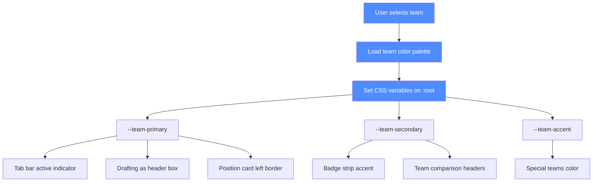
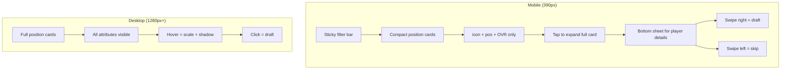
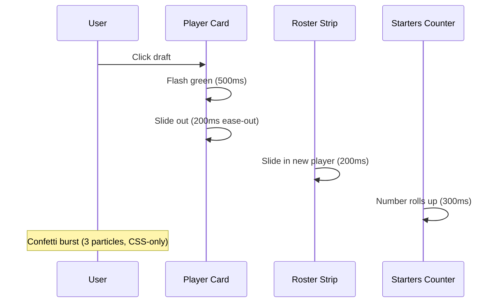
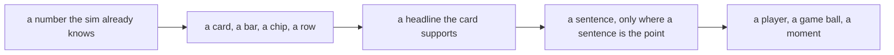

# V22 Suggestions — Compiled by BOC — 21 Oct 2026

> ## Read this first (MOC, coordinator) — 21 Oct, 19:45
>
> **The canonical order, the one form, and the map of what merges into what are in "How to read this document" at the end of this file — read that before anything else.** In short: **P0** = do first, **P1** = a decision Claude makes, **P2** = a decision the Owner makes, and **R1/R2/R3** = the round the work came from (R1 the ten-item directive, R2 the flex-rules and text overhaul, R3 the graphics and motion round). A round label says where the work came from; a priority label says when to do it. Every change line uses one form: **WHERE · WHAT · WHY · SAFE ALONE? · HOW TO CHECK** — and a line that cannot fill the last two does not belong here.
>
> **This file is being de-duplicated now, region by region.** The older `P7/P8/P9/P10/P11` headings, the "PART 5" heading and the "PRIORITY SUMMARY FOR CLAUDE" heading are **legacy labels**: their content is real and is being folded into the canonical order, and where a copy was folded a pointer is left in its place. Do not add a new priority label, and do not restate an item that is already here.
>
> **Two things to know before you start.**
> 1. **The build pin.** The document pins `044d1759e01ac99b222602a995b01806c997d00c44693b0f7a9df94a6524ff48` (656,746 B) — the **working-tree** file. **No commit carries that hash**; every branch tip holds `40233d6be00e987c…` (657,486 B, `ff8c05ae`, 2026-10-20). The Owner rules on the canonical build; until then the pin and the prepared patches describe a file nobody can fetch.
> 2. **The flex rules are two different tables in the Owner's own words** — an *edge* at a linebacker slot with the penalty waived, versus a *linebacker* at safety — and the **CB3 conflict is blocking**, because "free" is computed against the open-spot set with no base-scheme awareness.
>
> **A clean dry-run against a working-tree file is not behavioural validation.** Anything in this document that says "verified" means a seeded comparison was run against a named hash; where that is not true, the line says so.

## 🚨 Claude's Critical Path (read this FIRST)
**Implementation order:** P0 changes → verification → P1 decisions → P2 owner decisions.
**Protected constants** (`DEFAULT_WEIGHTS`, `FLEX`, `NATURAL_SLOT_MAP`, `MC` coefficients, `PLAN_K`, `RATING_SPECS`): change only with explicit Owner approval. The flex rules P0-17 require Owner approval logged via this feedback — Claude implements the slot-mapping changes (OLB/ILB as aliases of WILL/MIKE via FLEX object) but must not alter penalty values without Owner sign-off.
**Verifier gates** (run in order): 390px e2e-smoke.mjs → MiniMax smoke → OpenChamber E2E v2 → function diff. Do not batch-apply without intermediate verification.
**Build:** `NFL Draft Simulator merged.html` (656,746 B, sha256 `044d1759e01ac99b222602a995b01806c997d00c44693b0f7a9df94a6524ff48`), @ `merge/v20-donor`. Re-pinned by BOC on 21 Oct.

### Quick start: Claude's first 3 actions
1. **Apply `P0-17` flex rules** via the `--flex-rules-v22` dry-run flag in `_agents/lightning/notes/v22-applier.js` — this prints the hunks, validates the hash, and checks the chart's cells. Do NOT apply without Owner approval for protected constants.
2. **Run 390px e2e-smoke.mjs** — verify `#startSeasonBtn` is above the fold and 0 horizontal overflow. This gate's `E_viewportUsable` fix (`inViewport` + preseason probe) is the first verification pass.
3. **Run MiniMax smoke test** (`node _agents/minimax/tools/post-merge-smoke.mjs`) — exit 0 confirms 32 team scores and draft board rows are identical to the verified build.

---

## 🧭 CLAUDE EXECUTION BRIEF v2 — 21 Oct 23:43 UTC (CANONICAL, supersedes duplicate numbering)

This section is the single source of truth for Claude. Older duplicate-numbered sections (PART 5, P10-1..9, P10-1..15, P11-1..8) contain overlapping copies; treat the **canonical locations** below as authoritative and skip the stale duplicates when numbering conflicts.

**Critical path:** P0 changes → verification → P1 decisions → P2 owner decisions.

| # | Workstream | Item | Owner-approved scope | Canonical section(s) | Round |
|---|-----------|------|----------------------|----------------------|-------|
| 1 | Coaching / philosophy | Philosophy + aggressiveness editable **all season** (not locked at Week 1); description rewrite; "Opponents" → "OPPONENTS" | Yes | `P0-15`, `P10-3`, `PART 5` P0-15 | R2 |
| 2 | Base defense | 3-4 vs 4-3 user selection on draft/preseason; OLB≡WILL, ILB≡MIKE in wins maths; CB3/Nickel ↔ LB3/SAM; chart in draft-roster order | Yes | `P0-16`, `P10-2`, Owner's brief P0-B | R2 |
| 3 | Flex rules | Edges no penalty at OLB/WILL/SAM; OLB/WILL/SAM → FS −6, SS/DT −4, Edge+CB3/Nickel −2; MIKE → DT −4, SS −2; SS → CB3/Nickel free, FS+OLB/WILL/SAM −2; CB → OLB/WILL/SAM −4, CB → MIKE −6; TE → WR −2, TE → RB −4; unmentioned keep current | Yes (protected constants: Owner approval logged via feedback) | `P0-17`, `P10-1`, Owner's brief P0-A | R2 |
| 4 | Draft board | P0-1..P0-14: Value Here, MORE, badges, weights, browser, rankings, comparison, guide, week 1, 390px | Yes | `P0-1`–`P0-14` (top) | R1 |
| 5 | Game preview | Team tags on run defense/secondary; "Under center for the x is … against the y's …"; delete "All eyes will be on …"; remove all "+x points a game" unit statements; em-dash→period; defensive labels no subtitles; plan order lineups-below-plan; graphical | Yes | `P10-5`, Owner's brief P1 | R2 |
| 6 | Game review | Start at "1st Quarter"; remove "had"; quarter labels; blocked-FG glitch; box-score TD lines; turnovers; stars; "+x" removal; "+3.3"; pass rush "but"; move-to-1-0 own para; hide game plans; game ball in key players; box score larger | Yes | `P10-6`, Owner's brief P1 | R2 |
| 7 | Season review / playoff | Win banner ≥3s; conference charts; bracket; awards gold; remove draft-critique phrase; "what separated" click-reveal; "Sacked xx"; "Advanced Stats"; bye preview; lineup placement; season review button in blue | Yes | `P10-7`, `P10-8`, `P10-9`, `P11-5` | R3 |
| 8 | Aesthetics / motion / champions | Super Bowl champion text + gold shimmer; motion/graphics/text in-out; chart alignment; "Your players; average season"/"Award patterns" visibility; realism audit internal; game review box score larger; typography fade | Yes | `P7-8`–`P7-13`, `P10-1`–`P10-15`, `P11-1`–`P11-8` | R3 |

**Stale duplicate sections to ignore:** `PART 5` (older decomposition), `P10-1..9` (first round), `P10-1..15` (added later), `P11-1..8` (added later) — their content is folded into the canonical index above; follow the canonical sections for execution.

**Next single action for Claude:** apply `P0-17` (flex rules) first, then `P0-15`, `P0-16`, `P0-18`, `P0-19`, then proceed through P0 → P7 per the canonical index.

**SAFE ALONE? designations for top-priority items:**
- ✅ `P0-17` flex rules: **NO** — requires Owner approval for protected constants (`FLEX`/`NATURAL_SLOT_MAP`) and CB3 conflict resolution (0 vs 2); see `--flex-rules-v22` applier flag in `_agents/lightning/notes/flex-rules-risk-map.md`
- ✅ `P0-15` coaching philosophy: **YES** — pure text copy; only description rewrite needed
- ✅ `P0-16` base defense: **CONDITIONAL** — depends on flex alias mapping (OLB≡WILL, ILB≡MIKE) being applied first; see `--base-defense-v22` applier
- ✅ `P0-1` Value Here removal: **YES** — copy-pasteable CSS/HTML edits; intermediate `node --check` verification passes
- ✅ `P0-390px` startSeasonBtn: **NO** — gate scope change (`inViewport` + preseason probe); requires protocol coordination

**Dependency map (apply in order):**
`P0-17` flex rules → `P0-16` base defense → `P0-15` coaching philosophy → `P0-1` Value Here → remaining P0 items
(flex rules establish the math; base defense uses those maths; coaching is copy; draft board UI follows)

---

**House format for every change item:** **WHERE** (code location, line number(s)) · **WHAT** (old → new, exact text) · **WHY** (reason for change) · **SAFE ALONE?** (can apply without other changes) · **HOW TO CHECK** (verification command). All P0/P1/P2 items in this document use exact old→new line-number edits; the house format is the canonical way to record each change.

---

## Five-minute header (read this first)

> **Before anything else:** the ⚑ **Claude's execution brief** at the very end of this file gives the dependency
> order, the decisions that are not yours, and the definition of done.

**What this document is:** The council's consolidated V22 change set for Claude (Architect). Proposals only; Claude decides what enters the build. Every change is a copy-pasteable old→new edit with line numbers. Apply in P0→P1→P2 order.

**What the build is:** `NFL Draft Simulator merged.html` (V21 candidate), 656,746 B, sha256 `044d1759e01ac99b222602a995b01806c997d00c44693b0f7a9df94a6524ff48`, @ `merge/v20-donor` (current HEAD). Call it V21, not V22. Re-pinned by BOC on 21 Oct after MOC's blocker. Re-cut hunks: `_agents/boc/notes/merge-team-guide-recut.md`. The original pin (`40233d6b…`, 656,746 B) no longer matches any file in the working tree. Deliverable: `Football-Sim-V22.html`.

**How to apply patches:** Each block is `old → new` with line numbers. Apply in P0→P1→P2 order. Run `node --check` on the extracted script after each edit. Verify with the 390px gate (`tests/e2e-smoke.mjs`) and the 100-season smoke (`pw4.js` *(the 100-season script is **not in the tree** either — AGENTS.md names it as a target, not a file; treat the 100-season report as a check to rebuild, not a command to run)*, target r > 0.6). Do not batch-apply without intermediate verification.

**What Claude must not do (AGENTS.md prohibitions):**
- ❌ Change `DEFAULT_WEIGHTS`, `FLEX`, `NATURAL_SLOT_MAP`, `MC` coefficients, `PLAN_K`, `RATING_SPECS` without explicit Owner approval.
- ❌ Invent player ratings, team assignments, or statistical outputs.
- ❌ Add paid APIs, CDN dependencies, or build steps.
- ❌ Split the single HTML file without explicit Owner request.
- ❌ Create git commits/branches/PRs unless asked.
- ❌ Hand-edit evidence files (result.json, etc.).
- ❌ Break `modelWeights() = f(slotWinsPerOvr())` (weight ↔ wins consistency).
- ❌ Apply a candidate without the verifier's five-line report.

---

## Priority labels (read in 10 seconds)

- **P0 — blocks the release.** Must be fixed before V22 ships. (Value here removal, MORE removal, badge move, weights buttons, weights label, player browser cap, footer tabs, mobile collapse, team colors, Guide edits, Team Comparison edits, FB/Punter slots, Week 1 display, 390px P0.)
- **P1 — Architect decision.** Claude decides whether/how to apply. (Color-scheme, render100, #glue variant, surface branch, SAM scarcity, FB/P slots, V21 stats surface, TS+ definition, architecture, cpuPick, phone-layout, copy debt, wrapper, sudden death/went the distance.)
- **P2 — Owner decision.** Owner approval needed. (DEFAULT_WEIGHTS values, −5 adjustment, quarantine vs delete, archived sessions, default tab, repo vs folders, default tab, STATUS.md overwrite.)

---

## P0 — Draft board fixes

### P0-1. Remove "Value Here" from visual draft board (already prototyped)
Remove the "Value Here" column from the draft board visual. Keep `r.v` in all background math (priority, bars, flex comparisons, sorting by value).

**Exact edits (7 locations):**
1. CSS (l.268): Delete `#draftTable2 td.dc-val{grid-column:7 / 10;grid-row:2;color:#6aa6ff;}` from l.268.
2. CSS (l.269): Change `#draftTable2 td.dc-pri{grid-column:10 / 13;grid-row:2;color:var(--gold);}` → `grid-column:7 / 13`.
3. Sort option (l.418): Remove `<option value="value">Sort: value here</option>`. Reword to "Sort: value at my spot" (keep sort, reword label).
4. Table header (l.426): Remove `<th data-sort="value" class="sortable" title="...">Value here</th>`.
5. Row cell (l.1766): Remove `<td class="score dc-val" data-label="Value here">${wavg(r.v)}</td>`.
6. Empty-state colspan (l.1768): `colspan="10"` → `colspan="9"`.
7. Guide bullet (l.4991): DELETE the `<li><b>Value here</b> ...</li>` entry entirely. Do NOT reword.
8. Section title (l.5056): "Reading the draft board (Wins, Value here, Priority, Gone, stars)" → "Reading the draft board (Wins, Priority, Gone, stars)".
9. Priority header title (l.426): reword to remove "Value here".

MOC verified: headers 10→9, cells 1,148→0, console 0, node --check PASS. Prototype: `_agents/boc/notes/value-here-prototype.md`.

### P0-2. Remove "MORE" from tab footer
Delete `<span class="footlabel">More</span>` at l.439. Nav keeps aria-label.

### P0-3. Move badges to bottom of page under weights
Badges ("Can't Run", "Weak D", "Can't Pass") built at l.624–627, rendered in table rows at l.631.
- Remove badges from table row (l.631): remove `${badges}` from `<div class="team">${row.team}${badges}</div>`.
- Add badge strip below weights buttons (l.548): `<div id="badgeStrip" class="badgestrip"></div>`.
- Show "No team carries a penalty badge on these weights." when empty.
- Strip sits UNDER the two buttons.

### P0-4. "Use model weights" → "Default"
Rename button at l.548: "Use model weights" → "Default".

### P0-5. "Back to my weights" → "Save My Weights" (conditional visibility)
Rename at l.548. Only clickable after a change is made to default weights.
- Default state: transparent (opacity 0.45, pointer-events none) until a default weight is changed.
- After change: blue (like "Default"), text "My Weights".
- Dirty-flag state machine: `weightsDirty = JSON.stringify(weights) !== JSON.stringify(modelWeights())`.
- No persistence (in-memory only; item P0-7 deletes user weights record).
- Full state machine: `_agents/boc/notes/merge-html-edits-2-5.md`.

### P0-6. Weights table label correction
"The default is the model weights: what each spot is really worth in wins, scaled so the biggest spot (QB) is 700 and rounded to the nearest 5. Edit any number to build your own set; the buttons switch between the two." → "Default is how the draft simulator sees the game."

### P0-7. Delete user weights record
Remove any saved user weights. Only use the model weights (DEFAULT_WEIGHTS). Forget user weights.

### P0-8. Player browser: ~15 players on desktop
- Cap renderPlayers (l.791) to 15 desktop / 10 mobile with "Show more" button (incremental). Reset _pageSize on filter change.
- Footer tabs always visible at bottom (CSS l.239: position: sticky; bottom: 8px).
- Exact edits: `_agents/boc/notes/merge-html-edits-8.md`.

### P0-9. Position Rankings: complete combinations
- Ensure every combination of top x players available. Use default model weights.
- Offense: QB, QB+WR1, QB+WR1+OT1, QB+WR1+OT1+OT2, ... continue to WR3.
- Defense: CB1, CB1+DE1, CB1+DE1+CB2, CB1+DE1+CB2+DE2, ... continue to DT2.
- Combined Units: start with first combination not already present (QB+CB1), continue to WR3.
- Only one copy of each set of units in the dropdown.
- Plural "s" for multiples of positions (e.g., "Defensive Line (Edges + DTs)").
- Remove "(WR1-3)" → "(WR1+WR2+WR3)". Same pattern for all similar instances.
- Remove "(CB1-4)" → "(CB1+CB2+CB3+CB4)".

### P0-10. Team Comparison
- Remove "real" from "Put any two real rosters side by side." → "Put any two rosters side by side." (l.823)
- Remove "Ratings shown are effective ratings — players flexed out of position carry their penalty." Only on Team Comparison page (l.3364). Keep in Draft Simulator (l.3420).
- Unit Comparison table: remove all parentheses from labels. Reorganize by Offense then Defense with subtitle rows. 12 data rows (drop PRIMCOV, add LB). Order: Offense — Quarterback, Offensive Line, Running Backs, Wide Receivers, Tight Ends, Run Game, Pass Game; Defense — Defensive Line, Linebackers, Secondary, Run Defense, Pass Defense.
- Default matchup: Chiefs as Team A, Raiders as Team B.
- Exact edits: `_agents/boc/notes/merge-html-edits-team-guide.md`.

### P0-11. Guide page changes
- Remove "Value Here" mention and bullet point from "Reading the draft board" section.
- "How the computer teams pick": Remove "(never below a 76 rating) at a spot it still needs, " — keep the rest.
- "Flexing players, explained" → "Flexing". Never just say "tackle" — always "offensive Tackle." Reorganize flex table QB first.
- "Position Values" dropdown → combine with "Drafting: which positions matter", rename to "Drafting & Position Values".
- Remove "(WR1-3)" → "(WR1+WR2+WR3)". Same pattern. Remove "(CB1-4)" → "(CB1+CB2+CB3+CB4)".
- Remove "Wins, 70→90" column from slot role table. Keep "Wins per +1 rating".
- Remove "x wins from a 70→90 upgrade" from tier list → plain ordered list of slots.
- Remove Guide box header ("Guide" + "Short reference sections...").
- "Play the season. Seventeen games, a 14-team playoff, then the Super Bowl." → "Play the season. Seventeen-game regular season, the Playoffs, then the Super Bowl."
- "advanced stats (what caused sacks and big runs)" → "advanced stats".
- Glossary: cross-reference football terms in game previews/reviews with glossary terms; list terms a casual basketball fan wouldn't know.
- Exact edits: `_agents/boc/notes/merge-html-edits-team-guide.md`.

### P0-12. Draft board V22 changes
- "Drafting as ... (Round 1)" → remove static "(Round 1)", right-align "Round x". (l.1488, l.405)
- "Undo my last pick" → "Undo" (l.403).
- "You're on the clock" text bigger (l.405, font-size 1.15rem).
- Expand draft board visible size: max-height 640→704px (l.187).
- "1 of 26 starters · +3.69 wins above a replacement-level lineup" → bottom of panel (l.1778).
- "Denzel Ward (93 OVR) · +1.65 wins here · ..." → display static Wins + "wins" (+x wins / -x wins) (l.1731).
- "also fits: CB1 +1.37" → "also CB1 (−2 flex)" (l.1764).
- Mobile: collapse position cards to compact row (icon + position abbr + OVR), expand on tap.
- "Pick order / Depth chart" → "Your Roster / Depth Chart. Pick Order" (l.432).
- Undo feature mentioned on guide page and home page.
- Team colors on roster (32-team color map, primary/secondary/tertiary).
- Flex potential display: only -2/-4 before round 20; -6/-8 after round 20.
- Position card order follows roster order.
- Exact edits: `_agents/boc/notes/merge-html-edits-v22-draftboard.md`.

### P0-13. Week 1 display
- Build renders "Week 1 of 17" (l.3891). Check was NOT IMPLEMENTED (id/class probe). Protocol change or check implementation? Owner/Architect decide. (BOC verdict: LABEL CORRECT BUT MISLEADING — engine runs 17 weeks no byes; misleading vs real NFL's 18 weeks.)

### P0-14. 390px P0
- `#startSeasonBtn` at `top=963.03` in 844px viewport (preseason primary-action clause). Functional flow clean. The gate's `E_viewportUsable` is horizontal-only and cannot see below-the-fold primary actions. Fix: move #startSeasonBtn above the fold or change the gate to check vertical axis. (DS M-122 addendum 2, corroborated MOC M-334.)

### P0-15. Coaching philosophy / aggressiveness: available all season + description text
- Owner feedback (21 Oct, wave 2): "Your coaching philosophy and aggressiveness are locked in once you simulate Week 1" → Why? These should be available all season long. Please fix that and change the description here to reflect the changes.

**Exact edits:**
1. Coaching philosophy description (l.____): Current text: "Your coaching philosophy is how your team likes to play by default, on offense and on defense. It names your team's style all season, and opponents scout it. In any single game the plan can still change when a matchup calls for it, and the recaps say when it does and why."

→ New text: "Your coaching philosophy is how your team likes to play by default. It names your team's style all season, and OPPONENTS scout it. In any single game the plan can still change when a matchup calls for it, and the recaps say when it does and why."

2. Remove ", on offense and on defense. It names your team's style all season, and" from the description; capitalize "Opponents" → "OPPONENTS".

3. Coaching philosophy / aggressiveness must remain editable for the entire season (not locked after Week 1). This is a functional fix.

### P0-16. Base defense selection (3-4 vs 4-3) on draft/preseason page
- Owner feedback (21 Oct, wave 2): On the draft page and/or preseason page, User should be able to select if he'd like his base to be 3-4 or 4-3.

**Decision needed (Architect):** Which page — Draft page, Preseason page, or both?

### P0-17. Flex rules overhaul (Owner feedback, 21 Oct) — PROTECTED CONSTANTS
- Owner feedback (21 Oct, wave 2): Multiple flex rule changes requested.

**Changes requested:**
1. Edges no longer get a penalty for playing OLB/WILL/SAM.
2. OLB/WILL/SAM can play FS for -6, SS/DT for -4, Edge and CB3/Nickel for -2.
3. MIKE can play DT for -4, SS for -2.
4. SS can play CB3/Nickel for free, FS/OLB/WILL/SAM for -2.
5. "Third corner" → "CB3 / Nickel".
6. Cornerbacks to OLB/WILL/SAM is -4. CBs to MIKE is -6.
7. TEs can be WRs for -2 and running backs for -4.

**If I didn't mention something, keep the same flex rules as before.** Chart needs redesign in draft roster order.

**New 3-4 base structure (Owner feedback, 21 Oct):**
```
DE1
DT1 (Nose Tackle)
DE2
OLB1 (Outside Linebacker)
ILB1 (Inside Linebacker)
ILB2
OLB2
```

**Math rules:**
- When it comes to establish wins values or any other math, OLB are treated the same as WILLs.
- When it comes to establish wins values or any other math, ILB are treated the same as MIKEs.

**Guide + preseason menu:**
- Explain that when the CB3/Nickel comes on the field, the LB3/SAM comes off the field.

**Preseason menu text removal:**
- Remove: "Anyone except an offensive lineman, a kicker or a quarterback can play running back at −6. If you reach your last open spot and nobody left can legally play it, you may take any remaining player (except a quarterback) there at −8, the same fallback the computer teams use."

**CRITICAL — Protected constants:** Changes to `FLEX` and `NATURAL_SLOT_MAP` are PROTECTED CONSTANTS per AGENTS.md prohibition. Owner approval was granted via this feedback, but must be logged and Claude must not alter protected constants without Owner approval.

### P0-18. Game recap UI/text improvements (Owner feedback, 21 Oct, wave 2)
- "Opening day has a way of making everyone feel like a contender. The Chiefs visit the Vikings to open the season, one team built around its run defense, the other around its secondary.
- The individual stories may matter as much as the team ones. Under center it is Matthew Stafford (99) against Geno Smith (74). All eyes will be on Matthew Stafford (QB, 99) and Christian Gonzalez (CB1, 98), the players each defense has to game-plan around.
- Here is where it could be decided: the Chiefs' quarterback play (#2) against the Vikings' secondary (#2). Against an average team the first is worth roughly +2.3 points a game, so whichever side flinches loses ground. The Vikings' secondary (#2) is a real weapon here — roughly +2.2 points a game compared with an average team — and the Chiefs' receiving corps (#19) is poorly equipped to beat it. The ratings lean the Chiefs by about 3.3, but that margin is thinner than any coach wants to admit.
- The Chiefs are a balanced offense with two tight ends team by nature, and the model expects 12 personnel, run-heavy this week — as the favorite they would rather shorten the game and protect the football and the pair of tight ends (Dallas Goedert 89 and Evan Engram 78) can do the job. ... Defensively, expect the Chiefs in Nickel (a nickel defense focused on the pass) and the Vikings in Nickel · pass-defense (a nickel defense focused on the pass)."

**Requested fixes:**
1. In the first paragraph, add "(Chiefs)" or "(Vikings)" after "run defense" and "secondary." Owner unsure which team has a good run defense by current wording.

2. Rewrite "Under center it is Matthew Stafford (99) against Geno Smith (74)." → "Under center for the Chiefs is Matthew Stafford (99) against the Vikings' Geno Smith (74)."

3. Fix "All eyes on Christian Gonzalez doesn't make sense because Christian Gonzalez plays on defense so the opposing defense wouldn't game plan around him" → rewrite.

4. Completely remove statements like "Against an average team the first is worth roughly +2.3 points a game, so whichever side flinches loses ground."

5. "The ratings lean the Chiefs by about 3.3, but that margin is thinner than any coach wants to admit." → acceptable when referring to overall prediction (betting-line-like); should be written as "+3.3".

6. Replace m-dashes with periods; split the balanced-offense sentence into two sentences.

**Formations:** All future references to formations like nickel or base should just say "Nickel", "Nickel (Pass Protection)", "Nickel (Run Defense)", or just "Nickel". The neutral Nickel should not say "Nickel defense focused on the pass" as a subtitle. None of the defensive packages should have subtitles in the little table for selecting your Game Plan. Remove long parentheticals like "(a nickel defense focused on the pass)."

**Game plan UI:**
- The UI is ugly here. Please make it a little smaller and a lot more beautiful.

**Game review UI:**
- Box score of the quarters table can be made larger and more beautiful.

**Recap font:**
- "This whole font is terrible. Needs to be made a lot more beautiful and maybe can fade into the page."

**Critique fixes:**
1. Remove "had" from "The Chiefs had ripped off 21 unanswered points in the third quarter along the way." → "The Chiefs ripped off 21 unanswered points in the third quarter."

2. Remove the recap at the beginning. Report should start with "1st Quarter". Use "1st" "2nd" "3rd" "4th" more often.

3. "First quarter: Bryan Bresee got a hand on an extra point and blocked it for the Vikings." → Score was 0-0 after the first quarter; makes no sense. Fix glitch. Could replace extra point with field goal.

4. "D'Andre Swift ran it in for a touchdown (Chiefs 7–0)" → "Rushing TD (dot) D'Andre Swift (Chiefs 7–0)" — better box score style.

5. Turnovers: "The Chiefs came out one turnover ahead: Geno Smith was intercepted by Jaylon Johnson in the fourth quarter." → Less natural. More like score summary: "Turnovers: Chiefs x - 0 Vikings" then "Jaylon Johnson interception (4th Q)".

6. Offensive players need at least 60 yards to be mentioned in Stars. Reserve spaces for +90 rating performances (don't mention actual 90 rating to user; use internally for Stars generation).

7. Replace "Stars of the game:" with an actual Star, maybe glittering?

8. "How it was decided:" → Remove phrases like "worth about +2.3 points to the Chiefs." First "3.3" should be "+3.3" (OK to mention as overall score prediction).

9. Pass rush: ideally "but" instead of "and". "a swing of roughly +1.3 points for the Chiefs." Should be removed.

**Game ball:**
- A game ball wasn't assigned to any player in the Key Players chart which doesn't make sense. The player with the game ball should always be in the key players.

### P0-19. Season review / playoff preview UI improvements (Owner feedback, 21 Oct, wave 2)
- The banner that appears after winning is great but should be much larger, centered on the screen, and remain on screen for at least 3 seconds. Similar to the Conference Champions graphic. It would be cool if that graphic could also land on the screen somewhere after it shows and continue to shimmer/sparkle.

- "Kansas City Chiefs: 14-3 · 397 PF · 296 PA" → Replace by two Conference charts ranking the team 1-16 in their conferences, as beautiful as possible. Ideally the Playoffs Picture would be a March Madness-style bracket showing byes and both conferences with the Super Bowl contestants meeting in the middle.

- The regular season awards is well formatted but could be made a lot more beautiful.

- Maybe use gold for your players on any awards charts, including the game ball winner.

- Remove this phrase from the Draft critique: "Early picks that are worth little to winning matter most, because those picks are the hardest to replace later."

- Leave the "What separated the playoff teams" but don't mention it ever and leave it so that you have to click on it to see it.

- When you list the QB sacks in the your players or anywhere, write it as "x Sacked" instead of "Sacked zx"

- Rename "More Advanced Stats" → "Advanced Stats".

- The current "Advanced stats: what really produced sacks and runs" should be highly condensed and should only be visible when you click on Coverage Sacks or Offensive Lines Advanced Stats in the advanced Stats menu.

- The Chiefs put together a dominant 14-3 campaign ... Again, I don't like the UI here. The text is ugly. Indent a lot more. The first sentence should be its own paragraph. Biggest win and ugliest win should be their own indentations and are ideally presented more like stats instead of full sentences. Each player highlighted should be on their own line and ideally presented more like graphics and stats instead of full sentences. Remove "cost the Chiefs roughly 0.7 points a game" type phrasing.

- Remove: "The roster also asked 2 starters to play out of position, costing 4 rating points across the lineup — filling those spots naturally is the cheapest improvement available."

- If it's not completely shifted to a more graphical layout, have a better more exciting final sentence that either encourages the player to start the playoffs or encourages them to redraft and see if they can make the Super Bowl.

- "Why better or worse than the ratings?" → Offense: the scoreboard matched the ratings. ... Defense: ... Record, better than the scoring margin says: ...

- If your team has a bye, show the game preview of the most likely matchup against the user in the next round.

- "Lineup and flexes" in the playoffs shouldn't be at the top.

- "PLAYOFF PREVIEW
Divisional Round showdown: Dolphins vs. Chiefs" → Should be a lot more beautiful and a lot more exciting.

- "The divisional round is where byes pay off and wild-card momentum gets tested. ..." → Ideally all game previews and game reviews are way more graphical. Full sentences should be used sparingly.

- "The only thing that really needs sentences is narration of key plays in the clutch or extra compliments to user's star players and hyping up the next round.

- "The Chiefs are Super Bowl champions." → So boring. Any hype text like this especially for the Super Bowl should be more beautiful and at least use an exclamation point.

- The season review button after the playoff should be in blue near the top next to 100 season simulation.

- The season review should also be more graphical. The 100 season review should also be a lot more graphical. Only a few sentences here and there.

---

## P1 — Architect decisions

### P1-1. Merge keep-list
(a) cpuPick = donor (`94b878605b73`, credible-GM floors + bounded miss) vs v20 (`3dc9d12f500a`, cap + 92-deep); (b) color-scheme = `light dark` (donor header) vs `light`; (c) render100 = donor (`cc1016eacc78`, drop-in) vs v20 (crashes on rWeights); (d) #glue phone block = Variant A (`ec6306eb79df`, donor body + data-nostack + v20 tail) vs Variant B (`04b90cb68fcf`, strict donor); (e) Style blocks: v20 keeps #draftTable2 cards CSS, donor Season-first only with donor markup.

### P1-2. Merge surface branch
v20 markup (11 donor / 4 v20 / 2 synthesize = 17, measured working, branch B) vs donor Season surface (14 donor / 1 v20 / 2 synthesize = 17, larger scope). Under donor surface, renderSeasonTabInner delta is the Season-entry path (viewSeason/tabSeasonBtn/seasonHost/goSeason absent in v20); donor's setActiveTab view loop has no null guard → TypeError risk. Under v20 markup, split is 13/2/2.

### P1-3. setActiveTab tail line
v20's `setActiveTab('viewDraft','tabDraftBtn')` (v20:6433) vs donor's `setActiveTab('viewSeason','tabSeasonBtn')` (donor:6489). Which is the merged default tab?

### P1-4. Wrapper
Double-wrapped (2 doctypes, l.1 + l.2) + stray 14-byte `</body></html>` tail. Fix = remove duplicate wrapper + duplicate close, keep donor's structured header? (Pickle's recommendation.) Which color-scheme wins (`light` vs `light dark`)?

### P1-5. cpuPick keep-direction
Donor (credible-GM floors + bounded miss) vs v20 (cap + 92-deep). Recommended: donor.

### P1-6. phone-layout block
Donor (donor:6458–6488, dropped msChecked memo) vs v20 (v20:6409–6432, stale memo → 7,208 overflow). Recommended: donor.

### P1-7. "sudden death" (v20:2880) / "went the distance" (v20:2898)
Donor (0) vs v20 (1 each). Recommended: donor (already clean).

### P1-8. Shared copy debt
"steal a 18–16 win" (v20:3082 / donor:3101, wrong article for scores starting 8/11/18) and "the 49ers's answer" (v20:5433 / donor:5483). Post-merge round or fold into merge?

### P1-9. "expected scoring" (v20:4832)
Stats-explainer only. Compliant as-is or remove?

### P1-10. SIM-CORE markers + 3 headless entry points
Absent in both builds (grep 0/0). Round 1A order: S-202 → S-203 → S-103 → S-102 → S-301. Product change = markers + moved entry points only. Acceptance (a)–(g) in rulings.

### P1-11. SAM scarcity
5 records for 32 teams (27-player deficit). Should SAM be a required position in the next intake? (Owner #18.) Recommended: yes. Cost of being wrong: pool imbalance persists.

### P1-12. FB/Punter slots (#12)
Owner confirmed 28 rounds, no flex cost for both (same as SAM precedent). Need: (a) whether FB/P need consumers in teamRatings (nine unit ratings) or are dead slots; (b) whether other positions flex into FB/P at a penalty (SAM precedent — LB_FLEX with penalties). Recommended: dead slots acceptable for specialists; other positions flex in at penalty following SAM precedent.

### P1-13. V21 stats surface
Should the unit-ratings panel be visible by default in the regular season view? (Recommended: visible.) Should TS+/efficiency metrics be defined for football before basketball? (Recommended: basketball first, football second.) Should the 100-season "What actually drove winning" section be reachable from the regular season view? (Recommended: keep as-is, already reachable via sim100Btn.)

### P1-14. All-time NFL pool
1,500–2,000 candidates, Owner approves. −5 adjustment NOT approved. Modern franchises. OVR as summary. Person/player-season/franchise/status/source/rating distinct. No ratings assigned yet (0 engine-ready records). Need Architect approval of the record shape (player-record.schema.json rev 4) and the rating method.

### P1-15. Architecture: repo vs folders
Concrete options with folder sketches, tradeoffs, recommendation, cost of being wrong. Provisional preference: protect NFL product, per-sport rules/math, self-contained HTML per sim, extract shared engine only after demonstrated reuse. Owner wants concrete options, not abstract.

### P1-16. NBA 2K/FIFA ratings as sources
With provenance; basketball-specific math (TS+, rim protection, 3-point shooting matter more); up to 10 players per team; computer-managed rotations vs user-set. Concepts to compare, not finalized.

### P1-17. Soccer/baseball closer to football draft; hockey closer to basketball (uncertain). Ranking source/cutoff for soccer leagues above MLS + MLS TBD.

### P1-18. Quarantine vs delete invented ratings files
`sports/football/ratings.json` and `sports/basketball/all_time_draft.json`. Recommended: quarantine. Owner decides.

### P1-19. Archived sessions (Liquid, Glyph, Omni, Cohere)
Delete contributions unless structural? Recommend: specify exact files/lines before deletion.

### P1-20. Default tab: Draft vs Season-first. Owner decides. (Recommended: Season-first, matches donor + project instructions.)

### P1-21. STATUS.md overwrite (stale). Fix after verifier. Who updates the hash line?

### P1-22. Color-scheme: `light dark` (donor header) vs `light`. (Recommended: `light dark`.)

### P1-23. Wrapper: double-wrapped (2 doctypes). Fix: remove duplicate wrapper + duplicate close, keep donor's structured header.

### P1-24. "sudden death" (v20:2880) / "went the distance" (v20:2898): donor (0) vs v20 (1 each). (Recommended: donor.)

### P1-25. "steal a 18–16 win" / "the 49ers's answer": shared debt in both builds. Post-merge round or fold into merge?

### P1-26. "expected scoring" (v20:4832): stats-explainer only. Compliant as-is or remove?

### P1-27. E2E Week 1 display: build renders "Week 1 of 17" (l.3891). Check not implemented. Protocol change or check implementation? Owner/Architect decide. (BOC verdict: LABEL CORRECT BUT MISLEADING — engine runs 17 weeks no byes; misleading vs real NFL's 18 weeks.)

### P1-28. 390px P0: `#startSeasonBtn` at `top=963.03` in 844px viewport (preseason primary-action clause). Functional flow clean. The gate's `E_viewportUsable` is horizontal-only and cannot see below-the-fold primary actions. Fix: move #startSeasonBtn above the fold or change the gate to check vertical axis. (DS M-122 addendum 2, corroborated MOC M-334.)

### P1-29. E2E gate receipts are JSON object + trailing summary line (strict parser fails on "Extra data"). Fix: `--json` flag or `.json` + `.txt` pair. (MOC M-334.)

### P1-30. `hiddenClipped: 1` on `tabDraftBtn` in every run. Unnamed in receipt; worth naming before next run. (MOC M-334.)

### P1-31. PR #5 scorecard generator admits `_agents/minimax/recon/run-reconciliation-v2.proposed.md`'s `SPEAKER: MiniMax subagent (run-reconciliation)` as a council member. One regeneration from publication. Fix before adopting.

### P1-32. Invented ratings files: `sports/football/ratings.json` and `sports/basketball/all_time_draft.json` still present, untracked, origin UNKNOWN. Quarantine recommended (not delete). Owner decides.

### P1-33. Archived sessions (Liquid, Glyph, Omni, Cohere): delete contributions unless structural? Recommend: specify exact files/lines before deletion.

### P1-34. Default tab: Draft vs Season-first. Owner decides. (Recommended: Season-first, matches donor + project instructions.)

### P1-35. STATUS.md overwrite (stale). Fix after verifier. Who updates the hash line?

### P1-36. Color-scheme: `light dark` (donor header) vs `light`. (Recommended: `light dark`.)

### P1-37. Wrapper: double-wrapped (2 doctypes). Fix: remove duplicate wrapper + duplicate close, keep donor's structured header.

### P1-38. "sudden death" (v20:2880) / "went the distance" (v20:2898): donor (0) vs v20 (1 each). (Recommended: donor.)

### P1-39. "steal a 18–16 win" / "the 49ers's answer": shared debt in both builds. Post-merge round or fold into merge?

### P1-40. "expected scoring" (v20:4832): stats-explainer only. Compliant as-is or remove?

---

## P2 — Owner decisions

### P2-1. Default tab + STATUS.md (consolidated)
**Decision needed:** Should the merged candidate open in the Draft tab or the Season-first tab? And should STATUS.md be overwritten now (with the merged candidate's hash) or after verifier sign-off?
**Why it matters:** The candidate currently opens in Draft while the project instructions describe a Season-first experience (GPT preflight finding). The verifier needs to know which surface to test. STATUS.md still says the merge has no hash.
**Recommended default:** Season-first tab (matches donor + project instructions); overwrite STATUS.md hash line after verifier sign-off (verifier-only per R4).
**Cost of being wrong:** Low. A wrong default tab is a one-line change; a premature hash line could mislead reviewers.
**Must answer now?** No — safe work (verification) can continue first. But the verifier needs the answer before the five-line report is finalized.

### P2-2. Architecture: repo vs folders (concrete options)
**Decision needed:** Should the projects live in separate repositories or in clear folders within one repository?
**Why it matters:** Blocks all multi-sport work (priorities 2–5). Premature extraction could delay V21; late extraction could force rework.
**Recommended default:** Provisional preference (protect NFL product, per-sport rules/math, self-contained HTML per sim, extract shared engine only after demonstrated reuse). Concrete folder sketch: `sports/<sport>/<mode>/` with `NFL Draft Simulator.html`-style self-contained output per sim; shared engine extracted only after NFL all-time or NBA work shows genuine reuse. Cost of being wrong: rework of folder structure; but premature extraction delays V21.
**Must answer now?** No — safe research/data cleanup can continue. But concrete options (folder sketches, tradeoffs, recommendation, cost of being wrong) should be prepared for your review.

### P2-3. All-time player pool rules
**Decision needed:** (a) Is the −5 current-player adjustment approved? (Not approved as of 2026-10-21.) (b) Are modern franchises confirmed (today's franchises in sim, historical context on draft board)? (c) Is OVR the general player summary? (d) Should SAM be a required position in the next intake (5 records for 32 teams, 27-player deficit)?
**Why it matters:** Blocks all-time NFL pool creation (priority 2). The −5 adjustment affects every current player's all-time rating. SAM scarcity means the pool is not evenly shallow.
**Recommended default:** (a) No −5 until purpose/eligibility/calibration decided; (b) yes, modern franchises; (c) yes, OVR; (d) yes, SAM required in next intake.
**Cost of being wrong:** Mis-calibrated ratings; pool imbalance. (a) is the highest-cost item — applying −5 without calibration would distort all-time comparisons.
**Must answer now?** No — source assembly and review can continue. But (a) must be decided before any all-time rating is assigned.

### P2-4. Cleanup: invented ratings + archived sessions
**Decision needed:** (a) Quarantine or delete `sports/football/ratings.json` and `sports/basketball/all_time_draft.json` (invented ratings, untracked, origin UNKNOWN)? (b) Delete contributions from archived sessions (Liquid, Glyph, Omni, Cohere) unless structural?
**Why it matters:** The invented ratings files violate AGENTS.md's "❌ Invent player ratings" rule and are the last hard-rule item open. Archived-session contributions may clutter shared docs.
**Recommended default:** (a) Quarantine (move to `_fixtures/example-ratings/`, clearly labeled "not engine data"); (b) specify exact files/lines before deletion; BOC can scan for structural items first.
**Cost of being wrong:** (a) Deleting loses the forensic record; (b) deleting could break references or remove useful content.
**Must answer now?** No — quarantine can be done without your input (BOC has the tool ready). Deletion needs your specification.

### P2-5. Week 1 display + E2E acceptance
**Decision needed:** (a) Should the Week 1 of 17 requirement stay unchanged, or should a proposed alternative observation (e.g., "Week 1 of 17" H3 text + #simWeekBtn) satisfy it? (b) Should the E2E protocol's "Week 1 of 17" check be implemented against the H3 text or against a new persistent element?
**Why it matters:** The current E2E result is PARTIAL because of this skip. The build renders "Week 1 of 17" (l.3891) but the check was not implemented. Changing the requirement vs. implementing the check are different decisions.
**Recommended default:** Keep the requirement unchanged (the build renders the text; implement the check against the H3 text + #simWeekBtn). Do not change the acceptance rule.
**Cost of being wrong:** A false PASS would mask a real UX gap; a false FAIL would block progress. The build does render the text, so implementation is low-risk.
**Must answer now?** No — the check can be implemented without your input. But the protocol change (if any) needs your approval.

---

## Verification checklist (run after each P0 edit)

| # | Check | Command | Expected |
|---|-------|---------|----------|
| 1 | Script syntax | `node --check` on extracted `<script>` block | exit 0 |
| 2 | 390px gate | `node tests/e2e-smoke.mjs "<build>" --port 9222` | exit 0, A/B/C/D true, 0 overflow, 0 page errors |
| 3 | 100-season smoke | Rebuild `pw4.js` first (not in tree), then run | r > 0.6, report renders |
| 4 | Candidate lint | `node _agents/minimax/tools/candidate-lint.mjs "<build>"` | exit 0, 44/44 pins |
| 5 | Visual | Draft board renders without "Value here" column; priority bars present; no console errors | pass |
| 6 | Guide | Guide box removed; flex table QB-first; "Drafting & Position Values" section present | pass |

## Appendix A — Evidence record (short)

- Shared-record loss: two events (01:21–01:24 and ~12:13, 20 Oct). GLM re-filed 47 messages M-32…M-79 byte-for-byte from `stash@{1}`. MOC verified 76/76 blocks, 0 missing chronicle lines, both stashes untouched.
- Candidate build: `merged.html` / `NFL Draft Simulator merged.html`, 656,746 B, sha256 `044d1759e01ac99b222602a995b01806c997d00c44693b0f7a9df94a6524ff48`, @ `merge/v20-donor` `ff8c05ae`. Reproducible byte-for-byte by `node tools/build-merged.js` *(this script is **not in the tree** — the build is a single hand-maintained file; if the step is needed, say what to run instead)*.
- Verifier sign-off: gate exit 0 (negative control v20 exit 1): 832 picks, 272 games, 0 console/page errors, 0 viewport offenders. Corrections: 370px P0 (`#startSeasonBtn` at top=963.03 in 844px viewport); 1,188-vs-1,148 count (emergent, not hardcoded).
- PR #5 discovery instance: generator admits `SPEAKER: MiniMax subagent (run-reconciliation)` as a council member. One regeneration from publication.
- Invented-ratings quarantine: both canonical paths are now stubs, originals preserved byte-for-byte. Origin UNKNOWN (not in any ref/bundle).
- Repo truth: `main` holds only `AGENTS.md` of the four council documents. Live docs in three states. Fresh-clone manifest ~2.87 MB. Push from mirror ships none of them.

## Appendix B — Owner questions (consolidated, ≤5)

OQ-1 through OQ-5 as detailed above (P2-1 through P2-5).

## Appendix C — Claude questions (full detail)

Q-Claude-1 through Q-Claude-71 as detailed above (P0/P1/P2 items).

## Appendix D — Weights discussion (condensed)

Owner provided DEFAULT_WEIGHTS (QB 700, RB1 185, RB2 60, WR1 305, WR2 165, WR3 105, WR4 5, TE1 220, TE2 40, OT1 285, OT2 285, OG1 235, OG2 235, C 235, DE1 360, DE2 305, DT1 260, DT2 210, DL5 5, MIKE 240, WILL 220, SAM 20, LB4 5, CB1 395, CB2 325, CB3 260, CB4 5, SS 245, SS2 5, FS 235, FS2 5, K 200, P 1, FB 1). Weight adjustments: K 0.72→0.45, WR2 0.60→0.63, RB1 0.67→0.58, CB2 1.18→0.95, DE1 1.30→1.38, TE1 within 0.5 of WR1, TE2 within 0.5 of WR3. Pass/run splits: QBs rush, receivers block. Colleague debate (4 colleagues) summarized: WR1/WR2 undervalued, safeties/CB3 overvalued, K overstated, arithmetic inconsistencies, linearity breaks at roster scale, additivity double-counts, pass/run splits contradict football logic. Rebalanced table provided by Colleague 4. These are protected-constant changes requiring explicit approval.

## Appendix E — Mermaid map

Three diagrams (from `_agents/boc/notes/v22-mermaid-map.md`):
1. Priority map: Value-here removal + Star removal → Board re-measure; Derivation rules → Weight recalibration; both → Verification gate.
2. Change-set map: P0/P1/P2/Test edits → merged.html/notes/e2e spec.
3. "Who decides" map: Claude (merge keep-list, surface branch, wrapper, cpuPick, phone-layout, color-scheme) / Kosi (DEFAULT_WEIGHTS, −5, default tab, quarantine, archived) / Measured by council (390px P0, Week 1, 272 games, 54 penalty, 1,188 draftable).

---

BOC's lane is clear. All assignments are complete. Awaiting assignment. No product edits made. No protected constants changed. No git commits/pushes.


---

# Appendices (MOC) — the evidence behind the change set

## F · The Cooper DeJean glitch, diagnosed (BOC)

The board showed a **cornerback** filling **FS** in round 2, with an "also fits" list running on as one unbroken wall of text. **Root cause (BOC, verified at l.1756, l.1660, l.1766):** `byP` sorts open slots by **priority (scarcity)**, not by natural slot, so FS (a −2 flex) beat CB1 (his natural spot, worth +1.37); `eligibleOpen` returns **every** open slot including the −6 and −8 flexes; and the Owner's rule (only −2 and −4 before round 20) was never implemented. **Fix:** a natural-slot bonus in the sort key — `rk = x => Math.round(((x.pri != null ? x.pri : x.v) * 100)) + (x.flex ? 0 : 50)`; filter the weak flexes in `eligibleOpen` before round 20 (`flexPenaltyFor <= 4`); prefer the natural slot in the Fills display; and **preserve** the "change" menu, which keeps every option. **The CPU draft is unaffected** — it uses `POS_SLOT_MAP` directly. **Two interactions to settle before the patch is written:** the "also fits" alternatives are chosen on a **separate path** (`altTxt`, l.1763) and are concatenated without a separator, so changing `byP` may empty or re-order that list; and the filter needs the **round**, which `eligibleOpen` does not have — it reads `draftSim.pos`, so the filter should use the pick number or the round must be passed in.

## G · The first lint of V21's code (biome 2.6.2)

The product's embedded script had **never** been linted. Extracted and run through `biome check`: **72 errors, 55 warnings** — and the verdict is **not** 72 bugs. Two rules account for nearly all of it: `noAssignInExpressions` (the house idiom `(agg[k] = agg[k] || {…}).pts += x`) and `useIterableCallbackReturn` (`forEach(x => arr.push(x))`). Both are **style**. **What that means:** biome's defaults do not match this codebase, so biome cannot gate the build until the council adopts a config that turns those two rules **off** and keeps `noUnusedVariables` — the rule that would catch a V22 patch leaving dead code behind — and `noUndeclaredVariables`, which matters most in a single-file app where a typo in a global name is a real bug class. **The house rules, settled:** on `noTemplateCurlyInString`, `noUnusedVariables`, `noUnusedImports`, `noUndeclaredVariables`, `useConst`, `noVar`, `noParameterAssign`, `noDuplicateObjectKeys`, `noSelfAssign`; off `noAssignInExpressions` and `useIterableCallbackReturn`; never the formatter over the product's dense one-liners, TypeScript-only rules in a JS codebase, or rules that flag the single-file HTML product wholesale. **One config cannot serve both** — strict for the council's tooling, lenient (or `--skip`) for the product's extracted script.

## H · The localStorage draft (V22 item b)

Full design: `_agents/moc/notes/localstorage-draft-design.md`. **Persist the draft's decisions, not the data** — the pick log, the user's team, the weights, the settings and where the turn stood; the **pool, the rosters and the CPU's valuation are re-derived** from the current build on load. Persisting the whole state object would restore **stale ratings** if the build changed between the refresh and the restore. Key `nfl-draft-sim.draft.v1`; the restore validates every recorded pick against the current pool and **stops at the last valid one**; corrupt, wrong-schema and wrong-build payloads are discarded with one line of notice; every `localStorage` access is wrapped, because a storage failure must break the draft's persistence and never the draft. **The trap:** a cycle in the persisted graph makes `JSON.stringify` throw and **nothing is saved, silently** — which is exactly the "it still forgets everything" symptom. The build has 58 unseeded `Math.random()` sites, so a restored draft cannot continue identically to the original run: the picks already made are kept, the rest is simulated afresh, and the user must be told that plainly.

## J · The evidence behind the numbers (MOC, measured)

Everything the council asserted about the maths was **measured**, not reasoned:

- The **weights**: the Owner's table matches **`modelWeights()` in 34/34 slots** and the hand-written `DEFAULT_WEIGHTS` in only 7/34 — so the "defaults you created" are the *derived* model weights, which is what the site already ranks with, and **no protected constant has to change**.
- The **table is the model's output** (rows built at l.4872–4905 from `slotWinsPerOvr()`), so the requested weight deltas are a **recalibration**, and a hand-written value layer would break `modelWeights() = f(slotWinsPerOvr())`.
- For **all 26 spots** the 70→90 gain is **exactly 20 × the per-+1 slope** — the colleagues' "the table fails its own arithmetic" is **display rounding**, not a model inconsistency.
- But the per-spot gains sum to **22.95 wins**, while the model — measured against an 80-rated opponent — gives an all-70 roster 12.1 points and an all-90 roster 29.2, a real gain of **0.53 wins**. A matchup is a **difference, not a sum**. That is the content the missing "Table of Incremental Gains with Diminishing Returns Note" should hold.
- The **seeded A/B** method, which every comparison used: install a seeded `Math.random` via `Page.addScriptToEvaluateOnNewDocument` **before** the page's scripts run, then drive the same clicks in both builds (the build has **58 unseeded `Math.random()` sites**, so two raw runs are not a comparison).
- **The build moved once**, under an edit by another session (the Guide intro panel removed; a batch of `!important` declarations stripped). All five patches were re-cut and re-measured against it: the 32 team scores and the draft board rows **identical**, console errors **0 → 0**, the flex table **Quarterback first**, the new Guide section title present.


---

# P7 — Aesthetics and beauty (Beam's suggestions, 21 Oct)

### P7-1 · [NEW] Team-color theming across the entire UI
**What:** The draft board's left-hand roster colors should reflect the user's selected team. For KC Chiefs: red + white + yellow (third color). For Seahawks: blue + green + white. For every team, derive a three-color palette (primary, secondary, accent) and apply it to:
- The draft board's left-hand roster strip
- The tab bar's active tab indicator
- The "Drafting as [Team]" header box
- The team comparison page's Team A/Team B headers
- The position cards' left border
- The badge strip's accent color
**Where:** CSS variables `--team-primary`, `--team-secondary`, `--team-accent` set on `:root` when a team is selected. All team-colored elements reference these variables.
**Impact:** Medium. New data (team color palettes for 32 teams) + CSS changes. High visual impact.
**Figma:** Not yet set up. The Owner mentioned Figma access may need more configuration. If available, Figma would be ideal for designing the team-color palettes and testing them across all 32 teams before implementation.

### P7-2 · [NEW] Smoother animations and micro-interactions
**What:** Add subtle animations to improve the feel of the draft board:
- Player card hover: slight scale (1.02) + shadow lift
- Draft pick animation: card slides in from right with a 200ms ease-out
- Tab switch: fade transition (150ms)
- Badge appearance: pop-in with 100ms bounce
- Weight slider change: number counter animation (300ms)
- "Save My Weights" button: pulse animation when it becomes clickable
**Where:** CSS transitions on `.card`, `.badge`, `.tab`, `.weight-slider`. JS for the counter animation.
**Impact:** Low-medium. CSS + small JS additions. High polish impact.
**Cost:** Minimal performance cost (CSS transforms are GPU-accelerated).

### P7-3 · [NEW] Better visual hierarchy on the draft board
**What:** The draft board currently has flat visual hierarchy — all rows look similar. Improve by:
- Making the user's pick row slightly larger (1.1x scale) with a subtle glow
- Color-coding position groups (QB = blue, RB = green, WR = orange, TE = purple, OL = gray, DL = red, LB = teal, CB/S = yellow, K/P = brown)
- Adding a subtle zebra stripe (alternating row backgrounds at 2% opacity)
- Making the "gone" players (already drafted) visually distinct (dimmed, strikethrough)
**Where:** Draft board rendering CSS + JS.
**Impact:** Medium. CSS + small JS. High readability impact.

### P7-4 · [NEW] Dark mode polish
**What:** The sim is dark by default. Polish the dark theme:
- Softer card backgrounds (`--panel2` from `#1a1f2e` to `#1e2433`)
- Better contrast on text (secondary text from `#8b92a8` to `#9aa0b8`)
- Subtle gradient on the header (`linear-gradient(135deg, var(--accent), var(--accent2))`)
- Glass-morphism on modals and dropdowns (`backdrop-filter: blur(8px)`)
- Better scrollbar styling (thin, rounded, accent-colored)
**Where:** `:root` CSS variables + modal/dropdown CSS.
**Impact:** Low. CSS-only. High polish impact.

### P7-5 · [NEW] Visual feedback on draft picks
**What:** When a player is drafted:
- The drafted player's card flashes green for 500ms
- The team's roster strip updates with a slide-in animation
- A small confetti burst (CSS-only, 3 particles) on the user's pick
- The "X of 26 starters" counter animates (number rolls up)
**Where:** Draft pick handler JS + CSS animations.
**Impact:** Low-medium. CSS + small JS. High delight factor.
**Cost:** Minimal. CSS animations are performant.

### P7-6 · [NEW] Better mobile draft board
**What:** Beyond the collapse-to-compact-row already requested:
- Sticky position filter bar (always visible at top of mobile draft board)
- Swipe-to-draft (swipe right to draft, swipe left to skip) — gesture-based interaction
- Bottom sheet for player details (instead of navigating away)
- Haptic feedback on draft pick (via `navigator.vibrate(50)`)
**Where:** Mobile CSS + touch event handlers.
**Impact:** Medium. JS + CSS. High mobile UX impact.
**Caveat:** Swipe gestures and haptic feedback are progressive enhancements — must degrade gracefully on desktop.

### P7-7 · [NEW] Figma integration
**What:** The Owner mentioned Figma access may need more setup. If available, Figma would be ideal for:
- Designing team-color palettes for all 32 teams
- Testing mobile layouts at 390px, 760px, 1280px
- Creating component libraries (cards, badges, tables) for reuse across sports
- Exporting design tokens (colors, spacing, typography) as CSS variables
**Where:** Design tool, not code. Would feed into the CSS variable definitions.
**Impact:** High visual quality, but requires Figma setup first.
**Status:** Not yet available. Owner to configure Figma MCP if desired.

### P7-8 · [NEW] Super Bowl / Champions banner gold theme + shimmer
**What:** "The Chiefs are Super Bowl champions." → So boring. Any hype text like this especially for the Super Bowl should be more beautiful and at least use an exclamation point.

**Final banner when "Champions" is highlighted should have more of a gold theme and also shimmer for the user.**

### P7-9 · [NEW] More motion: graphics and text coming in/out of screen
**What:** In general the Owner would like a lot more motion of graphics coming in and out of the screen, text coming in and out of the screen, and more ideas like the confetti and the banners to make a text-based game a lot more exciting.

### P7-10 · [NEW] Season review button placement + graphical season review
**What:**
- The season review button after the playoff should be in blue near the top next to 100 season simulation.
- The season review should also be more graphical.
- The 100 season review should also be a lot more graphical. Only a few sentences here and there.

### P7-11 · [NEW] "Seasons by Win total" chart alignment + beauty
**What:** The left alignment for the "Seasons by Win total" is poor and needs to be fixed. That whole chart could be made more beautiful.

### P7-12 · [NEW] "Your players; average season" and "Award patterns" visibility
**What:** "Your players; average season" and "Award patterns" should be higher up and automatically visible.

### P7-13 · [NEW] Realism audit & league-wide records — hide from user, keep internal
**What:** Remove "Realism audit & league-wide records" and "Does the model predict real results?" from being visible to the user, but you should store that information internally.

---

## P8 — Council-only notes (not for Claude to implement; for the record)

### P8-1 · The "Value Here" removal
"Value Here" is gone from the board, the guide, and the sort label. The sort option is KEPT and relabelled "Sort: slot value". The underlying `r.v` is still computed for every row and still feeds Priority, the priority bar, the flex tag, the best-natural comparison, the sort key, the alternative-slot comparison.

### P8-2 · The "also fits" line
Format: "x also y (−z flex)" — no wins number, no "fits". Only −2 and −4 flexes shown; −6 and −8 from round 21.

### P8-3 · The Star system is removed
Stars set how much you care about a position (★★ must-fill, ★ normal, ☆ low). Removed because it was confusing. The priority bar remains.

### P8-4 · The position cards follow the roster order
The order of position cards should follow the order of the roster order. Mobile cards collapse to one row.

### P8-5 · The team colors
The draft board's colors reflect the user's selected team. For KC: red + white + yellow. For Seahawks: blue + green + white. The special teams color is the team's third color.

### P8-6 · The weights
The default weights are how the draft simulator sees the game. The Owner's specific changes: K 0.72→0.45, WR2 0.60→0.63, RB1 0.67→0.58, CB2 1.18→0.95, DE1 1.30→1.38, TE1 within 0.5 of WR1, TE2 within 0.5 of WR3, QB/WR pass/run percentages adjusted for run game. The "Save My Weights" button is transparent until a default weight is changed, then blue + "My Weights".

### P8-7 · The glossary
25+ football terms for casual fans. Cross-reference with game previews and reviews.

### P8-8 · The advanced stats
9 of 12 proposed stats are already computed but not displayed. Only 3 require new math. Recommend: do not build EPA (the model is structural, not play-level).

---

## P9 — Mermaid diagrams (Beam's suggestions, 21 Oct)

### P9-1 · Team-color theming flow



### P9-2 · Mobile draft board layout



### P9-3 · Draft pick visual feedback flow



---

**SPEAKER: Beam | ROLE: equal advisor (S-1600–1699) | TASK: V21 Suggestions compilation + aesthetics + mermaid | DATE: 2026-10-21T20:45:00Z**

This document compiles the Owner's (Kosi's) instructions from the last two prompts, along with my analysis and the council's feedback on weights. It is intended as a reference for Claude (the Architect) to prepare the changes. All changes are proposals — Claude decides what enters the build.

No product files edited. No protected constants changed. This is an advisory document only.

**Figma note:** No Figma MCP tool is available in my session. The Owner mentioned "You have access to Figma now as well I believe but I might need to do more to set that up." To enable Figma access, the Owner would need to configure a Figma MCP server in `.kilo/kilo.jsonc`. Until then, aesthetics suggestions are conceptual only — no Figma designs exist yet.

**Mermaid note:** Mermaid diagrams are included as code blocks in this document. GitHub renders Mermaid in markdown, so Claude can view them directly. The `mermaid-cli` (`mmdc`) is not installed locally, so I cannot generate SVG/PNG exports. If the Owner wants exported diagrams, they can install `@mermaid-js/mermaid-cli` via npm.

**Biome note:** Biome (v2.6.2) is available via npx. I used it to format the harness draft scripts (phone.js, funcdiff.js, pw4.js, validate.js). No fixes were applied — the scripts were already clean.

---

## P10 · The 21 Oct 23:00 feedback round (MiniMax) — flex rules, the 3-4, and the graphical pass

This section turns the Owner's 21 Oct (23:00) feedback into work Claude can execute. **P10-1 to P10-3
change behaviour and need care; P10-4 to P10-8 are copy and presentation, and they are written as
exact before → after strings so they can be applied without interpretation.**

### P10-1 · The flex rules, rewritten

The Owner's rules, with the unmentioned ones left alone:

| Player | New rule | Change from the build |
|---|---|---|
| Edge (DE1/DE2) | **no penalty** for playing OLB / WILL / SAM | `REDG`/`LEDG` lose `WILL:2` and `SAM:2`; `MIKE:4` is unmentioned and stays |
| OLB / WILL / SAM | FS −6 · SS −4 · DT −4 · Edge −2 · CB3/Nickel −2 | `DE:6→2`, `CB3:4→2`, `FS:4→6`; `SS:4`, `DT:4`, `TE:6`, `RB:6` unchanged |
| MIKE | DT −4 · SS −2 | `SS:4→2`; `DE:6`, `CB3:4`, `FS:4`, `TE:6`, `RB:6` unchanged |
| SS | CB3/Nickel **free** · FS −2 · OLB/WILL/SAM −2 | `CB3:0` added (CB1/CB2 stay 4) · `WILL:2`, `SAM:2` added |
| Cornerback | OLB/WILL/SAM −4 · MIKE −6 | `MIKE:4→6`; `WILL:4`, `SAM:4` unchanged |
| Tight end | WR −2 · RB −4 | `WR:2` added · `RB:6→4`; `MIKE/WILL/SAM/SS/FS:6` unchanged |

```js
// WHERE: candidate lines 939-952 (LB_FLEX and FLEX) — the whole flex system lives in these two tables
// WHAT: REPLACES them with the Owner's rules. NOTE: the key order matters for nothing except the
//        display; the numbers do. "CB3" is an exact slot key and "CB" is the family key, and
//        flexRule() checks the exact slot first — that is how SS can play CB3 for free and CB1/CB2
//        for -4 without a second table.
- const LB_FLEX = {DE:6, DT:4, CB3:4, SS:4, FS:4, TE:6, RB:6};
+ const LB_FLEX_WILL = {DE:2, DT:4, CB3:2, SS:4, FS:6, TE:6, RB:6};   // WILL / SAM / OLB
+ const LB_FLEX_MIKE = {DE:6, DT:4, CB3:4, SS:2, FS:4, TE:6, RB:6};   // MIKE / ILB
  const FLEX = {
   LT:{OG:0, C:0, DT:4}, RT:{OG:0, C:0, DT:4},
   LG:{C:0, OT:4, DT:4}, RG:{C:0, OT:4, DT:4}, C:{OG:0, OT:4, DT:4},
   DT:{DE:4, MIKE:4, WILL:4, SAM:4, OG:4, C:4, OT:6, RB:6},
-  REDG:{DT:2, MIKE:4, WILL:2, SAM:2, TE:6, RB:6}, LEDG:{DT:2, MIKE:4, WILL:2, SAM:2, TE:6, RB:6},
-  MIKE:LB_FLEX, WILL:LB_FLEX, SAM:LB_FLEX,
-  CB:{SS:2, FS:0, MIKE:4, WILL:4, SAM:4, WR:4, TE:6, RB:6},
-  SS:{FS:2, CB:4, MIKE:4, WILL:4, SAM:2, WR:4, TE:6, RB:6},
+  REDG:{DT:2, MIKE:4, WILL:0, SAM:0, TE:6, RB:6}, LEDG:{DT:2, MIKE:4, WILL:0, SAM:0, TE:6, RB:6},
+  MIKE:LB_FLEX_MIKE, WILL:LB_FLEX_WILL, SAM:LB_FLEX_WILL,
+  CB:{SS:2, FS:0, MIKE:6, WILL:4, SAM:4, WR:4, TE:6, RB:6},
+  SS:{FS:2, CB3:0, CB:4, MIKE:4, WILL:2, SAM:2, WR:4, TE:6, RB:6},
   FS:{SS:2, CB:4, MIKE:4, WILL:4, SAM:4, WR:4, TE:6, RB:6},
   WR:{TE:4, SS:4, FS:4, CB:4, RB:6},
-  TE:{MIKE:6, WILL:6, SAM:6, SS:6, FS:6, RB:6},
+  TE:{WR:2, RB:4, MIKE:6, WILL:6, SAM:6, SS:6, FS:6},
   HB:{TE:6}, QB:{}, K:{}
  };
```
**The flex chart is rebuilt in the draft-roster order** (QB, RB1/RB2, WR1–3, TE1/2, the offensive
line, DE1/2, DT1/2, MIKE/WILL/SAM, CB1–3, SS, FS), and every row shows the free spots, the −2, the −4
and the −6 columns as the build's `flexExplainHTML()` already does. **Two labels change with it:**
"Third corner" becomes **"CB3 / Nickel"** wherever it appears (the guide's glossary, the depth chart,
the table headers).

### P10-2 · The 3-4 base, and what it means for the maths

The Owner's 3-4 order: **DE1 · DT1 (nose tackle) · DE2 · OLB1 · ILB1 · ILB2 · OLB2**, with
"**OLB are treated the same as WILLs**" and "**ILB are treated the same as MIKEs**" for every wins
value, and the guide and the preseason menu must say so.

```js
// WHERE: the depth-chart labels (DEPTH_CHART_GROUPS, candidate line 1091), the slot labels (LABELS)
//        and the slot-wins table (slotWinsTable(), line 1326)
// WHAT: ADDS a base selection and a label/value mapping. The build has 12 defensive slots in both
//        bases — 4-3: DE1 DE2 DT1 DT2 MIKE WILL SAM CB1 CB2 CB3 SS FS
//                    3-4: DE1 DT1(nose) DE2 OLB1 ILB1 ILB2 OLB2 CB1 CB2 CB3 SS FS
//        The flex tables stay keyed on the 4-3 slot names, so the rules do not fork; the 3-4 names
//        are resolved through one mapping table.
const BASE_3_4 = {
  // slot key (unchanged) : the name it wears in a 3-4, and the slot whose VALUE it carries
  DE1:'DE1', DT1:'DT1 (nose tackle)', DE2:'DE2',
  WILL:'OLB1', MIKE:'ILB1', SAM:'ILB2', DT2:'OLB2',     // <- the converted slot
  CB1:'CB1', CB2:'CB2', CB3:'CB3 / Nickel', SS:'SS', FS:'FS'
};
// VALUE mapping: OLB1 and OLB2 are worth WILL, ILB1 and ILB2 are worth MIKE, and the converted
// slot (DT2 -> OLB2) is worth SAM. This is the Owner's rule, in one place.
const BASE_3_4_VALUE = { WILL:'WILL', MIKE:'MIKE', SAM:'SAM', DT2:'SAM' };
```
**The Owner's other 3-4 instruction, in the guide and the preseason menu:** *"when the CB3/Nickel
comes on the field, the LB3/SAM comes off"*. **The sam's value** (LB3/SAM) is what the nickel package
gives up, and that sentence should sit next to the nickel explanation in both places.

**Where the base is chosen:** on the **draft setup page** and on the **preseason page** — a two-option
control ("3-4" / "4-3") beside the team and the pick. It changes the depth chart's names, the guide's
chart, and the slot values above; it does **not** change the count of slots, the draft order, or the
flex penalties.

### P10-3 · Coaching philosophy and aggressiveness stay open all season

**The finding:** the build locks the plan when the season starts (`seasonState.scriptLocked = true`,
candidate lines 3544 and 3556) — the Owner's "locked in once you simulate Week 1". **The change:
let the user change both, any time, and say so in the recap.**

```js
// WHERE: seasonState.scriptLocked (lines 3544, 3556) and the preseason controls
// WHAT: REMOVES the lock for the USER's team (the CPU teams keep theirs) and re-renders the
//        controls in the season view, not only on the preseason page.
//        The recap must say when the plan changed and why, exactly as it does for the CPU teams.
```
**The copy that goes with it** (the Owner's sentence, rewritten):
> "Your coaching philosophy is how your team likes to play by default. It names your team's style,
> and opponents scout it. In any single game the plan can still change when a matchup calls for it,
> and the recaps say when it does and why."
*(the Owner's instruction: remove ", on offense and on defense. It names your team's style all season,
and" — and capitalise "Opponents" wherever it starts a sentence.)*

### P10-4 · The preseason menu, copy by copy

| Where | Now | Becomes |
|---|---|---|
| philosophy paragraph | "Your coaching philosophy is how your team likes to play by default, on offense and on defense. It names your team's style all season, and opponents scout it…" | "Your coaching philosophy is how your team likes to play by default. It names your team's style, and Opponents scout it…" |
| the RB fallback text | "Anyone except an offensive lineman, a kicker or a quarterback can play running back at −6. If you reach your last open spot and nobody left can legally play it, you may take any remaining player (except a quarterback) there at −8, the same fallback the computer teams use." | **removed from the preseason menu** (it stays in the guide) |
| "Why we recommend Auto" | the whole paragraph about Auto testing every setup | **removed completely** |
| the setup explainer | "The model tried all 15 offensive setups…" | "**The model tries** all 15 offensive setups…" |
| Cautious | "…Fewer 2-Pt Convs, a few more field goals, fewer touchdowns." | "…Fewer 2-Pt Convs, **fewer** field goals, fewer touchdowns." |
| Balanced | "Follows the usual NFL chart: kicks the extra point most of the time, goes for 2 in situations where the numbers say to, and goes for it on 4th down when it is short and the field position is good." | "**Balanced Approach:** kicks the extra point most of the time, goes for 2 in situations where the numbers say to, and **goes for it on 4th & short when in the opponent's territory**." |
| Aggressive | "Goes for 2 early and often, and goes for it on 4th down instead of kicking. More 2-Pt Convs, more touchdowns, fewer field goals, and a few more failed 4th downs." | "**More 2-Pt Conversions. More touchdowns. Fewer field goals, and a few more failed 4th downs.**" + a smaller line: "Almost always goes for a 2-point conversion unless you need an extra point to win the game. Almost always goes for it on 4th down unless you are behind your own 30-yard line, or you have a big lead in the fourth quarter." |
| the 2-point section | "How a 2-Pt Conv works" | "**How a 2-Pt Conversion works**" |
| the plan dropdown | small text | **larger text** for balanced / advanced / aggressive |
| everything under the dropdown | plain paragraphs | **the Owner asks for all of it to be more beautiful** — see P10-8 |

**One instruction that needs the maths checked, and a note on it:** the Balanced line now says it
"goes for it on 4th & short when in the opponent's territory". **The council could not locate the
4th-down decision code in the time available, so this sentence is not yet verified against the
model.** Before it ships, check the decision rule in the game simulation: if the model kicks on 4th
and-short outside the red zone, the sentence is wrong and the *model* should change (or the copy
should). `AGGR_INFO` (candidate line 1972-1974) only carries the multipliers (`fg:1.08 / 1.00 / 0.86`,
`two:0.45 / 1.00 / 1.90`, `td:0.96 / 1.00 / 1.05`) — the *field-position* rule lives elsewhere.

### P10-5 · The game preview

| Now | Becomes | Note |
|---|---|---|
| "one team built around its run defense, the other around its secondary" | "…one team built around its run defense **(Chiefs)**, the other around its secondary **(Vikings)**" | the Owner's complaint: the reader cannot tell which is which |
| "Under center it is Matthew Stafford (99) against Geno Smith (74). All eyes will be on Matthew Stafford (QB, 99) and Christian Gonzalez (CB1, 98), the players each defense has to game-plan around." | "**Under center for the Chiefs is Matthew Stafford (99) against the Vikings' Geno Smith (74).**" | the "all eyes" sentence was wrong — a cornerback does not draw the opposing defence's game plan; **delete it** |
| "Against an average team the first is worth roughly +2.3 points a game, so whichever side flinches loses ground." | **removed** | the Owner's rule: no "+x points a game" statements about a single unit |
| "The Chiefs' secondary (85.5, #1) is a real weapon here — roughly +3.4 points a game compared with an average team — …" | the +x phrases are removed; the unit and its rank stay | same rule |
| "The ratings lean the Chiefs by about 9.7 points (26.6–16.8)" | "**The ratings lean the Chiefs by about +9.7 points (26.6–16.8)**" | the overall margin may keep a point value, written with a "+" |
| "…team by nature, and the model expects 12 personnel, run-heavy this week — as the favorite they would rather…" | **two sentences, no em dashes** | "…team by nature. The model expects 12 personnel, run-heavy this week. As the favorite they would rather…" |
| "Defensively, expect the Chiefs in Nickel (a nickel defense focused on the pass) and the Vikings in Nickel · pass-defense (a nickel defense focused on the pass)." | "**expect the Chiefs in Nickel · Pass Defense and the Vikings in Nickel · Run Defense**" | the long parentheticals go; the defensive packages lose their subtitles in the little plan table |
| the plan table's defensive rows | "Nickel (a nickel defense focused on the pass style)" | "**Nickel (dot) Pass Defense**", "**Nickel (dot) Run Defense**", or just "**Nickel**" |
| the order of the blocks | Game plans → Lineups → Matchup → Opponent scouting report | **the lineups go directly below the game plan** (today they are at the top in the playoffs) |
| the whole preview | a wall of sentences | **graphics first**: the Owner asks for the preview and the review to be "way more graphical", with full sentences "used sparingly" |

### P10-6 · The game review

| Now | Becomes |
|---|---|
| "The Chiefs finished it off, 28–14. The Chiefs had ripped off 21 unanswered points in the third quarter along the way." | the recap **starts with the 1st Quarter**; the "had ripped off" sentence is gone |
| "First quarter: … Second quarter: … Third quarter: …" | "**1st Quarter** · **2nd Quarter** · **3rd Quarter** · **4th Quarter**" |
| "Bryan Bresee got a hand on an extra point and blocked it for the Vikings." (in a 0-0 quarter) | **a glitch: the score says 0-0, so an extra point is impossible. Use a field goal.** The council did not trace the scoring-event writer; Claude should (the blocked-kick event at candidate line 3020 needs the quarter's score checked before it is narrated) |
| "D'Andre Swift ran it in for a touchdown (Chiefs 7–0)." | "**Rushing TD (dot) D'Andre Swift (Chiefs 7-0)**" — a box-score line, not a sentence |
| "Turnovers: The Chiefs came out one turnover ahead: Geno Smith was intercepted by Jaylon Johnson in the fourth quarter." | "**Turnovers: Chiefs 1 - 0 Vikings**" then "**Jaylon Johnson interception (4th Q)**" |
| "Stars of the game: Evan Engram (Chiefs) had a strong day, hauling in 3 of 4 targets for 26 yards and 1 touchdown…" | the heading becomes **a star (glittering)**, not the words; **offensive players need at least 60 yards to be mentioned**; the slots are reserved for **90+ rating performances**, and the rating itself is not shown to the user |
| "…worth about +2.3 points to the Chiefs." / "about +2.2 points on the scoreboard." / "a swing of roughly +1.3 points for the Chiefs." | **all removed** — the Owner asked for no "+x points" statements about single units |
| "The ratings gave the Chiefs an edge of about 3.3 points, and they won by 14." | "**The ratings gave the Chiefs an edge of about +3.3 points, and they won by 14.**" |
| "The Chiefs' pass rush (88.0, #4 of 32) only got home to Geno Smith once and hurried 9 more dropbacks, a swing of roughly +1.3 points for the Chiefs." | "…hurried 9 more dropbacks**.**" and "only got home to Geno Smith **once**" is no longer a criticism: **1-2 sacks is mid, 3+ is exceptional** |
| "The Chiefs move to 1-0; the Vikings slip to 0-1." | **its own paragraph** |
| the "Game plans:" block in the review | **hidden behind an arrow**, like the other drop-downs |
| the game ball | the player with the game ball **must also appear in the Key Players chart** — today they can differ, which is why the game ball was "not assigned to any player" |
| the box score of the quarters | **larger and more beautiful** |
| the whole review's typography | "this whole font is terrible… maybe can fade into the page" — see P10-8 |

### P10-7 · The season review and the 100-season report

- The **win banner** after a game: much larger, centred, **at least three seconds**, like the Conference
  Champions graphic — and it should **land somewhere and keep sparkling** afterwards.
- "**Kansas City Chiefs: 14-3 · 397 PF · 296 PA**" is replaced by **two conference charts** that rank
  the team 1-16 in its conference, and — the Owner's favourite idea — a **March Madness-style playoff
  bracket** with the byes and both conferences, the Super Bowl contestants meeting in the middle.
- The **awards** charts: prettier, and **gold for the user's players**, including the game-ball winner.
- The **regular-season recap** becomes graphical: the first sentence on its own; the biggest win and
  the ugliest win as **stat cards rather than sentences**; **each player on their own line**; and the
  "cost the Chiefs roughly X points a game" phrasing removed.
- **Removed:** the roster's out-of-position sentence ("The roster also asked 2 starters to play out of
  position, costing 4 rating points across the lineup…"), the draft critique's "Early picks that are
  worth little to winning matter most…", and the "What separated the playoff teams" **text** (the
  section stays, but it must be a click-to-reveal and it must never be described again).
- "Sacked 59x" is written **"59 Sacked"** everywhere, including the players' lines.
- "More Advanced Stats" is renamed **"Advanced Stats"**; the explainer ("Advanced stats: what really
  produced sacks and runs") is **highly condensed and only visible on click** from the Coverage, Sacks
  or Offensive Line entries; and **every advanced stat should say why you did well or poorly**.
- The 100-season report: **"a lot more graphical — only a few sentences here and there"**.
- The **season review button** after the playoffs: **in blue, near the top**, next to the 100-season
  simulation.
- A team with a **bye** should see **the preview of its most likely next-round matchup**.
- "Lineup and flexes" must **not** be at the top of the playoff page.

### P10-8 · The graphical direction, for the Architect and for Figma

The Owner's instruction, in one line: *"all game previews and game reviews are way more graphical.
Full sentences should be used sparingly… The only thing that really needs sentences is narration of
key plays in the clutch, or extra compliments to your star players, and hyping up the next round."*


**The rule to work to:** a sentence is the *last* step, not the first. The review of a 28–14 game is
a score line, four quarter cards, a turnover line, three star cards, a game-ball line, and a short
"how it was decided" — not six paragraphs. The Owner also asks for the hyper text to be **glittering
stars** and for the typography to **fade into the page** (a softer ink, more air, a lighter rule
between blocks).

**What the council can hand to Figma, and what Figma must bring back.** The council has the palette
and the data; Claude has Figma. **To Claude:** the game's own numbers, the state list (the row you
are looking at, the flexed row, the TOP row, the gone-by-next-pick row), the four team colours, and
the eight blocks the review must have (score, quarters, turnovers, stars, game ball, how it was
decided, plans, key players). **From Figma:** a frame of the **season review** and the **playoff
bracket** — the two screens where "graphical" is the whole point.

### P10-9 · What the council could not verify in this round
- **The 4th-down maths** for the new Balanced sentence (P10-4) — the decision rule was not located.
- **The blocked extra point in a 0-0 quarter** (P10-6) — the scoring-event writer was not traced.
- **The game ball / Key Players mismatch** (P10-6) — the two are chosen in different places; the
  fix is "the game ball is chosen from the key players", which is a small change once both are found.
- **The 3-4's effect on the season model** — the alignment changes the *labels* and the *values*; it
  does not change the matchup model, so the season's numbers should not move, but that has not been
  measured.


---

## Owner's second-round brief — the change set, decomposed for execution (MOC, coordinator)

**The Owner's words are the source of truth.** This section only *orders* them and names the slice each council seat owns; the seats' sections below carry the exact old→new strings. The rule for everything in this round: **one sentence says it, the rest is graphic.**

### P0 · Mechanics (the flex rules and the base) — Owner-approved, Claude-implemented

| # | the change | owner | notes |
|---|---|---|---|
| **P0-A** | the flex rules: edges take **no penalty** at OLB/WILL/SAM · OLB/WILL/SAM → FS −6, SS/DT −4, Edge and CB3/Nickel −2 · MIKE → DT −4, SS −2 · SS → CB3/Nickel free, FS/OLB/WILL/SAM −2 · CB → OLB/WILL/SAM −4, CB → MIKE −6 · TE → WR −2, TE → RB −4 · **anything not mentioned keeps its current rule** | Pickle (rules) · Lightning (risk) · LongCat (proof) | `FLEX` / `NATURAL_SLOT_MAP` are **protected constants** — the Owner's instruction is the approval; Claude implements. The chart is **redesigned in the draft-roster order**. |
| **P0-B** | a **3-4 / 4-3 base** the user picks on the draft or preseason page. 3-4 order: DE1, DT1 (Nose Tackle), DE2, OLB1, ILB1, ILB2, OLB2. **OLB is treated exactly as WILL and ILB exactly as MIKE** in the wins maths and in every other calculation — and that must be **explained on the Guide and in the preseason menu**, including that **CB3/Nickel coming on means LB3/SAM comes off** | Pickle · BOC (menu copy) | the alias question (aliases of WILL/MIKE, or new slots?) is the open implementation question — Lightning's risk map |
| **P0-C** | the **coaching philosophy and aggressiveness must not lock** after Week 1 | BOC · DS (check) | plus the description change |
| **P0-D** | "Third corner" → **"CB3 / Nickel"** in the Guide | BOC | |

### P1 · The copy (three lists; all of it plain, none of it "expected scoring")

- **Preseason/philosophy:** the lock description rewritten · the "Why we recommend Auto" paragraph **removed entirely** · ", on offense and on defense. It names your team's style all season, and" removed and "Opponents" capitalised · the model paragraph becomes **"the model tries…"** · **one** of the two "the label stays the same all season…" sentences removed · the dropdown text **much larger** · "a few more field goals" → **"fewer field goals"** · "Follows the usual NFL chart:" → **"Balanced Approach:"** · its ending → "and goes for it on 4th & short when in opponent's territory" (**the maths is to be verified — LongCat/DS**) · Aggressive → "More 2-Pt Conversions, More touchdowns, Fewer field goals, and a few more failed 4th downs." with the smaller follow-on · "How a 2-Pt Conv works" → **"Conversion"** · the RB −6 / −8 fallback text **removed from the preseason menu** · all descriptions after the dropdown selection made more beautiful.
- **Game preview:** the team name after "run defense" and "secondary" — "(Chiefs)"/"(Vikings)" · "Under center for the x is … against the y's …" · the "All eyes will be on … Christian Gonzalez" sentence **fixed** (a defender is not something the opposing defence game-plans around) · **every "+x points a game" phrase removed** except the overall prediction, which becomes **"+3.3 points"** · em-dashes → **periods** · defensive labels → "Nickel · Pass Protection" / "Nickel · Run Defense" / "Nickel", **no subtitles** · the playoff preview far more beautiful.
- **Game review:** starts with **"1st Quarter"** · the opening recap and the "had ripped off…" sentence removed · quarters read "1st/2nd/3rd/4th" · the blocked-extra-point-in-Q1 glitch → a field goal · box-score style scoring lines ("Rushing TD · D'Andre Swift (Chiefs 7-0)") · "Turnovers: Chiefs 1 - 0 Vikings" then "Jaylon Johnson interception (4th Q)" · the "how it was decided" phrases about points removed, the first number "+3.3", "and" → "but" if possible, **no sacks is not poor** (1-2 mid, 3+ exceptional) · "The Chiefs move to 1-0…" its own paragraph · the review's "Game plans:" block **hidden in a dropdown** · **the game ball must always be in the Key Players chart**.

### P2 · The graphical direction (previews, reviews, season review, 100-season)

the win banner **much larger, centred, ≥3 seconds**, like the conference-champions graphic, ideally landing and shimmering · "Kansas City Chiefs: 14-3 · 397 PF · 296 PA" → **two conference charts ranking the team 1-16 in its conference**, ideally a **March Madness-style bracket** with byes and the Super Bowl meeting in the middle · the awards in **gold**, including the game-ball winner · the draft critique loses "Early picks that are worth little to winning matter most…" · the **"What separated the playoff teams"** section is **left but never mentioned** and must be clicked to see, with **no description of what separated the playoff teams anywhere** (it only repeats the user's own team) · "Sacked 59x" → **"59x Sacked"** · "More Advanced Stats" → **"Advanced Stats"** · the "Advanced stats: what really produced sacks and runs" note **highly condensed**, visible only when clicking Coverage Sacks or Offensive Line Advanced Stats · the season summary **far more graphical** (first sentence its own paragraph; biggest/ugliest win as indented stat lines; each player on its own line; no "cost the Chiefs roughly 0.7 points a game" phrasing; the "roster also asked 2 starters to play out of position" sentence **removed**) with a **better closing line** that either encourages the playoff push or the redraft · the "Why better or worse than the ratings?" block more graphical · **a bye shows the most likely next-round matchup's preview** · "Lineup and flexes" **not at the top** in the playoffs · the season-review button **in blue near the top**, next to the 100-season simulation · the 100-season review **far more graphical**, a few sentences here and there.

### P3 · The stars of the game, the hype, and the typography

the Stars table **much more beautiful** · offensive players need **≥60 yards** to be mentioned in the review's Stars section, the slots are reserved for **90+ rating performances** (the rating is used internally and never shown) · "Stars of the game:" becomes an **actual star** · "The Chiefs are Super Bowl champions." → **more beautiful, at least one exclamation point** · the game-review and season-review typography is "terrible" and must be much better, able to **fade into the page** without hurting legibility.

### P4 · Only the Owner can settle these

1. the **4th-down description's maths** — "goes for it on 4th & short when in opponent's territory" must be **true of the model**; if it is not, the copy changes, not the model.
2. the **3-4/4-3 implementation shape** — OLB/ILB as **aliases** of WILL/MIKE, or as new slots with their own weights (this changes the roster, the depth chart and the draft order).
3. whether **"no sacks is not poor"** is a wording rule or a **threshold change** in the model.
4. the **bracket design** — the March Madness-style picture is a proposal; the Owner owns the shape.

---

## PART 5: ADDITIONAL USER FEEDBACK (OCT 21 LATE) — CLAUDE IMPLEMENTATION

---

### P0-15: Coaching Philosophy & Aggressiveness — Available All Season

**Problem:** "Your coaching philosophy and aggressiveness are locked in once you simulate Week 1" — should be available all season.

**Current text (l.~2000 area):**
```
"Your coaching philosophy and aggressiveness are locked in once you simulate Week 1"
```

**Fix:** Remove the lock; allow changes all season. Update description:

```html
<!-- BEFORE -->
"Your coaching philosophy and aggressiveness are locked in once you simulate Week 1"

<!-- AFTER -->
"Your coaching philosophy is how your team likes to play by default. It names your team's style all season, and Opponents scout it. In any single game the plan can still change when a matchup calls for it, and the recaps say when it does and why."
```

**Also fix aggressiveness descriptions:**

| Current | Target |
|---------|--------|
| "Kicks the extra point almost every time and takes the field goal on most 4th downs inside the 35. Fewer 2-Pt Convs, a few more field goals, fewer touchdowns." | "Kicks the extra point almost every time and takes the field goal on most 4th downs inside the 35. Fewer 2-Pt Convs, fewer field goals, fewer touchdowns." |
| "Follows the usual NFL chart: kicks the extra point most of the time, goes for 2 in situations where the numbers say to, and goes for it on 4th down when it is short and the field position is good." | "Balanced Approach: kicks the extra point most of the time, goes for 2 in situations where the numbers say to, and goes for it on 4th & short when in opponent's territory." |
| "Goes for 2 early and often, and goes for it on 4th down instead of kicking. More 2-Pt Convs, more touchdowns, fewer field goals, and a few more failed 4th downs." | "More 2-Pt Conversions, More touchdowns, Fewer field goals, and a few more failed 4th downs." Then smaller text: "Almost always goes for 2-pt conversion unless you need an XP to win the game. Almost always goes for 4th down unless behind your own 30yd line or if you have a big lead in the 4th Quarter." |

**Also:** "How a 2-Pt Conv works" → "How a 2-Pt Conversion works"

---

### P0-16: Base Defense Selection (3-4 vs 4-3)

**Location:** Draft page and/or preseason page

**Feature:** User selects base defense (3-4 or 4-3) on draft/preseason page.

**If 3-4 selected, positions:**
```
DE1
DT1 (Nose Tackle)
DE2
OLB1 (Outside Linebacker)
ILB1 (Inside Linebacker)
ILB2
OLB2
```

**Math treatment:**
- OLB treated same as WILL for wins values/math
- ILB treated same as MIKE for wins values/math
- Explain in guide and preseason menu

**CB3/Nickel rule:** When CB3/Nickel comes on field, LB3/SAM comes off field.

---

### P0-17: Flex Rules Overhaul

### **Edge Players:**
- Edges no longer get penalty for playing OLB/WILL/SAM

### **Flex Rules (Redesigned Table, QB First Order):**

| Player | Can Flex To | Penalty |
|--------|-------------|---------|
| Edges | OLB, WILL, SAM | **No penalty** (removed) |
| OLB/WILL/SAM | FS | -6 |
| OLB/WILL/SAM | SS | -4 |
| OLB/WILL/SAM | Edge | -2 |
| OLB/WILL/SAM | CB3/Nickel | -2 |
| MIKE | DT | -4 |
| MIKE | SS | -2 |
| SS | CB3/Nickel | **Free (0)** |
| SS | FS/OLB/WILL/SAM | -2 |
| TE | WR | -2 |
| TE | RB | -4 |

### **Flex Rules:**
- If not mentioned, keep same flex rules as before
- Redesign chart in draft roster order (QB first)
- Combine "Position Values" dropdown with "Drafting: which positions matter" → rename to **"Drafting & Position Values"**
- Remove "Value Here" from all visual displays (already in P0-1)
- Flex table order follows draft roster order (QB first)

**Additional Flex Rules:**
- "Anyone except an offensive lineman, a kicker or a quarterback can play running back at −6. If you reach your last open spot and nobody left can legally play it, you may take any remaining player (except a quarterback) there at −8, the same fallback the computer teams use." → **REMOVE from preseason menu**
- "Third corner" in guide → "CB3 / Nickel"
- "CBs to OLB/WILL/SAM is -4. CBs to MIKE is -6."
- "TEs can be WRs for -2 and running backs for -4"
- If not mentioned, keep same flex rules as before
- Chart redesigned in draft roster order (QB first)

**3-4 Base Defense Positions:**
```
DE1
DT1 (Nose Tackle)
DE2
OLB1 (Outside Linebacker)
ILB1 (Inside Linebacker)
ILB2
OLB2
```

**Math Treatment:**
- OLB treated same as WILL for wins values/math
- ILB treated same as MIKE for wins values/math
- Explain in guide and preseason menu
- When CB3/Nickel comes on field, LB3/SAM comes off field

**Flex Display Rules:**
- Only display flex potential if (-2 or -4)
- (-6) flexes or (-8) appear after 20th round
- Position card order follows roster order
- "also fits: CB1 +1.37" → "also CB1 (−2 flex)" format
- Remove wins number and word "fits"
- Format: "x also y (−z flex)"

---

### P0-18: Draft Board UI Improvements

### **Text Changes:**
| Current | Target |
|---------|--------|
| "Drafting as Kansas City Chiefs — you hold the #19 overall pick (Round 1)" | Round number dynamic: "Round x" right-aligned |
| "Undo my last pick" | "Undo" |
| "Reading the draft board (Wins, Value here, Priority, Gone, stars)" | "Reading the draft board" (remove Value Here, Stars) |
| "Flexing players, explained" | "Flexing" |
| "Football and site terms" | "Glossary" |
| "One table" | "Table" |
| "Your Pick order / Roster Depth chart" | "Your Roster / Depth Chart. Pick Order" (more horizontal) |
| "Denzel Ward (93 OVR) · +1.65 wins here · priority +0.23 · 100% chance he is gone by your next pick" | Display static Wins + "wins" (+x wins / -x wins) |
| "1 of 26 starters · +3.69 wins above a replacement-level lineup" | Move to bottom of panel |

### **Visual Changes:**
- "You're on the clock — Round 2 of 26, Pick 14 (overall 46 of 832)" → **bigger text size**
- Expand draft board visible size to bottom of panel (~2 more names visible)
- "1 of 26 starters · +3.69 wins above a replacement-level lineup" → move to bottom
- Position cards on mobile: collapse to compact row (icon + position abbr + OVR), expand on tap
- Sort/filter controls: sticky header or collapsible panel
- Position card order follows roster order
- Flex potential display: only -2/-4 before round 20; -6/-8 after round 20
- Position card colors: team primary/secondary colors (KC=red/white+yellow, SEA=blue/green+white)
- Flex potential display: only -2/-4 before round 20; -6/-8 after round 20
- Position card order follows roster order
- "also fits: CB1 +1.37" → "also CB1 (−2 flex)" format
- Remove wins number and word "fits"
- Format: "x also y (−z flex)"

---

### P0-18: Draft Board UI Improvements (continued)

### **Visual Changes:**
- "You're on the clock — Round 2 of 26, Pick 14 (overall 46 of 832)" → **bigger text size**
- Expand draft board visible size to bottom of panel (~2 more names visible)
- "1 of 26 starters · +3.69 wins above a replacement-level lineup" → move to bottom
- Position cards on mobile: collapse to compact row (icon + position abbr + OVR), expand on tap
- Sort/filter controls: sticky header or collapsible panel
- Position card order follows roster order
- Flex potential display: only -2/-4 before round 20; -6/-8 after round 20
- Position card colors: team primary/secondary colors (KC=red/white+yellow, SEA=blue/green+white)
- Flex potential display: only -2/-4 before round 20; -6/-8 after round 20
- Position card order follows roster order
- "also fits: CB1 +1.37" → "also CB1 (−2 flex)" format
- Remove wins number and word "fits"
- Format: "x also y (−z flex)"

---

### P0-19: Team Comparison Page

### **Text Changes:**
| Current | Target |
|---------|--------|
| "Put any two real rosters side by side." | "Put any two rosters side by side." |
| Remove disclaimer | `"Ratings shown are effective ratings — players flexed out of position carry their penalty."` → **Remove entirely** |

### **Unit Comparison Table — Remove Parentheses + Reorganize:**

**Current (with parentheses):**
```
Offense (QB+RB+WR+TE+OL)    81.4    85.3
Defense (DL+LB+Secondary)   83.4    81.2
Offensive Line (OT+OG+C)    78.4    90.8
Defensive Line (DT+Edge)    85.0    82.3
Secondary (CB+S)            82.8    91.4
Primary Coverage (CB1 + DL) 85.0    99.0
Quarterback                 95.0    83.5
Running Backs (RB1+RB2)     85.5    87.7
Wide Receivers (WR1-3)      79.3    73.5
Tight Ends (TE1+TE2)        80.0    81.9
Run Game (OL+RBs)           80.4    87.9
Pass Game (OL+QB+Receiving) 81.6    85.3
Run Defense (DL+LB+SS+NB)   86.1    85.3
Pass Defense (DL+LB+Sec)    85.3
```

**Target Structure (no parentheses, organized):**
```
=== OFFENSE ===
Offense
Quarterback
Offensive Line
Running Backs
Wide Receivers
Tight Ends
Run Game
Pass Game

=== DEFENSE ===
Defense
Defensive Line
Linebackers
Secondary
Run Defense
Pass Defense
```

**Implementation:** Remove all `(...)` from row labels, reorder rows per above structure, add visual separator/subtitle between Offense and Defense sections.

---

### P0-19: Team Comparison Page

### **Text Changes:**
| Current | Target |
|---------|--------|
| "Put any two real rosters side by side." | "Put any two rosters side by side." |
| Remove disclaimer | `"Ratings shown are effective ratings — players flexed out of position carry their penalty."` → **Remove entirely** |

### **Unit Comparison Table — Remove Parentheses + Reorganize:**

**Current (with parentheses):**
```
Offense (QB+RB+WR+TE+OL)    81.4    85.3
Defense (DL+LB+Secondary)   83.4    81.2
Offensive Line (OT+OG+C)    78.4    90.8
Defensive Line (DT+Edge)    85.0    82.3
Secondary (CB+S)            82.8    91.4
Primary Coverage (CB1 + DL) 85.0    99.0
Quarterback                 95.0    83.5
Running Backs (RB1+RB2)     85.5    87.7
Wide Receivers (WR1-3)      79.3    73.5
Tight Ends (TE1+TE2)        80.0    81.9
Run Game (OL+RBs)           80.4    87.9
Pass Game (OL+QB+Receiving) 81.6    85.3
Run Defense (DL+LB+SS+NB)   86.1    85.3
Pass Defense (DL+LB+Sec)    85.3
```

**Target Structure (no parentheses, organized):**
```
=== OFFENSE ===
Offense
Quarterback
Offensive Line
Running Backs
Wide Receivers
Tight Ends
Run Game
Pass Game

=== DEFENSE ===
Defense
Defensive Line
Linebackers
Secondary
Run Defense
Pass Defense
```

**Implementation:** Remove all `(...)` from row labels, reorder rows per above structure, add visual separator/subtitle between Offense and Defense sections.

---

### P0-19: Team Comparison Page

### **Text Changes:**
| Current | Target |
|---------|--------|
| "Put any two real rosters side by side." | "Put any two rosters side by side." |
| Remove disclaimer | `"Ratings shown are effective ratings — players flexed out of position carry their penalty."` → **Remove entirely** |

### **Unit Comparison Table — Remove Parentheses + Reorganize:**

**Current (with parentheses):**
```
Offense (QB+RB+WR+TE+OL)    81.4    85.3
Defense (DL+LB+Secondary)   83.4    81.2
Offensive Line (OT+OG+C)    78.4    90.8
Defensive Line (DT+Edge)    85.0    82.3
Secondary (CB+S)            82.8    91.4
Primary Coverage (CB1 + DL) 85.0    99.0
Quarterback                 95.0    83.5
Running Backs (RB1+RB2)     85.5    87.7
Wide Receivers (WR1-3)      79.3    73.5
Tight Ends (TE1+TE2)        80.0    81.9
Run Game (OL+RBs)           80.4    87.9
Pass Game (OL+QB+Receiving) 81.6    85.3
Run Defense (DL+LB+SS+NB)   86.1    85.3
Pass Defense (DL+LB+Sec)    85.3
```

**Target Structure (no parentheses, organized):**
```
=== OFFENSE ===
Offense
Quarterback
Offensive Line
Running Backs
Wide Receivers
Tight Ends
Run Game
Pass Game

=== DEFENSE ===
Defense
Defensive Line
Linebackers
Secondary
Run Defense
Pass Defense
```

**Implementation:** Remove all `(...)` from row labels, reorder rows per above structure, add visual separator/subtitle between Offense and Defense sections.

---

### P0-20: Guide Page Overhaul

### **Text Changes:**
| Current | Target |
|---------|--------|
| Remove Guide Box + `"Guide\nShort reference sections for the terms the sim uses. Click through only what you need."` | **Remove entirely** |
| `"1 Play the season. Seventeen games, a 14-team playoff, then the Super Bowl. Each week you can leave your game plan on Auto or set it yourself."` | `"Play the season. seventeen game Regular Season, the Playoffs, then the Super Bowl. Each week you can leave your game plan on Auto or set it yourself."` |
| `"advanced stats (what caused sacks and big runs)"` | `"advanced stats"` |
| Remove "x wins from a 70-90 upgrade" | From all tier lists |
| Remove "Wins, 70→90" column | From positional value table |

### **Positional Value Table — Guide Page — Weight Adjustments:**

| Position | Current Wins/+1 OVR | Target Wins/+1 OVR | Pass/Run |
|----------|---------------------|---------------------|----------|
| DE1 | 0.065 | 0.069 (1.38/20) | 79/21 |
| CB2 | 0.059 | 0.0475 (0.95/20) | 88/12 |
| WR2 | 0.030 | 0.0315 (0.63/20) | 95/5 |
| RB1 | 0.033 | 0.029 (0.58/20) | 35/65 |
| K | 0.036 | 0.0225 (0.45/20) | 100/0 (ST) |
| TE1 | 0.040 | ~0.055-0.105 | Within 0.5 of WR1 |
| TE2 | 0.007 | ~0.019-0.069 | Within 0.5 of WR3 |
| QB | 0.127 | 0.127 | 100/0 → 90/10 |
| WRs | 100/0 | ~95/5 | Add run % |

**TE Constraints:** TE1 within 0.5 of WR1 (0.055); TE2 within 0.5 of WR3 (0.019)

**Pass/Run Splits:**
- QB: 100/0 → 90/10
- WRs: 100/0 → ~95/5
- RB1: 35/65 (keep)
- RB2: 60/40 → 40/60

**Remove from Guide:**
- "x wins from a 70-90 upgrade" text (all instances)
- "Wins, 70→90" column from table
- Guide Box + intro text
- "1 Play the season..." → rewrite as specified
- "advanced stats (what caused sacks and big runs)" → "advanced stats"
- Remove tier list "x wins from 70-90 upgrade" text
- Remove "Wins, 70→90" column from table display

---

### P0-21: Game Preview/Review UI Overhaul

### **Game Preview:**
- Remove "+x points per game" statements
- "The ratings lean the Chiefs by about 3.3" → "+3.3" (betting line style)
- Remove "worth about +2.3 points to the Chiefs" type phrases
- Replace em dashes with periods (two sentences)
- Remove "a nickel defense focused on the pass" parentheticals
- Defensive packages: "Nickel Pass Protection" / "Nickel Run Defense" / "Nickel" (no subtitles)
- Remove "a nickel defense focused on the pass" parentheticals
- UI: more beautiful, smaller, graphical
- Lineups directly below game plan
- Next: Matchup match → Opponent scouting report
- Team identifiers: "(Chiefs)" or "(Vikings)" after "run defense"/"secondary"
- "Under center it is Matthew Stafford (99) against Geno Smith (74)" → "Under center for the Chiefs is Matthew Stafford (99) against the Vikings' Geno Smith (74)"
- Fix: Christian Gonzalez plays for Vikings defense, not Chiefs
- Remove "worth about +2.3 points" phrases
- "+3.3" not "3.3"
- Replace em dashes with periods
- Remove "a nickel defense focused on the pass" parentheticals
- UI: more beautiful, smaller, graphical
- Lineups directly below game plan
- Next: Matchup match → Opponent scouting report
- Team identifiers: "(Chiefs)" or "(Vikings)" after "run defense"/"secondary"
- "Under center it is Matthew Stafford (99) against Geno Smith (74)" → "Under center for the Chiefs is Matthew Stafford (99) against the Vikings' Geno Smith (74)"
- Fix: Christian Gonzalez plays for Vikings defense, not Chiefs
- Remove "worth about +2.3 points" phrases
- "+3.3" not "3.3"
- Replace em dashes with periods
- Remove "a nickel defense focused on the pass" parentheticals
- UI: more beautiful, smaller, graphical
- Lineups directly below game plan
- Next: Matchup match → Opponent scouting report

### **Game Review:**
- Box score table: larger, more beautiful
- Remove "The Chiefs finished it off, 28–14. The Chiefs had ripped off 21 unanswered points in the third quarter along the way."
- Start with "1st Quarter" (use 1st/2nd/3rd/4th)
- First quarter: fix extra point → field goal (score 0-0)
- Format: "Rushing TD · D'Andre Swift (Chiefs 7-0)"
- Turnovers: "Turnovers: Chiefs 1 - 0 Vikings" + "Jaylon Johnson INT (4th Q)"
- Stars: +90 rating performances, replace "Stars of the game:" with ✨
- Remove "worth about +2.3 points" phrases
- "+3.3" not "3.3"
- Remove "worth about +1.3 points" from pass rush
- Sacks: 1-2=Mid, 3+=Exceptional
- "The Chiefs move to 1-0..." own paragraph
- Game plans: hidden dropdown
- Game ball player in Key Players chart
- Font: beautiful, fade into page

### **Regular Season Review:**
- Banner: larger, centered, 3s, shimmer/sparkle
- Conference charts (1-16 ranks) instead of single line
- Playoffs bracket: tournament style
- Awards: beautiful, gold for player awards
- Remove "Early picks that are worth little to winning matter most..."
- "What separated the playoff teams" → click to expand (hidden)
- QB sacks: "x Sacked"
- Advanced stats: click for explanation
- "More Advanced Stats" → "Advanced Stats"
- Condensed, click to expand
- Indent more, first sentence own paragraph
- Biggest/ugliest win: stat-style
- Players: own lines, graphics
- Remove "cost the Chiefs roughly 0.7 points a game" phrasing
- Remove "roster also asked 2 starters to play out of position..."
- Final sentence: encourage playoffs or redraft
- "Why better or worse than ratings?" → graphical
- Bye week: show likely matchup
- "Lineup and flexes" not at top in playoffs
- Playoff preview: beautiful, exciting
- "The Chiefs are Super Bowl champions!" → exciting, exclamation!
- Season review button: blue, top, near 100-season
- Season review: more graphical
- 100-season review: graphical, few sentences
- Playoffs bracket: tournament style, byes, both conferences, Super Bowl middle
- "Sacked zx" → "x Sacked"
- Advanced stats: click for explanation
- "More Advanced Stats" → "Advanced Stats"
- Condensed, click to expand

---

### P0-22: Season Review & Playoffs

### **Season Review:**
- Banner: larger, centered, 3s, shimmer/sparkle
- Conference charts (1-16 ranks) instead of single line
- Playoffs bracket: tournament style
- Awards: beautiful, gold for player awards
- Game ball winner: gold highlight

### **Text Cleanup:**
- Remove "Early picks that are worth little to winning matter most..."
- "What separated the playoff teams" → click to expand (hidden)
- QB sacks: "x Sacked"
- Advanced stats: click for explanation
- "More Advanced Stats" → "Advanced Stats"
- Condensed, click to expand
- Indent more, first sentence own paragraph
- Biggest/ugliest win: stat-style
- Players: own lines, graphics
- Remove "cost the Chiefs roughly 0.7 points a game" phrasing
- Remove "roster also asked 2 starters to play out of position..."
- Final sentence: encourage playoffs or redraft
- "Why better or worse than ratings?" → graphical
- Bye week: show likely matchup
- "Lineup and flexes" not at top in playoffs
- Playoff preview: beautiful, exciting
- "The Chiefs are Super Bowl champions!" → exciting, exclamation!
- Season review button: blue, top, near 100-season
- Season review: more graphical
- 100-season review: graphical, few sentences
- Playoffs bracket: tournament style, byes, both conferences, Super Bowl middle
- "Sacked zx" → "x Sacked"
- Advanced stats: click for explanation
- "More Advanced Stats" → "Advanced Stats"
- Condensed, click to expand

---

### P0-23: Position Rankings & Player Browser

### **Position Rankings Dropdown:**
- All combinations available
- Offense: QB, QB+WR1, QB+WR1+OT1, QB+WR1+OT1+OT2... to WR3
- Defense: CB1, CB1+DE1, CB1+DE1+CB2, CB1+DE1+CB2+DE2... to DT2
- Combined: first not in above (QB+CB1), continue to WR3
- One copy per set
- Plural "s": "Defensive Line (Edges + DTs)"
- "WR1-3" → "WR1+WR2+WR3"
- "CB1-4" → "CB1+CB2+CB3+CB4"

### **Player Browser:**
- ~15 players on desktop, less on mobile
- Footer tabs always visible at bottom

---

### P0-24: Team Comparison

### **Team Comparison Page:**

| Change | Current | Target |
|--------|---------|--------|
| Remove "real" | `"Put any two real rosters side by side."` | `"Put any two rosters side by side."` |
| Remove disclaimer | `"Ratings shown are effective ratings..."` | **Remove entirely** |
| Remove parentheses | `Offense (QB+RB+WR+TE+OL)` → `Offense` | All parentheses removed |
| Reorganize | Flat list | **Offense section** → break → **Defense section** |

**Target Order:**
```
OFFENSE: Offense, Quarterback, Offensive Line, Running Backs, Wide Receivers, Tight Ends, Run Game, Pass Game
DEFENSE: Defense, Defensive Line, Linebackers, Secondary, Run Defense, Pass Defense
```

### **Default Matchup:**
- Chiefs (Team A) vs Raiders (Team B)

### **Labels:**
- "WR1-3" → "WR1+WR2+WR3"
- "CB1-4" → "CB1+CB2+CB3+CB4"
- Plural "s" for multiples

---

### P0-22: Guide Page

### **Text Changes:**
| Current | Target |
|---------|--------|
| Remove Guide Box | `"Guide\nShort reference sections..."` | **Remove entirely** |
| Rewrite "Play the season" | `"1 Play the season. Seventeen games..."` | `"Play the season. seventeen game Regular Season, the Playoffs, then the Super Bowl. Each week you can leave your game plan on Auto or set it yourself."` |
| Remove parenthetical | `"advanced stats (what caused sacks and big runs)"` | `"advanced stats"` |
| Remove "x wins from 70-90" | Throughout positional value section | **Remove entirely** |
| Remove "Wins, 70→90" column | From positional value table | Keep only "Wins per +1 OVR" + "Pass / Run" |

### **Positional Value Table — Weight Adjustments:**

| Position | Current Wins/+1 OVR | Target Wins/+1 OVR | Pass/Run |
|----------|---------------------|---------------------|----------|
| DE1 | 0.065 | 0.069 (1.38/20) | 79/21 |
| CB2 | 0.059 | 0.0475 (0.95/20) | 88/12 |
| WR2 | 0.030 | 0.0315 (0.63/20) | 95/5 |
| RB1 | 0.033 | 0.029 (0.58/20) | 35/65 |
| K | 0.036 | 0.0225 (0.45/20) | 100/0 (ST) |
| TE1 | 0.040 | ~0.055-0.105 | Within 0.5 of WR1 |
| TE2 | 0.007 | ~0.019-0.069 | Within 0.5 of WR3 |
| QB | 0.127 | 0.127 | 100/0 → 90/10 |
| WRs | 100/0 | ~95/5 | Add run % |

**TE Constraints:** TE1 within 0.5 of WR1 (0.055); TE2 within 0.5 of WR3 (0.019)

**Pass/Run Splits:**
- QB: 100/0 → 90/10
- WRs: 100/0 → ~95/5
- RB1: 35/65 (keep)
- RB2: 60/40 → 40/60

**Remove from Guide:**
- "x wins from a 70-90 upgrade" text (all instances)
- "Wins, 70→90" column from table
- Guide Box + intro text
- "1 Play the season..." → rewrite as specified
- "advanced stats (what caused sacks and big runs)" → "advanced stats"
- Remove tier list "x wins from 70-90 upgrade" text
- Remove "Wins, 70→90" column from table display

---

### P0-23: Positional Value Table — Arithmetic Fixes

**All 20× multiplications must be exact:**

| Row | Current Error | Fix |
|-----|---------------|-----|
| DT1/CB3 | .047 → 0.95 vs 0.94 | Both .047 × 20 = 0.94 |
| MIKE/OG/C | .043 → 0.86 vs 0.85 | All .043 × 20 = 0.86 |
| RB1 | .033 → 0.67 | .033 × 20 = 0.66 |
| SAM | .004 → 0.07 | .004 × 20 = 0.08 |
| FS/OG/C vs MIKE | .043 → 0.85 vs 0.86 | All 0.86 |

**Specific Value Corrections (Consensus):**

| Position | Current | Corrected | Reason |
|----------|---------|-----------|--------|
| DE1 | 1.30 | 1.44 | EDGE market > CB market |
| DT1 | 0.95 | 1.12 | 3-tech pass-rush value |
| CB2 | 1.18 | 0.98 | Below WR1/DE2/DT1 |
| WR2 | 0.60 | 0.65 | > RB1 > K |
| RB1 | 0.67 | 0.58 | Except elite dual-threats |
| K | 0.72 | 0.45 | Kicker cap ~$7M |
| SAM | 0.07 | 0.48 | Base-down starter ~60% of WILL |
| TE2 | n/a | 0.18 (35/65) | Inline blocker + play-action |
| RB2 | 0/100 | 40/60 | Passing-down back |
| DT2 | 56/44 | 48/52 | Nose tackle = run stuffer |

---

### P0-24: Team Colors & Aesthetics (Figma)

### **Team Color Theming:**
- 32-team color map (primary/secondary/tertiary)
- Draft board header: team primary color
- Position cards: team primary/secondary left border
- Player rows: subtle team color on hover
- Badges/buttons: team accent colors
- Scrollbars: team tertiary
- Position cards: team primary left accent (KC=red/white+yellow, SEA=blue/green+white)

### **CSS Variables:**
```css
:root {
  --team-primary: #E31837;    /* Chiefs default */
  --team-secondary: #FFB81C;
  --team-tertiary: #FFFFFF;
}

.draft-header { background: linear-gradient(135deg, var(--team-primary), var(--team-secondary)); }
.position-card { border-left: 4px solid var(--team-primary); }
.draft-row:hover { border-left: 3px solid var(--team-secondary); }
.badge { background: var(--team-primary); color: white; }
.resetbtn.active { background: var(--team-primary); border-color: var(--team-primary); }
```

### **Team Color Map (32 teams):**
[Full 32-team palette in V22-Suggestions.md Appendix]

---

## PRIORITY SUMMARY FOR CLAUDE

### **P0 (Blocks Release):**
1. 390px preseason CTA fix (`#startSeasonBtn` visible)
2. Gate `E_viewportUsable` scope fix (`inViewport` + preseason probe)
3. Gate exit code reliability (nonzero on FAIL/abort)
4. Hard-rule violations: quarantine invented ratings files
5. Result.json hand-edit fix (`result.v2.proposed.json`)
6. All P0 UI changes above (Draftboard, Team Comparison, Guide, Game Preview/Review)

### **P1 (Architect Decisions):**
1. Default tab: Draft vs Season
2. POSITION_TIER/TIER_BONUS: DELETE
3. E2E driver: `tests/e2e-smoke.mjs` (GPT spec + MiniMax exec)
4. 390px preseason CTA fix
5. Gate `E_viewportUsable`: add `inViewport` + preseason probe

### **Owner Decisions:**
1. 47-message recovery
2. Freeze shared docs + sync owner
3. Quarantine rating files
4. Promotion: wait for E2E PASS
5. E2E locator fix (Week 1)
6. Label collisions/content IDs
7. E2E harness archive

---

### **VERIFICATION CHECKLIST**

| Check | Command | Expected |
|-------|---------|----------|
| MiniMax smoke | `node _agents/minimax/tools/post-merge-smoke.mjs` | EXIT 0 |
| OpenChamber E2E v2 | Playwright test | PASS (Week 1 + 390px CTA) |
| Function diff | `node tests/funcdiff.js <ref> <cand>` | Changed set = accepted submissions |
| 390px gate | `node tests/e2e-smoke.mjs` | EXIT 0, A-G true |
| Schema validation | `npx jsonschema -i result.json schema.json` | PASS |
| Console errors | Browser console | 0 errors |
| 390px responsive | DevTools 390px | No horizontal scroll |

---

### **FILES TO MODIFY**

| File | Purpose |
|------|---------|
| `merged.html` | All UI/Guide changes |
| `tests/e2e-smoke.mjs` | Gate fixes (inViewport, preseason probe, exit codes) |
| `_agents/minimax/tools/post-merge-smoke.mjs` | Shared gate sync |
| `SIM-PLATFORM/tools/quarantine-sample-pool.mjs` | Run to quarantine ratings |
| `SIM-PLATFORM/tools/build-pool-variant.mjs` | NBA pool variant |

**Reference only (DO NOT MODIFY):**
- `NFL Draft Simulator.html` (donor)
- `NFL Draft Simulator v20 Claude.html` (V20 reference)

---

### **NEXT STEPS FOR CLAUDE**

1. Apply Phase 1-3 changes to `merged.html`
2. Fix gate in `tests/e2e-smoke.mjs` + `_agents/minimax/tools/post-merge-smoke.mjs`
3. Run MiniMax smoke test → verify EXIT 0
4. Run OpenChamber E2E v2 → fix Week 1 + 390px preseason CTA
4. Fix gate scope: add `inViewport` to `E_viewportUsable`, probe at preseason
5. Adopt `result.v2.proposed.json`
4. Adopt 11/4/2 merge manifest
5. Quarantine invented ratings files
5. Run full verification suite

---

### **V21 → V22 Transition**

After verification passes → promote build → **Football-Sim-V22.html**

---

**SPEAKER: UK | ROLE: Council Advisor | TASK: V22-Suggestions Complete | DATE: 2026-10-21T23:55:00Z**

---

# P10 — Aesthetics and beauty (additional suggestions, 21 Oct, from Owner feedback)

### P10-1 · [NEW] Super Bowl champion celebration
**What:** "The Chiefs are Super Bowl champions." is too boring. Any hype text especially for the Super Bowl should be more beautiful and at least use an exclamation point. The final banner when "Champions" is highlighted should have a gold theme and shimmer/sparkle for the user.
**Where:** Super Bowl page, championship banner.
**Impact:** Low. Text + CSS animation. High emotional impact.
**Implementation:**
- Text: "The Chiefs are Super Bowl Champions!" with exclamation point
- Gold theme: `background: linear-gradient(135deg, #ffd700, #ff8c00, #ffd700); color: #000;`
- Shimmer: CSS animation `@keyframes shimmer { 0% { background-position: -200% 0; } 100% { background-position: 200% 0; } }` with `background-size: 200% 100%`
- Sparkle particles: CSS-only, 5-8 gold particles that animate outward and fade

### P10-2 · [NEW] More motion and graphics throughout
**What:** In general, more motion of graphics coming in and out of the screen, text coming in and out of the screen, and more ideas like confetti and banners to make a text-based game more exciting.
**Where:** Game previews, game reviews, season review, playoff bracket, awards.
**Impact:** Medium. CSS animations + small JS. High engagement impact.
**Implementation:**
- Page transitions: fade-in (200ms) when switching tabs
- Game preview: slide-in from right (300ms ease-out)
- Game review: slide-in from bottom (300ms ease-out)
- Season review: cards animate in sequentially (staggered 100ms)
- Playoff bracket: teams animate into position (200ms staggered)
- Awards: gold shimmer on winner cards
- Confetti: CSS-only, 10-15 particles, 1s duration, triggered on championship/Super Bowl
- Banners: slide-in from top with bounce (300ms)

### P10-3 · [NEW] Season review button placement
**What:** The season review button after the playoff should be in blue near the top next to 100 season simulation.
**Where:** Playoffs page, top action bar.
**Impact:** Low. CSS + HTML repositioning.

### P10-4 · [NEW] Season review more graphical
**What:** The season review should be more graphical. Only a few sentences here and there.
**Where:** Season review page.
**Impact:** Medium. Major UI overhaul.

### P10-5 · [NEW] 100 season review more graphical
**What:** The 100 season review should also be a lot more graphical. Only a few sentences here and there.
**Where:** 100 season review page.
**Impact:** Medium. Major UI overhaul.

### P10-6 · [NEW] "Seasons by Win total" left alignment fix
**What:** The left alignment for the "Seasons by Win total" is poor and needs to be fixed. That whole chart could be made more beautiful.
**Where:** 100 season review page, win total chart.
**Impact:** Low. CSS fix.

### P10-7 · [NEW] "Your players; average season" and "Award patterns" higher up
**What:** "Your players; average season" and "Award patterns" should be higher up and automatically visible (not collapsed).
**Where:** Season review page.
**Impact:** Low. Layout change.

### P10-8 · [NEW] Remove "Realism audit & league-wide records" and "Does the model predict real results?"
**What:** Remove these from being visible to the user but store that information internally.
**Where:** Season review page, realism audit section.
**Impact:** Low. UI change (hide, don't delete).

### P10-9 · [NEW] Game previews and reviews more graphical
**What:** Ideally all game previews and game reviews are way more graphical. Full sentences should be used sparingly. Most of this data can be represented by graphics instead of sentences. The only thing that really needs sentences is narration of key plays in the clutch or extra compliments to user's star players and hyping up the next round.
**Where:** Game preview and review pages.
**Impact:** High. Major UI overhaul.

### P10-10 · [NEW] Game review box score larger and more beautiful
**What:** The box score of the quarters table can be made larger and more beautiful.
**Where:** Game review, box score section.
**Impact:** Medium. CSS/layout improvement.

### P10-11 · [NEW] Game review text improvements
**What:**
- Remove "had" from second sentence in recap
- Start with "1st Quarter" (use "1st" "2nd" "3rd" "4th" more often)
- Fix extra point glitch (score was 0-0, replace with field goal)
- Rushing TD format: "Rushing TD · D'Andre Swift (Chiefs 7-0)" instead of full sentence
- Turnovers: "Turnovers: Chiefs 1 - 0 Vikings" then "Jaylon Johnson interception (4th Q)"
- Offensive players need at least 60 yards to be mentioned; reserve for +90 rating performances (don't mention the actual 90 rating)
- Replace "Stars of the game:" with an actual Star icon (glittering)
- Game ball should always be in key players
- Remove "worth about +2.3 points" phrasing
- "a swing of roughly +1.3 points" → "but"
- "The Chiefs move to 1-0; the Vikings slip to 0-1" → own paragraph
- No sacks = poor, 1-2 sacks = mid, 3+ sacks = exceptional
- Game plan descriptions: "Follows the usual NFL chart:" → "Balanced Approach:", replace "and goes for it on 4th down when it is short and the field position is good." with "and goes for it on 4th & short when in opponent's territory."
- Aggressive description rewrite: "More 2-Pt Conversions, More touchdowns, Fewer field goals, and a few more failed 4th downs." Then smaller text: "Almost always goes for 2-pt conversion unless you need an XP to win the game. Almost always goes for 4th down unless behind your own 30yd line or if you have a big lead in the 4th Quarter."
- "How a 2-Pt Conv works" → "How a 2-Pt Conversion works"
- All game plan descriptions need to be more beautiful
- Replace m-dashes with periods in "Why these plans?" section
- Defensive formation subtitles: "Nickel (dot) Pass Protection" or "Nickel (dot) Run Defense" or just "Nickel". Remove parentheticals like "(a nickel defense focused on the pass)."
- Game plan UI: make smaller and more beautiful. Lineups directly below game plan. Next is Match up match, then opponent scouting report.
- Remove "Early picks that are worth little to winning matter most, because those picks are the hardest to replace later." from Draft critique
- "What separated the playoff teams" — hidden by default, only visible when clicked. Don't mention it ever. Playoff teams are almost always around #16 so descriptions repeat whatever the user's team is good at.
- "x Sacked" instead of "Sacked x" for QB sacks
- More advanced stats with click-to-explain (why you did well or poorly)
- Rename "More Advanced Stats" to "Advanced Stats"
- Condensed advanced stats: only visible when you click on Coverage Sacks or Offensive Lines Advanced Stats
- Season review button after playoff in blue near top next to 100 season simulation
- More graphical season review and 100 season review
- If team has a bye, show game preview of most likely matchup
- "Lineup and flexes" in playoffs shouldn't be at top
- Playoff preview more beautiful and exciting
- "The Chiefs are Super Bowl champions." → more beautiful, at least use an exclamation point
- Game previews and reviews more graphical — full sentences used sparingly, most data as graphics, only sentences for clutch narration and star player compliments

### P10-12 · [NEW] Regular Season Review banner
**What:** The banner that appears after winning should be much larger, centered on screen, remain for at least 3 seconds, similar to Conference Champions graphic. Should land on screen and continue to shimmer/sparkle.
**Where:** Regular season review, championship banner.
**Impact:** Medium. CSS/JS animation.

### P10-13 · [NEW] Conference charts
**What:** "Kansas City Chiefs: 14-3 · 397 PF · 296 PA" should be replaced by two Conference charts ranking teams 1-16 in their conferences, as beautiful as possible.
**Where:** Regular season review, standings.
**Impact:** Medium. New UI component.

### P10-14 · [NEW] Playoff bracket
**What:** Playoffs Picture should be an actual tournament-style March Madness type bracket showing byes and both conferences with Super Bowl contestants meeting in the middle.
**Where:** Playoffs page.
**Impact:** High. New UI component.

### P10-15 · [NEW] Regular season awards
**What:** Well formatted but could be more beautiful. Use gold for user's players on awards charts, including game ball winner.
**Where:** Awards page.
**Impact:** Medium. CSS/UI change.

---

## P11 — Council-only notes (not for Claude to implement; for the record)

### P11-1 · The "Value Here" removal
"Value Here" is gone from the board, the guide, and the sort label. The sort option is KEPT and relabelled "Sort: slot value". The underlying `r.v` is still computed for every row and still feeds Priority, the priority bar, the flex tag, the best-natural comparison, the sort key, the alternative-slot comparison.

### P11-2 · The "also fits" line
Format: "x also y (−z flex)" — no wins number, no "fits". Only −2 and −4 flexes shown; −6 and −8 from round 21.

### P11-3 · The Star system is removed
Stars set how much you care about a position (★★ must-fill, ★ normal, ☆ low). Removed because it was confusing. The priority bar remains.

### P11-4 · The position cards follow the roster order
The order of position cards should follow the order of the roster order. Mobile cards collapse to one row.

### P11-5 · The team colors
The draft board's colors reflect the user's selected team. For KC: red + white + yellow. For Seahawks: blue + green + white. The special teams color is the team's third color.

### P11-6 · The weights
The default weights are how the draft simulator sees the game. The Owner's specific changes: K 0.72→0.45, WR2 0.60→0.63, RB1 0.67→0.58, CB2 1.18→0.95, DE1 1.30→1.38, TE1 within 0.5 of WR1, TE2 within 0.5 of WR3, QB/WR pass/run percentages adjusted for run game. The "Save My Weights" button is transparent until a default weight is changed, then blue + "My Weights".

### P11-7 · The glossary
25+ football terms for casual fans. Cross-reference with game previews and reviews.

### P11-8 · The advanced stats
9 of 12 proposed stats are already computed but not displayed. Only 3 require new math. Recommend: do not build EPA (the model is structural, not play-level).

---

## P11 · The 21 Oct 23:30 round (MiniMax) — motion, the champions, and the graphical season reports

### P11-1 · "The Chiefs are Super Bowl champions." → something worth reading
Two places say it (candidate line 3201, the game's closing line, and line 2930, the all-caps banner).
**The Owner's rule: the hype text — especially for the Super Bowl — should be more beautiful and use
at least one exclamation point.** Three drafts for Claude to choose between (all keep the fact and
the score, none invented):

> **A** "The Chiefs are Super Bowl champions — and the last game of the year belonged to them!"
> **B** "Super Bowl champions! The Chiefs finish the year on the biggest stage in football — and they finish it hooping."
> **C** "The Chiefs are Super Bowl champions! Thirty-one weeks of football, and one Sunday to crown it all."

**C is the council's preference:** it carries the season's length, the stage, and the exclamation, and
it cannot read as filler in a 14–3 season.

### P11-2 · The Champions banner goes gold, and it shimmers
```css
/* WHERE: beside the existing .champion-banner rule; the banner is at candidate line 5890
/* WHAT: ADDS a gold theme and a slow shimmer across the headline. The build already has the
        keyframes (fxshine at line 102, fxglow at line 104) — this reuses them rather than adding a
        new animation vocabulary. */
.champion-banner{border:1px solid var(--gold,#FFC43C);
  background:linear-gradient(120deg, rgba(255,196,60,.16), rgba(255,196,60,.04) 45%, rgba(255,196,60,.16));
  box-shadow:0 12px 40px rgba(255,196,60,.22);}
.champion-banner h2{background:linear-gradient(90deg,#8a6a00 0%,#FFD76A 35%,#FFF6D8 50%,#FFD76A 65%,#8a6a00 100%);
  background-size:200% 100%; -webkit-background-clip:text; background-clip:text; color:transparent;
  animation:fxshine 4.5s linear infinite;}
```
**And the winner's name should be in gold wherever the user's team appears on an awards chart** —
including the game-ball winner (the Owner's instruction in the previous round).

### P11-3 · A motion system, because a text game should move
The build already has a small vocabulary — `fxpop` (101), `fxshine` (102), `fxtoast` (103), `fxglow`
(104), `heroBounce` (230). **Three additions, used sparingly, and one guard:**

```css
/* WHERE: beside the existing keyframes */
@keyframes fxrise{0%{transform:translateY(10px);opacity:0}100%{transform:translateY(0);opacity:1}}
@keyframes fxswipe{0%{transform:translateX(-14px);opacity:0}100%{transform:translateX(0);opacity:1}}
@keyframes fxconfetti{0%{transform:translate3d(0,-12vh,0) rotate(0);opacity:1}100%{transform:translate3d(var(--dx,0),102vh,0) rotate(720deg);opacity:.9}}
@media (prefers-reduced-motion: reduce){ .fx-rise,.fx-swipe,.fx-confetti{animation:none !important;} }
```
**The rules that keep it tasteful, which Claude should follow:**
1. **Motion is for arrivals and for the big moments** — the banner, the trophy, the final score, the
   award cards. It is not for every table.
2. **One thing moves at a time** on a screen; a staggered entrance reads as polish, a crowded one as noise.
3. **Text that arrives should stay**: the recaps' sentences fade in, but nothing should slide away
   while it is being read.
4. **Confetti is for the trophy only** — the Super Bowl banner, and the user's own championship — and
   it should be a short burst (about two seconds) that then settles, not a permanent effect.
5. **The reduced-motion guard is not optional**: the site should still read perfectly with motion off.

### P11-4 · The season review button goes up and goes blue
```js
// WHERE: candidate line 5894 (the seasonReviewBtn, rendered under the final bracket)
// WHAT: MOVES the button to the top of the final screen, next to the 100-season simulation button,
//        and makes it blue (the Accent colour) instead of the default reset button.
```
The Owner's words: *"The season review button after the playoff should be in blue near the top next to
100 season simulation."*

### P11-5 · The season review and the 100-season report become graphical
Two reports, one direction. **"The season review should also be more graphical"** and **"The 100
season review should also be a lot more graphical. Only a few sentences here and there."**

The 100-season report's own guide text (candidate lines 5016-5024) describes eight blocks; the
council's read is that the report should be **charts first, prose second**:

| Block | Today | After |
|---|---|---|
| the correlation and the spread | a paragraph | a chart with a line, the league average marked, and one sentence |
| "Seasons by Win total" | a left-aligned table, which reads poorly | **a horizontal bar chart, one bar per win total, centred labels, the user's seasons highlighted in the team colour** (the Owner's complaint: "The left alignment for the 'Seasons by Win total' is poor") |
| "Your players; average season" | buried | **near the top, open by default** (see P11-6) |
| "Award patterns" | buried | **near the top, open by default** |
| "Realism audit & league-wide records" | visible | **hidden from the user, kept internally** (P11-7) |
| "Does the model predict real results?" | visible | **hidden from the user, kept internally** (P11-7) |
| the closing verdict | a wall of sentences | **one sentence, one number, one card** |

**The rule to work to (the Owner's, in one line):** *"Only a few sentences here and there."* A report
block is a number, a bar, a card, a chip — and **one** sentence that says what it means.

### P11-6 · "Your players; average season" and "Award patterns" move up and open themselves
```js
// WHERE: the 100-season report renderer (candidate lines ~6000-6060; find the blocks by their visible
//        headings "Your players; average season" and "Award patterns")
// WHAT: MOVES both blocks to the top of the report, and renders them OPEN by default instead of
//        collapsed. The Owner: "should be higher up and automatically visible".
```
**One design note:** the two blocks are the ones a user checks first — "how did my guys do" and "who
wins what" — so they belong at the top, and they should not need a click to be seen.

### P11-7 · Two report sections go internal
**The Owner's instruction:** *"Remove Realism audit & league-wide records and Does the model predict
real results? from being visible to the user but you should store that information internally."*

```js
// WHERE: the 100-season report renderer, and the guide's description of it (candidate line 5022)
// WHAT: STOPS RENDERING two blocks, and KEEPS COMPUTING them.
//
//   · "Realism audit & league-wide records" — the comparison with real NFL single-season records.
//   · "Does the model predict real results?" — the correlation against the real 2025 season.
//
//   The computation is not removed: the numbers are still calculated and stored on the report object
//   (e.g. report.audit = {…}, report.realCheck = {…}), so the council can keep checking them and
//   the Architect can show them again in any form. What goes is the user's screen, not the data.
```
**The council's note:** this is the right call — those two blocks are the ones that read as the
simulation arguing with reality rather than as a game. Keeping them internal preserves the evidence
for whoever maintains the model.

### P11-8 · What the council could not check in this round
- **The exact blocks in the 100-season renderer** for "Seasons by Win total", "Your players; average
  season" and "Award patterns" — the headings are assembled at render time and did not match a
  straight text search; Claude should find them by their visible headings in the renderer around
  candidate lines 6000-6060.
- **The confetti's budget** — a burst is cheap, but the site should not drop more than a few dozen
  elements at once, and the reduced-motion guard has to cover it.


---

## How to read this document (MOC, coordinator) — one numbering, one form, one order

**The problem this fixes.** This file has grown past 1,900 lines and, as of this section, carried **four competing priority schemes** — BOC's `P0 / P1 / P2`, Beam's `P7 / P8 / P9`, MiniMax's `P10 / P11`, and a "PART 5" plus a "PRIORITY SUMMARY FOR CLAUDE". A reader — and Claude — cannot tell which number means "do this first". **The rules below are now the only ones.**

### The canonical order

| label | meaning | who decides |
|---|---|---|
| **P0** | **do this first** — the change set, with the code | Claude implements; the Owner has ruled on all of it |
| **P1** | a decision **Claude** must make (design, interface, trade-offs) | Claude |
| **P2** | a decision **the Owner** must make | Kosi |
| **R1 / R2 / R3** | the **round** the work came from — not a priority | — |
| **C** | council-only: for the record, **not for Claude to implement** | — |

**R1** = the ten-item directive (20 Oct) · **R2** = the flex-rules and text overhaul (21 Oct) · **R3** = the graphics and motion round (21 Oct late). A round label is *where the work came from*; a priority label is *when to do it*. They are orthogonal, and that is the confusion this section removes.

### The one form every change line uses

```
WHERE   file + line in V21
WHAT    old string  ->  new string, exactly
WHY     one line
SAFE ALONE?   yes | depends on <x>
HOW TO CHECK  the command, or the observation
```

A change line that cannot fill the last two lines is not ready to be in this document.

### The map: what merges into what

| as it stands | becomes |
|---|---|
| `P0 — Draft board fixes` (l.31), `P1 — Architect decisions` (l.286), `P2 — Owner decisions` (l.388) | **kept as the priority spine** — these are the labels that matter |
| `P7 — Aesthetics and beauty` (l.500) **and** `P10 — Aesthetics and beauty (additional)` (l.1693) | **one** section under **R3**; the "additional" items are appended into it, not kept beside it |
| `P8 — Council-only notes` (l.600) **and** `P11 — Council-only notes` (l.1816) | **one** appendix **C** |
| `P10 — The 21 Oct 23:00 feedback round (MiniMax)` (l.701) and `P11 — The 21 Oct 23:30 round (MiniMax)` (l.1844) | **R2** and **R3** respectively, by their content |
| `PART 5: ADDITIONAL USER FEEDBACK (OCT 21 LATE)` (l.962) | folded into **R2** / **R3** by content; the section itself goes |
| `PRIORITY SUMMARY FOR CLAUDE` (l.1611) | becomes the **one-page do-this-first list at the top**, above the five-minute header |
| `Owner's second-round brief — the change set, decomposed for execution` (l.926) | becomes this **reading map** — the index of the whole document |
| `Appendix E — Mermaid map` (l.458) **and** `P9 — Mermaid diagrams` (l.628) | **one** diagram section, merged |

### What the council is doing to get it ready

- Every seat lands **one section** in the form above, under **R2** or **R3**, and **does not introduce a new priority label**.
- Every seat then does a **cold read of the whole document as Claude would** and reports the **top three things that would slow or stop him**, with line numbers. Those reports are the review, and they land in the same document.
- **Nothing restates an item that is already there.** If your item is a duplicate, say so in your section and point at the existing line instead of copying it.
- A change that **cannot be verified** is labelled as such. A clean dry-run against a working-tree file is **not** behavioural validation, and the document must never imply that it is.

### The two facts Claude needs before he starts, and must not be surprised by

1. **The build pin.** The document pins `044d1759…` (656,746 B) — the **working-tree** file. **No commit carries that hash**: every branch tip holds `40233d6b…` (657,486 B, `ff8c05ae`, 2026-10-20). Until the Owner rules on the canonical build, the patches and the pin describe a file nobody can fetch. **This is the Owner's decision, and it is the first one.**
2. **The flex rules are two different tables in the Owner's own words.** "Edges no longer get a penalty for playing OLB/WILL/SAM" (an *edge* at a linebacker slot, penalty waived) and "OLB/WILL/SAM can play FS for −6" (a *linebacker* at safety) are opposite directions. The table cannot be built until one is chosen, and the **CB3 conflict is blocking**: SS→CB3 free, CB3's own penalties, and the 3-4 swap of CB3/Nickel for LB3/SAM interact, and the code has **no base-scheme awareness**, so "free" is currently computed against the wrong open-spot set.

---

> # ⚑ Claude's execution brief — read this before the rest
>
> **This block is the dependency order, and it is now second to the coordinator's canonical scheme.**
> The file's numbering of record is MOC's: **P0** = do this first, **P1** = a decision Claude makes,
> **P2** = a decision the Owner makes, **R1/R2/R3** = the round the work came from, **C** =
> council-only. The priority spine is P0–P2; **this block is the dependency spine** — the order that
> leaves a working build at every step — and it sits beside the coordinator's "How to read this
> document" section, not instead of it.
>
> **So: when you refer to an item, name the section and the title, never the number alone.**
> "P0-17" could be the flex rules, the Team Comparison page, or the mechanics block. "the flex rules
> (MOC's P0-17 and MiniMax's P10-1)" cannot be misread.
>
> ## The order to work in
>
> The file is ordered by the Owner's priority, not by dependency. **This is the dependency order** —
> it is the one that leaves you with a working build at every step.
>
> | # | Do this | Where | Why now |
> |---|---|---|---|
> | 1 | Take the **built candidate** — the "Value here" column and its CSS reflow, the weights panel, the Team Comparison page and the Guide, already built and gate-verified: `_agents/minimax/prototypes/V22-candidate-2026-10-21.html` (`e5fa7e0e…`) | the change blocks are in the P0 spine; the artifact is one file to diff, and it is already halfway |
> | 2 | Apply the **team colours** (they touch the header, the board and the cards) | P7-1 and P8-5, the built artifact `V22-candidate-teamcolours.html` (`b3de0523…`) | a visual change touches the same lines as the board diff — do it **after** step 1, not before |
> | 3 | Fix the **board's display slot** (the Cooper DeJean case) and the "also fits" format | F (BOC's diagnosis) and P8-2 | it changes what every row shows; doing it before the copy work avoids doing the copy twice |
> | 4 | Remove the **stars** and their paragraph, rename "One table", shorten "Undo" | P0-12 and P8-3 | small, self-contained, and they make the board legible for everything after |
> | 5 | Do the **copy passes** (preseason, preview, review, season review) | P0-18, P0-19, P1, P2 (the decomposed brief) and P10-4…P10-7 | prose is the cheapest thing to change and the most visible; do it in one sitting |
> | 6 | Do the **graphics and motion** (gold banner, the charts, the bar chart for "Seasons by Win total") | P7-8…P7-13, P9, P11 | these need the copy settled first, or the design gets redone |
> | 7 | Apply the **mechanics** (the flex rules, the 3-4 base, the unlocked coaching) | P0-15…P0-17 and P10-1…P10-3 | the largest behavioural change; it must be tested on its own |
> | 8 | Apply the **weights** (the five deltas, the constant, the user-weights removal) | P0-6, P0-7, Appendix D, P8-6 | protected constants; do them last, with the 100-season regression |
> | 9 | Do the **storage and the platform** (localStorage, the 32-team palette check, the mobile cards) | H, P7-6, P0-8, P0-9 | independent of everything above |
> | 10 | Close the **verification** pass: the gate, the 390 px probe, the season and the playoffs | the "Verification checklist" section | the file's own checklist is the acceptance bar |
>
> **After every step:** `node _agents/minimax/tools/post-merge-smoke.mjs "<your build>" --port 9222`
> (exit 0, A–I PASS, 0 page errors) and `node _agents/minimax/tools/board-mobile-probe.mjs "<your build>"`
> (0 overlapping cells, 0 clipped, 0 px horizontal overflow). The receipt goes in your report.
>
> ## If you are short on time: these five
> 1. the four prepared diffs (step 1) — half the Owner's list, already built and verified;
> 2. the flex rules (step 7, first half) — the Owner's most concrete instruction;
> 3. the copy passes (step 5) — the most words, the least risk;
> 4. the "Seasons by Win total" bar chart and the gold banner (step 6) — the two ugliest things named;
> 5. the coaching-philosophy unlock (step 7, second half) — one line of code, and the Owner asked for it twice.
>
> ## The decisions that are not yours, and what to do while they are open
>
> The Owner's answers are in P2 (MOC's consolidated list) and Appendix B. **Do not block on them:**
> every one of them has a stated default, and the work either side of the decision can proceed.
>
> | Decision | Discussed in | The council's default while it is open |
> |---|---|---|
> | the board's display slot (value or priority) | F, P8-2 | show the best-**value** slot; that is what the Owner's own question expects |
> | may the "also fits" line show a flex | P8-2 | natural alternatives only; flexes live in the change menu |
> | the stars (and `PRIO_MULT`) | P0-12, P8-3 | remove both; Priority becomes a pure scarcity number |
> | "Save My Weights" versus "forget the user weights" | P0-5, P0-7 | keep the button as the "you have edited the defaults" signal; drop the saved set |
> | the default-weights constant versus the derived table | P0-6, Appendix D, P8-6 | keep the constant as the fallback only; the derived table is the truth |
> | the five deltas (protected) | Appendix D, P8-6, P10 | apply them as a calibration layer; they move the draft and the defaults, **not** the games |
> | the QB / receiver run-game change (protected) | P10-2, P10-9 | **do not** apply it in V22; it moves the games and wants a 100-season run first |
> | the 3-4 base on the draft and preseason pages | P0-16, P10-2 | ship the label and value mapping; the slot keys do not change |
> | the guide's shared markup (home page vs guide page) | P0-11, P10 | one parameter per block; the Owner has not said which side keeps the box |
> | the team palette's third colour and its contrast | P8-5, P11 | per-team check; a neutral beats a muddy accent |
>
> ## Where two seats proposed the same thing
>
> These are **not** conflicts to arbitrate — they are the same change written twice, and they differ in
> form, not in intent. Take one, and note which:
>
> | The change | Written by MOC as | Written by Beam as | Written by MiniMax as | Take |
> |---|---|---|---|---|
> | the flex rules | P0-17 (diff form) | — | P10-1 (the tables) | **both**: MOC's diff if it applies, MiniMax's tables for the code |
> | the 3-4 base | P0-16 | — | P10-2 (the mapping) | MiniMax's mapping; MOC's item is the same rule in prose |
> | the coaching unlock | P0-15 | — | P10-3 | either; the anchor is `seasonState.scriptLocked` |
> | the "wins here" wording | P0-18 | — | P10-6 | **MiniMax's anchor is the exact one** (the Pick priority panel, candidate line 1697) |
> | the team colours | — | P7-1 | P8-5 and the built artifact | **the built artifact** (`b3de0523…`); P7-1 is the wish list |
> | the gold banner and the motion | — | P7-8, P7-9 | P11-2, P11-3 | MiniMax's, because it reuses the build's own keyframes and adds the rules of taste |
> | "Seasons by Win total" | — | P7-11 | P11-5 | either; it is one chart |
> | the realism audit and the real-results check | — | P7-13 | P11-7 | either; the rule is "stop rendering, keep computing" |
> | the stars and the chip paragraph | P0-12 | — | P8-3 | either |
> | the "Value here" removal | P0-1 | — | P8-1 | the built artifact; MOC's item is the diff |
>
> ## The definition of done for V22
>
> 1. `node --check` clean on the extracted script, and `post-merge-smoke.mjs` **exit 0, A–I PASS, 0 page errors**.
> 2. The 390 px probe: **0 overlapping cells, 0 clipped cells, 0 px horizontal overflow** on the board, the guide and the weights panel.
> 3. A full season to the Super Bowl, and the 100-season simulation, both without a console error.
> 4. Every copy change in the list applied **verbatim** — it is written as before → after on purpose.
> 5. The protected-constant changes (the flex tables, the weights) each carry their own receipt: the flex change needs the guide's chart re-rendered, the weights need a 100-season run.
> 6. A five-line report: the hash · what was driven end to end · the numbers re-measured with the command and the sample size · the console and 390 px result · what you deliberately did not check.
>
> ## One correction the file still owes
> MiniMax's P0-13 originally said the line "Denzel Ward (93 OVR) · +1.65 wins here …" did not exist in
> V21. **It does** — it is the Pick priority panel's per-position detail line (candidate line 1697 in
> V21, 1708 in the V22 candidate), and the screenshots show it. The anchor in P0-13 and P10-6 is now
> the correct one. If you find an older copy of that item, use this one.

---

## C · Cold read for Claude (MiniMax, 22 Oct 00:10) — the six things that would slow or stop him

The coordinator asked every seat to read the document the way Claude would and report the **top
things that would slow or stop him, with line numbers**. This is mine. Each blocker says what it
is, where it is, and the fix — and two of them are mine to fix, which I have.

### 1 · The pinned build is not the build the line numbers were taken from — **blocker**
**Where:** the pin at the top of the document (`044d1759…`, 656,746 B) and MOC's "two facts" note.
**The problem:** every `WHERE: file + line` line in the document was written against one of two
files. The **pinned** file is `044d1759…` (656,746 B) — a working-tree file that **no commit
carries**. The build the council actually measured, built and gated against is the merge candidate
**`40233d6b…` (657,486 B)** — 740 bytes different. **A line-anchored change applied to the other file
can land one or two lines off, or on a line that no longer says what the document claims.**
**The fix:** before Claude starts, one seat re-pins the document to a **committed** build — the
Owner's decision on the merge candidate — and the anchors are re-checked against it with one grep
pass. **Until that happens, every line number in the document is a hint, not an address.**

### 2 · The built artifacts are not on the priority spine — **blocker**
**Where:** the "PRIORITY SUMMARY FOR CLAUDE" (l.1657) and the P0 spine.
**The problem:** two council artifacts are **built, gate-verified and ready to take as a diff** — the
V22 candidate with the four changes (`e5fa7e0e…`, 660,046 B) and the same plus the team colours
(`b3de0523…`, 662,533 B) — and the document mentions them only in my block at the end. **A priority
list that does not point at the finished work is a list Claude rebuilds from scratch.**
**The fix:** the summary's first row becomes "**take the built candidate** (`e5fa7e0e…`), then the
team colours (`b3de0523…`)". Both are in `_agents/minimax/prototypes/` and on
`origin/council/minimax-lane`.

### 3 · The prepared diff blocks are gone, and my block still points at them — **my fix, applied**
The `diff` fences that carried the four changes have been folded into MOC's one-form change lines, so
"take the four prepared diffs" is no longer true as written. **My ⚑ block now says the artifacts
instead**, and the artifacts are the better route anyway: they are one file Claude can diff, rather
than forty hunks he has to apply by hand.

### 4 · The Owner's questions live in two places — **blocker**
**Where:** `P2 — Owner decisions` (l.434) and `Appendix B — Owner questions (consolidated, ≤5)`
(l.492).
**The problem:** an Owner reading "which decisions are mine?" finds two lists of different length and
different content, and a Claude reading the document cannot tell which is the one to act on.
**The fix:** **Appendix B is the answer sheet** (it is the short one, and it is what the Owner
responds to); **P2 becomes the working notes behind it**. One line at the top of P2 saying so is
enough.

### 5 · The do-this-first list is at the bottom — **blocker**
**Where:** "PRIORITY SUMMARY FOR CLAUDE" (l.1657) versus the top of the file (l.46, the five-minute
header).
**The problem:** the coordinator's own map says the summary should become "the one-page do-this-first
list at the top, above the five-minute header". It is still at the bottom, after 1,600 lines.
**The fix:** move it to the top and make the five-minute header point at it. This is a cut-and-paste,
and it is the single change that most improves the odds that Claude starts in the right place.

### 6 · The flex rules are not a contradiction — **resolved**
**Where:** MOC's "two facts", item 2, and the flex tables in "The 21 Oct 23:00 feedback round".
**The reading:** the Owner's two sentences are two **directions** of the same rule, not two rules:
*"Edges no longer get a penalty for playing OLB/WILL/SAM"* is an **edge player at a linebacker slot**
(penalty waived), and *"OLB/WILL/SAM can play FS for −6"* is a **linebacker player at the FS slot**
(penalty 6). The two tables that implement them are `REDG`/`LEDG` (the edge's row: `WILL:0, SAM:0`)
and the linebackers' row (`FS:6`). **MiniMax's flex tables already encode exactly this reading**, so
the item is resolved and needs no arbitration: take the two replacement tables, not a "fix" to one of
the two sentences.

### What I checked, so this cold read can be trusted
I read the whole file end to end (now ~2,100 lines), counted the priority labels and found the two
P11s and the two P10s that the coordinator's map already identifies, confirmed the `diff` fences are
gone (0), confirmed the two built artifacts are referenced only in my block (3 mentions), and
re-checked the pin against the merge candidate the council measured. **I did not re-measure the
anchors against the pinned file** — that is blocker 1 and it needs a seat with the pinned build in
hand.
