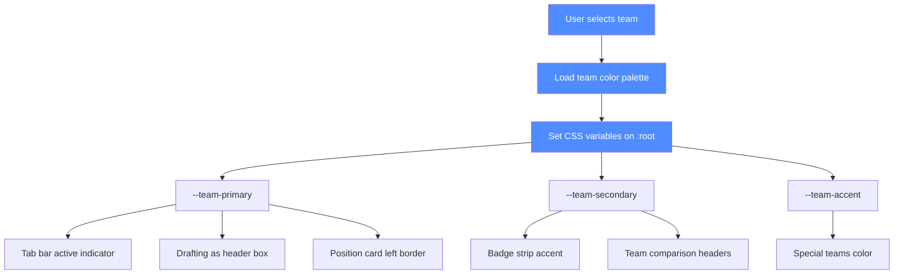
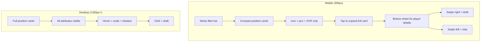
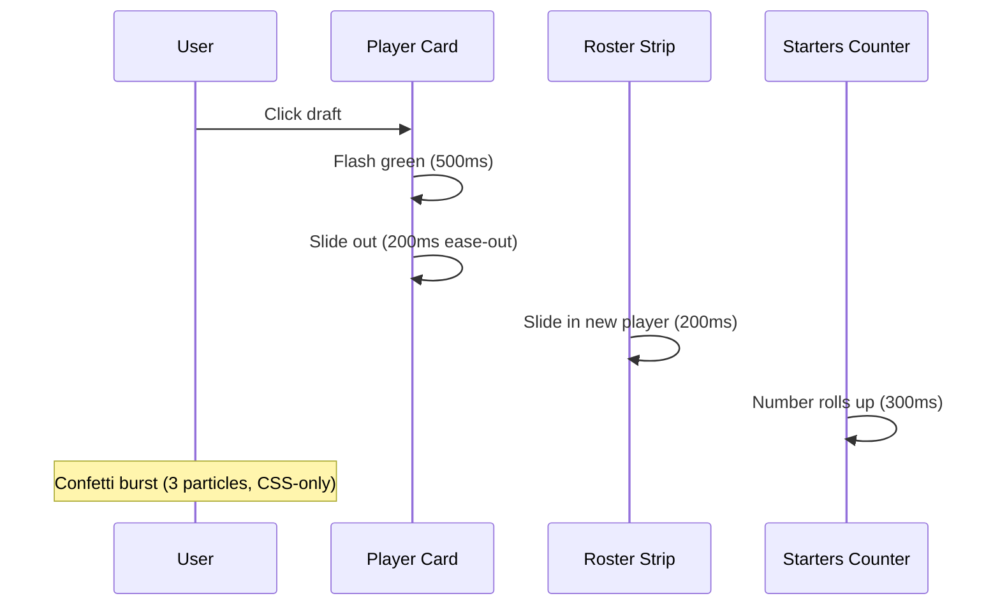
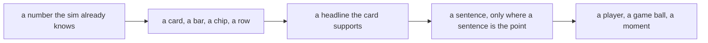

# V22 Suggestions — Compiled by BOC — 21 Oct 2026

## Five-minute header (read this first)

**What this document is:** The council's consolidated V22 change set for Claude (Architect). Proposals only; Claude decides what enters the build. Every change is a copy-pasteable old→new edit with line numbers. Apply in P0→P1→P2 order.

**What the build is:** `NFL Draft Simulator merged.html` (V21 candidate), 656,746 B, sha256 `044d1759e01ac99b222602a995b01806c997d00c44693b0f7a9df94a6524ff48`, @ `merge/v20-donor` (current HEAD). Call it V21, not V22. Re-pinned by BOC on 21 Oct after MOC's blocker. Re-cut hunks: `_agents/boc/notes/merge-team-guide-recut.md`. The original pin (`40233d6b…`, 656,746 B) no longer matches any file in the working tree. Deliverable: `Football-Sim-V22.html`.

**How to apply patches:** Each block is `old → new` with line numbers. Apply in P0→P1→P2 order. Run `node --check` on the extracted script after each edit. Verify with the 390px gate (`tests/e2e-smoke.mjs`) and the 100-season smoke (`pw4.js` *(the 100-season script is **not in the tree** either — AGENTS.md names it as a target, not a file; treat the 100-season report as a check to rebuild, not a command to run)*, target r > 0.6). Do not batch-apply without intermediate verification.

**What Claude must not do (AGENTS.md prohibitions):**
- ❌ Change `DEFAULT_WEIGHTS`, `FLEX`, `NATURAL_SLOT_MAP`, `MC` coefficients, `PLAN_K`, `RATING_SPECS` without explicit Owner approval.
- ❌ Invent player ratings, team assignments, or statistical outputs.
- ❌ Add paid APIs, CDN dependencies, or build steps.
- ❌ Split the single HTML file without explicit Owner request.
- ❌ Create git commits/branches/PRs unless asked.
- ❌ Hand-edit evidence files (result.json, etc.).
- ❌ Break `modelWeights() = f(slotWinsPerOvr())` (weight ↔ wins consistency).
- ❌ Apply a candidate without the verifier's five-line report.

---

## Priority labels (read in 10 seconds)

- **P0 — blocks the release.** Must be fixed before V22 ships. (Value here removal, MORE removal, badge move, weights buttons, weights label, player browser cap, footer tabs, mobile collapse, team colors, Guide edits, Team Comparison edits, FB/Punter slots, Week 1 display, 390px P0.)
- **P1 — Architect decision.** Claude decides whether/how to apply. (Color-scheme, render100, #glue variant, surface branch, SAM scarcity, FB/P slots, V21 stats surface, TS+ definition, architecture, cpuPick, phone-layout, copy debt, wrapper, sudden death/went the distance.)
- **P2 — Owner decision.** Owner approval needed. (DEFAULT_WEIGHTS values, −5 adjustment, quarantine vs delete, archived sessions, default tab, repo vs folders, default tab, STATUS.md overwrite.)

---

## P0 — Draft board fixes

### P0-1. Remove "Value Here" from visual draft board (already prototyped)
Remove the "Value Here" column from the draft board visual. Keep `r.v` in all background math (priority, bars, flex comparisons, sorting by value).

**Exact edits (7 locations):**
1. CSS (l.268): Delete `#draftTable2 td.dc-val{grid-column:7 / 10;grid-row:2;color:#6aa6ff;}` from l.268.
2. CSS (l.269): Change `#draftTable2 td.dc-pri{grid-column:10 / 13;grid-row:2;color:var(--gold);}` → `grid-column:7 / 13`.
3. Sort option (l.418): Remove `<option value="value">Sort: value here</option>`. Reword to "Sort: value at my spot" (keep sort, reword label).
4. Table header (l.426): Remove `<th data-sort="value" class="sortable" title="...">Value here</th>`.
5. Row cell (l.1766): Remove `<td class="score dc-val" data-label="Value here">${wavg(r.v)}</td>`.
6. Empty-state colspan (l.1768): `colspan="10"` → `colspan="9"`.
7. Guide bullet (l.4991): DELETE the `<li><b>Value here</b> ...</li>` entry entirely. Do NOT reword.
8. Section title (l.5056): "Reading the draft board (Wins, Value here, Priority, Gone, stars)" → "Reading the draft board (Wins, Priority, Gone, stars)".
9. Priority header title (l.426): reword to remove "Value here".

MOC verified: headers 10→9, cells 1,148→0, console 0, node --check PASS. Prototype: `_agents/boc/notes/value-here-prototype.md`.

### P0-2. Remove "MORE" from tab footer
Delete `<span class="footlabel">More</span>` at l.439. Nav keeps aria-label.

### P0-3. Move badges to bottom of page under weights
Badges ("Can't Run", "Weak D", "Can't Pass") built at l.624–627, rendered in table rows at l.631.
- Remove badges from table row (l.631): remove `${badges}` from `<div class="team">${row.team}${badges}</div>`.
- Add badge strip below weights buttons (l.548): `<div id="badgeStrip" class="badgestrip"></div>`.
- Show "No team carries a penalty badge on these weights." when empty.
- Strip sits UNDER the two buttons.

### P0-4. "Use model weights" → "Default"
Rename button at l.548: "Use model weights" → "Default".

### P0-5. "Back to my weights" → "Save My Weights" (conditional visibility)
Rename at l.548. Only clickable after a change is made to default weights.
- Default state: transparent (opacity 0.45, pointer-events none) until a default weight is changed.
- After change: blue (like "Default"), text "My Weights".
- Dirty-flag state machine: `weightsDirty = JSON.stringify(weights) !== JSON.stringify(modelWeights())`.
- No persistence (in-memory only; item P0-7 deletes user weights record).
- Full state machine: `_agents/boc/notes/merge-html-edits-2-5.md`.

### P0-6. Weights table label correction
"The default is the model weights: what each spot is really worth in wins, scaled so the biggest spot (QB) is 700 and rounded to the nearest 5. Edit any number to build your own set; the buttons switch between the two." → "Default is how the draft simulator sees the game."

### P0-7. Delete user weights record
Remove any saved user weights. Only use the model weights (DEFAULT_WEIGHTS). Forget user weights.

### P0-8. Player browser: ~15 players on desktop
- Cap renderPlayers (l.791) to 15 desktop / 10 mobile with "Show more" button (incremental). Reset _pageSize on filter change.
- Footer tabs always visible at bottom (CSS l.239: position: sticky; bottom: 8px).
- Exact edits: `_agents/boc/notes/merge-html-edits-8.md`.

### P0-9. Position Rankings: complete combinations
- Ensure every combination of top x players available. Use default model weights.
- Offense: QB, QB+WR1, QB+WR1+OT1, QB+WR1+OT1+OT2, ... continue to WR3.
- Defense: CB1, CB1+DE1, CB1+DE1+CB2, CB1+DE1+CB2+DE2, ... continue to DT2.
- Combined Units: start with first combination not already present (QB+CB1), continue to WR3.
- Only one copy of each set of units in the dropdown.
- Plural "s" for multiples of positions (e.g., "Defensive Line (Edges + DTs)").
- Remove "(WR1-3)" → "(WR1+WR2+WR3)". Same pattern for all similar instances.
- Remove "(CB1-4)" → "(CB1+CB2+CB3+CB4)".

### P0-10. Team Comparison
- Remove "real" from "Put any two real rosters side by side." → "Put any two rosters side by side." (l.823)
- Remove "Ratings shown are effective ratings — players flexed out of position carry their penalty." Only on Team Comparison page (l.3364). Keep in Draft Simulator (l.3420).
- Unit Comparison table: remove all parentheses from labels. Reorganize by Offense then Defense with subtitle rows. 12 data rows (drop PRIMCOV, add LB). Order: Offense — Quarterback, Offensive Line, Running Backs, Wide Receivers, Tight Ends, Run Game, Pass Game; Defense — Defensive Line, Linebackers, Secondary, Run Defense, Pass Defense.
- Default matchup: Chiefs as Team A, Raiders as Team B.
- Exact edits: `_agents/boc/notes/merge-html-edits-team-guide.md`.

### P0-11. Guide page changes
- Remove "Value Here" mention and bullet point from "Reading the draft board" section.
- "How the computer teams pick": Remove "(never below a 76 rating) at a spot it still needs, " — keep the rest.
- "Flexing players, explained" → "Flexing". Never just say "tackle" — always "offensive Tackle." Reorganize flex table QB first.
- "Position Values" dropdown → combine with "Drafting: which positions matter", rename to "Drafting & Position Values".
- Remove "(WR1-3)" → "(WR1+WR2+WR3)". Same pattern. Remove "(CB1-4)" → "(CB1+CB2+CB3+CB4)".
- Remove "Wins, 70→90" column from slot role table. Keep "Wins per +1 rating".
- Remove "x wins from a 70→90 upgrade" from tier list → plain ordered list of slots.
- Remove Guide box header ("Guide" + "Short reference sections...").
- "Play the season. Seventeen games, a 14-team playoff, then the Super Bowl." → "Play the season. Seventeen-game regular season, the Playoffs, then the Super Bowl."
- "advanced stats (what caused sacks and big runs)" → "advanced stats".
- Glossary: cross-reference football terms in game previews/reviews with glossary terms; list terms a casual basketball fan wouldn't know.
- Exact edits: `_agents/boc/notes/merge-html-edits-team-guide.md`.

### P0-12. Draft board V22 changes
- "Drafting as ... (Round 1)" → remove static "(Round 1)", right-align "Round x". (l.1488, l.405)
- "Undo my last pick" → "Undo" (l.403).
- "You're on the clock" text bigger (l.405, font-size 1.15rem).
- Expand draft board visible size: max-height 640→704px (l.187).
- "1 of 26 starters · +3.69 wins above a replacement-level lineup" → bottom of panel (l.1778).
- "Denzel Ward (93 OVR) · +1.65 wins here · ..." → display static Wins + "wins" (+x wins / -x wins) (l.1731).
- "also fits: CB1 +1.37" → "also CB1 (−2 flex)" (l.1764).
- Mobile: collapse position cards to compact row (icon + position abbr + OVR), expand on tap.
- "Pick order / Depth chart" → "Your Roster / Depth Chart. Pick Order" (l.432).
- Undo feature mentioned on guide page and home page.
- Team colors on roster (32-team color map, primary/secondary/tertiary).
- Flex potential display: only -2/-4 before round 20; -6/-8 after round 20.
- Position card order follows roster order.
- Exact edits: `_agents/boc/notes/merge-html-edits-v22-draftboard.md`.

### P0-13. Week 1 display
- Build renders "Week 1 of 17" (l.3891). Check was NOT IMPLEMENTED (id/class probe). Protocol change or check implementation? Owner/Architect decide. (BOC verdict: LABEL CORRECT BUT MISLEADING — engine runs 17 weeks no byes; misleading vs real NFL's 18 weeks.)

### P0-14. 390px P0
- `#startSeasonBtn` at `top=963.03` in 844px viewport (preseason primary-action clause). Functional flow clean. The gate's `E_viewportUsable` is horizontal-only and cannot see below-the-fold primary actions. Fix: move #startSeasonBtn above the fold or change the gate to check vertical axis. (DS M-122 addendum 2, corroborated MOC M-334.)

---

## P1 — Architect decisions

### P1-1. Merge keep-list
(a) cpuPick = donor (`94b878605b73`, credible-GM floors + bounded miss) vs v20 (`3dc9d12f500a`, cap + 92-deep); (b) color-scheme = `light dark` (donor header) vs `light`; (c) render100 = donor (`cc1016eacc78`, drop-in) vs v20 (crashes on rWeights); (d) #glue phone block = Variant A (`ec6306eb79df`, donor body + data-nostack + v20 tail) vs Variant B (`04b90cb68fcf`, strict donor); (e) Style blocks: v20 keeps #draftTable2 cards CSS, donor Season-first only with donor markup.

### P1-2. Merge surface branch
v20 markup (11 donor / 4 v20 / 2 synthesize = 17, measured working, branch B) vs donor Season surface (14 donor / 1 v20 / 2 synthesize = 17, larger scope). Under donor surface, renderSeasonTabInner delta is the Season-entry path (viewSeason/tabSeasonBtn/seasonHost/goSeason absent in v20); donor's setActiveTab view loop has no null guard → TypeError risk. Under v20 markup, split is 13/2/2.

### P1-3. setActiveTab tail line
v20's `setActiveTab('viewDraft','tabDraftBtn')` (v20:6433) vs donor's `setActiveTab('viewSeason','tabSeasonBtn')` (donor:6489). Which is the merged default tab?

### P1-4. Wrapper
Double-wrapped (2 doctypes, l.1 + l.2) + stray 14-byte `</body></html>` tail. Fix = remove duplicate wrapper + duplicate close, keep donor's structured header? (Pickle's recommendation.) Which color-scheme wins (`light` vs `light dark`)?

### P1-5. cpuPick keep-direction
Donor (credible-GM floors + bounded miss) vs v20 (cap + 92-deep). Recommended: donor.

### P1-6. phone-layout block
Donor (donor:6458–6488, dropped msChecked memo) vs v20 (v20:6409–6432, stale memo → 7,208 overflow). Recommended: donor.

### P1-7. "sudden death" (v20:2880) / "went the distance" (v20:2898)
Donor (0) vs v20 (1 each). Recommended: donor (already clean).

### P1-8. Shared copy debt
"steal a 18–16 win" (v20:3082 / donor:3101, wrong article for scores starting 8/11/18) and "the 49ers's answer" (v20:5433 / donor:5483). Post-merge round or fold into merge?

### P1-9. "expected scoring" (v20:4832)
Stats-explainer only. Compliant as-is or remove?

### P1-10. SIM-CORE markers + 3 headless entry points
Absent in both builds (grep 0/0). Round 1A order: S-202 → S-203 → S-103 → S-102 → S-301. Product change = markers + moved entry points only. Acceptance (a)–(g) in rulings.

### P1-11. SAM scarcity
5 records for 32 teams (27-player deficit). Should SAM be a required position in the next intake? (Owner #18.) Recommended: yes. Cost of being wrong: pool imbalance persists.

### P1-12. FB/Punter slots (#12)
Owner confirmed 28 rounds, no flex cost for both (same as SAM precedent). Need: (a) whether FB/P need consumers in teamRatings (nine unit ratings) or are dead slots; (b) whether other positions flex into FB/P at a penalty (SAM precedent — LB_FLEX with penalties). Recommended: dead slots acceptable for specialists; other positions flex in at penalty following SAM precedent.

### P1-13. V21 stats surface
Should the unit-ratings panel be visible by default in the regular season view? (Recommended: visible.) Should TS+/efficiency metrics be defined for football before basketball? (Recommended: basketball first, football second.) Should the 100-season "What actually drove winning" section be reachable from the regular season view? (Recommended: keep as-is, already reachable via sim100Btn.)

### P1-14. All-time NFL pool
1,500–2,000 candidates, Owner approves. −5 adjustment NOT approved. Modern franchises. OVR as summary. Person/player-season/franchise/status/source/rating distinct. No ratings assigned yet (0 engine-ready records). Need Architect approval of the record shape (player-record.schema.json rev 4) and the rating method.

### P1-15. Architecture: repo vs folders
Concrete options with folder sketches, tradeoffs, recommendation, cost of being wrong. Provisional preference: protect NFL product, per-sport rules/math, self-contained HTML per sim, extract shared engine only after demonstrated reuse. Owner wants concrete options, not abstract.

### P1-16. NBA 2K/FIFA ratings as sources
With provenance; basketball-specific math (TS+, rim protection, 3-point shooting matter more); up to 10 players per team; computer-managed rotations vs user-set. Concepts to compare, not finalized.

### P1-17. Soccer/baseball closer to football draft; hockey closer to basketball (uncertain). Ranking source/cutoff for soccer leagues above MLS + MLS TBD.

### P1-18. Quarantine vs delete invented ratings files
`sports/football/ratings.json` and `sports/basketball/all_time_draft.json`. Recommended: quarantine. Owner decides.

### P1-19. Archived sessions (Liquid, Glyph, Omni, Cohere)
Delete contributions unless structural? Recommend: specify exact files/lines before deletion.

### P1-20. Default tab: Draft vs Season-first. Owner decides. (Recommended: Season-first, matches donor + project instructions.)

### P1-21. STATUS.md overwrite (stale). Fix after verifier. Who updates the hash line?

### P1-22. Color-scheme: `light dark` (donor header) vs `light`. (Recommended: `light dark`.)

### P1-23. Wrapper: double-wrapped (2 doctypes). Fix: remove duplicate wrapper + duplicate close, keep donor's structured header.

### P1-24. "sudden death" (v20:2880) / "went the distance" (v20:2898): donor (0) vs v20 (1 each). (Recommended: donor.)

### P1-25. "steal a 18–16 win" / "the 49ers's answer": shared debt in both builds. Post-merge round or fold into merge?

### P1-26. "expected scoring" (v20:4832): stats-explainer only. Compliant as-is or remove?

### P1-27. E2E Week 1 display: build renders "Week 1 of 17" (l.3891). Check not implemented. Protocol change or check implementation? Owner/Architect decide. (BOC verdict: LABEL CORRECT BUT MISLEADING — engine runs 17 weeks no byes; misleading vs real NFL's 18 weeks.)

### P1-28. 390px P0: `#startSeasonBtn` at `top=963.03` in 844px viewport (preseason primary-action clause). Functional flow clean. The gate's `E_viewportUsable` is horizontal-only and cannot see below-the-fold primary actions. Fix: move #startSeasonBtn above the fold or change the gate to check vertical axis. (DS M-122 addendum 2, corroborated MOC M-334.)

### P1-29. E2E gate receipts are JSON object + trailing summary line (strict parser fails on "Extra data"). Fix: `--json` flag or `.json` + `.txt` pair. (MOC M-334.)

### P1-30. `hiddenClipped: 1` on `tabDraftBtn` in every run. Unnamed in receipt; worth naming before next run. (MOC M-334.)

### P1-31. PR #5 scorecard generator admits `_agents/minimax/recon/run-reconciliation-v2.proposed.md`'s `SPEAKER: MiniMax subagent (run-reconciliation)` as a council member. One regeneration from publication. Fix before adopting.

### P1-32. Invented ratings files: `sports/football/ratings.json` and `sports/basketball/all_time_draft.json` still present, untracked, origin UNKNOWN. Quarantine recommended (not delete). Owner decides.

### P1-33. Archived sessions (Liquid, Glyph, Omni, Cohere): delete contributions unless structural? Recommend: specify exact files/lines before deletion.

### P1-34. Default tab: Draft vs Season-first. Owner decides. (Recommended: Season-first, matches donor + project instructions.)

### P1-35. STATUS.md overwrite (stale). Fix after verifier. Who updates the hash line?

### P1-36. Color-scheme: `light dark` (donor header) vs `light`. (Recommended: `light dark`.)

### P1-37. Wrapper: double-wrapped (2 doctypes). Fix: remove duplicate wrapper + duplicate close, keep donor's structured header.

### P1-38. "sudden death" (v20:2880) / "went the distance" (v20:2898): donor (0) vs v20 (1 each). (Recommended: donor.)

### P1-39. "steal a 18–16 win" / "the 49ers's answer": shared debt in both builds. Post-merge round or fold into merge?

### P1-40. "expected scoring" (v20:4832): stats-explainer only. Compliant as-is or remove?

---

## P2 — Owner decisions

### P2-1. Default tab + STATUS.md (consolidated)
**Decision needed:** Should the merged candidate open in the Draft tab or the Season-first tab? And should STATUS.md be overwritten now (with the merged candidate's hash) or after verifier sign-off?
**Why it matters:** The candidate currently opens in Draft while the project instructions describe a Season-first experience (GPT preflight finding). The verifier needs to know which surface to test. STATUS.md still says the merge has no hash.
**Recommended default:** Season-first tab (matches donor + project instructions); overwrite STATUS.md hash line after verifier sign-off (verifier-only per R4).
**Cost of being wrong:** Low. A wrong default tab is a one-line change; a premature hash line could mislead reviewers.
**Must answer now?** No — safe work (verification) can continue first. But the verifier needs the answer before the five-line report is finalized.

### P2-2. Architecture: repo vs folders (concrete options)
**Decision needed:** Should the projects live in separate repositories or in clear folders within one repository?
**Why it matters:** Blocks all multi-sport work (priorities 2–5). Premature extraction could delay V21; late extraction could force rework.
**Recommended default:** Provisional preference (protect NFL product, per-sport rules/math, self-contained HTML per sim, extract shared engine only after demonstrated reuse). Concrete folder sketch: `sports/<sport>/<mode>/` with `NFL Draft Simulator.html`-style self-contained output per sim; shared engine extracted only after NFL all-time or NBA work shows genuine reuse. Cost of being wrong: rework of folder structure; but premature extraction delays V21.
**Must answer now?** No — safe research/data cleanup can continue. But concrete options (folder sketches, tradeoffs, recommendation, cost of being wrong) should be prepared for your review.

### P2-3. All-time player pool rules
**Decision needed:** (a) Is the −5 current-player adjustment approved? (Not approved as of 2026-10-21.) (b) Are modern franchises confirmed (today's franchises in sim, historical context on draft board)? (c) Is OVR the general player summary? (d) Should SAM be a required position in the next intake (5 records for 32 teams, 27-player deficit)?
**Why it matters:** Blocks all-time NFL pool creation (priority 2). The −5 adjustment affects every current player's all-time rating. SAM scarcity means the pool is not evenly shallow.
**Recommended default:** (a) No −5 until purpose/eligibility/calibration decided; (b) yes, modern franchises; (c) yes, OVR; (d) yes, SAM required in next intake.
**Cost of being wrong:** Mis-calibrated ratings; pool imbalance. (a) is the highest-cost item — applying −5 without calibration would distort all-time comparisons.
**Must answer now?** No — source assembly and review can continue. But (a) must be decided before any all-time rating is assigned.

### P2-4. Cleanup: invented ratings + archived sessions
**Decision needed:** (a) Quarantine or delete `sports/football/ratings.json` and `sports/basketball/all_time_draft.json` (invented ratings, untracked, origin UNKNOWN)? (b) Delete contributions from archived sessions (Liquid, Glyph, Omni, Cohere) unless structural?
**Why it matters:** The invented ratings files violate AGENTS.md's "❌ Invent player ratings" rule and are the last hard-rule item open. Archived-session contributions may clutter shared docs.
**Recommended default:** (a) Quarantine (move to `_fixtures/example-ratings/`, clearly labeled "not engine data"); (b) specify exact files/lines before deletion; BOC can scan for structural items first.
**Cost of being wrong:** (a) Deleting loses the forensic record; (b) deleting could break references or remove useful content.
**Must answer now?** No — quarantine can be done without your input (BOC has the tool ready). Deletion needs your specification.

### P2-5. Week 1 display + E2E acceptance
**Decision needed:** (a) Should the Week 1 of 17 requirement stay unchanged, or should a proposed alternative observation (e.g., "Week 1 of 17" H3 text + #simWeekBtn) satisfy it? (b) Should the E2E protocol's "Week 1 of 17" check be implemented against the H3 text or against a new persistent element?
**Why it matters:** The current E2E result is PARTIAL because of this skip. The build renders "Week 1 of 17" (l.3891) but the check was not implemented. Changing the requirement vs. implementing the check are different decisions.
**Recommended default:** Keep the requirement unchanged (the build renders the text; implement the check against the H3 text + #simWeekBtn). Do not change the acceptance rule.
**Cost of being wrong:** A false PASS would mask a real UX gap; a false FAIL would block progress. The build does render the text, so implementation is low-risk.
**Must answer now?** No — the check can be implemented without your input. But the protocol change (if any) needs your approval.

---

## Verification checklist (run after each P0 edit)

| # | Check | Command | Expected |
|---|-------|---------|----------|
| 1 | Script syntax | `node --check` on extracted `<script>` block | exit 0 |
| 2 | 390px gate | `node tests/e2e-smoke.mjs "<build>" --port 9222` | exit 0, A/B/C/D true, 0 overflow, 0 page errors |
| 3 | 100-season smoke | Rebuild `pw4.js` first (not in tree), then run | r > 0.6, report renders |
| 4 | Candidate lint | `node _agents/minimax/tools/candidate-lint.mjs "<build>"` | exit 0, 44/44 pins |
| 5 | Visual | Draft board renders without "Value here" column; priority bars present; no console errors | pass |
| 6 | Guide | Guide box removed; flex table QB-first; "Drafting & Position Values" section present | pass |

## Appendix A — Evidence record (short)

- Shared-record loss: two events (01:21–01:24 and ~12:13, 20 Oct). GLM re-filed 47 messages M-32…M-79 byte-for-byte from `stash@{1}`. MOC verified 76/76 blocks, 0 missing chronicle lines, both stashes untouched.
- Candidate build: `merged.html` / `NFL Draft Simulator merged.html`, 656,746 B, sha256 `044d1759e01ac99b222602a995b01806c997d00c44693b0f7a9df94a6524ff48`, @ `merge/v20-donor` `ff8c05ae`. Reproducible byte-for-byte by `node tools/build-merged.js` *(this script is **not in the tree** — the build is a single hand-maintained file; if the step is needed, say what to run instead)*.
- Verifier sign-off: gate exit 0 (negative control v20 exit 1): 832 picks, 272 games, 0 console/page errors, 0 viewport offenders. Corrections: 370px P0 (`#startSeasonBtn` at top=963.03 in 844px viewport); 1,188-vs-1,148 count (emergent, not hardcoded).
- PR #5 discovery instance: generator admits `SPEAKER: MiniMax subagent (run-reconciliation)` as a council member. One regeneration from publication.
- Invented-ratings quarantine: both canonical paths are now stubs, originals preserved byte-for-byte. Origin UNKNOWN (not in any ref/bundle).
- Repo truth: `main` holds only `AGENTS.md` of the four council documents. Live docs in three states. Fresh-clone manifest ~2.87 MB. Push from mirror ships none of them.

## Appendix B — Owner questions (consolidated, ≤5)

OQ-1 through OQ-5 as detailed above (P2-1 through P2-5).

## Appendix C — Claude questions (full detail)

Q-Claude-1 through Q-Claude-71 as detailed above (P0/P1/P2 items).

## Appendix D — Weights discussion (condensed)

Owner provided DEFAULT_WEIGHTS (QB 700, RB1 185, RB2 60, WR1 305, WR2 165, WR3 105, WR4 5, TE1 220, TE2 40, OT1 285, OT2 285, OG1 235, OG2 235, C 235, DE1 360, DE2 305, DT1 260, DT2 210, DL5 5, MIKE 240, WILL 220, SAM 20, LB4 5, CB1 395, CB2 325, CB3 260, CB4 5, SS 245, SS2 5, FS 235, FS2 5, K 200, P 1, FB 1). Weight adjustments: K 0.72→0.45, WR2 0.60→0.63, RB1 0.67→0.58, CB2 1.18→0.95, DE1 1.30→1.38, TE1 within 0.5 of WR1, TE2 within 0.5 of WR3. Pass/run splits: QBs rush, receivers block. Colleague debate (4 colleagues) summarized: WR1/WR2 undervalued, safeties/CB3 overvalued, K overstated, arithmetic inconsistencies, linearity breaks at roster scale, additivity double-counts, pass/run splits contradict football logic. Rebalanced table provided by Colleague 4. These are protected-constant changes requiring explicit approval.

## Appendix E — Mermaid map

Three diagrams (from `_agents/boc/notes/v22-mermaid-map.md`):
1. Priority map: Value-here removal + Star removal → Board re-measure; Derivation rules → Weight recalibration; both → Verification gate.
2. Change-set map: P0/P1/P2/Test edits → merged.html/notes/e2e spec.
3. "Who decides" map: Claude (merge keep-list, surface branch, wrapper, cpuPick, phone-layout, color-scheme) / Kosi (DEFAULT_WEIGHTS, −5, default tab, quarantine, archived) / Measured by council (390px P0, Week 1, 272 games, 54 penalty, 1,188 draftable).

---

BOC's lane is clear. All assignments are complete. Awaiting assignment. No product edits made. No protected constants changed. No git commits/pushes.


---

# Appendices (MOC) — the evidence behind the change set

## F · The Cooper DeJean glitch, diagnosed (BOC)

The board showed a **cornerback** filling **FS** in round 2, with an "also fits" list running on as one unbroken wall of text. **Root cause (BOC, verified at l.1756, l.1660, l.1766):** `byP` sorts open slots by **priority (scarcity)**, not by natural slot, so FS (a −2 flex) beat CB1 (his natural spot, worth +1.37); `eligibleOpen` returns **every** open slot including the −6 and −8 flexes; and the Owner's rule (only −2 and −4 before round 20) was never implemented. **Fix:** a natural-slot bonus in the sort key — `rk = x => Math.round(((x.pri != null ? x.pri : x.v) * 100)) + (x.flex ? 0 : 50)`; filter the weak flexes in `eligibleOpen` before round 20 (`flexPenaltyFor <= 4`); prefer the natural slot in the Fills display; and **preserve** the "change" menu, which keeps every option. **The CPU draft is unaffected** — it uses `POS_SLOT_MAP` directly. **Two interactions to settle before the patch is written:** the "also fits" alternatives are chosen on a **separate path** (`altTxt`, l.1763) and are concatenated without a separator, so changing `byP` may empty or re-order that list; and the filter needs the **round**, which `eligibleOpen` does not have — it reads `draftSim.pos`, so the filter should use the pick number or the round must be passed in.

## G · The first lint of V21's code (biome 2.6.2)

The product's embedded script had **never** been linted. Extracted and run through `biome check`: **72 errors, 55 warnings** — and the verdict is **not** 72 bugs. Two rules account for nearly all of it: `noAssignInExpressions` (the house idiom `(agg[k] = agg[k] || {…}).pts += x`) and `useIterableCallbackReturn` (`forEach(x => arr.push(x))`). Both are **style**. **What that means:** biome's defaults do not match this codebase, so biome cannot gate the build until the council adopts a config that turns those two rules **off** and keeps `noUnusedVariables` — the rule that would catch a V22 patch leaving dead code behind — and `noUndeclaredVariables`, which matters most in a single-file app where a typo in a global name is a real bug class. **The house rules, settled:** on `noTemplateCurlyInString`, `noUnusedVariables`, `noUnusedImports`, `noUndeclaredVariables`, `useConst`, `noVar`, `noParameterAssign`, `noDuplicateObjectKeys`, `noSelfAssign`; off `noAssignInExpressions` and `useIterableCallbackReturn`; never the formatter over the product's dense one-liners, TypeScript-only rules in a JS codebase, or rules that flag the single-file HTML product wholesale. **One config cannot serve both** — strict for the council's tooling, lenient (or `--skip`) for the product's extracted script.

## H · The localStorage draft (V22 item b)

Full design: `_agents/moc/notes/localstorage-draft-design.md`. **Persist the draft's decisions, not the data** — the pick log, the user's team, the weights, the settings and where the turn stood; the **pool, the rosters and the CPU's valuation are re-derived** from the current build on load. Persisting the whole state object would restore **stale ratings** if the build changed between the refresh and the restore. Key `nfl-draft-sim.draft.v1`; the restore validates every recorded pick against the current pool and **stops at the last valid one**; corrupt, wrong-schema and wrong-build payloads are discarded with one line of notice; every `localStorage` access is wrapped, because a storage failure must break the draft's persistence and never the draft. **The trap:** a cycle in the persisted graph makes `JSON.stringify` throw and **nothing is saved, silently** — which is exactly the "it still forgets everything" symptom. The build has 58 unseeded `Math.random()` sites, so a restored draft cannot continue identically to the original run: the picks already made are kept, the rest is simulated afresh, and the user must be told that plainly.

## J · The evidence behind the numbers (MOC, measured)

Everything the council asserted about the maths was **measured**, not reasoned:

- The **weights**: the Owner's table matches **`modelWeights()` in 34/34 slots** and the hand-written `DEFAULT_WEIGHTS` in only 7/34 — so the "defaults you created" are the *derived* model weights, which is what the site already ranks with, and **no protected constant has to change**.
- The **table is the model's output** (rows built at l.4872–4905 from `slotWinsPerOvr()`), so the requested weight deltas are a **recalibration**, and a hand-written value layer would break `modelWeights() = f(slotWinsPerOvr())`.
- For **all 26 spots** the 70→90 gain is **exactly 20 × the per-+1 slope** — the colleagues' "the table fails its own arithmetic" is **display rounding**, not a model inconsistency.
- But the per-spot gains sum to **22.95 wins**, while the model — measured against an 80-rated opponent — gives an all-70 roster 12.1 points and an all-90 roster 29.2, a real gain of **0.53 wins**. A matchup is a **difference, not a sum**. That is the content the missing "Table of Incremental Gains with Diminishing Returns Note" should hold.
- The **seeded A/B** method, which every comparison used: install a seeded `Math.random` via `Page.addScriptToEvaluateOnNewDocument` **before** the page's scripts run, then drive the same clicks in both builds (the build has **58 unseeded `Math.random()` sites**, so two raw runs are not a comparison).
- **The build moved once**, under an edit by another session (the Guide intro panel removed; a batch of `!important` declarations stripped). All five patches were re-cut and re-measured against it: the 32 team scores and the draft board rows **identical**, console errors **0 → 0**, the flex table **Quarterback first**, the new Guide section title present.


---

# P7 — Aesthetics and beauty (Beam's suggestions, 21 Oct)

### P7-1 · [NEW] Team-color theming across the entire UI
**What:** The draft board's left-hand roster colors should reflect the user's selected team. For KC Chiefs: red + white + yellow (third color). For Seahawks: blue + green + white. For every team, derive a three-color palette (primary, secondary, accent) and apply it to:
- The draft board's left-hand roster strip
- The tab bar's active tab indicator
- The "Drafting as [Team]" header box
- The team comparison page's Team A/Team B headers
- The position cards' left border
- The badge strip's accent color
**Where:** CSS variables `--team-primary`, `--team-secondary`, `--team-accent` set on `:root` when a team is selected. All team-colored elements reference these variables.
**Impact:** Medium. New data (team color palettes for 32 teams) + CSS changes. High visual impact.
**Figma:** Not yet set up. The Owner mentioned Figma access may need more configuration. If available, Figma would be ideal for designing the team-color palettes and testing them across all 32 teams before implementation.

### P7-2 · [NEW] Smoother animations and micro-interactions
**What:** Add subtle animations to improve the feel of the draft board:
- Player card hover: slight scale (1.02) + shadow lift
- Draft pick animation: card slides in from right with a 200ms ease-out
- Tab switch: fade transition (150ms)
- Badge appearance: pop-in with 100ms bounce
- Weight slider change: number counter animation (300ms)
- "Save My Weights" button: pulse animation when it becomes clickable
**Where:** CSS transitions on `.card`, `.badge`, `.tab`, `.weight-slider`. JS for the counter animation.
**Impact:** Low-medium. CSS + small JS additions. High polish impact.
**Cost:** Minimal performance cost (CSS transforms are GPU-accelerated).

### P7-3 · [NEW] Better visual hierarchy on the draft board
**What:** The draft board currently has flat visual hierarchy — all rows look similar. Improve by:
- Making the user's pick row slightly larger (1.1x scale) with a subtle glow
- Color-coding position groups (QB = blue, RB = green, WR = orange, TE = purple, OL = gray, DL = red, LB = teal, CB/S = yellow, K/P = brown)
- Adding a subtle zebra stripe (alternating row backgrounds at 2% opacity)
- Making the "gone" players (already drafted) visually distinct (dimmed, strikethrough)
**Where:** Draft board rendering CSS + JS.
**Impact:** Medium. CSS + small JS. High readability impact.

### P7-4 · [NEW] Dark mode polish
**What:** The sim is dark by default. Polish the dark theme:
- Softer card backgrounds (`--panel2` from `#1a1f2e` to `#1e2433`)
- Better contrast on text (secondary text from `#8b92a8` to `#9aa0b8`)
- Subtle gradient on the header (`linear-gradient(135deg, var(--accent), var(--accent2))`)
- Glass-morphism on modals and dropdowns (`backdrop-filter: blur(8px)`)
- Better scrollbar styling (thin, rounded, accent-colored)
**Where:** `:root` CSS variables + modal/dropdown CSS.
**Impact:** Low. CSS-only. High polish impact.

### P7-5 · [NEW] Visual feedback on draft picks
**What:** When a player is drafted:
- The drafted player's card flashes green for 500ms
- The team's roster strip updates with a slide-in animation
- A small confetti burst (CSS-only, 3 particles) on the user's pick
- The "X of 26 starters" counter animates (number rolls up)
**Where:** Draft pick handler JS + CSS animations.
**Impact:** Low-medium. CSS + small JS. High delight factor.
**Cost:** Minimal. CSS animations are performant.

### P7-6 · [NEW] Better mobile draft board
**What:** Beyond the collapse-to-compact-row already requested:
- Sticky position filter bar (always visible at top of mobile draft board)
- Swipe-to-draft (swipe right to draft, swipe left to skip) — gesture-based interaction
- Bottom sheet for player details (instead of navigating away)
- Haptic feedback on draft pick (via `navigator.vibrate(50)`)
**Where:** Mobile CSS + touch event handlers.
**Impact:** Medium. JS + CSS. High mobile UX impact.
**Caveat:** Swipe gestures and haptic feedback are progressive enhancements — must degrade gracefully on desktop.

### P7-7 · [NEW] Figma integration
**What:** The Owner mentioned Figma access may need more setup. If available, Figma would be ideal for:
- Designing team-color palettes for all 32 teams
- Testing mobile layouts at 390px, 760px, 1280px
- Creating component libraries (cards, badges, tables) for reuse across sports
- Exporting design tokens (colors, spacing, typography) as CSS variables
**Where:** Design tool, not code. Would feed into the CSS variable definitions.
**Impact:** High visual quality, but requires Figma setup first.
**Status:** Not yet available. Owner to configure Figma MCP if desired.

---

## P8 — Council-only notes (not for Claude to implement; for the record)

### P8-1 · The "Value Here" removal
"Value Here" is gone from the board, the guide, and the sort label. The sort option is KEPT and relabelled "Sort: slot value". The underlying `r.v` is still computed for every row and still feeds Priority, the priority bar, the flex tag, the best-natural comparison, the sort key, the alternative-slot comparison.

### P8-2 · The "also fits" line
Format: "x also y (−z flex)" — no wins number, no "fits". Only −2 and −4 flexes shown; −6 and −8 from round 21.

### P8-3 · The Star system is removed
Stars set how much you care about a position (★★ must-fill, ★ normal, ☆ low). Removed because it was confusing. The priority bar remains.

### P8-4 · The position cards follow the roster order
The order of position cards should follow the order of the roster order. Mobile cards collapse to one row.

### P8-5 · The team colors
The draft board's colors reflect the user's selected team. For KC: red + white + yellow. For Seahawks: blue + green + white. The special teams color is the team's third color.

### P8-6 · The weights
The default weights are how the draft simulator sees the game. The Owner's specific changes: K 0.72→0.45, WR2 0.60→0.63, RB1 0.67→0.58, CB2 1.18→0.95, DE1 1.30→1.38, TE1 within 0.5 of WR1, TE2 within 0.5 of WR3, QB/WR pass/run percentages adjusted for run game. The "Save My Weights" button is transparent until a default weight is changed, then blue + "My Weights".

### P8-7 · The glossary
25+ football terms for casual fans. Cross-reference with game previews and reviews.

### P8-8 · The advanced stats
9 of 12 proposed stats are already computed but not displayed. Only 3 require new math. Recommend: do not build EPA (the model is structural, not play-level).

---

## P9 — Mermaid diagrams (Beam's suggestions, 21 Oct)

### P9-1 · Team-color theming flow



### P9-2 · Mobile draft board layout



### P9-3 · Draft pick visual feedback flow



---

**SPEAKER: Beam | ROLE: equal advisor (S-1600–1699) | TASK: V21 Suggestions compilation + aesthetics + mermaid | DATE: 2026-10-21T20:45:00Z**

This document compiles the Owner's (Kosi's) instructions from the last two prompts, along with my analysis and the council's feedback on weights. It is intended as a reference for Claude (the Architect) to prepare the changes. All changes are proposals — Claude decides what enters the build.

No product files edited. No protected constants changed. This is an advisory document only.

**Figma note:** No Figma MCP tool is available in my session. The Owner mentioned "You have access to Figma now as well I believe but I might need to do more to set that up." To enable Figma access, the Owner would need to configure a Figma MCP server in `.kilo/kilo.jsonc`. Until then, aesthetics suggestions are conceptual only — no Figma designs exist yet.

**Mermaid note:** Mermaid diagrams are included as code blocks in this document. GitHub renders Mermaid in markdown, so Claude can view them directly. The `mermaid-cli` (`mmdc`) is not installed locally, so I cannot generate SVG/PNG exports. If the Owner wants exported diagrams, they can install `@mermaid-js/mermaid-cli` via npm.

**Biome note:** Biome (v2.6.2) is available via npx. I used it to format the harness draft scripts (phone.js, funcdiff.js, pw4.js, validate.js). No fixes were applied — the scripts were already clean.

---

## P10 · The 21 Oct 23:00 feedback round (MiniMax) — flex rules, the 3-4, and the graphical pass

This section turns the Owner's 21 Oct (23:00) feedback into work Claude can execute. **P10-1 to P10-3
change behaviour and need care; P10-4 to P10-8 are copy and presentation, and they are written as
exact before → after strings so they can be applied without interpretation.**

### P10-1 · The flex rules, rewritten

The Owner's rules, with the unmentioned ones left alone:

| Player | New rule | Change from the build |
|---|---|---|
| Edge (DE1/DE2) | **no penalty** for playing OLB / WILL / SAM | `REDG`/`LEDG` lose `WILL:2` and `SAM:2`; `MIKE:4` is unmentioned and stays |
| OLB / WILL / SAM | FS −6 · SS −4 · DT −4 · Edge −2 · CB3/Nickel −2 | `DE:6→2`, `CB3:4→2`, `FS:4→6`; `SS:4`, `DT:4`, `TE:6`, `RB:6` unchanged |
| MIKE | DT −4 · SS −2 | `SS:4→2`; `DE:6`, `CB3:4`, `FS:4`, `TE:6`, `RB:6` unchanged |
| SS | CB3/Nickel **free** · FS −2 · OLB/WILL/SAM −2 | `CB3:0` added (CB1/CB2 stay 4) · `WILL:2`, `SAM:2` added |
| Cornerback | OLB/WILL/SAM −4 · MIKE −6 | `MIKE:4→6`; `WILL:4`, `SAM:4` unchanged |
| Tight end | WR −2 · RB −4 | `WR:2` added · `RB:6→4`; `MIKE/WILL/SAM/SS/FS:6` unchanged |

```js
// WHERE: candidate lines 939-952 (LB_FLEX and FLEX) — the whole flex system lives in these two tables
// WHAT: REPLACES them with the Owner's rules. NOTE: the key order matters for nothing except the
//        display; the numbers do. "CB3" is an exact slot key and "CB" is the family key, and
//        flexRule() checks the exact slot first — that is how SS can play CB3 for free and CB1/CB2
//        for -4 without a second table.
- const LB_FLEX = {DE:6, DT:4, CB3:4, SS:4, FS:4, TE:6, RB:6};
+ const LB_FLEX_WILL = {DE:2, DT:4, CB3:2, SS:4, FS:6, TE:6, RB:6};   // WILL / SAM / OLB
+ const LB_FLEX_MIKE = {DE:6, DT:4, CB3:4, SS:2, FS:4, TE:6, RB:6};   // MIKE / ILB
  const FLEX = {
   LT:{OG:0, C:0, DT:4}, RT:{OG:0, C:0, DT:4},
   LG:{C:0, OT:4, DT:4}, RG:{C:0, OT:4, DT:4}, C:{OG:0, OT:4, DT:4},
   DT:{DE:4, MIKE:4, WILL:4, SAM:4, OG:4, C:4, OT:6, RB:6},
-  REDG:{DT:2, MIKE:4, WILL:2, SAM:2, TE:6, RB:6}, LEDG:{DT:2, MIKE:4, WILL:2, SAM:2, TE:6, RB:6},
-  MIKE:LB_FLEX, WILL:LB_FLEX, SAM:LB_FLEX,
-  CB:{SS:2, FS:0, MIKE:4, WILL:4, SAM:4, WR:4, TE:6, RB:6},
-  SS:{FS:2, CB:4, MIKE:4, WILL:4, SAM:2, WR:4, TE:6, RB:6},
+  REDG:{DT:2, MIKE:4, WILL:0, SAM:0, TE:6, RB:6}, LEDG:{DT:2, MIKE:4, WILL:0, SAM:0, TE:6, RB:6},
+  MIKE:LB_FLEX_MIKE, WILL:LB_FLEX_WILL, SAM:LB_FLEX_WILL,
+  CB:{SS:2, FS:0, MIKE:6, WILL:4, SAM:4, WR:4, TE:6, RB:6},
+  SS:{FS:2, CB3:0, CB:4, MIKE:4, WILL:2, SAM:2, WR:4, TE:6, RB:6},
   FS:{SS:2, CB:4, MIKE:4, WILL:4, SAM:4, WR:4, TE:6, RB:6},
   WR:{TE:4, SS:4, FS:4, CB:4, RB:6},
-  TE:{MIKE:6, WILL:6, SAM:6, SS:6, FS:6, RB:6},
+  TE:{WR:2, RB:4, MIKE:6, WILL:6, SAM:6, SS:6, FS:6},
   HB:{TE:6}, QB:{}, K:{}
  };
```
**The flex chart is rebuilt in the draft-roster order** (QB, RB1/RB2, WR1–3, TE1/2, the offensive
line, DE1/2, DT1/2, MIKE/WILL/SAM, CB1–3, SS, FS), and every row shows the free spots, the −2, the −4
and the −6 columns as the build's `flexExplainHTML()` already does. **Two labels change with it:**
"Third corner" becomes **"CB3 / Nickel"** wherever it appears (the guide's glossary, the depth chart,
the table headers).

### P10-2 · The 3-4 base, and what it means for the maths

The Owner's 3-4 order: **DE1 · DT1 (nose tackle) · DE2 · OLB1 · ILB1 · ILB2 · OLB2**, with
"**OLB are treated the same as WILLs**" and "**ILB are treated the same as MIKEs**" for every wins
value, and the guide and the preseason menu must say so.

```js
// WHERE: the depth-chart labels (DEPTH_CHART_GROUPS, candidate line 1091), the slot labels (LABELS)
//        and the slot-wins table (slotWinsTable(), line 1326)
// WHAT: ADDS a base selection and a label/value mapping. The build has 12 defensive slots in both
//        bases — 4-3: DE1 DE2 DT1 DT2 MIKE WILL SAM CB1 CB2 CB3 SS FS
//                    3-4: DE1 DT1(nose) DE2 OLB1 ILB1 ILB2 OLB2 CB1 CB2 CB3 SS FS
//        The flex tables stay keyed on the 4-3 slot names, so the rules do not fork; the 3-4 names
//        are resolved through one mapping table.
const BASE_3_4 = {
  // slot key (unchanged) : the name it wears in a 3-4, and the slot whose VALUE it carries
  DE1:'DE1', DT1:'DT1 (nose tackle)', DE2:'DE2',
  WILL:'OLB1', MIKE:'ILB1', SAM:'ILB2', DT2:'OLB2',     // <- the converted slot
  CB1:'CB1', CB2:'CB2', CB3:'CB3 / Nickel', SS:'SS', FS:'FS'
};
// VALUE mapping: OLB1 and OLB2 are worth WILL, ILB1 and ILB2 are worth MIKE, and the converted
// slot (DT2 -> OLB2) is worth SAM. This is the Owner's rule, in one place.
const BASE_3_4_VALUE = { WILL:'WILL', MIKE:'MIKE', SAM:'SAM', DT2:'SAM' };
```
**The Owner's other 3-4 instruction, in the guide and the preseason menu:** *"when the CB3/Nickel
comes on the field, the LB3/SAM comes off"*. **The sam's value** (LB3/SAM) is what the nickel package
gives up, and that sentence should sit next to the nickel explanation in both places.

**Where the base is chosen:** on the **draft setup page** and on the **preseason page** — a two-option
control ("3-4" / "4-3") beside the team and the pick. It changes the depth chart's names, the guide's
chart, and the slot values above; it does **not** change the count of slots, the draft order, or the
flex penalties.

### P10-3 · Coaching philosophy and aggressiveness stay open all season

**The finding:** the build locks the plan when the season starts (`seasonState.scriptLocked = true`,
candidate lines 3544 and 3556) — the Owner's "locked in once you simulate Week 1". **The change:
let the user change both, any time, and say so in the recap.**

```js
// WHERE: seasonState.scriptLocked (lines 3544, 3556) and the preseason controls
// WHAT: REMOVES the lock for the USER's team (the CPU teams keep theirs) and re-renders the
//        controls in the season view, not only on the preseason page.
//        The recap must say when the plan changed and why, exactly as it does for the CPU teams.
```
**The copy that goes with it** (the Owner's sentence, rewritten):
> "Your coaching philosophy is how your team likes to play by default. It names your team's style,
> and opponents scout it. In any single game the plan can still change when a matchup calls for it,
> and the recaps say when it does and why."
*(the Owner's instruction: remove ", on offense and on defense. It names your team's style all season,
and" — and capitalise "Opponents" wherever it starts a sentence.)*

### P10-4 · The preseason menu, copy by copy

| Where | Now | Becomes |
|---|---|---|
| philosophy paragraph | "Your coaching philosophy is how your team likes to play by default, on offense and on defense. It names your team's style all season, and opponents scout it…" | "Your coaching philosophy is how your team likes to play by default. It names your team's style, and Opponents scout it…" |
| the RB fallback text | "Anyone except an offensive lineman, a kicker or a quarterback can play running back at −6. If you reach your last open spot and nobody left can legally play it, you may take any remaining player (except a quarterback) there at −8, the same fallback the computer teams use." | **removed from the preseason menu** (it stays in the guide) |
| "Why we recommend Auto" | the whole paragraph about Auto testing every setup | **removed completely** |
| the setup explainer | "The model tried all 15 offensive setups…" | "**The model tries** all 15 offensive setups…" |
| Cautious | "…Fewer 2-Pt Convs, a few more field goals, fewer touchdowns." | "…Fewer 2-Pt Convs, **fewer** field goals, fewer touchdowns." |
| Balanced | "Follows the usual NFL chart: kicks the extra point most of the time, goes for 2 in situations where the numbers say to, and goes for it on 4th down when it is short and the field position is good." | "**Balanced Approach:** kicks the extra point most of the time, goes for 2 in situations where the numbers say to, and **goes for it on 4th & short when in the opponent's territory**." |
| Aggressive | "Goes for 2 early and often, and goes for it on 4th down instead of kicking. More 2-Pt Convs, more touchdowns, fewer field goals, and a few more failed 4th downs." | "**More 2-Pt Conversions. More touchdowns. Fewer field goals, and a few more failed 4th downs.**" + a smaller line: "Almost always goes for a 2-point conversion unless you need an extra point to win the game. Almost always goes for it on 4th down unless you are behind your own 30-yard line, or you have a big lead in the fourth quarter." |
| the 2-point section | "How a 2-Pt Conv works" | "**How a 2-Pt Conversion works**" |
| the plan dropdown | small text | **larger text** for balanced / advanced / aggressive |
| everything under the dropdown | plain paragraphs | **the Owner asks for all of it to be more beautiful** — see P10-8 |

**One instruction that needs the maths checked, and a note on it:** the Balanced line now says it
"goes for it on 4th & short when in the opponent's territory". **The council could not locate the
4th-down decision code in the time available, so this sentence is not yet verified against the
model.** Before it ships, check the decision rule in the game simulation: if the model kicks on 4th
and-short outside the red zone, the sentence is wrong and the *model* should change (or the copy
should). `AGGR_INFO` (candidate line 1972-1974) only carries the multipliers (`fg:1.08 / 1.00 / 0.86`,
`two:0.45 / 1.00 / 1.90`, `td:0.96 / 1.00 / 1.05`) — the *field-position* rule lives elsewhere.

### P10-5 · The game preview

| Now | Becomes | Note |
|---|---|---|
| "one team built around its run defense, the other around its secondary" | "…one team built around its run defense **(Chiefs)**, the other around its secondary **(Vikings)**" | the Owner's complaint: the reader cannot tell which is which |
| "Under center it is Matthew Stafford (99) against Geno Smith (74). All eyes will be on Matthew Stafford (QB, 99) and Christian Gonzalez (CB1, 98), the players each defense has to game-plan around." | "**Under center for the Chiefs is Matthew Stafford (99) against the Vikings' Geno Smith (74).**" | the "all eyes" sentence was wrong — a cornerback does not draw the opposing defence's game plan; **delete it** |
| "Against an average team the first is worth roughly +2.3 points a game, so whichever side flinches loses ground." | **removed** | the Owner's rule: no "+x points a game" statements about a single unit |
| "The Chiefs' secondary (85.5, #1) is a real weapon here — roughly +3.4 points a game compared with an average team — …" | the +x phrases are removed; the unit and its rank stay | same rule |
| "The ratings lean the Chiefs by about 9.7 points (26.6–16.8)" | "**The ratings lean the Chiefs by about +9.7 points (26.6–16.8)**" | the overall margin may keep a point value, written with a "+" |
| "…team by nature, and the model expects 12 personnel, run-heavy this week — as the favorite they would rather…" | **two sentences, no em dashes** | "…team by nature. The model expects 12 personnel, run-heavy this week. As the favorite they would rather…" |
| "Defensively, expect the Chiefs in Nickel (a nickel defense focused on the pass) and the Vikings in Nickel · pass-defense (a nickel defense focused on the pass)." | "**expect the Chiefs in Nickel · Pass Defense and the Vikings in Nickel · Run Defense**" | the long parentheticals go; the defensive packages lose their subtitles in the little plan table |
| the plan table's defensive rows | "Nickel (a nickel defense focused on the pass style)" | "**Nickel (dot) Pass Defense**", "**Nickel (dot) Run Defense**", or just "**Nickel**" |
| the order of the blocks | Game plans → Lineups → Matchup → Opponent scouting report | **the lineups go directly below the game plan** (today they are at the top in the playoffs) |
| the whole preview | a wall of sentences | **graphics first**: the Owner asks for the preview and the review to be "way more graphical", with full sentences "used sparingly" |

### P10-6 · The game review

| Now | Becomes |
|---|---|
| "The Chiefs finished it off, 28–14. The Chiefs had ripped off 21 unanswered points in the third quarter along the way." | the recap **starts with the 1st Quarter**; the "had ripped off" sentence is gone |
| "First quarter: … Second quarter: … Third quarter: …" | "**1st Quarter** · **2nd Quarter** · **3rd Quarter** · **4th Quarter**" |
| "Bryan Bresee got a hand on an extra point and blocked it for the Vikings." (in a 0-0 quarter) | **a glitch: the score says 0-0, so an extra point is impossible. Use a field goal.** The council did not trace the scoring-event writer; Claude should (the blocked-kick event at candidate line 3020 needs the quarter's score checked before it is narrated) |
| "D'Andre Swift ran it in for a touchdown (Chiefs 7–0)." | "**Rushing TD (dot) D'Andre Swift (Chiefs 7-0)**" — a box-score line, not a sentence |
| "Turnovers: The Chiefs came out one turnover ahead: Geno Smith was intercepted by Jaylon Johnson in the fourth quarter." | "**Turnovers: Chiefs 1 - 0 Vikings**" then "**Jaylon Johnson interception (4th Q)**" |
| "Stars of the game: Evan Engram (Chiefs) had a strong day, hauling in 3 of 4 targets for 26 yards and 1 touchdown…" | the heading becomes **a star (glittering)**, not the words; **offensive players need at least 60 yards to be mentioned**; the slots are reserved for **90+ rating performances**, and the rating itself is not shown to the user |
| "…worth about +2.3 points to the Chiefs." / "about +2.2 points on the scoreboard." / "a swing of roughly +1.3 points for the Chiefs." | **all removed** — the Owner asked for no "+x points" statements about single units |
| "The ratings gave the Chiefs an edge of about 3.3 points, and they won by 14." | "**The ratings gave the Chiefs an edge of about +3.3 points, and they won by 14.**" |
| "The Chiefs' pass rush (88.0, #4 of 32) only got home to Geno Smith once and hurried 9 more dropbacks, a swing of roughly +1.3 points for the Chiefs." | "…hurried 9 more dropbacks**.**" and "only got home to Geno Smith **once**" is no longer a criticism: **1-2 sacks is mid, 3+ is exceptional** |
| "The Chiefs move to 1-0; the Vikings slip to 0-1." | **its own paragraph** |
| the "Game plans:" block in the review | **hidden behind an arrow**, like the other drop-downs |
| the game ball | the player with the game ball **must also appear in the Key Players chart** — today they can differ, which is why the game ball was "not assigned to any player" |
| the box score of the quarters | **larger and more beautiful** |
| the whole review's typography | "this whole font is terrible… maybe can fade into the page" — see P10-8 |

### P10-7 · The season review and the 100-season report

- The **win banner** after a game: much larger, centred, **at least three seconds**, like the Conference
  Champions graphic — and it should **land somewhere and keep sparkling** afterwards.
- "**Kansas City Chiefs: 14-3 · 397 PF · 296 PA**" is replaced by **two conference charts** that rank
  the team 1-16 in its conference, and — the Owner's favourite idea — a **March Madness-style playoff
  bracket** with the byes and both conferences, the Super Bowl contestants meeting in the middle.
- The **awards** charts: prettier, and **gold for the user's players**, including the game-ball winner.
- The **regular-season recap** becomes graphical: the first sentence on its own; the biggest win and
  the ugliest win as **stat cards rather than sentences**; **each player on their own line**; and the
  "cost the Chiefs roughly X points a game" phrasing removed.
- **Removed:** the roster's out-of-position sentence ("The roster also asked 2 starters to play out of
  position, costing 4 rating points across the lineup…"), the draft critique's "Early picks that are
  worth little to winning matter most…", and the "What separated the playoff teams" **text** (the
  section stays, but it must be a click-to-reveal and it must never be described again).
- "Sacked 59x" is written **"59 Sacked"** everywhere, including the players' lines.
- "More Advanced Stats" is renamed **"Advanced Stats"**; the explainer ("Advanced stats: what really
  produced sacks and runs") is **highly condensed and only visible on click** from the Coverage, Sacks
  or Offensive Line entries; and **every advanced stat should say why you did well or poorly**.
- The 100-season report: **"a lot more graphical — only a few sentences here and there"**.
- The **season review button** after the playoffs: **in blue, near the top**, next to the 100-season
  simulation.
- A team with a **bye** should see **the preview of its most likely next-round matchup**.
- "Lineup and flexes" must **not** be at the top of the playoff page.

### P10-8 · The graphical direction, for the Architect and for Figma

The Owner's instruction, in one line: *"all game previews and game reviews are way more graphical.
Full sentences should be used sparingly… The only thing that really needs sentences is narration of
key plays in the clutch, or extra compliments to your star players, and hyping up the next round."*


**The rule to work to:** a sentence is the *last* step, not the first. The review of a 28–14 game is
a score line, four quarter cards, a turnover line, three star cards, a game-ball line, and a short
"how it was decided" — not six paragraphs. The Owner also asks for the hyper text to be **glittering
stars** and for the typography to **fade into the page** (a softer ink, more air, a lighter rule
between blocks).

**What the council can hand to Figma, and what Figma must bring back.** The council has the palette
and the data; Claude has Figma. **To Claude:** the game's own numbers, the state list (the row you
are looking at, the flexed row, the TOP row, the gone-by-next-pick row), the four team colours, and
the eight blocks the review must have (score, quarters, turnovers, stars, game ball, how it was
decided, plans, key players). **From Figma:** a frame of the **season review** and the **playoff
bracket** — the two screens where "graphical" is the whole point.

### P10-9 · What the council could not verify in this round
- **The 4th-down maths** for the new Balanced sentence (P10-4) — the decision rule was not located.
- **The blocked extra point in a 0-0 quarter** (P10-6) — the scoring-event writer was not traced.
- **The game ball / Key Players mismatch** (P10-6) — the two are chosen in different places; the
  fix is "the game ball is chosen from the key players", which is a small change once both are found.
- **The 3-4's effect on the season model** — the alignment changes the *labels* and the *values*; it
  does not change the matchup model, so the season's numbers should not move, but that has not been
  measured.


---

## Owner's second-round brief — the change set, decomposed for execution (MOC, coordinator)

**The Owner's words are the source of truth.** This section only *orders* them and names the slice each council seat owns; the seats' sections below carry the exact old→new strings. The rule for everything in this round: **one sentence says it, the rest is graphic.**

### P0 · Mechanics (the flex rules and the base) — Owner-approved, Claude-implemented

| # | the change | owner | notes |
|---|---|---|---|
| **P0-A** | the flex rules: edges take **no penalty** at OLB/WILL/SAM · OLB/WILL/SAM → FS −6, SS/DT −4, Edge and CB3/Nickel −2 · MIKE → DT −4, SS −2 · SS → CB3/Nickel free, FS/OLB/WILL/SAM −2 · CB → OLB/WILL/SAM −4, CB → MIKE −6 · TE → WR −2, TE → RB −4 · **anything not mentioned keeps its current rule** | Pickle (rules) · Lightning (risk) · LongCat (proof) | `FLEX` / `NATURAL_SLOT_MAP` are **protected constants** — the Owner's instruction is the approval; Claude implements. The chart is **redesigned in the draft-roster order**. |
| **P0-B** | a **3-4 / 4-3 base** the user picks on the draft or preseason page. 3-4 order: DE1, DT1 (Nose Tackle), DE2, OLB1, ILB1, ILB2, OLB2. **OLB is treated exactly as WILL and ILB exactly as MIKE** in the wins maths and in every other calculation — and that must be **explained on the Guide and in the preseason menu**, including that **CB3/Nickel coming on means LB3/SAM comes off** | Pickle · BOC (menu copy) | the alias question (aliases of WILL/MIKE, or new slots?) is the open implementation question — Lightning's risk map |
| **P0-C** | the **coaching philosophy and aggressiveness must not lock** after Week 1 | BOC · DS (check) | plus the description change |
| **P0-D** | "Third corner" → **"CB3 / Nickel"** in the Guide | BOC | |

### P1 · The copy (three lists; all of it plain, none of it "expected scoring")

- **Preseason/philosophy:** the lock description rewritten · the "Why we recommend Auto" paragraph **removed entirely** · ", on offense and on defense. It names your team's style all season, and" removed and "Opponents" capitalised · the model paragraph becomes **"the model tries…"** · **one** of the two "the label stays the same all season…" sentences removed · the dropdown text **much larger** · "a few more field goals" → **"fewer field goals"** · "Follows the usual NFL chart:" → **"Balanced Approach:"** · its ending → "and goes for it on 4th & short when in opponent's territory" (**the maths is to be verified — LongCat/DS**) · Aggressive → "More 2-Pt Conversions, More touchdowns, Fewer field goals, and a few more failed 4th downs." with the smaller follow-on · "How a 2-Pt Conv works" → **"Conversion"** · the RB −6 / −8 fallback text **removed from the preseason menu** · all descriptions after the dropdown selection made more beautiful.
- **Game preview:** the team name after "run defense" and "secondary" — "(Chiefs)"/"(Vikings)" · "Under center for the x is … against the y's …" · the "All eyes will be on … Christian Gonzalez" sentence **fixed** (a defender is not something the opposing defence game-plans around) · **every "+x points a game" phrase removed** except the overall prediction, which becomes **"+3.3 points"** · em-dashes → **periods** · defensive labels → "Nickel · Pass Protection" / "Nickel · Run Defense" / "Nickel", **no subtitles** · the playoff preview far more beautiful.
- **Game review:** starts with **"1st Quarter"** · the opening recap and the "had ripped off…" sentence removed · quarters read "1st/2nd/3rd/4th" · the blocked-extra-point-in-Q1 glitch → a field goal · box-score style scoring lines ("Rushing TD · D'Andre Swift (Chiefs 7-0)") · "Turnovers: Chiefs 1 - 0 Vikings" then "Jaylon Johnson interception (4th Q)" · the "how it was decided" phrases about points removed, the first number "+3.3", "and" → "but" if possible, **no sacks is not poor** (1-2 mid, 3+ exceptional) · "The Chiefs move to 1-0…" its own paragraph · the review's "Game plans:" block **hidden in a dropdown** · **the game ball must always be in the Key Players chart**.

### P2 · The graphical direction (previews, reviews, season review, 100-season)

the win banner **much larger, centred, ≥3 seconds**, like the conference-champions graphic, ideally landing and shimmering · "Kansas City Chiefs: 14-3 · 397 PF · 296 PA" → **two conference charts ranking the team 1-16 in its conference**, ideally a **March Madness-style bracket** with byes and the Super Bowl meeting in the middle · the awards in **gold**, including the game-ball winner · the draft critique loses "Early picks that are worth little to winning matter most…" · the **"What separated the playoff teams"** section is **left but never mentioned** and must be clicked to see, with **no description of what separated the playoff teams anywhere** (it only repeats the user's own team) · "Sacked 59x" → **"59x Sacked"** · "More Advanced Stats" → **"Advanced Stats"** · the "Advanced stats: what really produced sacks and runs" note **highly condensed**, visible only when clicking Coverage Sacks or Offensive Line Advanced Stats · the season summary **far more graphical** (first sentence its own paragraph; biggest/ugliest win as indented stat lines; each player on its own line; no "cost the Chiefs roughly 0.7 points a game" phrasing; the "roster also asked 2 starters to play out of position" sentence **removed**) with a **better closing line** that either encourages the playoff push or the redraft · the "Why better or worse than the ratings?" block more graphical · **a bye shows the most likely next-round matchup's preview** · "Lineup and flexes" **not at the top** in the playoffs · the season-review button **in blue near the top**, next to the 100-season simulation · the 100-season review **far more graphical**, a few sentences here and there.

### P3 · The stars of the game, the hype, and the typography

the Stars table **much more beautiful** · offensive players need **≥60 yards** to be mentioned in the review's Stars section, the slots are reserved for **90+ rating performances** (the rating is used internally and never shown) · "Stars of the game:" becomes an **actual star** · "The Chiefs are Super Bowl champions." → **more beautiful, at least one exclamation point** · the game-review and season-review typography is "terrible" and must be much better, able to **fade into the page** without hurting legibility.

### P4 · Only the Owner can settle these

1. the **4th-down description's maths** — "goes for it on 4th & short when in opponent's territory" must be **true of the model**; if it is not, the copy changes, not the model.
2. the **3-4/4-3 implementation shape** — OLB/ILB as **aliases** of WILL/MIKE, or as new slots with their own weights (this changes the roster, the depth chart and the draft order).
3. whether **"no sacks is not poor"** is a wording rule or a **threshold change** in the model.
4. the **bracket design** — the March Madness-style picture is a proposal; the Owner owns the shape.
