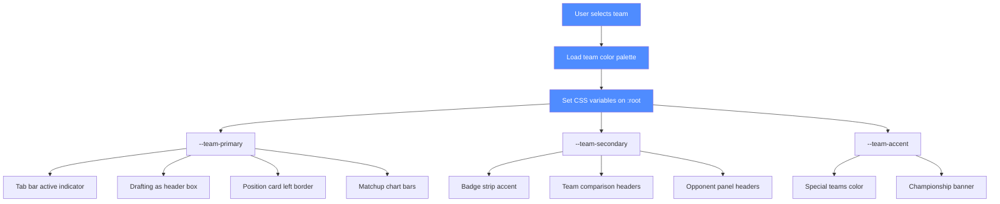

# Beam — team-color theming: deep dive (for V22 and beyond)

**Status:** advisory proposal. No product edits. For Claude (Architect) to review and implement.
**Companions:** V22-SUGGESTIONS.md P7/P9/P12, _agents/beam/notes/v21-roadmap.md

---

## 1. The core idea

Every visual element on the screen should know which team it belongs to. The user's team colors permeate the entire UI — not just the draft board, but every page, every panel, every badge. When the user faces an opponent, that opponent's colors appear on their elements. The sim should feel like the user's team is playing in their own stadium.

## 2. User's team colors (selected team)

When the user selects a team (e.g., KC Chiefs), the following elements use team colors:

| Element | Current | Team-colored version |
|---------|---------|---------------------|
| Draft board header ("Drafting as KC Chiefs") | Blue border (#4f8cff) | Red border (#E31837) with yellow accent |
| Tab bar active indicator | Blue (#4f8cff) | Team primary color |
| Position cards left border | None | Team primary color (2px solid) |
| Badge strip accent | Blue | Team primary color |
| "Drafting as [Team]" box | Blue border | Team primary border + team secondary background |
| Team comparison Team A header | Blue | Team primary |
| Roster strip (left edge) | None | Team primary (3px solid) |
| Weight sliders | Blue accent | Team primary accent |
| Save My Weights button | Blue when active | Team primary when active |
| Championship banner | Gold | Team primary + gold |
| Conference chart bars | Blue | Team primary |
| Season review banner | Gold | Team primary + gold |
| Playoff bracket (user's team) | Neutral | Team primary |
| Awards (user's players) | Gold | Team primary + gold |
| Game ball winner (if user's player) | Gold | Team primary + gold |

## 3. Opponent team colors (in matchups)

When facing an opponent, their colors appear on their elements:

| Element | Current | Opponent-colored version |
|---------|---------|---------------------|
| Opponent's player cards in preview | Same as user's | Opponent's primary color border |
| Opponent's star players | Same as user's | Opponent's primary color tint |
| Game ball winner (if opponent) | Gold | Opponent's primary color |
| Opponent's panel headers | Same as user's | Opponent's primary |
| Opponent's badges | Same as user's | Opponent's primary |
| Matchup chart bars | Blue/red | User's primary vs opponent's primary |
| Playoff bracket (opponent's team) | Neutral | Opponent's primary |
| Preview text "run defense (#1)" | Neutral | User's team color for user's stats, opponent's color for theirs |

## 4. Team color palette (32 teams)

Each team gets a 3-color palette: primary, secondary, accent (third color).

| Team | Primary | Secondary | Accent (3rd) |
|------|---------|-----------|--------------|
| Arizona Cardinals | #97233F | #000000 | #FFB612 |
| Atlanta Falcons | #A71930 | #000000 | #A5ACAF |
| Baltimore Ravens | #241773 | #000000 | #9E7C0C |
| Buffalo Bills | #00338D | #C60C30 | #FFFFFF |
| Carolina Panthers | #0085CA | #101820 | #BFC0BF |
| Chicago Bears | #0B162A | #C83803 | #FFFFFF |
| Cincinnati Bengals | #FB4F14 | #000000 | #FFFFFF |
| Cleveland Browns | #311D00 | #FF3C00 | #FFFFFF |
| Dallas Cowboys | #003594 | #869397 | #FFFFFF |
| Denver Broncos | #FB4F14 | #002244 | #FFFFFF |
| Detroit Lions | #0076B6 | #B0B7BC | #000000 |
| Green Bay Packers | #203731 | #FFB612 | #FFFFFF |
| Houston Texans | #03202F | #A71930 | #FFFFFF |
| Indianapolis Colts | #002C5F | #FFFFFF | #A2AAAD |
| Jacksonville Jaguars | #006778 | #D7A22A | #000000 |
| Kansas City Chiefs | #E31837 | #FFB612 | #FFFFFF |
| Las Vegas Raiders | #000000 | #A5ACAF | #FFFFFF |
| Los Angeles Chargers | #0080C6 | #FFC20E | #FFFFFF |
| Los Angeles Rams | #003594 | #FFA300 | #FFFFFF |
| Miami Dolphins | #008E97 | #F58220 | #FFFFFF |
| Minnesota Vikings | #4F2683 | #FFC62F | #FFFFFF |
| New England Patriots | #002244 | #C60C30 | #B0B7BC |
| New Orleans Saints | #D3BC8D | #101820 | #FFFFFF |
| New York Giants | #0B2265 | #A71930 | #A5ACAF |
| New York Jets | #125740 | #FFFFFF | #000000 |
| Philadelphia Eagles | #004C54 | #A5ACAF | #000000 |
| Pittsburgh Steelers | #FFB612 | #101820 | #FFFFFF |
| San Francisco 49ers | #AA0000 | #B3995D | #FFFFFF |
| Seattle Seahawks | #002244 | #69BE28 | #A5ACAF |
| Tampa Bay Buccaneers | #D50A0A | #34302B | #FF7900 |
| Tennessee Titans | #0C2340 | #4B92DB | #C8102E |
| Washington Commanders | #5A1414 | #FFB612 | #FFFFFF |

## 5. Implementation approach

### CSS variables
```css
:root {
  --team-primary: #4f8cff;   /* default (blue) */
  --team-secondary: #8b92a8; /* default (gray) */
  --team-accent: #ffd700;    /* default (gold) */
  --opp-primary: #8b92a8;    /* default (gray) */
  --opp-secondary: #4f8cff;  /* default (blue) */
}
```

When a team is selected:
```js
function setTeamColors(teamName) {
  const palette = TEAM_COLORS[teamName];
  document.documentElement.style.setProperty('--team-primary', palette.primary);
  document.documentElement.style.setProperty('--team-secondary', palette.secondary);
  document.documentElement.style.setProperty('--team-accent', palette.accent);
}
```

### Team-colored elements
All elements that should use team colors reference the CSS variables:
- `.draft-header { border-color: var(--team-primary); }`
- `.tab.active { border-bottom-color: var(--team-primary); }`
- `.position-card { border-left: 3px solid var(--team-primary); }`
- `.badge-strip { accent-color: var(--team-primary); }`
- `.team-a-header { background: var(--team-primary); }`
- `.team-b-header { background: var(--opp-primary); }`

### Opponent colors in matchups
When displaying opponent elements, use a separate set of variables:
```css
:root {
  --opp-primary: #8b92a8;   /* default (gray) */
  --opp-secondary: #4f8cff; /* default (blue) */
}
```

Apply opponent colors to:
- Opponent's player cards in preview (opponent's primary border)
- Opponent's star players (opponent's primary tint)
- Game ball winner (if opponent: opponent's primary color)
- Opponent's panel headers (opponent's primary)
- Opponent's badges (opponent's primary)
- Matchup chart bars (user's primary vs opponent's primary)
- Playoff bracket (user's color for their team, opponent's color for theirs)

### Mermaid diagram: team-color theming flow


## 6. Additional aesthetics ideas

Beyond the team-color theming, here are more beauty/aesthetics improvements:

1. **Gradient header** — `linear-gradient(135deg, var(--team-primary), var(--team-accent))` on the draft board header
2. **Glass-morphism on modals** — `backdrop-filter: blur(8px)` + semi-transparent background on all modals and dropdowns
3. **Better scrollbar styling** — thin (6px), rounded, accent-colored scrollbar that matches team colors
4. **Zebra stripes on tables** — alternating row backgrounds at 2% opacity for better readability
5. **Position group color-coding** — QB=blue, RB=green, WR=orange, TE=purple, OL=gray, DL=red, LB=teal, CB/S=yellow, K/P=brown
6. **Glow on user's pick row** — subtle `box-shadow: 0 0 8px var(--team-primary)` on the row where the user is about to pick
7. **Dimmed "gone" players** — `opacity: 0.4` + `text-decoration: line-through` on already-drafted players
8. **Smooth tab transitions** — 150ms fade between tabs instead of instant switch
9. **Number counter animation** — when a weight changes, the Wins number rolls up/down over 300ms
10. **Pulse on "Save My Weights"** — when the button becomes clickable, a subtle pulse animation draws attention
11. **Confetti on championship** — CSS-only, 10-15 particles, 1s duration, triggered on championship/Super Bowl
12. **Shimmer on gold elements** — gold gradient with shimmer animation on championship banner and award winners
13. **Opponent team colors in matchups** — opponent's primary color on their player cards, panel headers, badges
14. **Playoff bracket team colors** — user's team in their color, opponent's team in theirs, Super Bowl in gold
15. **Award winners** — gold border on user's players, opponent's primary for others
16. **Gradient on team comparison headers** — `linear-gradient(135deg, var(--team-primary), var(--team-accent))` on Team A header
17. **Animated draft pick counter** — number rolls up when a pick is made
18. **Hover tooltips** — position group color-coded tooltips on hover
19. **Better focus states** — visible focus rings on all interactive elements (accessibility)
20. **Loading skeleton** — subtle pulse animation on loading states
