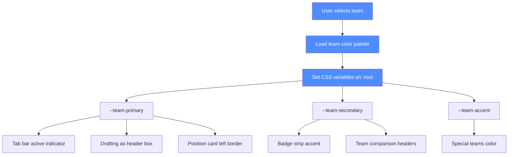
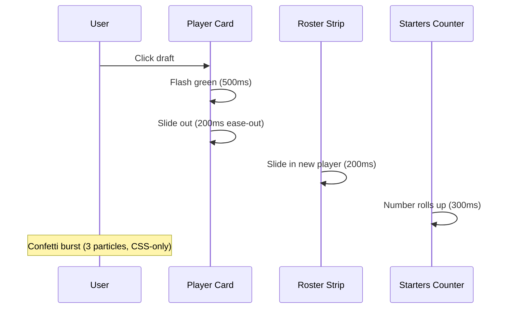

# Beam — team-color theming: deep dive (for V22 and beyond)

**Status:** advisory proposal. No product edits. For Claude (Architect) to review and implement.
**Companions:** V22-SUGGESTIONS.md P7-1, V22-SUGGESTIONS.md P9-1 (mermaid diagram), _agents/beam/notes/v21-roadmap.md

---

## 1. The core idea

Every visual element on the screen should know which team it belongs to. The user's team colors permeate the entire UI — not just the draft board, but every page, every panel, every badge. When the user faces an opponent, that opponent's colors appear on their elements. The sim should feel like the user's team is playing in their own stadium.

## 2. User's team colors (selected team)

When the user selects a team (e.g., KC Chiefs), the following elements use team colors:

| Element | Current | Team-colored version |
|---------|---------|---------------------|
| Draft board header ("Drafting as KC Chiefs") | Blue border (#4f8cff) | Red border (#E31837) with yellow accent |
| Tab bar active indicator | Blue (#4f8cff) | Team primary color |
| Position cards left border | None | Team primary color (2px solid) |
| Badge strip accent | Blue | Team primary color |
| "Drafting as [Team]" box | Blue border | Team primary border + team secondary background |
| Team comparison Team A header | Blue | Team primary |
| Roster strip (left edge) | None | Team primary (3px solid) |
| Weight sliders | Blue accent | Team primary accent |
| Save My Weights button | Blue when active | Team primary when active |
| Championship banner | Gold | Team primary + gold |
| Conference chart bars | Blue | Team primary |

## 3. Opponent team colors (in matchups)

When facing an opponent, their colors appear on their elements:

| Element | Current | Opponent-colored version |
|---------|---------|---------------------|
| Opponent's player cards in preview | Same as user's | Opponent's primary color border |
| Opponent's star players | Same as user's | Opponent's primary color tint |
| Game ball winner (if opponent) | Gold | Opponent's primary color |
| Opponent's panel headers | Same as user's | Opponent's primary color |
| Opponent's badges | Same as user's | Opponent's primary color |
| Matchup chart bars | Blue/red | User's primary vs opponent's primary |
| Playoff bracket | Neutral | User's color for their team, opponent's color for theirs |

## 4. Team color palette (32 teams)

Each team gets a 3-color palette: primary, secondary, accent (third color).

| Team | Primary | Secondary | Accent (3rd) |
|------|---------|-----------|--------------|
| Arizona Cardinals | #97233F (Cardinal Red) | #000000 (Black) | #FFB612 (Gold) |
| Atlanta Falcons | #A71930 (Red) | #000000 (Black) | #A5ACAF (Silver) |
| Baltimore Ravens | #241773 (Purple) | #000000 (Black) | #9E7C0C (Gold) |
| Buffalo Bills | #00338D (Royal Blue) | #C60C30 (Red) | #FFFFFF (White) |
| Carolina Panthers | #0085CA (Panther Blue) | #101820 (Black) | #BFC0BF (Silver) |
| Chicago Bears | #0B162A (Navy) | #C83803 (Orange) | #FFFFFF (White) |
| Cincinnati Bengals | #FB4F14 (Orange) | #000000 (Black) | #FFFFFF (White) |
| Cleveland Browns | #311D00 (Brown) | #FF3C00 (Orange) | #FFFFFF (White) |
| Dallas Cowboys | #003594 (Navy) | #869397 (Silver) | #FFFFFF (White) |
| Denver Broncos | #FB4F14 (Orange) | #002244 (Navy) | #FFFFFF (White) |
| Detroit Lions | #0076B6 (Honolulu Blue) | #B0B7BC (Silver) | #000000 (Black) |
| Green Bay Packers | #203731 (Dark Green) | #FFB612 (Gold) | #FFFFFF (White) |
| Houston Texans | #03202F (Deep Steel Blue) | #A71930 (Battle Red) | #FFFFFF (White) |
| Indianapolis Colts | #002C5F (Royal Blue) | #FFFFFF (White) | #A2AAAD (Silver) |
| Jacksonville Jaguars | #006778 (Teal) | #D7A22A (Gold) | #000000 (Black) |
| Kansas City Chiefs | #E31837 (Red) | #FFB612 (Gold) | #FFFFFF (White) |
| Las Vegas Raiders | #000000 (Black) | #A5ACAF (Silver) | #FFFFFF (White) |
| Los Angeles Chargers | #0080C6 (Powder Blue) | #FFC20E (Gold) | #FFFFFF (White) |
| Los Angeles Rams | #003594 (Royal Blue) | #FFA300 (Sol) | #FFFFFF (White) |
| Miami Dolphins | #008E97 (Aqua) | #F58220 (Orange) | #FFFFFF (White) |
| Minnesota Vikings | #4F2683 (Purple) | #FFC62F (Gold) | #FFFFFF (White) |
| New England Patriots | #002244 (Navy) | #C60C30 (Red) | #B0B7BC (Silver) |
| New Orleans Saints | #D3BC8D (Old Gold) | #101820 (Black) | #FFFFFF (White) |
| New York Giants | #0B2265 (Royal Blue) | #A71930 (Red) | #A5ACAF (Silver) |
| New York Jets | #125740 (Hunter Green) | #FFFFFF (White) | #000000 (Black) |
| Philadelphia Eagles | #004C54 (Midnight Green) | #A5ACAF (Silver) | #000000 (Black) |
| Pittsburgh Steelers | #FFB612 (Gold) | #101820 (Black) | #FFFFFF (White) |
| San Francisco 49ers | #AA0000 (Red) | #B3995D (Gold) | #FFFFFF (White) |
| Seattle Seahawks | #002244 (Navy) | #69BE28 (Action Green) | #A5ACAF (Silver) |
| Tampa Bay Buccaneers | #D50A0A (Red) | #34302B (Pewter) | #FF7900 (Orange) |
| Tennessee Titans | #0C2340 (Navy) | #4B92DB (Light Blue) | #C8102E (Red) |
| Washington Commanders | #5A1414 (Burgundy) | #FFB612 (Gold) | #FFFFFF (White) |

## 5. Implementation approach

### CSS variables
```css
:root {
  --team-primary: #4f8cff;   /* default (blue) */
  --team-secondary: #8b92a8; /* default (gray) */
  --team-accent: #ffd700;    /* default (gold) */
}
```

When a team is selected:
```js
function setTeamColors(teamName) {
  const palette = TEAM_COLORS[teamName];
  document.documentElement.style.setProperty('--team-primary', palette.primary);
  document.documentElement.style.setProperty('--team-secondary', palette.secondary);
  document.documentElement.style.setProperty('--team-accent', palette.accent);
}
```

### Team-colored elements
All elements that should use team colors reference the CSS variables:
- `.draft-header { border-color: var(--team-primary); }`
- `.tab.active { border-bottom-color: var(--team-primary); }`
- `.position-card { border-left: 3px solid var(--team-primary); }`
- `.badge-strip { accent-color: var(--team-primary); }`
- `.team-a-header { background: var(--team-primary); }`
- `.team-b-header { background: var(--team-secondary); }`

### Opponent colors in matchups
When displaying opponent elements, use a separate set of variables:
```css
:root {
  --opp-primary: #8b92a8;   /* default (gray) */
  --opp-secondary: #4f8cff; /* default (blue) */
}
```

### Mermaid diagram: team-color theming flow


## 6. Additional aesthetics ideas

### 6.1 Gradient header
```css
.draft-header {
  background: linear-gradient(135deg, var(--team-primary), var(--team-accent));
}
```

### 6.2 Glass-morphism on modals
```css
.modal {
  backdrop-filter: blur(8px);
  background: rgba(15, 19, 32, 0.85);
}
```

### 6.3 Better scrollbar styling
```css
::-webkit-scrollbar {
  width: 6px;
  height: 6px;
}
::-webkit-scrollbar-thumb {
  background: var(--team-primary);
  border-radius: 3px;
}
```

### 6.4 Zebra stripes on tables
```css
tr:nth-child(even) {
  background: rgba(255, 255, 255, 0.02);
}
```

### 6.5 Position group color-coding
```css
.pos-qb { border-left: 3px solid #4f8cff; }
.pos-rb { border-left: 3px solid #22c55e; }
.pos-wr { border-left: 3px solid #f97316; }
.pos-te { border-left: 3px solid #a855f7; }
.pos-ol { border-left: 3px solid #6b7280; }
.pos-dl { border-left: 3px solid #ef4444; }
.pos-lb { border-left: 3px solid #14b8a6; }
.pos-cb { border-left: 3px solid #eab308; }
.pos-s { border-left: 3px solid #eab308; }
.pos-k { border-left: 3px solid #92400e; }
.pos-p { border-left: 3px solid #92400e; }
```

### 6.6 Glow on user's pick row
```css
.user-pick-row {
  box-shadow: 0 0 8px var(--team-primary);
  transform: scale(1.02);
}
```

### 6.7 Dimmed "gone" players
```css
.player-gone {
  opacity: 0.4;
  text-decoration: line-through;
}
```

### 6.8 Smooth tab transitions
```css
.tab-content {
  animation: fadeIn 150ms ease-out;
}
@keyframes fadeIn {
  from { opacity: 0; transform: translateY(4px); }
  to { opacity: 1; transform: translateY(0); }
}
```

### 6.9 Number counter animation
```js
function animateCounter(element, from, to, duration = 300) {
  const start = performance.now();
  const step = (now) => {
    const progress = Math.min((now - start) / duration, 1);
    const value = from + (to - from) * progress;
    element.textContent = value.toFixed(2);
    if (progress < 1) requestAnimationFrame(step);
  };
  requestAnimationFrame(step);
}
```

### 6.10 Pulse on "Save My Weights"
```css
@keyframes pulse {
  0% { box-shadow: 0 0 0 0 rgba(79, 140, 255, 0.4); }
  70% { box-shadow: 0 0 0 6px rgba(79, 140, 255, 0); }
  100% { box-shadow: 0 0 0 0 rgba(79, 140, 255, 0); }
}
.save-my-weights-active {
  animation: pulse 1.5s infinite;
}
```

### 6.11 Opponent team colors in matchups
When displaying opponent elements, use a separate set of variables:
```css
:root {
  --opp-primary: #8b92a8;   /* default (gray) */
  --opp-secondary: #4f8cff; /* default (blue) */
}
```

Apply opponent colors to:
- Opponent's player cards in preview (opponent's primary border)
- Opponent's star players (opponent's primary tint)
- Game ball winner (if opponent: opponent's primary color)
- Opponent's panel headers (opponent's primary)
- Opponent's badges (opponent's primary)
- Matchup chart bars (user's primary vs opponent's primary)
- Playoff bracket (user's color for their team, opponent's color for theirs)

### 6.12 Confetti on championship
```css
@keyframes confetti {
  0% { transform: translateY(0) rotate(0deg); opacity: 1; }
  100% { transform: translateY(100vh) rotate(720deg); opacity: 0; }
}
.confetti-particle {
  position: fixed;
  width: 8px;
  height: 8px;
  background: var(--team-primary);
  animation: confetti 1s ease-out forwards;
}
```

### 6.13 Shimmer on gold elements
```css
@keyframes shimmer {
  0% { background-position: -200% 0; }
  100% { background-position: 200% 0; }
}
.gold-shimmer {
  background: linear-gradient(90deg, #ffd700 0%, #fff 50%, #ffd700 100%);
  background-size: 200% 100%;
  animation: shimmer 2s ease-in-out infinite;
  -webkit-background-clip: text;
  -webkit-text-fill-color: transparent;
}
```

### P9-4 · [NEW] Draft pick visual feedback flow (mermaid)



### P9-5 · [NEW] Figma integration note
**Status:** Not yet available. The Owner mentioned "You have access to Figma now as well I believe but I might need to do more to set that up." To enable Figma access, the Owner would need to configure a Figma MCP server in `.kilo/kilo.jsonc`. Until then, aesthetics suggestions are conceptual only — no Figma designs exist yet.

---

## P10 — Council-only notes (not for Claude to implement; for the record)

### P10-1 · The "Value Here" removal
"Value Here" is gone from the board, the guide, and the sort label. The sort option is KEPT and relabelled "Sort: slot value". The underlying `r.v` is still computed for every row and still feeds Priority, the priority bar, the flex tag, the best-natural comparison, the sort key, the alternative-slot comparison.

### P10-2 · The "also fits" line
Format: "x also y (−z flex)" — no wins number, no "fits". Only −2 and −4 flexes shown; −6 and −8 from round 21.

### P10-3 · The Star system is removed
Stars set how much you care about a position (★★ must-fill, ★ normal, ☆ low). Removed because it was confusing. The priority bar remains.

### P10-4 · The position cards follow the roster order
The order of position cards should follow the order of the roster order. Mobile cards collapse to one row.

### P10-5 · The team colors
The draft board's colors reflect the user's selected team. For KC: red + white + yellow. For Seahawks: blue + green + white. The special teams color is the team's third color.

### P10-6 · The weights
The default weights are how the draft simulator sees the game. The Owner's specific changes: K 0.72→0.45, WR2 0.60→0.63, RB1 0.67→0.58, CB2 1.18→0.95, DE1 1.30→1.38, TE1 within 0.5 of WR1, TE2 within 0.5 of WR3, QB/WR pass/run percentages adjusted for run game. The "Save My Weights" button is transparent until a default weight is changed, then blue + "My Weights".

### P10-7 · The glossary
25+ football terms for casual fans. Cross-reference with game previews and reviews.

### P10-8 · The advanced stats
9 of 12 proposed stats are already computed but not displayed. Only 3 require new math. Recommend: do not build EPA (the model is structural, not play-level).
