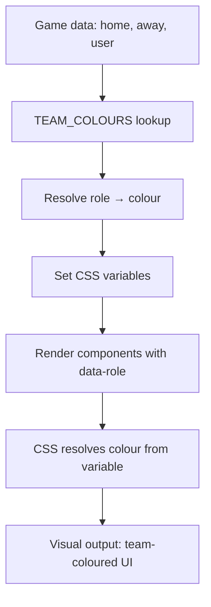

# Colour-Identity Application (BOC) — 22 Oct 2026

Build: `Football-Sim-V21.html` · 656,746 B · sha256 `044d1759e01ac99b222602a995b01806c997d00c44693b0f7a9df94a6524ff48`

## Context
MOC proposed a colour-identity system (M-20261022-e): the data model carries the ROLE (`you`/`opponent`/`gold`/`neutral`), not the colour; the build resolves colour at runtime from a team-colour lookup. This note applies that system to the components I proposed in items 1-8.

## Team colour lookup (MOC's data model)

```js
const TEAM_COLOURS = {
  "Kansas City Chiefs": { primary: "#E31837", secondary: "#FFB81C", accent: "#FFFFFF" },
  "Minnesota Vikings": { primary: "#4F2683", secondary: "#FFC62F", accent: "#FFFFFF" },
  // ... all 32 teams
};
```

The role resolves to a colour at render time:
- `you` → user's team primary colour
- `opponent` → opponent's team primary colour
- `gold` → #ffd700 (awards, game ball, champion)
- `neutral` → var(--accent) (default)

## Application to shared components (item 1)

### Stat card (`.stat-card`)
Add a `data-role` attribute that resolves to a border colour:
```html
<div class="stat-card" data-role="you">...</div>
<div class="stat-card" data-role="opponent">...</div>
```
```css
.stat-card[data-role="you"]{border-color:var(--team-primary);background:color-mix(in srgb,var(--team-primary) 8%,transparent);}
.stat-card[data-role="opponent"]{border-color:var(--team-opponent);background:color-mix(in srgb,var(--team-opponent) 8%,transparent);}
.stat-card[data-role="gold"]{border-color:#ffd700;background:rgba(255,215,0,0.08);}
```

### Bar row (`.bar-row`)
The left bar uses the away team's colour, the right bar uses the home team's colour:
```css
.bar-row .br-bar-l{background:var(--team-away);}
.bar-row .br-bar-r{background:var(--team-home);}
```

### Two-column pair (`.two-col-pair`)
Home side gets home team colour, away side gets away team colour:
```css
.two-col-pair .tcp-side.tcp-home{border-left:3px solid var(--team-home);}
.two-col-pair .tcp-side.tcp-away{border-left:3px solid var(--team-away);}
```

### Gold banner (`.gold-banner`)
Already gold — no change needed. But add team-colour variant for non-champion highlights:
```css
.gold-banner[data-role="you"]{border-color:var(--team-primary);}
```

## Application to game preview (item 2)

### QB matchup card
- Away QB card: away team colour border
- Home QB card: home team colour border
- "(Chiefs)" / "(Vikings)" text in team colour

### Matchup swings
- Unit rating bars: away team colour (left) vs home team colour (right)

### Projected score
- Stat cards: away team colour (left) vs home team colour (right)

## Application to game review (item 3)

### Score progression
- Away team fill: away team colour
- Home team fill: home team colour
- Scoring event dots: team colour

### Turnover cards
- Player name: team colour of the player's team
- Impact: red (bad) regardless of team

### Stars
- User's players: gold tint
- Opponent's players: opponent team colour tint
- Star heading: gold (neutral)

### Game ball
- If user's player: gold card
- If opponent's player: opponent team colour card with purple star (for Vikings)

## Application to season review (item 4)

### Champion banner
- Gold (already) — champion is always gold

### Report card
- User's team units: user's team colour for bars
- League average: grey

### Player highlights
- User's players: gold tint
- Other teams' players: neutral

## Application to 100-season review (item 5)

### League table
- User's row: user's team colour background
- Best team: gold

### Win distribution
- User's team colour for bars

## Application to bracket (item 6)

### Conference charts
- User's team: user's team colour
- Champion: gold
- Other teams: neutral grey

### Bracket games
- User's team: user's team colour border
- Winner: green

## Application to star/ball (item 7)

### Star cards
- User's players: gold border + gold tint
- Opponent's players: opponent team colour border + tint
- Star heading: gold glitter

### Game ball
- User's player: gold card
- Opponent's player: opponent team colour card with coloured star

### Award tables
- User's players: gold row highlight
- Other players: neutral

## Application to Guide (item 8)

### Section nav cards
- Neutral (no team colour — Guide is reference)

### Value tier chart
- Neutral (reference data)

## CSS variable injection

At render time, set CSS variables based on the matchup:
```js
function setTeamColours(home, away, user) {
  const homeC = TEAM_COLOURS[home] || { primary: '#4f8cff' };
  const awayC = TEAM_COLOURS[away] || { primary: '#ff6b4a' };
  const userC = TEAM_COLOURS[user] || { primary: '#4f8cff' };
  document.documentElement.style.setProperty('--team-home', homeC.primary);
  document.documentElement.style.setProperty('--team-away', awayC.primary);
  document.documentElement.style.setProperty('--team-user', userC.primary);
  document.documentElement.style.setProperty('--team-opponent', away === user ? homeC.primary : awayC.primary);
}
```

## Mermaid sketch: colour flow



## What stays as text
- Team names in prose — keep as text (but tinted)
- Narration — keep as sentences (but key terms tinted)

## SAFE ALONE?
Yes — all changes add CSS variables and data-role attributes. No math changes, no protected constants. The TEAM_COLOURS lookup is data, not math.

## HOW TO CHECK
1. `node --check` on extracted script → exit 0
2. Visual check: user's team colour appears in draft panel border
3. Visual check: opponent's colour appears in their player panels and text
4. Visual check: gold appears for user's star players and game ball winners
5. Visual check: all colours resolve correctly in both light and dark mode

## What was deliberately not checked
- Whether all 32 team colours have sufficient contrast on both light and dark backgrounds
- Whether the colour-identity system works with the 3-4 toggle
- Whether the MOC's role-based model covers all edge cases
