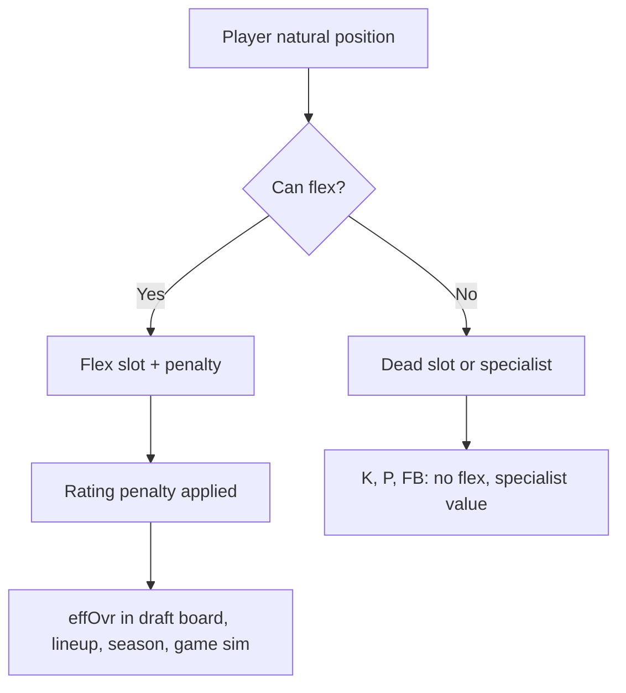

# Flex Table Spec — Hand-Off Frame for Claude (BOC) — 22 Oct 2026

Build: `Football-Sim-V21.html` · 656,746 B · sha256 `044d1759e01ac99b222602a995b01806c997d00c44693b0f7a9df94a6524ff48`

Owner: "Left and right don't matter. Let claude handle the table."

## What this is
A spec for the flex table that Claude can build. The table shows which positions can play which slots, with rating penalties. The Owner confirmed: positions are labels, not math changes. OLB ≡ WILL math, ILB ≡ MIKE math, NT ≡ DT1 math. CB3 becomes Nickel when placed there.

## Component: Flex Table

### Columns
| Column | Content | Width |
|--------|---------|-------|
| Position | The player's natural position (QB, HB, WR, TE, LT, RT, LG, RG, C, DT, EDGE, MIKE, WILL, SAM, CB, SS, FS, K, P, FB) | 60px |
| Natural slots | Where this position naturally plays (e.g., EDGE → DE1, DE2) | 120px |
| Flex slots | Where this position can flex, with penalty (e.g., EDGE → DT at −2, MIKE at −4) | 200px |
| Notes | Special rules (e.g., "QB cannot flex", "CB3 becomes Nickel when placed there") | 160px |

### Rows (20 positions, sorted by tier)

**Tier 1 (most valuable):**
| Position | Natural slots | Flex slots | Notes |
|----------|--------------|------------|-------|
| QB | QB | (none) | Cannot flex. QB is QB. |
| EDGE | DE1, DE2 | DT (−2), MIKE (−4), WILL (−2), SAM (−2), TE (−6), RB (−6) | Unified EDGE (no L/R). CB3/Nickel interaction: in 4-3, EDGE stays. |
| CB | CB1, CB2, CB3 | SS (−2), FS (0), MIKE (−4), WILL (−4), SAM (−4), WR (−4), TE (−6), RB (−6) | CB3 becomes Nickel when placed in CB3 slot |

**Tier 2 (high value):**
| Position | Natural slots | Flex slots | Notes |
|----------|--------------|------------|-------|
| LT | OT1, OT2 | OG (0), C (0), DT (−4) | Tackle plays any line spot for free |
| RT | OT1, OT2 | OG (0), C (0), DT (−4) | Same as LT |
| LG | OG1, OG2 | C (0), OT (−4), DT (−4) | Guard↔center free |
| RG | OG1, OG2 | C (0), OT (−4), DT (−4) | Same as LG |
| C | C | OG (0), OT (−4), DT (−4) | Center↔guard free |
| DT | DT1, DT2 | DE (−4), MIKE (−4), WILL (−4), SAM (−4), OG (−4), C (−4), OT (−6), RB (−6) | DT1 can be relabeled "DT1 / Nose Tackle" in 3-4 |
| MIKE | MIKE, WILL, SAM | DE (−6), DT (−4), CB3 (−4), SS (−4), FS (−4), TE (−6), RB (−6) | ILB in 3-4 (math unchanged) |
| WILL | WILL, MIKE, SAM | DE (−6), DT (−4), CB3 (−4), SS (−4), FS (−4), TE (−6), RB (−6) | OLB in 3-4 (math unchanged) |
| SAM | SAM, MIKE, WILL | DE (−6), DT (−4), CB3 (−4), SS (−2), FS (−4), WR (−4), TE (−6), RB (−6) | Worn by OLB2 in 3-4. Alias TBD by Owner. |

**Tier 3 (solid):**
| Position | Natural slots | Flex slots | Notes |
|----------|--------------|------------|-------|
| SS | SS | FS (−2), CB (−4), MIKE (−4), WILL (−4), SAM (−2), WR (−4), TE (−6), RB (−6) | SS2/Big Nickel is a SS flex |
| FS | FS | SS (−2), CB (−4), MIKE (−4), WILL (−4), SAM (−4), WR (−4), TE (−6), RB (−6) | FS2/Quarter is a FS flex |
| WR | WR1, WR2, WR3 | TE (−4), SS (−4), FS (−4), CB (−4), RB (−6) | WR4 is a flex slot |
| TE | TE1, TE2 | MIKE (−6), WILL (−6), SAM (−6), SS (−6), FS (−6), RB (−6) | TE2 is a flex slot |

**Tier 4 (lower value):**
| Position | Natural slots | Flex slots | Notes |
|----------|--------------|------------|-------|
| HB | RB1, RB2 | (none via FLEX) | RB1/RB2 are both HB; no flex to other positions |
| K | K | (none) | Specialist, no flex |
| P | P | (none) | Specialist, no flex. Value ≈ 1 (Owner ruling) |
| FB | FB | (none) | Specialist, no flex. Heavier block spec than RB in matchup model (Owner ruling) |

### 3-4 base toggle (UI only, no math changes)

When 3-4 base is selected:
- DT1 → relabeled "DT1 / Nose Tackle" (math unchanged — slotWins('DT1', ovr))
- DT2 → ILB2 (math unchanged — slotWins('MIKE', ovr), since ILB ≡ MIKE)
- SAM → OLB2 (math unchanged — slotWins('WILL', ovr), since OLB ≡ WILL)
- The user picks: toggle on preseason lineup page, or board-driven recommendation

When 4-3 base is selected (default):
- DT1, DT2 (both DTs)
- MIKE, WILL, SAM (3 LBs)
- Standard formation

### Nickel substitution (by base)
- **4-3:** CB3 comes on → SAM comes off. WILL wears SAM role (math unchanged).
- **3-4:** CB3 comes on → lowest-rated of {MIKE, WILL, SAM} comes off. Math unchanged.

### Flex penalties (from FLEX map)
Penalties are rating points lost when playing out of position:
- 0 = free (no penalty)
- −2 = minor penalty
- −4 = moderate penalty
- −6 = significant penalty

### Visual design (for Figma)
- **Table layout:** 4 columns (Position, Natural slots, Flex slots, Notes)
- **Colour coding:** each position tier gets a different row background
- **Flex penalties:** colour-coded (green for 0, yellow for −2, orange for −4, red for −6)
- **3-4 toggle:** switch widget on the preseason lineup page
- **Team colours:** row borders use team colours (per MOC's colour-identity system)

### Mermaid sketch: flex table structure

### What the table should NOT contain
- No separate nose slot (DT1 is the nose in 3-4, relabeled only)
- No separate OLB slot (MIKE/WILL/SAM are the LBs; in 3-4, OLB1/OLB2 wear WILL, ILB1/ILB2 wear MIKE)
- No left/right edge distinction
- No flex cost for QB (QB cannot flex)
- No math changes for 3-4 positions (labels only)

### SAFE ALONE?
N/A — this is a spec for Claude to build, not a code change.

### HOW TO CHECK
When Claude produces the table: (1) no left/right distinction, (2) CB3/Nickel interaction correct for both bases, (3) 3-4 nickel rule matches Owner's ruling, (4) flex penalties match FLEX map, (5) no protected constants changed.
