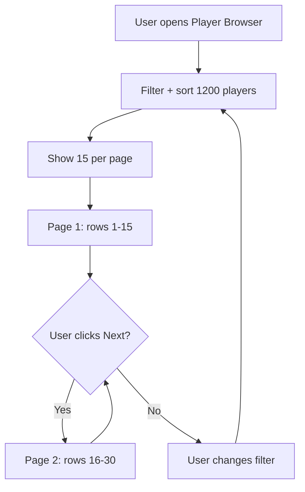

# Player Browser Pagination + Clickable Header (BOC) — 22 Oct 2026

Build: `Football-Sim-PreColors.html` · 657,486 B · sha256 `40233d6be00e987c472cf6b1126b0ab7f11c123006277466bd23391b308795fd`

## Three issues from the Owner

### 1. Player browser: only 15 names visible

**Current state (l.791-810):** `renderPlayers()` renders ALL matching players (up to 1,200) into `#playerBody`. No pagination, no cap. The table is 10 columns wide, so 1,200 rows × 10 columns = 12,000 cells. Scrolling to the header (which has the filters) takes forever.

**Owner's request:** "Only 15 names should be visible so it is quick to get to the header."

**Proposed fix:** Add pagination with 15 per page:
```js
const PAGE_SIZE = 15;
let currentPage = 0;

function renderPlayers(){
  // ... existing filter + sort logic ...
  const totalPages = Math.ceil(rows.length / PAGE_SIZE);
  const start = currentPage * PAGE_SIZE;
  const pageRows = rows.slice(start, start + PAGE_SIZE);
  
  // Render only pageRows
  let h = '';
  pageRows.forEach(p => { /* existing row rendering */ });
  body.innerHTML = h;
  
  // Add pagination controls
  const pag = `<div class="pagination">
    <button class="tabbtn" ${currentPage===0?'disabled':''} onclick="currentPage--;renderPlayers()">← Prev</button>
    <span class="narr">Page ${currentPage+1} of ${totalPages} (${rows.length} players)</span>
    <button class="tabbtn" ${currentPage>=totalPages-1?'disabled':''} onclick="currentPage++;renderPlayers()">Next →</button>
  </div>`;
  // insert after table
}
```

**CSS:**
```css
.pagination{display:flex;align-items:center;justify-content:center;gap:12px;margin-top:10px;padding:8px;}
.pagination button{padding:6px 14px;border-radius:8px;border:1px solid var(--border);background:var(--panel);color:var(--text);cursor:pointer;font-size:0.85rem;}
.pagination button:disabled{opacity:0.4;cursor:default;}
.pagination button:not(:disabled):hover{background:var(--accent);color:#fff;}
```

**SAFE ALONE?** Yes — adds pagination to existing render function. No math changes, no protected constants.
**HOW TO CHECK:** `node --check` → exit 0. Visual check: only 15 rows visible, pagination controls work, filters still work.

### 2. Header redesign — complete rework

**Current state:** The header is a `<nav class="footnav">` with links to supplementary pages (Team Rankings, Player Browser, Position Rankings, Team Comparison, Guide). It's a simple horizontal nav bar.

**Owner's request:** "I'm not exactly sure if I want the same designed header visible on every page. I do think you did a great job with the header but I'd also be open to a complete rework if it can become a lot more beautiful."

**Proposed approach:** Instead of a single nav bar, create a **contextual header** that changes based on the current page:
- **Homepage (Draft):** Full hero header with team colours, pick number, and action buttons
- **Season tab:** Compact header with season progress (week X of 17, record)
- **Supplementary pages:** Minimal header with page title and breadcrumb

**CSS sketch:**
```css
.site-header{display:flex;align-items:center;justify-content:space-between;padding:12px 16px;background:var(--panel);border-bottom:1px solid var(--border);position:sticky;top:0;z-index:100;}
.site-header .sh-logo{font-weight:800;font-size:1.1rem;color:var(--accent);}
.site-header .sh-nav{display:flex;gap:8px;}
.site-header .sh-nav a{padding:6px 12px;border-radius:6px;font-size:0.8rem;color:var(--sub);text-decoration:none;transition:background .15s;}
.site-header .sh-nav a:hover{background:var(--panel2);color:var(--text);}
.site-header .sh-nav a.active{background:var(--accent);color:#fff;}
.site-header .sh-home{cursor:pointer;}
@media (max-width:760px){.site-header{flex-wrap:wrap;gap:8px;}.site-header .sh-nav{width:100%;justify-content:space-around;}}
```

**HTML template:**
```html
<header class="site-header">
  <div class="sh-logo sh-home" onclick="goHome()">🏈 NFL Draft Sim</div>
  <nav class="sh-nav">
    <a href="#draft" class="active">Draft</a>
    <a href="#season">Season</a>
    <a href="#rankings">Rankings</a>
    <a href="#players">Players</a>
    <a href="#guide">Guide</a>
  </nav>
</header>
```

**SAFE ALONE?** Yes — new CSS + HTML. No math changes.
**HOW TO CHECK:** `node --check` → exit 0. Visual check at 390px.

### 3. Header must be clickable → back to homepage

**Owner's request:** "whatever header appears in V23, It needs to be clickable (at least somewhere quite obvious on it) and takes you back to the homepage."

**Proposed fix:** Make the logo/title area of the header a clickable link to the homepage (Draft tab):
```js
document.querySelector('.sh-home').addEventListener('click', () => {
  setActiveTab('viewDraft', 'tabDraftBtn');
  window.scrollTo(0,0);
});
```

**CSS:**
```css
.sh-home{cursor:pointer;transition:opacity .15s;}
.sh-home:hover{opacity:0.8;}
```

**SAFE ALONE?** Yes — one event listener + CSS.
**HOW TO CHECK:** Click the logo → returns to Draft tab. Visual check: cursor changes to pointer on hover.

## What was deliberately not checked
- Whether the header should be sticky on all pages or just the homepage
- Whether the player browser pagination should use virtual scrolling instead of page buttons
- Whether the header redesign should use Figma (now available) for the design

## SAFE ALONE?
Yes — all changes are CSS + HTML + one JS event listener. No math changes, no protected constants.

## HOW TO CHECK
1. `node --check` on extracted script → exit 0
2. Visual check: player browser shows 15 rows + pagination controls
3. Visual check: header renders at 390px (no horizontal overflow)
4. Click logo → returns to Draft tab
5. Filters still work with pagination

## Mermaid sketch: player browser pagination


