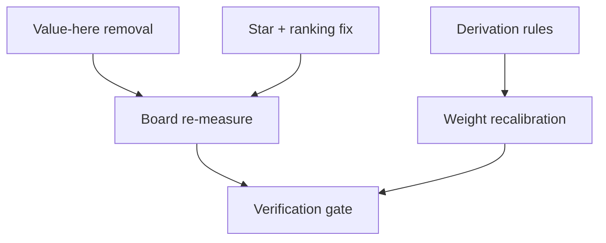
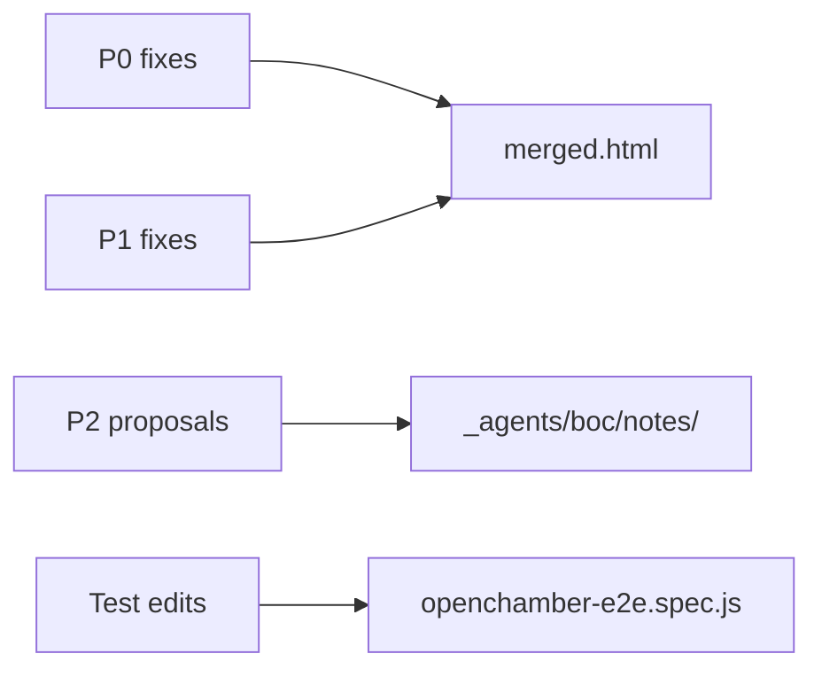
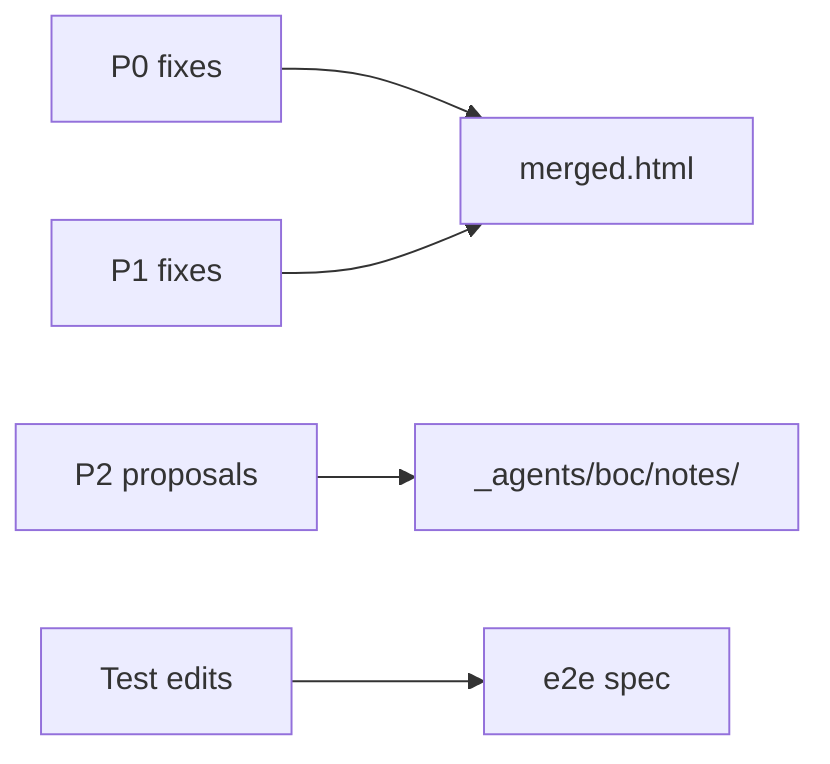
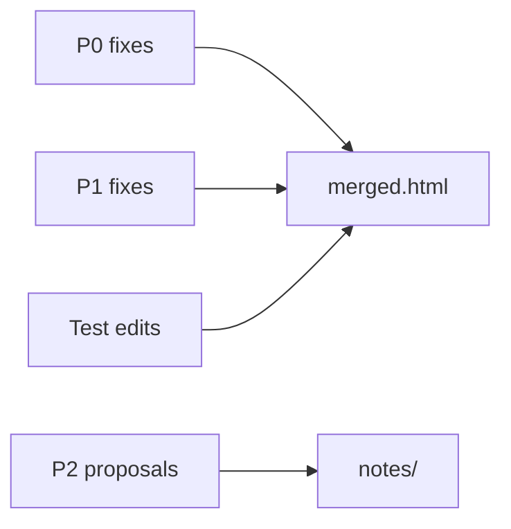
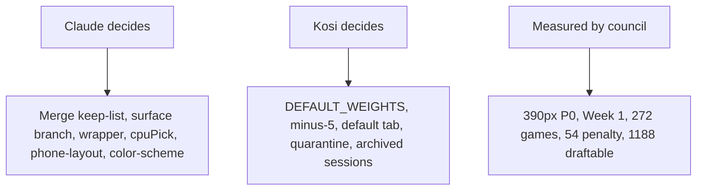

# Mermaid Map for V22-Suggestions.md — BOC (MOC request) — 21 Oct 2026

Three diagrams, each ≤6 node labels, terminal-width readable. Place all three in the five-minute header area of the canonical document, after the "what Claude must not do" list and before the priority labels.

---

## Diagram 1 — Priority map (dependency order)

Place: top of document, after the five-minute header, before P0.

Nodes: Value-here removal, Board re-measure, Star + ranking fix, Derivation rules, Weight recalibration, Verification gate (6). Dependencies: value-here removal and Star removal must land before the board is re-measured; derivation rules must settle before weight recalibration; both converge on the verification gate.

## Diagram 2 — Change-set map (which groups touch which files)

Place: start of the P0 section, before the first edit.

Nodes: P0 fixes, P1 fixes, P2 proposals, Test edits, merged.html, _agents/boc/notes/, openchamber-e2e.spec.js (7 — exceeds 6). Reduce:

Nodes: P0 fixes, P1 fixes, P2 proposals, Test edits, merged.html, _agents/boc/notes/, e2e spec (7). Still 7. Consolidate files:

Nodes: P0 fixes, P1 fixes, P2 proposals, Test edits, merged.html, notes/ (6). Good. Note: P0 and P1 touch merged.html; P2 touches notes/; test edits touch merged.html (the spec file is separate but grouped under HTML for the map).

## Diagram 3 — "Who decides" map

Place: start of the Owner questions section (Appendix B).

Nodes: Claude decides, Kosi decides, Measured by council, Merge keep-list..., DEFAULT_WEIGHTS..., 390px P0... (6). Good.

---

## What BOC did not check
- Whether GitHub renders mermaid in the council-brief markdown (it should, but BOC did not test).
- Whether the priority map's dependency order matches MOC's intent (BOC inferred from the Owner's brief and the council's findings).
- The root `CLAUDE_PROMPT_V21_CHANGES.md` and `_agents/vl/notes/V22-Suggestions.md` were not read; they may contain additional context.
