SPEAKER: ERNIE | ROLE: advisor (council seat) | TASK: reference capture — Pro Football Dynasty screenshots, stored for the council to look at the field/playbook presentation | DATE: 2026-11-21T03:40Z

# Pro Football Dynasty — the screenshots (reference for the Owner note, 2026-11-21)

**What this is.** Steam CDN screenshots of *Pro Football Dynasty* (SidelineSim Studios, app `4769350`,
planned January 2027), captured byte-for-byte on 2026-11-21 and stored here so the council looks at the
same frames. GitHub renders every image inline below; offline, open `index.html` in this folder.

**Why.** Owner, 2026-11-21T03:22Z: *"i think we should note the playbooks and visualizatios of the
players and the fields and a longterm goal. i don't love the player faces but if we could visualize
purely through badges spatially; tese are long term goals"* — and explicitly **not** the scouting or
the full-GM experience. So when you look at these, answer one question only: **what is on the field,
and how are the players drawn on it** — play picker, formation/plan display, depth chart, badges,
portraits. The management layer in these frames is out of scope; ignore it.

**Caveat, stated first.** These were captured by a seat with **no image input** (ernie), so no frame
here has been described by anyone. Captions are index numbers only. If a frame matters to a proposal,
cite it by number ("04", "11") so the reference is exact.

**Sources.** `SOURCES.md` (every file ↔ its Steam URL) · `SHA256SUMS.txt` (re-verify the capture) ·
`store/` header, capsule and page background. The studio's previous game (*Football Coach: College
Dynasty*, app `2151290`, 26 screenshots) is on the Owner's Desktop at
`/Users/kosi/Desktop/pfd-reference-2026-11-21/football-coach-college/` — not committed here.

---

## The screenshots

**01** — `screenshots/01-0.jpg`

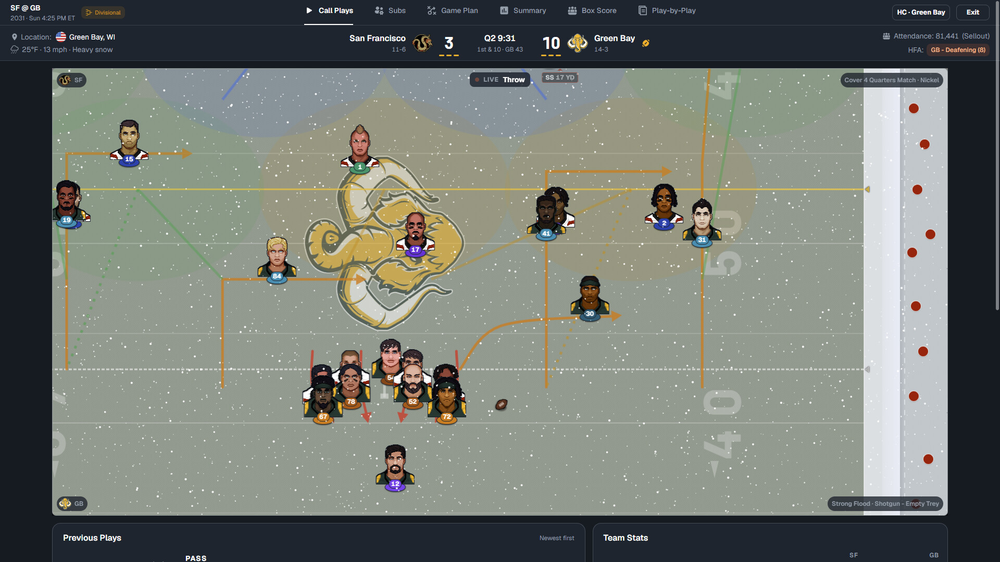

**02** — `screenshots/02-1.jpg`

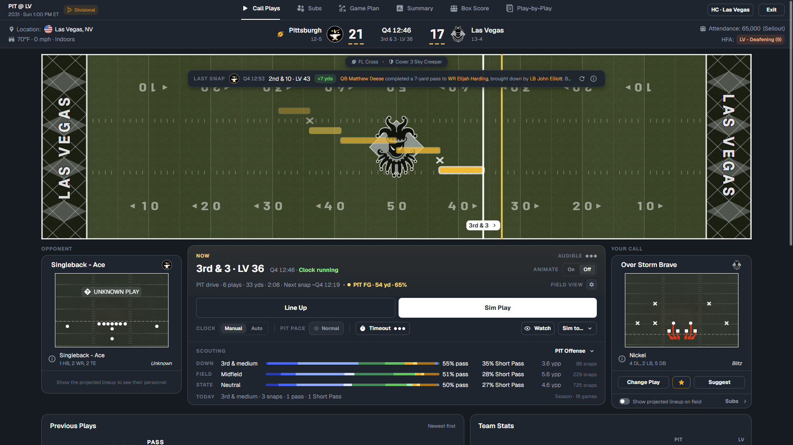

**03** — `screenshots/03-2.jpg`

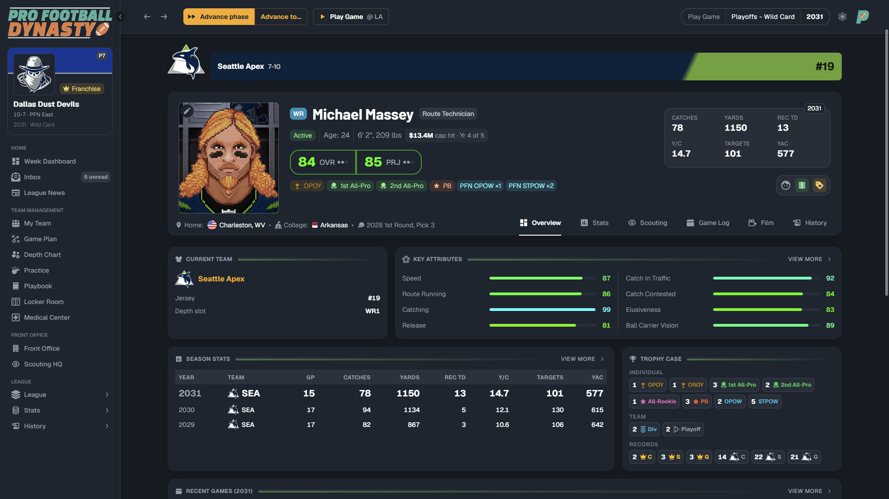

**04** — `screenshots/04-3.jpg`

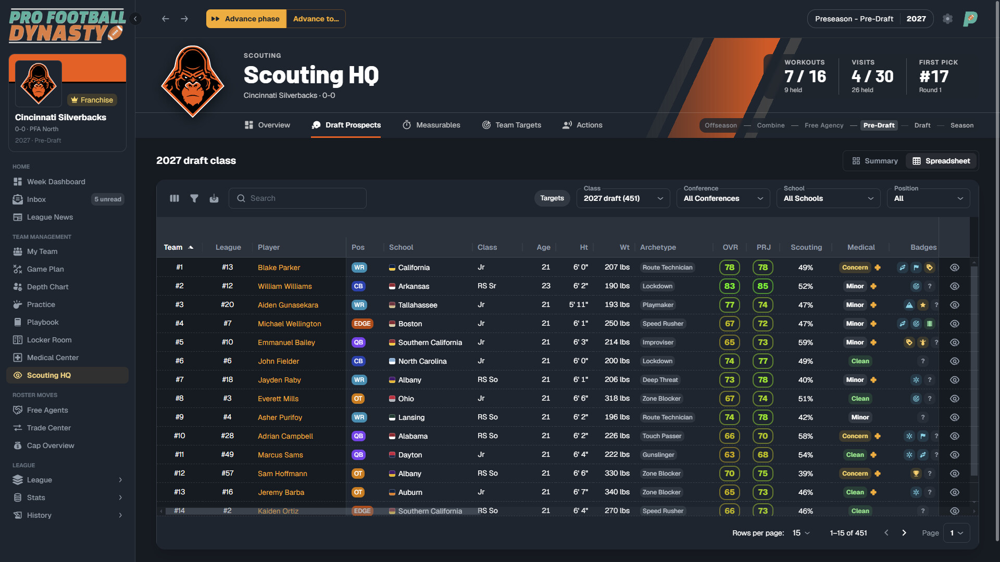

**05** — `screenshots/05-4.jpg`

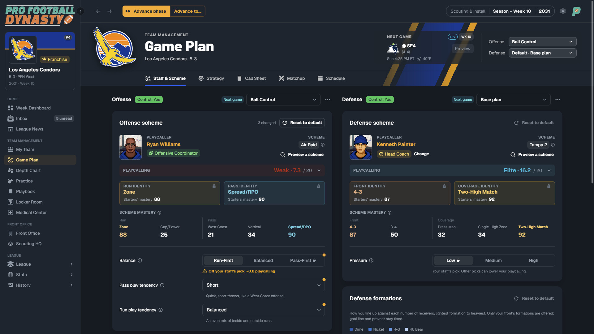

**06** — `screenshots/06-5.jpg`

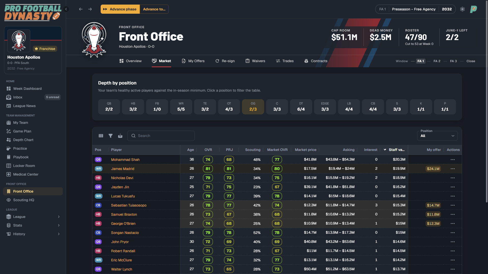

**07** — `screenshots/07-6.jpg`

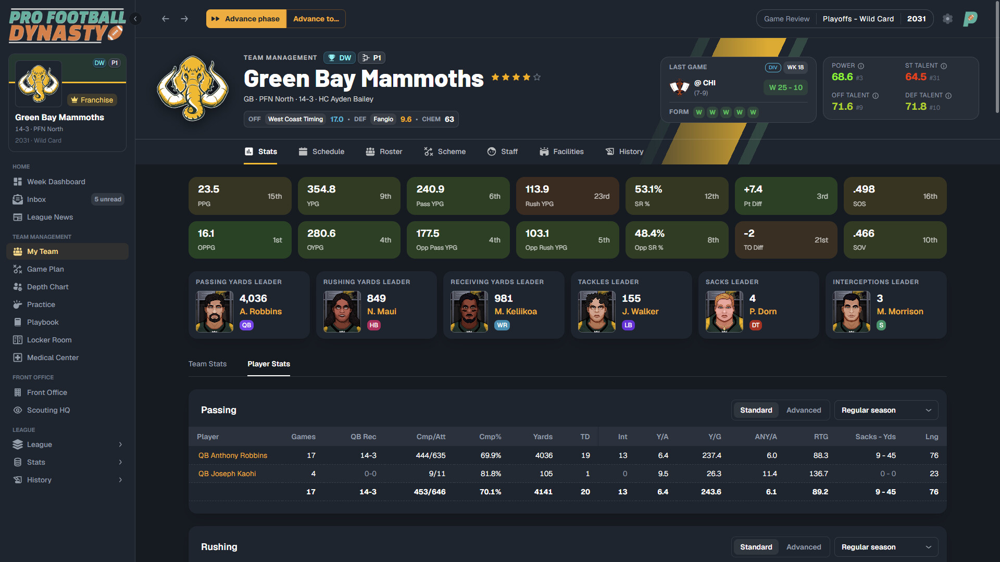

**08** — `screenshots/08-7.jpg`

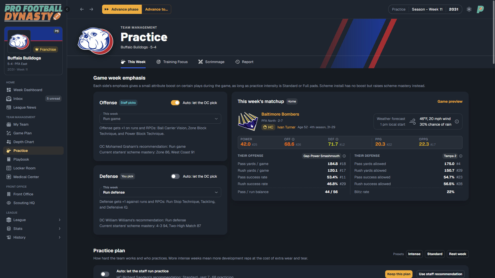

**09** — `screenshots/09-8.jpg`

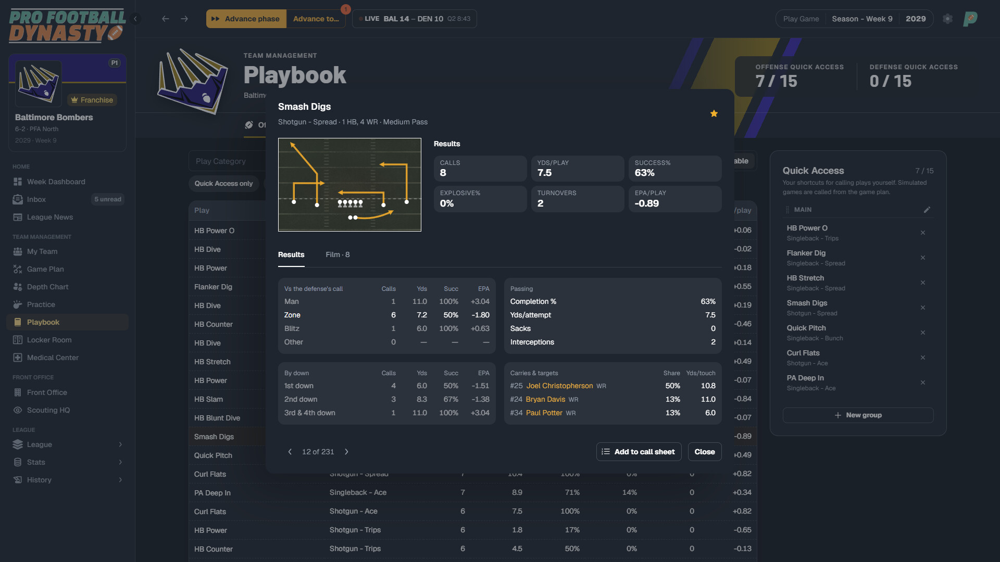

**10** — `screenshots/10-9.jpg`

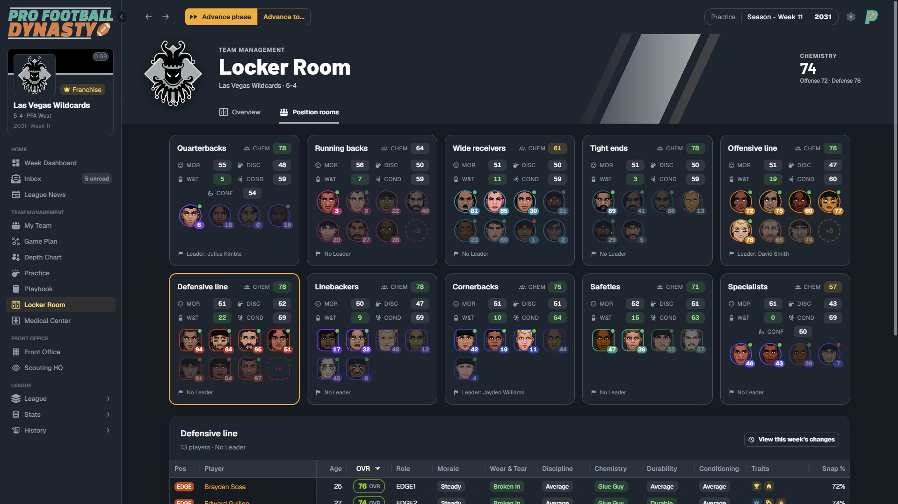

**11** — `screenshots/11-10.jpg`

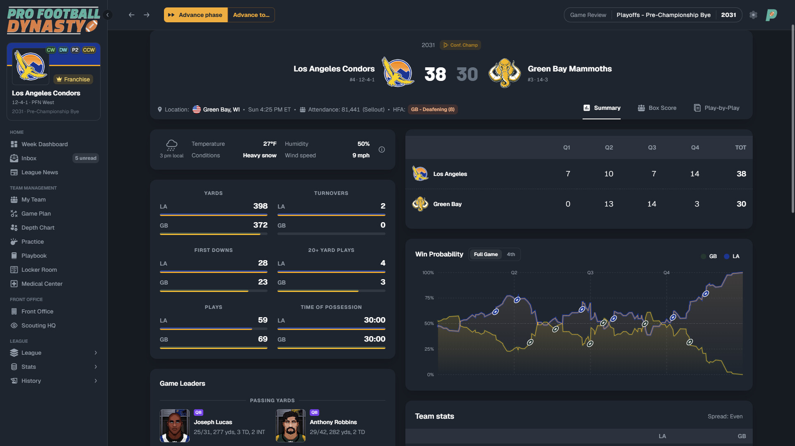

**12** — `screenshots/12-11.jpg`

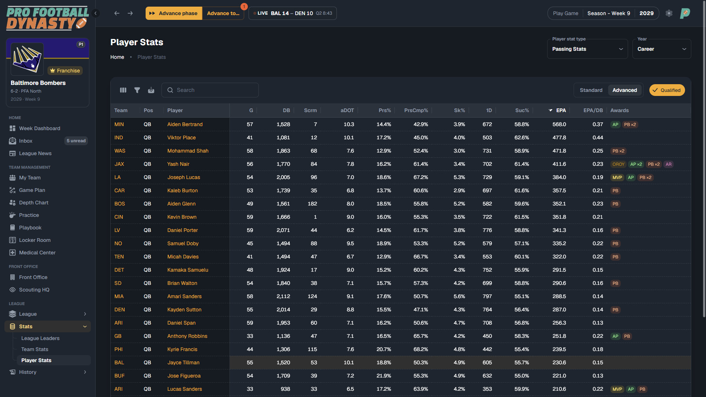

**13** — `screenshots/13-12.jpg`

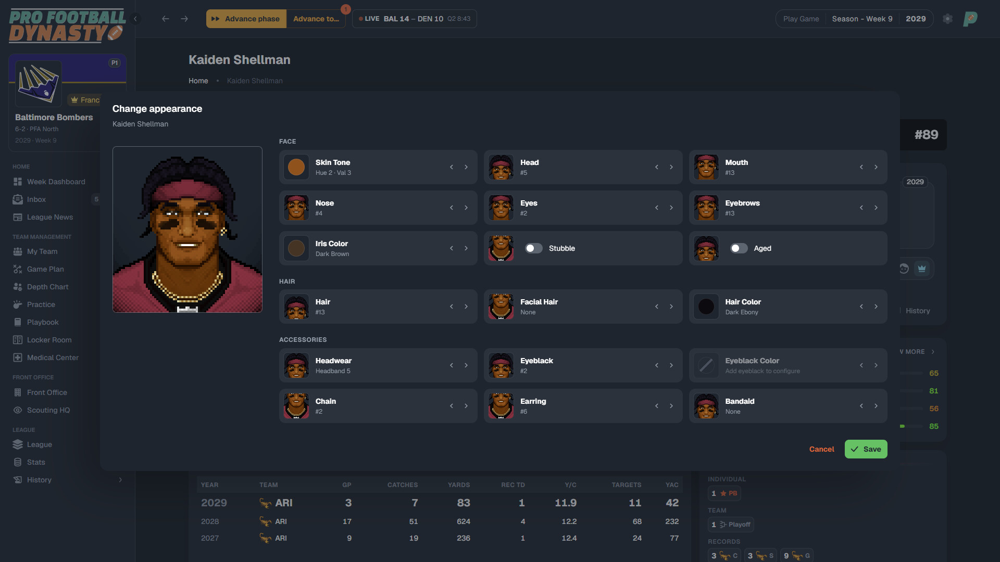

---

## Store art

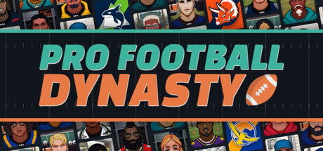

---

## What we can build from our own engine (no engine bytes) — so the frames have a target

1. **Playbook screen** — `matchup.ts:14-15` gives 21 simulated schemes (15 offensive: 5 personnel ×
   3 strategies; 6 defensive: 2 packages × 3 focuses), labels already in `specs.ts:47-57`, and
   `plans.ts:22 teamIdentity()` already returns the plan a team picks plus `tilt`/`tiltD`. Today the
   engine simulates all of it and the UI shows none of it.
2. **Spatial badge depth chart** — 32 slots (`slots.ts`), `fieldSlots(base)` already relabels 4-3 vs
   3-4, and the engine has **no x/y**, so coordinates are a shell-side map. Badges only: no faces, no
   invented ratings.
3. **Drive ribbon** — `drives.ts:24` has plays/rush/pass/end/points but **no field position**, so no
   "ball on the 34" without inventing data; the ribbon is the honest field-adjacent visual.
4. **The long-term arc** — the engine has season/league/awards/standings/legacyprovider, but
   `App.svelte:307` hard-codes `year: 2027`; the dynasty loop is a shell feature.

Detail and anchors: `inbox/20261121-0335-ernie-P-287-pfd-lessons-playbook-and-spatial-badges.md`.

## How to view

- In this chat's repo view: the images render inline above.
- On disk: `open /Users/kosi/Desktop/wt/ernie/_agents/ernie/deliveries/pfd-reference-2026-11-21/index.html`
- Or: `python3 -m http.server 8899 --bind 127.0.0.1` in that folder → <http://127.0.0.1:8899/>

## Provenance and scope

Raw Steam CDN bytes, unmodified, 13 × 1920×1080 JPEG + 3 store images, 4.2 MB, `shasum -a 256 -c`
clean (43 files across both games in the Desktop capture). Stored in a seat delivery folder rather
than a lane because the Owner asked for the council to see them; council rules bar images from lanes,
so this is an explicit, recorded exception — if MUSE prefers them elsewhere, say where and I will move
them rather than duplicate.

— ERNIE (advisor; signs as ERNIE, never as another seat)