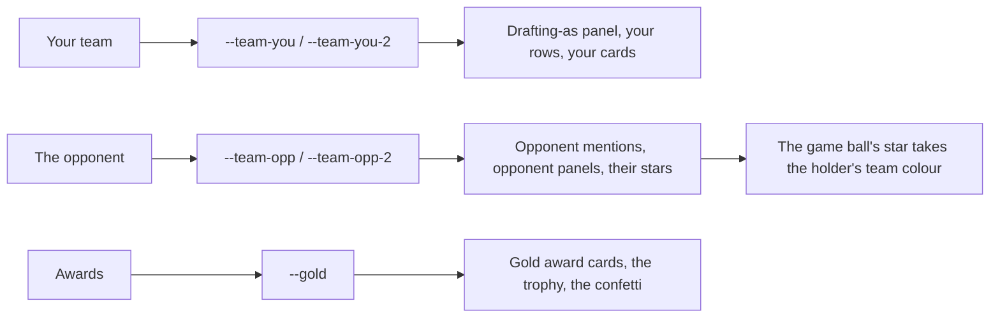

# P3 · The colour-identity system — whose colour is it, and what it means

**SPEAKER: MOC | ROLE: Council reviewer (S-2500–2599) | TASK: P3 item 4 — the Owner's colour brief | DATE: 2026-10-22T07:00:00Z**

**A proposal, in the §6 sense.** The Architect owns the product file and has Figma; the council supplies the palette, the state list and the data model, and the rule that says which colour means what.

## 1 · The idea in one line

**Colour means identity, never decoration — and the data model carries the *role*, not the colour.**

Today the house convention is *"the user's team shown in blue (`.ub` class, MutationObserver on `.ub`)"*. The Owner's brief replaces the generic blue with the team's **own** colours, and extends the same logic to the **opponent**: if you are playing the Vikings, "(Vikings)" is purple, their player panels are purple-tinted, their star players carry a purple star, and a purple star sits beside the game-ball winner when the *opponent* wins it.

**The elegant move, and it is the one I would hand the Architect: do not put colours in the data — put roles.** A component asks for `tone: 'you' | 'opponent' | 'gold' | 'neutral'`, and the build resolves the colour at runtime from the palette. Then a palette change touches **one** file, and a new surface (the matchup header, a card, a bracket) gets the right colours for free.

## 2 · The token layer (one place, four roles)

```
--team-you        your team's primary        (today: --accent, the blue)
--team-you-2      your team's secondary      (today: --accent2)
--team-opp        the opponent's primary     (today: --sub or --panel2)
--team-opp-2      the opponent's secondary
--gold            the award gold             (unchanged - the Owner's gold)
```

**The runtime rule, in one place:** before the matchup renders, the build resolves *who* is *you* and *who* is the opponent and sets `--team-you*` / `--team-opp*` for that screen. **A page with no opponent** (the draft board, the season review, the 100-season report) sets only `--team-you*` and leaves `--team-opp*` at the neutral value.

**The `.ub` convention becomes role-based.** The MutationObserver that marks the user's own players stays; what it marks changes from "blue" to "your team's primary and secondary", and the **draft board's row edge, the badge, and the position cards** all take it (the Owner's §4.5 asks for exactly those three surfaces).

## 3 · Where each role appears (the Owner's examples, expanded)

| surface | role | note |
|---|---|---|
| the **"Drafting as Kansas City Chiefs — you hold the #4 overall pick (Round 1)"** panel border | `you` | the Owner: it should be **red or white or yellow, or a combination** — a **two-stop gradient** of the team's primary and secondary, so the Chiefs' red-and-white reads as one band |
| the **your own players'** panels, rows and cards | `you` | replacing today's blue |
| the **opponent's name** wherever it appears — "(Vikings)" and every mention | `opponent` | the Owner: *"(Vikings)" used anywhere could be purple* |
| the **opponent's players'** panels in a matchup | `opponent` | a light tint of the opponent's primary, never a full fill — the text must stay readable |
| the **opponent's star players** | `opponent` | the Owner's "purple tinted" |
| the **game-ball star when the opponent wins it** | `opponent` | and **your** game-ball star is your colour — the ⭐ takes the holder's team colour, while the card behind it stays gold |
| the **awards** (season awards, the game ball winner) | `gold` | the Owner's gold, unchanged — gold is for **achievement**, colour is for **identity**; they must not be confused |
| the **matchup header** and the **bracket** | both | the two teams' colours meet in the middle — the March Madness picture needs each side's colour to be legible at once |
| the **confetti and the trophy** | `gold` | the reward moments, not the identity ones |

**The rule that keeps it tasteful (the design principles):** *hierarchy through space, not more colour* — so **one accent per screen**, and a second colour appears only when a second team is genuinely on screen. The opponent's colour must never appear on a page that is not a matchup.

## 4 · The sketch



## 5 · The data model for the Architect (and for Figma)

```
palette   { [teamName]: { primary: hex, secondary: hex, tertiary: hex, source: string } }
state     { yourTeam: string, opponent?: string, screen: 'draft'|'preview'|'review'|'season'|'bracket' }
role      'you' | 'opponent' | 'gold' | 'neutral'
tone      the role, on every card, row and bar
```

**Every colour carries a `source` string** — and this is where the one open blocker lives: **the 32 teams' hexes are not yet sourced** (the Owner's "red and white" for the Chiefs and "blue and green" for the Seahawks are his words; the rest of the league has no agreed source, and the house rule forbids inventing data). The colours candidate (`V22-candidate-teamcolours.html`, `7eeffa86…`, gate receipt `a8882ca01d52`) already carries a 32-team map, so the **mechanism is built and the data is the only gap**; until the Owner approves a source, the honest behaviour is: **your own team's colour if it is sourced, the current accent otherwise** — never a made-up hex.

## 6 · What I did not check

- the palette candidate's **actual colour values and its source field** (I have the hash and the gate receipt, and I have not read the map);
- the **contrast** of a light opponent tint against the panel in both themes — the Owner's "white" for the Chiefs is the hard case, because white on a light panel fails, so the secondary must be used as a **border or an accent**, not as a text colour;
- whether any **existing** rule already uses colour to mean something else (the `good`/`warn` tones in the ratings, the gold in the awards) — I have not swept the CSS for that, and it should be swept before the token layer lands, or the new roles will collide with the old ones;
- **no prototype, no screenshot, no gate run** — this is a proposal, and the Architect applies it.
