# P3 · The shared visual system — one set of components for every screen

**SPEAKER: MOC | ROLE: Council reviewer (S-2500–2599) | TASK: the shared component set (the graphics queue, item 1) | DATE: 2026-10-22T05:30:00Z**

**A proposal, in the §6 sense: the block, what it contains, the shape, a sketch, and the one sentence it says.** The Architect owns the product file; this is a change set, not a patch.

**The rule underneath it (the Owner's):** *"One idea, one number, one card. A sentence is the last step: the number is the headline, the sentence says what it means."* And the design principles: a number beats a sentence, a card beats a paragraph, the user's team is the accent colour, hierarchy through **space** rather than more colour, motion is punctuation, one idea per block, and never tell the reader something the screen can show.

## 1 · The components (seven, and nothing else)

Each is one CSS class and one function. The point is that **the preview, the review, the season review and the 100-season report all use the same seven**, so the site reads as one system instead of four bespoke designs — which is exactly what the council's four overlapping aesthetics sections have been producing.

| # | component | shape | the data it needs | the one line it says |
|---|---|---|---|---|
| **1** | **`.stat-card`** | a bordered block: a label (small, uppercase), a value (large), and an optional sub-line | any `{label, value, sub}` triple | nothing — the number is the sentence |
| **2** | **`.bar-row`** | a label column (fixed width, **right-aligned** — the "Seasons by Win total" left-alignment complaint is a component bug, not a chart bug), a track, a filled bar, and the value at the end of the bar | `{label, value, max}` | nothing |
| **3** | **`.pair`** | two blocks side by side, falling back to stacked under ~600 px | two card groups | nothing |
| **4** | **`.gold-banner`** | full-bleed, centred, gold gradient, a masked shimmer sweep (background-position, no library), holding one line | the headline | one line, and the **"!"** that makes the Super Bowl line land |
| **5** | **`.star`** | the ★ glyph, with the glitter; replaces the word "Stars of the game:" | the star list | nothing |
| **6** | **`.section-head`** | a heading plus a hairline rule and generous space below — the "indent a lot more" answer | a title | nothing |
| **7** | **`.box-row`** | the quarter box score: a fixed label column, a score column, a per-quarter grid, larger type | the quarter lines | nothing |

## 2 · Where each attaches (the lines I can cite are VERIFIED; the rest are marked)

| screen | the block becomes | the code |
|---|---|---|
| **game review** | the quarter lines become `.box-row`s; the "Stars of the game:" heading becomes a `.star`; the turnovers line becomes a score line; the final line becomes its own `.section-head` paragraph | `starsParagraph()` **l.3027**; the recap assembly **l.3184–3195**; the Key Players chart **l.3743** (the ⭐ lives here — see my game-ball spec: the ball holder must be unioned into the list, or the star has no card to mark) |
| **game review** | the "how it was decided" block: every "+x points" phrase except the overall one goes; the pass-rush sentence reads "but" | the same recap assembly, **l.3184–3195** |
| **game preview** | the unit lines become `.bar-row`s; the plan block becomes two `.stat-card`s (offense, defense); the overall line stays a number — "+9.7 points" | *the preview builder's location I have not verified — the seat that implements it supplies the line* |
| **season review** | "Your strongest units" and "your weakest units" become a `.pair` of `.stat-card`s; the biggest and ugliest win become `.stat-card`s; each player gets one line; "Why better or worse than the ratings?" becomes three `.bar-row`s; the awards become gold `.stat-card`s | *location not verified by me* |
| **100-season review** | "Seasons by Win total" becomes a column of `.bar-row`s; a few sentences only | *location not verified by me* |
| **playoff picture** | a `.bracket` built from `.stat-card`s, both conferences meeting in the middle | *location not verified by me* |
| **preseason** | "Your strongest / weakest" → a `.pair`; the top three setups → three `.stat-card`s; the philosophy dropdown's text grows | *location not verified by me* |

**Why I did not verify every line:** I have been reading the recap and star paths closely for the game-ball spec, but I have not opened the season-review, 100-season, preview or preseason builders in this session. Rather than quote a line number I have not looked at, the implementing seat supplies it — that is the house rule anyway: *"a line number is a hint, not an address."*

## 3 · The sketch (mermaid — it renders in the repository)

```mermaid
flowchart TB
  subgraph PREV["Game preview"]
    P1["Plan: two stat-cards"] --> P2["Lineups, below the plan"] --> P3["Matchup: one bar-row"] --> P4["Scouting report"]
  end
  subgraph REV["Game review"]
    R1["Box score: box-rows by quarter"] --> R2["Turnovers: a score line"] --> R3["Stars: a star and stat-cards"] --> R4["The ball: the name and the one line"]
  end
  subgraph SEAS["Season review"]
    S1["Banner: gold, lands, sparkles"] --> S2["Conference charts: bar-rows"] --> S3["Awards: gold stat-cards"] --> S4["Your players: one line each"]
  end
  subgraph HUND["100-season report"]
    U1["Seasons by win total: bar-rows"] --> U2["A few sentences"]
  end
```



## 4 · The data model to hand the Architect (for Figma, and for the code)

```
stat-card  { label: string, value: string, sub?: string, tone?: 'default'|'gold'|'accent' }
bar-row    { label: string, value: number, max: number, tone?: 'default'|'accent'|'warn' }
pair       { left: stat-card[], right: stat-card[] }
gold-banner{ headline: string, line?: string, shine?: boolean }
box-row    { label: string, score?: string, quarters?: [4]{label, text, tone} }
star       { name: string, team: string, line: string, grade: number }
```

**The `tone` field is the only new concept, and it is the user's team colour** — one accent, used for the user's own rows and nothing else; gold is reserved for the award moments.

## 5 · The motion rules, in the code's own terms

Motion is for **arrivals and the big moments** — the banner, the trophy, the final score, the award cards — **not for every table**; **one thing moves at a time**; **text that arrives stays**; **confetti is for the trophy only**, a short burst that settles. The build already honours `@media (prefers-reduced-motion: reduce)`, so **every new motion needs its reduced path** — a fade, not a freeze, and no motion at all for a screen that is already animated.

## 6 · What this proposal does not decide

- **The palette.** The team colours' data source is still unsourced (the Owner approves; the 32 teams' hexes are not yet agreed), so the system takes the accent from a variable, and the fallback is the current `--accent`.
- **Whether a block becomes a chart or a card** — that is per block, and the implementing seat's judgement; the components above are the vocabulary.
- **The 390 px behaviour** of each component — Ultra's lane, with the standing rules (the cards collapse to icon + abbreviation + OVR; the filters go sticky or collapsible).

**Evidence:** the components and their data hooks are read from the build (the star/ball path cited above is VERIFIED at the lines given); the line numbers I did not verify are marked as such. **No simulation was run and no screenshot was taken** — this is a proposal, and it is the Architect's to apply.
